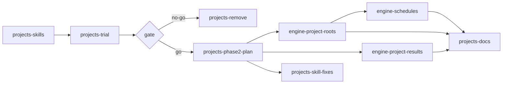

# Wintermute in Copilot app Projects Implementation Plan

> **For agentic workers:** REQUIRED SUB-SKILL: Use superpowers:subagent-driven-development (recommended) or superpowers:executing-plans to implement this plan task-by-task. Steps use checkbox (`- [ ]`) syntax for tracking.

**Goal:** Find out with one cheap trial whether a GitHub Copilot app Project is a good place to run wintermute, and give the user a measured go/no-go decision, with a one-PR removal path if the answer is no.

**Architecture:** Phase 1 adds two opt-in prompt skills to the `wintermute` plugin's `skills/` folder, `wintermute-project` for a Project's own coordinator and `wintermute-project-worker` for its child sessions, and a validator module that fails `npm run validate` when the coordinator skill's copy of the model tier table or the "Never use these:" list differs from `wintermute-core`. A user trial then runs one small real task in a scratch Project and, as a baseline, with `wintermute-core` in an ordinary session; a measurement script reads both swarms' logs and dashboard snapshots. At the gate, "go" leads to a separate Phase 2 plan for the engine and docs, and "no-go" to one removal PR.

**Tech Stack:** Node.js 18+ built-ins only (`node:test`, `node:assert/strict`, `node:fs`, `node:path`, `node:os`); Markdown skills; the plugin's `scripts/swarm-snapshot.mjs`; `sqlite3 -readonly`; `gh`.

**Spec:** `docs/superpowers/specs/2026-11-19-wintermute-projects-design.md`. Section numbers below (8.4.8, F6, U5 and so on) refer to it.

**Base:** `origin/main` at `7e7ded4` (#135), wintermute 1.2.6. Paths are relative to `ghcp/plugins/wintermute/` unless they start with `docs/`, `.github/` or `~`. Every edit is anchored on exact text, not on line numbers.

In a wintermute swarm, the orchestrator gives each unit below to one child session instead of a sub-agent.

## Global Constraints

- **Agents unchanged.** No unit commits a change to any file in `com.github.copilot/agents/` (decision 5).
- **Evals untouched.** Nothing under `evals/` changes (design 8.13).
- **Nothing in the engine before the gate.** Phase 1 changes no file under `engine/`, `server/`, `ui/` or `shared/` (design 8.1).
- **Opt-in only.** Nothing loads the Projects skills except `/wintermute-project`, the Project memory line, or the kickoff and assignment lines of an opted-in Project; no hook and no global instruction (decision 4).
- **Skill names.** `wintermute-project` and `wintermute-project-worker`, in `skills/`. No copy in `ghcp/skills/`. Each `name` equals its folder; neither sets `disable-model-invocation`; each `description` is one double-quoted line of at most 1,024 characters (design 8.3, 8.7; C32).
- **The copy rule.** The tier table and the "Never use these:" list in `skills/wintermute-project/SKILL.md` are word-for-word copies from `com.github.copilot/agents/wintermute-core.agent.md`, and `npm run validate` fails when they differ (decision 6). They are copied by command, never retyped.
- **Versions.** Every PR under `ghcp/plugins/wintermute/` runs `npm run release:bump -- <patch|minor>` (minor for a feature or a removal, patch for a fix) and replaces the new section's TODO with release notes (C27).
- **Checks.** From `ghcp/plugins/wintermute/`: `npm test && npm run validate`. Also `npm run check:layout` if anything under `ui/` changes (no task here changes `ui/`).
- **Node 18.** Shipped code uses no API newer than Node 18; tests use `node:test` without `t.after` or `t.before` (`tests/guards.test.mjs`). No `dependencies` or `devDependencies`.
- **npm.** Never run npm under `env -i` or with a scratch `HOME`: that bypasses the required `~/.npmrc` proxy.
- **Commits.** No `Co-authored-by` trailers and no other AI attribution.
- **User-facing text.** README, QUICKSTART, DASHBOARD.md, skill and plugin descriptions and the CHANGELOG never mention the dashboard's cockpit view (C30).
- **Scratch work stays outside the repository.** Trial files live in `~/wm-trial-<UTC time>/`. A task refuses to start when its scratch folder already exists.
- **Trial safety.** Trial sessions, branches and PRs are created only by the two trial coordinators. Cleanup deletes only branches on a list the user approved.

## Units

Each unit with a PR is one child session with its own branch and PR, a review from a model of another vendor, and a claims check. `projects-trial` is a chain of one-off jobs and user steps with no PR. "Critical" uses the six triggers in "Plan by stage" of `com.github.copilot/agents/wintermute-core.agent.md`: a unit is critical if it parses or validates outside input; touches security, authentication or secrets; handles money, rounding, dates or time zones; handles concurrency, ordering or retries; changes schemas, migrations or public interfaces; or is a unit that other units build on. A critical unit runs at the High tier and gets a critical review. For a one-off job whose findings a decision rests on, "critical" means that a fact-checker from another vendor checks its findings first.

| Phase | Unit | Scope | Depends on | Critical | Suggested tier | Review and checks |
|---|---|---|---|---|---|---|
| 1 | `projects-skills` | Tasks 1–4: the skill validator, the worker skill, the coordinator skill, README, repository instructions, version and CHANGELOG. One PR. | none | yes: other units build on it, and it defines a public interface, the child report contract in a Project | High: Opus at `xhigh` | Critical review: Astra at `xhigh`. Claims check: Sol at `medium`. |
| 1 | `projects-trial` | Tasks 5–11: plugin update, run folder and measurement script, the user's trial, measurement and findings, findings check, the gate, cleanup. No PR. | `projects-skills` merged | yes: the gate rests on its findings | Task 6 and 11: Low, Sol at `medium`. Task 8: document draft, Opus at `xhigh`. | Task 9: fact-check, Sol at `xhigh` |
| 2b | `projects-remove` | Task 12: remove everything Phase 1 added, and commit the findings. One PR. Only after a no-go. | the gate | no | Low: Sol at `medium` (mechanical edits from an exact recipe) | Regular review: Opus at `xhigh`. Claims check: Sol at `medium`. |
| 2a | `projects-phase2-plan` | Task 13: commit the findings and write the Phase 2 plan. One PR. Only after a go. | the gate | yes: the Phase 2 units build on it | Document draft: Opus at `xhigh` | Fact-check: Sol at `xhigh` |
| 2a | `engine-project-roots` | Design 8.11: quiet Project tables, marked Project roots before the first child, `run.project`. Planned in Task 13. | `projects-phase2-plan` | yes: parses outside input | High: Opus at `xhigh` | Critical review: Astra at `xhigh` |
| 2a | `engine-project-results` | Design 8.11: ready results as received copies, the no-handoff notice, relays as needs. Planned in Task 13. | `projects-phase2-plan` | yes: parses outside input | High: Sol at `max` | Critical review: Opus at `xhigh` |
| 2a | `engine-schedules` | Design 8.11: automations are not PR monitors, Project-owned schedules classified. Planned in Task 13. | `engine-project-roots` | yes: parses outside input | High: Sol at `max` | Critical review: Opus at `xhigh` |
| 2a | `projects-skill-fixes` | Skill changes that the findings list, if any. Planned in Task 13. | `projects-phase2-plan` | yes: the child contract | High: Opus at `xhigh` | Critical review: Astra at `xhigh` |
| 2a | `projects-docs` | Design 8.11: README, QUICKSTART, DASHBOARD.md and the dashboard design note. Planned in Task 13. | the engine units | no | Mid: Opus at `medium` | Regular review: Astra at `high` |

Order:



- `projects-trial` starts when the `projects-skills` PR has merged to `main`; the trial uses the plugin from the marketplace (design 8.9).
- One fix round (design 8.10): if a fit criterion fails because of a defect in the skill text, the fix is a patch PR on `projects-skills`' files, and Tasks 7–9 run once more with the spare task.
- Only one of `projects-remove` and `projects-phase2-plan` ever runs.

## File structure

| File | Unit | Responsibility |
|---|---|---|
| `scripts/lib/validate-skills.mjs` (create) | `projects-skills` | Checks the two Projects skills, and the coordinator skill's copy of the model policy. |
| `tests/validate-skills.test.mjs` (create) | `projects-skills` | Tests for it. |
| `scripts/validate-plugin.mjs` (modify: one import, one call) | `projects-skills` | Runs the skill checks in `npm run validate`. |
| `skills/wintermute-project-worker/SKILL.md` (create) | `projects-skills` | The child sessions' rules. |
| `skills/wintermute-project/SKILL.md` (create) | `projects-skills` | The Project coordinator's rules, with the copied tier table and list. |
| `README.md`, `CHANGELOG.md`, `plugin.json`, `package.json`, `.github/plugin/marketplace.json`, `.github/copilot-instructions.md` (modify) | `projects-skills` | Docs, the copy rule and the version. |
| `~/wm-trial-<UTC time>/` (scratch, outside the repository) | `projects-trial` | The measurement script, snapshots, metrics and inventory. |
| `/Users/nicksologoub/.copilot/session-state/e0c34f1a-6bb3-4fb1-82c0-1978a6b221f8/files/wintermute-projects-trial-findings.md` (create) | `projects-trial` | The findings for the gate, until a later PR commits them. |
| `docs/superpowers/specs/<trial date>-wintermute-projects-trial-findings.md` (create) | `projects-remove` or `projects-phase2-plan` | The committed findings. `<trial date>` is the date of Task 7, Step 3, as `YYYY-MM-DD`. |
| `docs/superpowers/plans/<date>-wintermute-projects-phase-2.md` (create) | `projects-phase2-plan` | The Phase 2 plan. `<date>` is the day it is written. |

---

## Phase 1, unit `projects-skills`

Branch from `main`. Commit after each task. After Task 4, push, and hand off with the pushed commit for the critical review and the claims check. The skills are prompts: their checks are the validator (Task 1), the drift check (Task 3) and the trial. Each `SKILL.md` follows the repository's skill rules: `name` and `description` frontmatter, an "Operating mode" section, an "Output format" section, and the rules against invented results.

### Task 1: The skill validator

**Files:**
- Create: `scripts/lib/validate-skills.mjs`
- Test: `tests/validate-skills.test.mjs`

**Interfaces:**
- Consumes: `AGENTS_DIR` and `parseAgentFrontmatter(text): { errors: string[], fields: object }` from `scripts/lib/validate-package.mjs` (existing).
- Produces: `SKILLS_DIR = 'skills'`, `COORDINATOR_SKILL = 'wintermute-project'`, `WORKER_SKILL = 'wintermute-project-worker'`, `PROJECT_SKILLS`, `POLICY_AGENT = 'com.github.copilot/agents/wintermute-core.agent.md'`, `POLICY_SECTION = 'Models and effort'`; `headingsOf(text): string[]`; `sectionOf(text, name): string | null`; `tierTable(section): string | null`; `neverUseList(section): string | null`; `policyBlocks(text): { table: string | null, neverUse: string | null }`; `quotedNames(text): string[]`; `validateSkills(root, repositoryRoot): Promise<string[]>`. Task 3 wires `validateSkills` into `scripts/validate-plugin.mjs` and uses `policyBlocks` to copy the blocks.

- [ ] **Step 1: Write the failing tests**

Create `tests/validate-skills.test.mjs`:

````js
import { test } from 'node:test';
import assert from 'node:assert/strict';
import { mkdirSync, readFileSync, writeFileSync } from 'node:fs';
import path from 'node:path';
import { fileURLToPath } from 'node:url';
import {
  COORDINATOR_SKILL, POLICY_AGENT, PROJECT_SKILLS, SKILLS_DIR, WORKER_SKILL,
  headingsOf, neverUseList, policyBlocks, sectionOf, tierTable, validateSkills,
} from '../scripts/lib/validate-skills.mjs';
import { tempDir } from './helpers/temp.mjs';

const pluginRoot = path.resolve(path.dirname(fileURLToPath(import.meta.url)), '..');
const coreText = readFileSync(path.join(pluginRoot, POLICY_AGENT), 'utf8');

/** A fixture SKILL.md; `front` overrides frontmatter fields and `body` replaces the text after the title. */
function skillText(name, { front = {}, body } = {}) {
  const fields = { name, description: `"Fixture ${name} skill."`, ...front };
  const lines = Object.entries(fields).map(([key, value]) => `${key}: ${value}`);
  return `---\n${lines.join('\n')}\n---\n\n# Fixture\n\n${body ?? ''}`;
}

/** A coordinator body with the real policy copy and the sections and labels it refers to. */
function coordinatorBody({ table, neverUse, labels = ['Follow-up jobs', 'Security review'] } = {}) {
  const blocks = policyBlocks(coreText);
  const labelLines = labels.map(label => `- **${label}**: fixture.`).join('\n');
  return `## Models and effort\n\n${table ?? blocks.table}\n\n- Fixture rule.\n\n${neverUse ?? blocks.neverUse}\n\n## Evidence and review\n\n${labelLines}\n`;
}

/** A scratch repository with the plugin's policy agent and fixture skills; `skills` maps a skill name to its text, or null to leave it out. */
function sandbox(skills = {}) {
  const repo = tempDir('swarm-skills-');
  const root = path.join(repo, 'ghcp/plugins/wintermute');
  mkdirSync(path.join(root, path.dirname(POLICY_AGENT)), { recursive: true });
  writeFileSync(path.join(root, POLICY_AGENT), coreText);
  const texts = { [COORDINATOR_SKILL]: skillText(COORDINATOR_SKILL, { body: coordinatorBody() }), [WORKER_SKILL]: skillText(WORKER_SKILL), ...skills };
  for (const name of PROJECT_SKILLS) {
    if (texts[name] === null) continue;
    mkdirSync(path.join(root, SKILLS_DIR, name), { recursive: true });
    writeFileSync(path.join(root, SKILLS_DIR, name, 'SKILL.md'), texts[name]);
  }
  return { repo, root };
}

async function errorsFor(skills, change) {
  const { repo, root } = sandbox(skills);
  if (change) change(repo, root);
  return validateSkills(root, repo);
}

function assertReported(errors, expected) {
  assert.ok(errors.some(error => error.includes(expected)), `${expected} in\n${errors.join('\n')}`);
}

test('headingsOf and sectionOf read level-two headings outside code fences', () => {
  const text = ['# Title', '## One', 'a', '```', '## Not a heading', '```', '### Three', 'b', '## Two', 'c'].join('\n');
  assert.deepEqual(headingsOf(text), ['One', 'Two']);
  assert.equal(sectionOf(text, 'One'), ['a', '```', '## Not a heading', '```', '### Three', 'b'].join('\n'));
  assert.equal(sectionOf(text, 'Two'), 'c');
  assert.equal(sectionOf(text, 'Missing'), null);
});

test('tierTable and neverUseList take the first table and the whole list, with wrapped items', () => {
  const section = ['Intro.', '', '| A | B |', '|---|---|', '| 1 | 2 |', '', 'Text.', '', '| C |', '', 'Never use these:', '', '- One.', '- Two,', '  wrapped.', '', 'After.'].join('\n');
  assert.equal(tierTable(section), '| A | B |\n|---|---|\n| 1 | 2 |');
  assert.equal(neverUseList(section), 'Never use these:\n\n- One.\n- Two,\n  wrapped.');
  assert.equal(tierTable('No table.'), null);
  assert.equal(neverUseList('Never use these:\n\nNo items.'), null);
});

test('skills with an exact copy of the model policy pass', async () => {
  assert.deepEqual(await errorsFor(), []);
});

test('a change to the tier table or the list in wintermute-core is reported as drift', async () => {
  const edits = [
    [text => text.replace('| Low |', '| Lowest |'), 'the tier table differs from'],
    [text => text.replace('Never use these:\n\n- ', 'Never use these:\n\n- Haiku at `max`.\n- '), 'the "Never use these:" list differs from'],
  ];
  for (const [edit, expected] of edits) {
    const errors = await errorsFor({}, (repo, root) => writeFileSync(path.join(root, POLICY_AGENT), edit(coreText)));
    assertReported(errors, expected);
  }
});

test('a skill without its copy of the table or the list is reported', async () => {
  const noTable = skillText(COORDINATOR_SKILL, { body: coordinatorBody({ table: 'The tiers are in wintermute-core.' }) });
  assertReported(await errorsFor({ [COORDINATOR_SKILL]: noTable }), 'must contain the tier table');
  const noList = skillText(COORDINATOR_SKILL, { body: coordinatorBody({ neverUse: 'Avoid weak models.' }) });
  assertReported(await errorsFor({ [COORDINATOR_SKILL]: noList }), 'must contain the "Never use these:" list');
});

test('a name the copied policy refers to must be a heading or a bold label in the skill', async () => {
  const text = skillText(COORDINATOR_SKILL, { body: coordinatorBody({ labels: ['Follow-up jobs'] }) });
  assertReported(await errorsFor({ [COORDINATOR_SKILL]: text }), 'refers to "Security review"');
});

test('each broken packaging rule is reported', async () => {
  const cases = [
    [{ [WORKER_SKILL]: null }, `${SKILLS_DIR}/${WORKER_SKILL}/SKILL.md: required skill is missing`],
    [{ [WORKER_SKILL]: skillText(WORKER_SKILL, { front: { name: 'other-name' } }) }, 'must match the folder name'],
    [{ [WORKER_SKILL]: skillText(WORKER_SKILL, { front: { 'disable-model-invocation': 'true' } }) }, 'must not set disable-model-invocation'],
    [{ [WORKER_SKILL]: skillText(WORKER_SKILL, { front: { description: `"${'x'.repeat(1025)}"` } }) }, 'description must be at most 1024 characters'],
  ];
  for (const [skills, expected] of cases) assertReported(await errorsFor(skills), expected);
  const copied = await errorsFor({}, repo => mkdirSync(path.join(repo, 'ghcp/skills', WORKER_SKILL), { recursive: true }));
  assertReported(copied, `ghcp/skills/${WORKER_SKILL}: the plugin ships this skill`);
});
````

- [ ] **Step 2: Run the tests to see them fail**

Run: `node --test tests/validate-skills.test.mjs`
Expected: FAIL with `ERR_MODULE_NOT_FOUND`, "Cannot find module …/scripts/lib/validate-skills.mjs".

- [ ] **Step 3: Write the validator**

Create `scripts/lib/validate-skills.mjs`:

````js
import { access, readFile } from 'node:fs/promises';
import path from 'node:path';
import { AGENTS_DIR, parseAgentFrontmatter } from './validate-package.mjs';

export const SKILLS_DIR = 'skills';
export const COORDINATOR_SKILL = 'wintermute-project';
export const WORKER_SKILL = 'wintermute-project-worker';
export const PROJECT_SKILLS = Object.freeze([COORDINATOR_SKILL, WORKER_SKILL]);
/** The agent whose tier table and "Never use these:" list the coordinator skill copies word for word. */
export const POLICY_AGENT = `${AGENTS_DIR}/wintermute-core.agent.md`;
export const POLICY_SECTION = 'Models and effort';
const NEVER_USE = 'Never use these:';
const FENCE = /^\s*```/;
const HEADING = /^## (.+?)\s*$/;

/** The `## ` headings of a Markdown text, outside code fences, in order. */
export function headingsOf(text) {
  const out = [];
  let fenced = false;
  for (const line of text.split(/\r?\n/)) {
    if (FENCE.test(line)) {
      fenced = !fenced;
      continue;
    }
    const match = fenced ? null : HEADING.exec(line);
    if (match) out.push(match[1]);
  }
  return out;
}

/** The body of the `## <name>` section, up to the next `## ` heading outside a code fence; null when there is none. */
export function sectionOf(text, name) {
  const lines = text.split(/\r?\n/);
  let fenced = false;
  let start = -1;
  for (let index = 0; index < lines.length; index += 1) {
    if (FENCE.test(lines[index])) {
      fenced = !fenced;
      continue;
    }
    const match = fenced ? null : HEADING.exec(lines[index]);
    if (!match) continue;
    if (start >= 0) return lines.slice(start, index).join('\n');
    if (match[1] === name) start = index + 1;
  }
  return start >= 0 ? lines.slice(start).join('\n') : null;
}

/** The first Markdown table in a section: its consecutive lines that start with `|`. */
export function tierTable(section) {
  const lines = section.split(/\r?\n/);
  const start = lines.findIndex(line => line.startsWith('|'));
  if (start < 0) return null;
  let end = start;
  while (end < lines.length && lines[end].startsWith('|')) end += 1;
  return lines.slice(start, end).join('\n');
}

/** The "Never use these:" line and its list items, with any indented continuation lines. */
export function neverUseList(section) {
  const lines = section.split(/\r?\n/);
  const start = lines.indexOf(NEVER_USE);
  if (start < 0) return null;
  let index = start + 1;
  while (index < lines.length && lines[index].trim() === '') index += 1;
  const items = [];
  while (index < lines.length && (lines[index].startsWith('- ') || (items.length > 0 && /^\s+\S/.test(lines[index])))) {
    items.push(lines[index]);
    index += 1;
  }
  return items.length ? [NEVER_USE, '', ...items].join('\n') : null;
}

/** The tier table and the "Never use these:" list in a file's "## Models and effort" section; null for each one that is missing. */
export function policyBlocks(text) {
  const section = sectionOf(text, POLICY_SECTION);
  return { table: section === null ? null : tierTable(section), neverUse: section === null ? null : neverUseList(section) };
}

/** The capitalised quoted names in a text, such as "Evidence and review": the sections and labels it refers to. */
export function quotedNames(text) {
  return [...new Set([...text.matchAll(/"([A-Z][^"\n]*)"/g)].map(match => match[1]))];
}

const boldLabels = text => [...text.matchAll(/\*\*([^*\n]+)\*\*/g)].map(match => match[1]);

function firstDifferentLine(expected, actual) {
  const left = expected.split('\n');
  const right = actual.split('\n');
  const index = left.findIndex((line, i) => line !== right[i]);
  return (index < 0 ? left.length : index) + 1;
}

/** The Projects skills: present and well formed, with the coordinator's copy of the model policy identical to wintermute-core's. */
export async function validateSkills(root, repositoryRoot) {
  const errors = [];
  let coordinator;
  for (const name of PROJECT_SKILLS) {
    const file = `${SKILLS_DIR}/${name}/SKILL.md`;
    let text;
    try {
      text = await readFile(path.join(root, file), 'utf8');
    } catch (error) {
      errors.push(error.code === 'ENOENT' ? `${file}: required skill is missing` : `${file}: ${error.message}`);
      continue;
    }
    if (name === COORDINATOR_SKILL) coordinator = text;
    const parsed = parseAgentFrontmatter(text);
    for (const error of parsed.errors) errors.push(`${file}: ${error}`);
    if (typeof parsed.fields.name === 'string' && parsed.fields.name !== name) errors.push(`${file}: frontmatter name ${parsed.fields.name} must match the folder name ${name}`);
    if (typeof parsed.fields.description === 'string' && parsed.fields.description.length > 1024) errors.push(`${file}: description must be at most 1024 characters`);
    if (Object.hasOwn(parsed.fields, 'disable-model-invocation')) errors.push(`${file}: must not set disable-model-invocation, because the model loads this skill`);
    try {
      await access(path.join(repositoryRoot, 'ghcp/skills', name));
      errors.push(`ghcp/skills/${name}: the plugin ships this skill, so no copy may stay in ghcp/skills/`);
    } catch (error) {
      if (error.code !== 'ENOENT') errors.push(`ghcp/skills/${name}: ${error.message}`);
    }
  }
  if (coordinator !== undefined) errors.push(...await validatePolicyCopy(root, coordinator));
  return errors;
}

async function validatePolicyCopy(root, skillText) {
  const skillFile = `${SKILLS_DIR}/${COORDINATOR_SKILL}/SKILL.md`;
  let agentText;
  try {
    agentText = await readFile(path.join(root, POLICY_AGENT), 'utf8');
  } catch (error) {
    return [`${POLICY_AGENT}: ${error.message}`];
  }
  const errors = [];
  const source = policyBlocks(agentText);
  const copy = policyBlocks(skillText);
  for (const [key, label] of [['table', 'tier table'], ['neverUse', '"Never use these:" list']]) {
    if (source[key] === null) errors.push(`${POLICY_AGENT}: "## ${POLICY_SECTION}" has no ${label}`);
    else if (copy[key] === null) errors.push(`${skillFile}: "## ${POLICY_SECTION}" must contain the ${label} copied from ${POLICY_AGENT}`);
    else if (copy[key] !== source[key]) errors.push(`${skillFile}: the ${label} differs from ${POLICY_AGENT} at its line ${firstDifferentLine(source[key], copy[key])}; copy it again word for word`);
  }
  const known = new Set([...headingsOf(skillText), ...boldLabels(skillText)]);
  for (const block of [copy.table, copy.neverUse]) {
    if (block === null) continue;
    for (const name of quotedNames(block)) {
      if (!known.has(name)) errors.push(`${skillFile}: the copied model policy refers to "${name}", which is not a "## " heading or a bold label in the skill`);
    }
  }
  return errors;
}
````

- [ ] **Step 4: Run the tests to see them pass**

Run: `node --test tests/validate-skills.test.mjs && npm test`
Expected: the 7 new tests pass, then the whole suite passes (1,161 tests at base `7e7ded4`). `npm run validate` doesn't run the new checks yet: Task 3 wires them in.

- [ ] **Step 5: Commit**

```bash
git add scripts/lib/validate-skills.mjs tests/validate-skills.test.mjs
git commit -m "feat(wintermute): validate the Projects skills and their copy of the model policy"
```

### Task 2: The worker skill

**Files:**
- Create: `skills/wintermute-project-worker/SKILL.md`

**Interfaces:**
- Consumes: `validateSkills` (Task 1).
- Produces: the child-side contract that the coordinator skill (Task 3) relies on: the scope check on `<copilot_project_child_session>` or `<copilot_coordinated_child>`; gates as assignments; two-line handoffs; `blocked` with `purpose: "error"`; `assignment_id` on every report; publishing at review-ready only.

- [ ] **Step 1: Run the skill check to see it fail**

Run, from `ghcp/plugins/wintermute/`:

```bash
node --input-type=module -e "
import { validateSkills } from './scripts/lib/validate-skills.mjs';
const errors = await validateSkills('.', '../../..');
console.log(errors.length ? errors.join('\n') : 'no skill errors');
"
```

Expected:

```text
skills/wintermute-project/SKILL.md: required skill is missing
skills/wintermute-project-worker/SKILL.md: required skill is missing
```

- [ ] **Step 2: Write the skill**

Create `skills/wintermute-project-worker/SKILL.md` with exactly this text:

````markdown
---
name: wintermute-project-worker
description: "Child-session rules for a GitHub Copilot app Project that runs wintermute: assignments, gates, reports and publishing. Load it only when your kickoff prompt or a message from your coordinating Project tells you to load wintermute-project-worker."
---

# Wintermute Project worker

You are a child session of a GitHub Copilot app Project that runs wintermute's rules. The Project is your coordinator: it plans the work, starts every session and checks the results. You do one unit of the work, as your kickoff says: an owner unit, which is a branch and a PR with the fixes and rebases that need your knowledge of the work, or a one-off job, which is one result that the coordinator uses once, such as a review, a claims check or a command.

## Operating mode

**Where this skill applies.** Follow it only if your context contains `<copilot_project_child_session>` or `<copilot_coordinated_child>`, the app's blocks for a child session of a Project. Otherwise stop following this skill, and say in one line that `wintermute-project-worker` applies only to a Project's child sessions. When a message from your coordinator tells you to follow this skill and its rules aren't in your context, load it again first.

- You can't create app sessions; the app doesn't allow it. Don't run `copilot -p`, `gh agent-task`, `claude`, `codex` or any other agent CLI from the shell, don't call the app's local API, don't assign an issue or PR to Copilot, and don't request a Copilot code review.
- Don't start sub-agents, even if you have the tool. When a skill, a memory or your brief says to start one, do that step yourself. When the step needs independence, such as a review of your own work, or parallel work, ask your coordinator for a helper (see "Helper requests").
- Don't use `ask_user`. Send a question to your coordinator as `needs_input` (see "Output format"), then end your turn and wait for the reply.
- Never open a PR, take one out of draft or merge without a go-ahead from your coordinator. A go-ahead comes as a new assignment (see "Assignments and gates").
- Your coordinator may merge or retarget your PR itself. When you come back to your PR after a pause, read its state once before you push, rebase or reply. If it has merged or closed, don't act on it: report what you found. If your coordinator says that it will merge or retarget your PR, pause your work on the PR until it tells you the job is done.
- Don't watch a PR: no automation, event subscription, polling loop or background script. When you are asked to check a PR's state, CI or review comments, read them once and report. When a required check needs CI that is still running, you may wait for it once with one command that has a time limit of about 30 minutes, such as `gh pr checks --watch`, then report the result, or report CI as pending if the limit passes.
- For a live web page, such as a site behind a sign-in or a UI check, use Copilot Browser. For desktop app UI, use Computer Use. If either asks for the user's approval, a sign-in or another sensitive step, send `needs_input` that names the step, and wait.
- For Azure DevOps, use the `az` CLI, and `az devops invoke` for REST resources with no command. Before PR work on Azure DevOps or GitHub, load the `wintermute-pr-commands` skill once, and read only the provider reference you need.
- After two failed attempts at the same problem, stop and report `blocked` with your diagnosis.
- A review and a claims check are separate jobs. If you are a reviewer and a message also asks you to confirm the author's claims for a merge, publish or "done", do the review only, and say in your handoff that the claims job needs a separate claims checker. You may still run tests or reproduce a failure when your review needs that to settle a finding.
- A one-off job stays inside its brief. Work only in the repository, branch or folder it names. Don't commit or push. Write files only where the brief says. When the brief says the job is read-only, change no files, branches or anything remote. A one-off job on a PR, such as a merge, changes only the PR, through the PR service, and only at the commit the brief names.
- Keep commands, test output, file lists and other detail in your own thread. Your reports state outcomes.
- Never invent results, sources, line numbers or command output, and never say that you ran a command or read a file when you didn't. Mark anything you didn't check yourself as unverified.
- At the start, if you have `rename_session`, rename your session so that it starts with your unit label, for example `api: Orders endpoint`. Keep your todos current: the Project's Overview shows them.

## Assignments and gates

Each message from your coordinator that gives you new work, a revision, a rerun or a go-ahead is a new assignment, with its own `assignment_id`. Finish it, hand it off once, and wait for the next one.

As the owner of a unit:

1. Implement, test and push. Hand off with `commit=`. If your kickoff says that the repository's CI runs only on PRs, open a draft PR for CI in this step, and add `pr=`.
2. For each fix that a review or a claims check asks for: fix, test, push, and hand off with the new `commit=`.
3. On the go-ahead to publish: open the PR ready for review, or take your draft out of draft. Publish it (see "Publishing"), and hand off with `pr=`.

Your coordinator merges the PR, so don't merge it unless an assignment tells you to.

When your work is done and only waits for its review and claims check, which your coordinator starts, hand off. Don't ask for them with `needs_input`.

## Output format

Every message to your coordinator is a report, sent with `send_session_message`. Its first line is the status line, with nothing before it:

```text
swarm-status: <status> unit=<unit> pr=<provider>:<id> commit=<sha>
```

- `<status>` is `complete`, `progress`, `needs_input` or `blocked`.
- `unit=` is your unit label from the kickoff, exactly as given.
- `pr=` appears once your unit has a PR, draft or published. `<provider>` is `github` or `ado`, and `<id>` is the GitHub PR number or the Azure DevOps pull request id.
- `commit=` appears when the report is about pushed code: the commit SHA in lowercase hex, 7–40 characters.
- The fields come in this order, separated by single spaces, with no other text and no Markdown on the line.

Set `purpose` from the status: `complete` → `handoff`, `progress` → `progress`, `needs_input` → `needs_input`, and `blocked` → `error`. Set `assignment_id` to the id of the work the report is about, from your kickoff context or from the envelope of the message that gave you the work.

**Handoff.** A handoff ends an assignment. It has two lines: the status line, and `Summary:` with one outcome sentence. The sentence may carry one essential link or next action.

```text
swarm-status: complete unit=api pr=github:42 commit=3f9a2c1
Summary: The endpoint and its tests are pushed, and the PR is open for review.
```

- Write no `Evidence:` or `Blockers:` field, and no test counts, commands or file lists.
- When your result is longer than one sentence, such as review findings, research or a claims check's test counts, write it to a file in the folder your kickoff names, and give the file's absolute path in the sentence.
- In a one-off job, also say in the sentence whether your worktree is clean, from `git status --porcelain --untracked-files=all`, for example "…; worktree clean".
- If your result changes in a material way after a handoff, send another handoff with the same `assignment_id`.

**Question, helper request or blocker.** A question, or a request for a helper, is `needs_input`. A material blocker, including two failed attempts at the same problem, is `blocked`, sent with `purpose: "error"`. Both have three fields:

```text
swarm-status: needs_input unit=api commit=3f9a2c1
Summary: <what happened, in one or two sentences>
Evidence:
- <what supports it: the commands or checks you ran, and their results>
Blockers:
- <the decision, answer or change you need>
```

Then call `task_complete` if you have it, and wait for the reply.

**Progress.** A `progress` report stays in your own thread; your coordinator never receives it. Send one only as an optional note.

## Helper requests

When you need another agent, send `needs_input` with the request under `Blockers:`:

- the job, and why you need it;
- the inputs: the repository, branch and pushed commit, or absolute paths for a one-off job;
- what to send back;
- whether you can carry on with other work meanwhile.

Then call `task_complete` if you have it, and wait. Your coordinator tells you whether to wait or carry on, and passes you the result.

## Publishing

The app asks you to publish review-ready output in your own thread before you report it. In this Project, review-ready means:

- A PR is review-ready when an assignment gives you the go-ahead to publish it, after its review and claims check are clean. Open it ready for review, or take it out of draft, publish it with `publish_chat_update` (attachment `kind: "pr"`), then hand off. A draft PR that you opened for CI is not review-ready: don't publish it.
- A document, or any other file, preview or issue, is review-ready when your coordinator says so in an assignment. Publish it then, and hand off.

Publish nothing before that. Publishing is not approval, and it changes no go-ahead.
````

- [ ] **Step 3: Run the skill check again**

Run the command from Step 1.
Expected: only `skills/wintermute-project/SKILL.md: required skill is missing`.

- [ ] **Step 4: Commit**

```bash
git add skills/wintermute-project-worker/SKILL.md
git commit -m "feat(wintermute): add the wintermute-project-worker skill"
```

### Task 3: The coordinator skill, and the validator wired in

**Files:**
- Create: `skills/wintermute-project/SKILL.md`
- Modify: `scripts/validate-plugin.mjs` (one import, one call)

**Interfaces:**
- Consumes: `validateSkills`, `policyBlocks`, `POLICY_AGENT` (Task 1); the worker contract (Task 2).
- Produces: the coordinator skill; `npm run validate` checks both skills from now on.

- [ ] **Step 1: Write the skill with two marker lines**

Create `skills/wintermute-project/SKILL.md` with exactly this text. The two lines that start with `<!-- wintermute-core:` are markers: Step 3 replaces them with the tier table and the list from `wintermute-core`. Don't type the table or the list by hand.

````markdown
---
name: wintermute-project
description: "Wintermute rules for coordinating work from a GitHub Copilot app Project: units, a model and effort for every job, an independent review from another vendor and a claims check before every merge, and at most two repair cycles. Load it only when the user types /wintermute-project in a Project's conversation, or when the Project's memory says to follow the wintermute-project skill. Not for ordinary sessions or for a Project's child sessions."
---

# Wintermute in a Copilot app Project

You are the coordinator of a GitHub Copilot app Project. The Project's own UI stays as it is: its Overview, Inbox, Library and Automations keep working as the app designed them. This skill adds wintermute's discipline to how you run work. You split it into units, choose a model and an effort for every job, get an independent review from another vendor's model and a claims check before every merge, and stop a repair loop after two cycles. Child sessions and sub-agents do the work; you plan, delegate, check and report.

## Operating mode

**Where this skill applies.** Before you follow anything else in this skill, check your context:

- It contains `<copilot_persistent_agent>`, the app's block for a persistent Project: you are a Project's own conversation. Go on.
- It contains `<copilot_project_child_session>` or `<copilot_coordinated_child>`: you are a child session of a Project. Stop following this skill. If your kickoff or a message from your Project told you to load `wintermute-project-worker`, load that skill and follow it instead.
- Neither: you are an ordinary session. Stop following this skill, and tell the user in one line that outside a Project the `wintermute:wintermute-core` agent does this job, and that they can pick it with `/agent`.

**Turning it on and off.**

- The user turns this skill on for this Project by typing `/wintermute-project`, or with this line in the Project's memory:

  > Wintermute: this Project follows the `wintermute-project` skill. If that skill's rules aren't in your context, load it before you do anything else.

- When the user types `/wintermute-project` and your Project memory doesn't have that line, add it with `update_project_memory`. The tool replaces the whole memory, so save your current memory text unchanged with the line added, within 8,192 bytes. Then tell the user in one line what you saved, and that removing the line turns wintermute off in this Project. If you can't save it, ask the user to add it.
- When the user removes the line or tells you to stop, stop following this skill from your next turn. Keep your SQL tables.

**Every time this skill loads**, including after a compaction or a resume:

1. Start your reply with the line `wintermute-project rules loaded.`
2. Read your SQL state: `todos`, `tasks`, `children` and `child_notes`, if they exist.
3. Call `get_session` for every child that `child_notes` doesn't mark as archived, and reconcile what changed. Do this before you create a session, send work or merge anything.

**Your limits.** Nothing removes tools from a Project, so these rules are yours to keep:

- You do quick jobs only (see "Quick jobs you do yourself"). Every other job goes to a child session or a sub-agent (see "Choose the delegation type").
- You make no repository commits. A Project has no checkout, so every repository edit goes to a child.
- You never do a review, a claims check, a panel or a second opinion yourself. Those stay independent (see "Evidence and review").
- You never read in or write to a child's worktree.
- For Azure DevOps, use the `az` CLI, and `az devops invoke` for REST resources with no command. Before PR work on Azure DevOps or GitHub, load the `wintermute-pr-commands` skill once, and read only the provider reference you need.
- If the `orchestrate` skill is also loaded, this skill wins on delegation, models and reviews.
- Never invent status, results, sources or line numbers. Session state comes from `get_session`. PR state, CI and code come from the owning child, a one-off job, or your own quick check. If you don't have it yet, say that you are checking.

## Quick jobs you do yourself

A quick job is one you can finish in about five tool calls or about two minutes: read a file, a log or a Library item; run `gh`, `az` or `git` status commands for PR state and CI; do a simple PR job (see "Simple PR jobs"); do one web fetch; or write a note in your own files folder.

- If a job grows past that, stop and delegate the rest, with what you have done so far.
- When you do a quick job, say so to the user in one line.
- Quick jobs run on your own model. Every job you hand out still gets its own tier (see "Models and effort").

## Plan by stage

Each user request that you plan is a task. Record it in `tasks`, and give each of its units that task in `child_notes`. Show the user the breakdown before you start substantial work, and wait for approval when the user or the Project's memory asks for it. Ask with `ask_user`, tagged `[unit=* need=plan]` (see "Talking to the user").

- **Research or specification**: split it into independent questions and run them in parallel as one-off jobs. Combine the findings yourself.
- **Implementation**: one owner child per PR-sized unit. Stack a unit that builds on another with `base_branch`, as soon as the parent has pushed its branch.
- **Critical units**: mark a unit critical if it does any of these:
  - parses or validates outside input;
  - touches security, authentication or secrets;
  - handles money, rounding, dates or time zones;
  - handles concurrency, ordering or retries;
  - changes schemas, migrations or public interfaces;
  - is a unit that other units build on.

  Record a one-line reason in `child_notes`. A critical unit runs at the High tier by default and gets a critical review instead of the regular one.
- **Investigation or debugging**: give separate hypotheses to separate one-off jobs, and require evidence of the cause before anyone starts a fix.
- **Speed**: plan for wall-clock time. Run independent units in parallel. Put each unit's review and claims check in the plan up front, and the final panel too (see "Evidence and review").

## Choose the delegation type

| Type | Use it for | How |
|---|---|---|
| Owner unit | Work with a branch, a PR or follow-ups | A child session from `create_session`, or from `open_pr_session` or `open_issue_session` for an existing PR or issue. One session, one branch, one PR. |
| One-off job that needs a checkout | A review, a claims check, a panel judge, a verification or a repository command | A child session from `create_session`, with `base_branch` set to the branch under test. |
| One-off job with no checkout | Web research, a summary of a Library file, a plan critique, a second opinion on a document or a fact-check | A `task` sub-agent with `agent_type: "general-purpose"`, and `model` and `reasoning_effort` from "Models and effort". Use `mode: "background"` when it may get a re-check, so that you can send the re-check with `write_agent`. |
| Quick job | See "Quick jobs you do yourself" | You do it. |

For every `create_session`:

- set `project_id` of a repository that this Project has added (from `list_repositories`, or add the repository first with the app's repository setup);
- set `base_branch` when the unit is stacked or under test, and only to a branch that is already pushed;
- set `kickoff.mode` to `"autopilot"`, or to `"plan"` when the user wants to approve the approach first; never leave it unset;
- set `kickoff.model` and `kickoff.reasoning_effort` from "Models and effort"; never leave them unset;
- set `coordinate_with_creator: true` and `notify_on_idle: "once"`;
- never set `kickoff.agent`. Custom agents don't run in a Project's sessions; the worker skill gives children their rules.

Give each child a unit label (see "State and registry"), and start its session name with it, for example `api: Orders endpoint`.

- One owner per piece of work. Work that needs the owner's context goes to its owner: fixes, review comments, rebases, PR text and decisions. Never start a second session for owned work, except for simple PR jobs and the independent checks in "Evidence and review".
- A successful `create_session` doesn't prove that the child started. Confirm it with `get_session` or with its first report.
- If `create_session` fails, it can still leave a session behind. Archive that session, note it in `child_notes`, fix the cause, and try once more as a new unit.
- A child paused on a plan or a question doesn't read messages. Bring it to the user (see "Talking to the user").
- Children don't start sessions or sub-agents. When a workflow needs several agents, you run its fan-out.

**Helper requests.** A child that needs another agent sends you a `needs_input` report with the job under `Blockers:`. Handle it at once, in this order: answer it from your own state; route owned work to its owner; do it yourself if it is a quick job and not a review, a check, a panel or a second opinion; send it to an idle session that has the context and fits the job's tier and vendor; otherwise start a helper. A request for an independent review or a claims check becomes the unit's planned review or claims check. Tell the child at once whether to wait or carry on, and which unit has the job.

## Simple PR jobs

Reading PR state, CI and policies, merging after the go-ahead, retargeting, re-queuing builds, and adding reviewers or labels are simple PR jobs. Do them yourself as quick jobs with `gh` or `az`. Give a job that outgrows the budget, such as a wait for CI, to a one-off job at the Low tier.

- A simple PR job changes only the PR, through the PR service. It never writes to the branch.
- Merge only after the go-ahead, and only when the PR's head is the commit that passed every check (see "Evidence and review"). On GitHub, use `gh pr merge <number> -R <owner>/<repo> --squash --match-head-commit <sha>`. Never delete the source branch.
- If the owner is busy on the PR, tell it before you merge or retarget the PR, and wait for its reply.
- Nobody watches a PR: no automation, event subscription, polling loop or background script. When you need a PR's state, read it once. When a required check needs CI that is still running, one session may wait for it once, with one command that has a time limit of about 30 minutes, such as `gh pr checks --watch`.

## Models and effort

Choose a model and an effort for every job you hand out: `kickoff.model` and `kickoff.reasoning_effort` for every child session, and `model` and `reasoning_effort` for every `task` call. Never leave them unset: a child would get your own model and effort, which suit coordination, not the job.

The table and the list below are the user's model policy, copied word for word from the `wintermute-core` agent. A model or effort that the user asks for overrides them, but only for the jobs the user named it for.

<!-- wintermute-core: tier table -->

How to apply the table in a Project:

- The table names model families. Use the newest version of each family in the model list of the tool you call. If a family isn't listed, use another family from the same tier, at the level that the row gives that family.
- Sonnet and Opus are Anthropic models, Sol and Astra are OpenAI models, and Argon and Carbon are Google models. The author's vendor is the vendor of the model that wrote the work.
- A child gets the tier of the work it owns. The owner of a PR is Mid, unless its unit is critical (High by default) or the work is harder. A review, a claims check or a judge gets its own row. A plan critique or a second opinion is Max.
- A follow-up job gets the tier or review row of its own scope and risk, not the unit's (see "Follow-up jobs" in "Evidence and review").
- Execution at Max is only for the two roles that the Max row names, and only after the user approves. Ask with `ask_user`, tagged with the unit.
- If a one-off job's result is shallow although its brief was sound, run it once more one tier up, at most to High, as a new job. You can't change a running child's model: if an owner looks under-tiered, ask the user whether to replace it.
- Record each job's model, effort and a one-line reason in `child_notes`.

<!-- wintermute-core: never-use list -->

## Kickoff prompts and forwarding

Every kickoff prompt:

- starts with this line: ``Load the `wintermute-project-worker` skill now, before anything else, and follow it for this whole session.``
- quotes the user's request verbatim, or the part that applies, and then adds only the context the child needs to work alone;
- gives the child its unit label, and names what it owns (a branch and a PR, or one job) and what it must leave alone; keeps confirmed decisions apart from suggestions;
- for a Mid-tier implementation unit, includes acceptance tests written from the request;
- turns every user memory and Project memory that applies into an explicit requirement, including actions that need the user's approval;
- for a one-off job, says that it is a one-off job with no commits or pushes, whether it is read-only, and the absolute path of your files folder for its result file;
- tells an owner that you start its review and claims check when it hands off a pushed commit.

Later messages to a child:

- New work, a revision, a rerun or a go-ahead is a new assignment: send it without `assignment_id`.
- An answer to a child's question, or other context about its current work, carries that work's `assignment_id`.
- Start your own text in every new assignment with: ``Follow the `wintermute-project-worker` skill; load it again if its rules aren't in your context.``
- To pass on something the user wrote to you, use `source_user_message` with that message's current source reference, so that the app quotes it word for word. Put only your own words in `message` and `coordinator_instructions`, and never present your own summary as the user's words. If the source is no longer available, for example after the app restarted, ask the user to send it again.

## Reports and gates

Children report with `send_session_message`, with a status line and a `purpose`:

| Status line | `purpose` | Reaches you |
|---|---|---|
| `complete` | `handoff` | As a ready result, together with others that arrive close to it |
| `progress` | `progress` | Never: it stays in the child's thread |
| `needs_input` | `needs_input` | At once |
| `blocked` | `error` | At once |

A handoff has two lines: the status line and `Summary:` with one outcome sentence. It keeps `commit=` and `pr=` when they apply. A longer result is in a file whose absolute path the sentence gives. `needs_input` and `error` reports also have `Evidence:` and `Blockers:`.

**Gates.** A unit's work is a chain of assignments, each ending in one handoff:

1. Kickoff: the owner implements, tests and pushes, then hands off with `commit=`. If the repository's CI runs only on PRs, the owner also opens a draft PR for CI and hands off with `pr=`.
2. Checks: you start the unit's review and its claims check at that commit (see "Evidence and review"), and for the last unit of a task in a repository, the final panel too. Each fix they ask for is a new assignment to the owner, which ends in a handoff with the new commit. Re-checks follow "Follow-up jobs".
3. Publish: when the review and the claims check are clean at the same commit, get the go-ahead to open the PR, or to take the draft out of draft. Ask the user with `[unit=<unit> need=pr]` unless they gave you that go-ahead. Then send the owner a new assignment to do it. The owner publishes the PR to the Inbox and hands off with `pr=`.
4. Merge: when the unit's review, its claims check and, for the last unit of a task, the final panel are all clean at the PR's head, get the go-ahead to merge (`need=pr`, unless the user gave it), and merge the PR yourself as a simple PR job. Then run the claims check on `main`.

Children never ask for a go-ahead with `needs_input`: they hand off and wait for the next assignment.

**Status checks.** Don't ask a child for a progress report: its reply would never reach you. Use `get_session` and the child's todos. If a child is idle with no handoff since its last assignment, send it a message with that `assignment_id` that asks for its result as a handoff, or its blocker as an error. The app's notice "The session finished without sending a handoff." is not a report: check that child with `get_session`.

**Ending work.** Keep a unit's reviewer and claims checker until the unit merges, and the final panel's judges until the task's last merge, so that they can take re-checks. After the post-merge claims check, archive the task's children once each has no open work, PR or automation, and its branch is pushed. Archive a one-off job's session when you have recorded its result and its worktree is clean. Set `outcome` in `children` before you archive, and record each archive in `child_notes`.

## State and registry

Keep your state in your session SQL database with the `sql` tool, not in files.

- `todos` and `todo_deps` hold the plan.
- `tasks` holds one row per task:

  ```sql
  CREATE TABLE IF NOT EXISTS tasks (
    task       TEXT PRIMARY KEY,  -- short id, such as t1
    title      TEXT NOT NULL,     -- a few words that name the user's request
    request    TEXT NOT NULL,     -- the user's request, quoted
    created_at TEXT NOT NULL,     -- ISO 8601, UTC
    ended_at   TEXT               -- ISO 8601, UTC; set after the task's last merge and claims check
  );
  ```

- `children` is the swarm dashboard's registry: one row per child session. Create it with this exact definition before you insert the first row:

  ```sql
  CREATE TABLE IF NOT EXISTS children (
    unit        TEXT PRIMARY KEY,  -- unit label
    session_id  TEXT NOT NULL,     -- id returned when the child session was created
    title       TEXT NOT NULL,     -- short human name for the unit
    todo_id     TEXT,              -- the unit's todos.id, when the plan uses todos
    branch      TEXT,              -- the unit's branch
    base_branch TEXT,              -- branch it was created from: a parent unit's branch, or main
    pr_provider TEXT CHECK (pr_provider IN ('ado', 'github')),
    pr_repo     TEXT,              -- GitHub: owner/repo; Azure DevOps: organization/project/repository
    pr_id       INTEGER,           -- Azure DevOps pull request id or GitHub PR number
    pr_url      TEXT,              -- the PR's web URL
    outcome     TEXT CHECK (outcome IN ('merged', 'closed', 'failed')),
    created_at  TEXT NOT NULL,     -- ISO 8601, UTC
    updated_at  TEXT NOT NULL,     -- ISO 8601, UTC; set on every change
    ended_at    TEXT               -- ISO 8601, UTC; set together with outcome
  );
  ```

  Insert a child's row as soon as the child exists. Fill `pr_provider`, `pr_repo`, `pr_id` and `pr_url` as soon as the unit has a PR; take the URL from `get_session` or a quick `gh pr view`. When the unit ends, set `outcome` to `merged`, `closed` or `failed`, with `ended_at`. Write timestamps with `strftime('%Y-%m-%dT%H:%M:%SZ', 'now')`, and set `updated_at` on every change. Never delete rows, add columns or use values outside the `CHECK` lists.
- `child_notes` holds everything else per unit, keyed by `unit`: its task, its kind (owner or one-off), its model and effort with a reason, its current `assignment_id`, its working status (including `archived`), its last report, every review verdict and claims check result with the commit it applies to, skipped reviews and escalations.

**Unit labels.** The dashboard reads them exactly:

- a label is 1–32 characters from `A–Z`, `a–z`, `0–9`, `.`, `_` and `-`;
- it is unique within this Project, across all its tasks, and never reused, even after its child ends; compare with `lower(unit)` before you insert a row;
- a child that takes over a lost or archived child's work is a new unit with a new label, for example `api-2`.

## Evidence and review

- A report of "done" or "tests pass" without evidence is unverified: ask the owner for the evidence. A test run that ran no tests is not evidence.
- **Claims check**: before every merge, every publish, and before you tell the user that work is finished, a claims checker confirms the owner's claims at the pushed commit: the tests ran at that commit, with counts; CI is green at that commit, if the repository has CI; and the scope matches the brief. It is a one-off child session at the claims check row, read-only, created with `base_branch` set to the branch, and it works from its own fresh fetch. Keep it until the unit merges, so that it can check later commits. A reviewer, a judge, the owner or you never does a claims check.
- **Regular review**: every unit gets one review before it merges, from one reviewer at the regular review row, never from the author's vendor. Opus- or Sonnet-written code goes to Astra, Astra- or Sol-written code goes to Opus, and Argon- or Carbon-written code can go to either. Scope the brief to the unit's request and its risky code paths, and tell the reviewer to report every finding. Run it as a one-off child session with `base_branch` set to the unit's branch.
- **Critical review**: a critical unit gets a critical review instead, at the critical review row, run the same way.
- **Security review**: a review of security, authentication or secrets uses Astra at `xhigh`, or, for code that an OpenAI model wrote, Opus at `xhigh` (Argon at `high` if Opus refuses, fails or times out).
- **Final panel**: when one unit of a task is left unmerged in a repository, its owner rebases the branch onto that repository's `main`, and two judges check its head: how the task's units work together, and whether the request is covered as a whole. If its PR targets another branch, retarget it to `main` as a simple PR job. The judges come from the two vendors that wrote the fewest of this task's units in this repository, at the final panel row, at its critical levels if any of those units was critical. They run alongside the unit's own review, as two one-off child sessions with `base_branch` set to the unit's branch. If the task has only one unit in the repository, the panel checks that unit. Units of other tasks don't wait for this panel.
- **Disagreement panel**: when a child disputes a finding with evidence, or two agents disagree, two fresh judges from two vendors decide, at the disagreement panel row. If both uphold the finding, it gets fixed; if both reject it, it is dismissed; if they split, the user decides.
- **Documents**: a load-bearing document, such as a spec or a research brief, gets a drafter at the document draft row and a fact-checker from another vendor at the fact-check row.
- **Findings**: must-fix and should-fix findings block the merge until they are fixed or disproved; nits never block. Give each dismissed finding a one-line reason. Record every verdict in `child_notes`, with the commit it applies to.
- **Follow-up jobs**: size every fix, re-check, rebase and later claims check by its own scope and risk, from the diff at the pushed commit, which you read as a quick job. A mechanical change that tests fully cover needs no review re-check. A small change with real logic gets one reviewer: the unit's idle reviewer if it fits, otherwise one at the light review row. A change that meets a critical-unit trigger gets a critical review. Record each choice in `child_notes`.
- **Re-checks**: a reviewer who re-checks reviews only the new diff, and runs code only to settle a possible finding.
- Allow at most two repair cycles on the same problem. If it persists, stop, find out why, and change the plan or bring it to the user. Don't just switch to a stronger model.
- Get a second opinion at the Max tier, from another vendor than the one that did the work, for irreversible actions, public interfaces, schemas or security, or when the user asks.
- A review that the user or the project requires stays open until someone other than the author has done it.

## Talking to the user

- Lead with what needs the user. Say nothing about idle notices, archive confirmations or checks that bring no news.
- Start every `ask_user` question with a tag, one space, then the question: `[unit=<unit>]`, `[unit=<unit> need=pr]` for a PR go-ahead, or `[unit=* need=plan]` for a plan. `unit=` takes one label, several labels separated by commas with no spaces, or `*` for the whole task. The swarm dashboard reads these tags.
- When a child pauses on a plan or a question, answer it from your own state when you can, with `answer_session_input` or `respond_to_session_plan_v2`, and never choose `autopilot_fleet`. Otherwise use `relay_session_input`, and start its context with the tag, for example `[unit=api need=plan]`. If it returns `outcome: "answered_here"`, the answer already reached the child: don't send it again.
- Children publish their own review-ready output to the Inbox. Tell a child in a new assignment when its document or other output is review-ready, so that it publishes it. You publish only your own deliverables, such as a plan you wrote or the final result after the post-merge claims check. When you present several children's outputs, follow the app's rules: a separate `publish_chat_update` for each producing child's non-PR output, with that child's `agent_session_id`; one update for pull requests, with `source_session_id` on each PR attachment; and at most six attachments in one update. Publishing is not approval.
- When the first child of a task exists, open the swarm dashboard once with `open_canvas`: `canvasId: "swarm-dashboard"`, `instanceId: "swarm-dashboard"`, `input: {}`. Don't wait for it, and don't retry if it fails.
- Anything the user's memories or the Project's memory say needs approval needs it here too. Pass that on to children.

## Output format

- Before a turn that calls `create_session`, write one short sentence that ends in a colon. After the calls, write one short paragraph, without bullets or session references, that says in a few words what each new session does, with its model and effort. For example: "I started 2 sessions: one writes the test on Opus at medium, and one reviews it on Astra at high."
- When you send new work, a revision or a rerun to existing sessions, write one sentence with the real references inline.
- When a task finishes, report the result, the review and claims check verdicts with their commits, unresolved risks and any skipped review.
- Every question to the user starts with its tag (see "Talking to the user").
````

- [ ] **Step 2: Run the skill check to see the copy is missing**

Run the command from Task 2, Step 1.
Expected:

```text
skills/wintermute-project/SKILL.md: "## Models and effort" must contain the tier table copied from com.github.copilot/agents/wintermute-core.agent.md
skills/wintermute-project/SKILL.md: "## Models and effort" must contain the "Never use these:" list copied from com.github.copilot/agents/wintermute-core.agent.md
```

- [ ] **Step 3: Copy the table and the list from `wintermute-core`**

Run, from `ghcp/plugins/wintermute/`:

```bash
node --input-type=module -e "
import { readFileSync, writeFileSync } from 'node:fs';
import { POLICY_AGENT, policyBlocks } from './scripts/lib/validate-skills.mjs';
const file = 'skills/wintermute-project/SKILL.md';
const { table, neverUse } = policyBlocks(readFileSync(POLICY_AGENT, 'utf8'));
const marks = ['<!-- wintermute-core: tier table -->', '<!-- wintermute-core: never-use list -->'];
const text = readFileSync(file, 'utf8');
if (!marks.every(mark => text.split(mark).length === 2)) throw new Error('each marker must appear exactly once');
writeFileSync(file, text.replace(marks[0], () => table).replace(marks[1], () => neverUse));
console.log('Copied the tier table and the never-use list from ' + POLICY_AGENT);
"
```

Expected: `Copied the tier table and the never-use list from com.github.copilot/agents/wintermute-core.agent.md`. Then run the command from Task 2, Step 1 again.
Expected: `no skill errors`.

- [ ] **Step 4: Wire the validator into `npm run validate`**

In `scripts/validate-plugin.mjs`, after the line

```js
import { validatePackage } from './lib/validate-package.mjs';
```

add

```js
import { validateSkills } from './lib/validate-skills.mjs';
```

and after the line

```js
  errors.push(...await validateDashboard(root, manifest, pkg));
```

add

```js
  errors.push(...await validateSkills(root, repositoryRoot));
```

Change nothing else in the file, so that a removal is two lines (design 8.7).

- [ ] **Step 5: Prove that drift fails `npm run validate`, then restore the agent**

Run, from `ghcp/plugins/wintermute/`:

```bash
node -e 'const fs = require("fs"); const f = "com.github.copilot/agents/wintermute-core.agent.md"; fs.writeFileSync(f, fs.readFileSync(f, "utf8").replace("| Claims check | Sol at `medium`", "| Claims check | Sol at `high`"));'
npm run validate; echo "exit $?"
git checkout -- com.github.copilot/agents/wintermute-core.agent.md
git status --short com.github.copilot/agents
```

Expected: `skills/wintermute-project/SKILL.md: the tier table differs from com.github.copilot/agents/wintermute-core.agent.md at its line 9; copy it again word for word`, then `exit 1`, and no output from `git status`. The agent file must be back as it was.

- [ ] **Step 6: Run every check**

Run: `npm test && npm run validate`
Expected: PASS (1,161 tests at base `7e7ded4`), ending with "Plugin validation passed: manifests, root marketplace entry, packaged agents, CHANGELOG and required files."

- [ ] **Step 7: Commit**

```bash
git add skills/wintermute-project/SKILL.md scripts/validate-plugin.mjs
git commit -m "feat(wintermute): add the wintermute-project skill and run the skill checks in validate"
```

### Task 4: README, repository instructions, version and CHANGELOG

**Files:**
- Modify: `README.md`, `CHANGELOG.md`, `plugin.json`, `package.json`, `.github/plugin/marketplace.json`, `.github/copilot-instructions.md`

**Interfaces:**
- Consumes: the skills (Tasks 2 and 3).
- Produces: version 1.3.0 (or the next minor version after `main`'s), with its CHANGELOG section.

- [ ] **Step 1: Point to the new README section**

In `README.md`, under `## What's in the plugin`, after the line

```markdown
- the [swarm dashboard](DASHBOARD.md), which shows what those sessions are doing.
```

add one blank line and then this line:

```markdown
It also has two experimental skills for Copilot app Projects (see [Projects (experimental)](#projects-experimental)).
```

- [ ] **Step 2: Add the README section**

In `README.md`, directly before the line `## The swarm dashboard`, insert exactly this text (it ends with one blank line):

````markdown
## Projects (experimental)

The plugin also has two skills for [Copilot app Projects](https://docs.github.com/en/copilot/how-tos/github-copilot-app/working-with-projects). They are an evaluation of whether a Project is a good place to run wintermute, and they may be removed.

A Project can't run `wintermute-core` as its agent, because the app doesn't allow custom agents in a Project or its sessions. Instead, the `wintermute-project` skill gives the Project's own coordinator the same rules: units, a model and effort for every job, an independent review from another vendor and a claims check before every merge, and at most two repair cycles. Its child sessions load `wintermute-project-worker`, which tells them how to report through the Project. The Project's Overview, Inbox, Library and Automations work as usual.

- **Turn it on** in a Project by typing `/wintermute-project` with your request. The coordinator saves a line in the Project's memory, so that it keeps following the skill.
- **If it stops following the rules**, for example after a long conversation was compacted, type `/wintermute-project` again.
- **Turn it off** by removing the wintermute line from the Project's memory and telling the Project to stop.

The tier table and the "Never use these" list in `wintermute-project` are copies of the ones in `wintermute-core`, and `npm run validate` fails if they differ. The swarm dashboard shows a Project's work once the Project has child sessions.

````

- [ ] **Step 3: Update the repository instructions**

In `.github/copilot-instructions.md`, after the bullet that starts `- The report-format block in \`wintermute-core.agent.md\` stays word for word`, add this bullet:

```markdown
- The tier table and the "Never use these:" list in the "Models and effort" section of `wintermute-core.agent.md` are copied word for word into the experimental `skills/wintermute-project/SKILL.md` of the `wintermute` plugin, and `npm run validate` fails when they differ. A change to either in `wintermute-core` copies it into the skill in the same PR.
```

In the same file, in the `wintermute` plugin entry, replace

```text
The skill runs nothing and grants no permission. The dashboard counts
```

with

```text
The skill runs nothing and grants no permission. Two experimental skills for Copilot app Projects sit beside it in `skills/`: `wintermute-project`, the rules for a Project's own coordinator, and `wintermute-project-worker`, the rules for its child sessions; `scripts/lib/validate-skills.mjs` checks them. The dashboard counts
```

- [ ] **Step 4: Bump the version**

Run, from `ghcp/plugins/wintermute/`: `npm run release:bump -- minor`
Expected: `Wintermute 1.3.0: updated all three versions. Finish CHANGELOG.md before publishing.` (from 1.2.6; a later `main` gives its next minor version).

- [ ] **Step 5: Write the release notes**

In `CHANGELOG.md`, under the new `## 1.3.0 — <date>` heading, replace the line `- TODO: Describe this release.` with exactly:

```markdown
### Added

- Two experimental skills for GitHub Copilot app Projects. `wintermute-project` gives a Project's own coordinator wintermute's rules: units, a model and effort for every job, an independent review from another vendor and a claims check before every merge, and at most two repair cycles. The Project's Overview, Inbox, Library and Automations work as usual. `wintermute-project-worker` gives the Project's child sessions their rules for assignments, reports and publishing. Type `/wintermute-project` in a Project to turn them on. They are an evaluation and may be removed. The agents are unchanged.
- `npm run validate` checks both skills, and fails when the tier table or the "Never use these:" list in `wintermute-project` differs from the one in `wintermute-core`.
```

- [ ] **Step 6: Run every check, and check the user-facing text**

Run, from `ghcp/plugins/wintermute/`:

```bash
npm test && npm run validate
git diff origin/main -- README.md CHANGELOG.md skills | grep -ci cockpit
```

Expected: PASS, then `0`.

- [ ] **Step 7: Commit, push and hand off**

```bash
git add README.md CHANGELOG.md plugin.json package.json ../../../.github/plugin/marketplace.json ../../../.github/copilot-instructions.md
git commit -m "docs(wintermute): document the experimental Projects skills; release 1.3.0"
git push
```

Hand off with the pushed commit. The orchestrator starts the critical review and the claims check at that commit, then brings the PR go-ahead to the user.

---

## Phase 1, unit `projects-trial`

One-off jobs and user steps. No repository commits and no pushes by these jobs; the two trial coordinators create their own branches and PRs. The orchestrator brings each **USER** step to the user and waits for "done". Task 11 (cleanup) runs whenever the trial ends: after the gate, or at once if the user stops the trial.

Shell variables don't carry over between steps. Each step that needs the run folder starts with `RUN=<run>; BASE="$HOME/$RUN"`, with the run name from Task 6.

### Task 5 (USER): Update the plugin

**Interfaces:**
- Consumes: the merged `projects-skills` PR.
- Produces: the app running the plugin version with both skills.

- [ ] **Step 1 (USER): Update and restart**

In a terminal:

```bash
copilot plugin update wintermute@ai-tools
copilot plugin list
```

Expected: `wintermute@ai-tools` at version 1.3.0 or later. Then quit and reopen the GitHub Copilot app.

### Task 6: Prepare the run folder and the measurement script

One-off job, Low tier. It writes only in `~/wm-trial-<UTC time>/`, and needs a checkout of `ncksol/ai_tools` for Step 5.

**Files (outside the repository):**
- Create: `~/wm-trial-<UTC time>/trial-metrics.mjs`
- Create: `~/wm-trial-<UTC time>/inventory.md`

**Interfaces:**
- Produces: the run name `wm-trial-<UTC time>`, the script that Task 8 runs, and the start of the inventory.

- [ ] **Step 1: Make a fresh run folder, or refuse**

```bash
RUN="wm-trial-$(date -u +%Y%m%dT%H%M%SZ)"
BASE="$HOME/$RUN"
if [ -e "$BASE" ]; then echo "refusing: $BASE exists"; exit 1; fi
mkdir "$BASE" && echo "$RUN"
```

Expected: the run name. Report `blocked` on anything else; delete nothing.

- [ ] **Step 2: Check the installed plugin**

```bash
ls ~/.copilot/installed-plugins/ai-tools/wintermute/skills/
node -e 'console.log(require(process.env.HOME + "/.copilot/installed-plugins/ai-tools/wintermute/plugin.json").version)'
```

Expected: `wintermute-pr-commands`, `wintermute-project` and `wintermute-project-worker`, then 1.3.0 or later. Anything else: report `blocked`, because the user's Task 5 didn't take effect.

- [ ] **Step 3: Write the measurement script**

Create `$BASE/trial-metrics.mjs`:

````js
#!/usr/bin/env node
// Measures one wintermute Projects trial from Copilot's local session logs and two swarm-dashboard snapshots.
// Read-only. Usage:
//   node trial-metrics.mjs --project-snapshot <file> --baseline-snapshot <file> [--copilot-home <dir>]
import { existsSync, readFileSync } from 'node:fs';
import { homedir } from 'node:os';
import path from 'node:path';

const READY = 'READY TO MERGE:';
const PURPOSE = { complete: 'handoff', progress: 'progress', needs_input: 'needs_input', blocked: 'error' };
const WATCHED = new Set(['skill', 'sql', 'get_session', 'create_session', 'send_session_message', 'task', 'relay_session_input', 'ask_user', 'bash']);

function options(argv) {
  const out = { 'copilot-home': path.join(homedir(), '.copilot') };
  for (let index = 0; index < argv.length; index += 2) {
    if (!argv[index].startsWith('--') || argv[index + 1] === undefined) throw new Error(`Bad argument: ${argv[index]}`);
    out[argv[index].slice(2)] = argv[index + 1];
  }
  for (const name of ['project-snapshot', 'baseline-snapshot']) if (!out[name]) throw new Error(`Missing --${name}`);
  return out;
}

const opts = options(process.argv.slice(2));
const iso = ms => (ms === null || ms === undefined ? null : new Date(ms).toISOString());
const clip = (text, size = 160) => String(text ?? '').replace(/\s+/g, ' ').slice(0, size);

/** Events of one or more CLI sessions, merged in time order. */
function readEvents(cliIds) {
  const events = [];
  const missing = [];
  for (const id of cliIds) {
    const file = path.join(opts['copilot-home'], 'session-state', id, 'events.jsonl');
    if (!existsSync(file)) {
      missing.push(id);
      continue;
    }
    for (const line of readFileSync(file, 'utf8').split('\n')) {
      if (!line.trim()) continue;
      let event;
      try {
        event = JSON.parse(line);
      } catch {
        continue;
      }
      events.push({ type: event.type, data: event.data ?? {}, at: Date.parse(event.timestamp) || 0 });
    }
  }
  events.sort((a, b) => a.at - b.at);
  return { events, missing };
}

const isHuman = event => event.type === 'user.message' && !event.data.source && !String(event.data.content ?? '').startsWith('<system_notification>');
const starts = (events, tool) => events.filter(event => event.type === 'tool.execution_start' && event.data.toolName === tool);

function completions(events) {
  const done = new Map();
  for (const event of events) if (event.type === 'tool.execution_complete') done.set(event.data.toolCallId, event);
  return done;
}

function statusLine(message) {
  const first = String(message ?? '').split(/\r?\n/, 1)[0].trim();
  if (!first.startsWith('swarm-status:')) return { status: null, commit: null };
  const [status, ...tokens] = first.slice('swarm-status:'.length).trim().split(/\s+/);
  const commit = tokens.find(token => token.startsWith('commit='));
  return { status, commit: commit ? commit.slice('commit='.length) : null };
}

/** The cumulative cost, in USD, at the last 5-minute bucket that starts at or before `at`. */
function costAt(snapshot, at) {
  if (at === null) return null;
  const usdPerCredit = snapshot.cost.credits ? snapshot.cost.usd / snapshot.cost.credits : 0.01;
  let credits = 0;
  for (const point of snapshot.cost.series) if (point.at <= at) credits = point.credits;
  return Math.round(credits * usdPerCredit * 100) / 100;
}

function coordinator(snapshot) {
  const { events, missing } = readEvents(snapshot.orchestrator.cliSessionIds);
  const done = completions(events);
  const human = events.filter(isHuman);
  const start = human.length ? human[0].at : null;
  const readyEvent = events.find(event =>
    (event.type === 'assistant.message' && String(event.data.content ?? '').includes(READY))
    || (event.type === 'tool.execution_start' && event.data.toolName === 'ask_user' && JSON.stringify(event.data.arguments ?? {}).includes(READY)));
  const ready = readyEvent ? readyEvent.at : null;
  const upToReady = event => start !== null && event.at >= start && (ready === null || event.at <= ready);
  const answered = ['ask_user', 'relay_session_input'].flatMap(tool => starts(events, tool))
    .filter(event => upToReady(event) && done.get(event.data.toolCallId)?.data.success);
  const compactions = events.filter(event => event.type === 'session.compaction_complete').map(event => event.at);
  const lastCompaction = compactions.length ? compactions[compactions.length - 1] : null;
  const afterCompaction = lastCompaction === null ? [] : events
    .filter(event => event.at > lastCompaction && (event.type === 'skill.invoked' || (event.type === 'tool.execution_start' && WATCHED.has(event.data.toolName))))
    .filter(event => event.type !== 'tool.execution_start' || event.data.toolName !== 'bash' || /gh pr merge/.test(event.data.arguments?.command ?? ''))
    .slice(0, 40)
    .map(event => event.type === 'skill.invoked'
      ? { at: iso(event.at), what: `skill.invoked ${event.data.name}` }
      : { at: iso(event.at), what: `${event.data.toolName} ${clip(JSON.stringify(event.data.arguments ?? {}), 100)}` });
  const started = events.find(event => event.type === 'session.start');
  return {
    sessions: snapshot.orchestrator.cliSessionIds,
    runtimeVersion: started?.data.copilotVersion ?? null,
    missingLogs: missing,
    model: snapshot.orchestrator.model,
    effort: snapshot.orchestrator.effort,
    start: iso(start),
    ready: iso(ready),
    wallMinutes: start !== null && ready !== null ? Math.round((ready - start) / 6000) / 10 : null,
    costToReadyUsd: costAt(snapshot, ready),
    totalUsd: snapshot.cost.usd,
    userActionsToReady: human.filter(upToReady).length + answered.length,
    skills: events.filter(event => event.type === 'skill.invoked').map(event => ({ at: iso(event.at), name: event.data.name, plugin: event.data.pluginName ?? null, trigger: event.data.trigger ?? null })),
    creates: starts(events, 'create_session').map(event => {
      const args = event.data.arguments ?? {};
      return {
        at: iso(event.at), name: args.name ?? null, model: args.kickoff?.model ?? null, effort: args.kickoff?.reasoning_effort ?? null,
        mode: args.kickoff?.mode ?? null, agent: args.kickoff?.agent ?? null, baseBranch: args.base_branch ?? null,
        coordinate: args.coordinate_with_creator ?? null, notifyOnIdle: args.notify_on_idle ?? null,
        firstLine: clip(String(args.kickoff?.prompt ?? '').split('\n', 1)[0], 120),
      };
    }),
    tasks: starts(events, 'task').map(event => {
      const args = event.data.arguments ?? {};
      return { at: iso(event.at), name: args.name ?? null, agentType: args.agent_type ?? null, model: args.model ?? null, effort: args.reasoning_effort ?? null, mode: args.mode ?? null };
    }),
    questions: ['ask_user', 'relay_session_input'].flatMap(tool => starts(events, tool).map(event => ({
      at: iso(event.at), tool, text: clip(event.data.arguments?.question ?? event.data.arguments?.context ?? ''), outcome: clip(done.get(event.data.toolCallId)?.data.result?.content ?? '', 120),
    }))),
    publishes: starts(events, 'publish_chat_update').map(event => ({
      at: iso(event.at), kinds: (event.data.arguments?.attachments ?? []).map(item => item.kind), agentSession: event.data.arguments?.agent_session_id ?? null,
    })),
    merges: starts(events, 'bash').filter(event => /gh pr merge/.test(event.data.arguments?.command ?? '')).map(event => ({ at: iso(event.at), command: clip(event.data.arguments.command, 200) })),
    compactions: compactions.map(iso),
    afterCompaction,
  };
}

function unit(snapshotUnit) {
  const { events, missing } = readEvents(snapshotUnit.cliSessionIds);
  const done = completions(events);
  const workerSkill = events.find(event => event.type === 'skill.invoked' && event.data.name === 'wintermute-project-worker');
  const reports = starts(events, 'send_session_message').map(event => {
    const args = event.data.arguments ?? {};
    const { status, commit } = statusLine(args.message);
    return {
      at: iso(event.at), status, commit, purpose: args.purpose ?? null, purposeMatches: status !== null && PURPOSE[status] === args.purpose,
      assignmentId: Boolean(args.assignment_id), lines: String(args.message ?? '').split(/\r?\n/).filter(line => line.trim()).length,
      summary: clip(String(args.message ?? '').split(/\r?\n/).slice(1).join(' ')),
    };
  });
  const checks = starts(events, 'bash').filter(event => /npm (test|run validate)/.test(event.data.arguments?.command ?? ''));
  const failedShell = starts(events, 'bash').filter(event => done.get(event.data.toolCallId)?.data.success === false);
  return {
    label: snapshotUnit.label, name: snapshotUnit.name, kind: snapshotUnit.kind, model: snapshotUnit.model, effort: snapshotUnit.effort,
    usd: Math.round(snapshotUnit.cost.credits) / 100, sessions: snapshotUnit.cliSessionIds, missingLogs: missing,
    workerSkillAt: iso(workerSkill?.at ?? null),
    workerSkillBeforeFirstReport: Boolean(workerSkill) && (reports.length === 0 || workerSkill.at <= Date.parse(reports[0].at)),
    coordinatorSkillLoaded: events.some(event => event.type === 'skill.invoked' && event.data.name === 'wintermute-project'),
    reports,
    publishes: starts(events, 'publish_chat_update').map(event => ({ at: iso(event.at), kinds: (event.data.arguments?.attachments ?? []).map(item => item.kind) })),
    testRuns: checks.length,
    testRunsPassed: checks.filter(event => done.get(event.data.toolCallId)?.data.success).length,
    failedShellCalls: failedShell.length,
    deniedShellCalls: failedShell.filter(event => /denied|not permitted|approval/i.test(done.get(event.data.toolCallId)?.data.result?.content ?? '')).length,
  };
}

function measure(file) {
  const snapshot = JSON.parse(readFileSync(file, 'utf8'));
  return {
    swarm: snapshot.run.id,
    name: snapshot.run.name,
    coordinator: coordinator(snapshot),
    units: snapshot.units.filter(item => item.kind !== 'subagent').map(unit),
    subagents: snapshot.units.filter(item => item.kind === 'subagent').map(item => ({ label: item.label, model: item.model, effort: item.effort, usd: Math.round(item.cost.credits) / 100 })),
  };
}

const project = measure(opts['project-snapshot']);
const baseline = measure(opts['baseline-snapshot']);
const ratio = (a, b) => (a === null || b === null || b === 0 ? null : Math.round((a / b) * 100) / 100);
console.log(JSON.stringify({
  generatedAt: new Date().toISOString(),
  project,
  baseline,
  baselineLoadedProjectSkill: baseline.coordinator.skills.some(skill => skill.name === 'wintermute-project'),
  ratios: {
    costToReady: ratio(project.coordinator.costToReadyUsd, baseline.coordinator.costToReadyUsd),
    wallToReady: ratio(project.coordinator.wallMinutes, baseline.coordinator.wallMinutes),
    userActionsDifference: project.coordinator.userActionsToReady - baseline.coordinator.userActionsToReady,
  },
}, null, 2));
````

- [ ] **Step 4: Check the script**

```bash
node --check "$BASE/trial-metrics.mjs" && echo ok
```

Expected: `ok`.

- [ ] **Step 5: Choose the prompt**

From the root of your own checkout of `ncksol/ai_tools`, without changing it:

```bash
git fetch --quiet origin main
git grep -l "How to report to the orchestrator" origin/main -- ghcp/plugins/wintermute/tests || echo "default task is open"
git grep -l "wintermute-pr-commands" origin/main -- ghcp/plugins/wintermute/tests || echo "spare task is open"
```

Expected: both lines end in "is open". Use the default prompt in Task 7 when the default task is open, and the spare prompt otherwise. If neither is open, report `needs_input`: the user picks another task (design section 9).

- [ ] **Step 6: Start the inventory**

Write `$BASE/inventory.md` with: the run name; the folder path; the UTC time now; the installed plugin version from Step 2; the `main` commit, from `git ls-remote https://github.com/ncksol/ai_tools.git refs/heads/main`; and the prompt to use (default or spare). Report `complete` with the run name and the prompt to use.

### Task 7 (USER): Run the trial

Each step names the criterion it serves (design 8.10). Write notes as you go; Step 11 lists what to send.

- [ ] **Step 1 (USER): Create the scratch Project (F1, F5)**

In the app, create a new Project: name `wm-trial`, repository `ncksol/ai_tools`. In its composer, choose Claude Opus at `high` as the model. Don't send anything yet.

- [ ] **Step 2 (USER): Prepare the baseline session (F8, F9)**

Start a new ordinary session (not in the Project) on `ncksol/ai_tools`. Pick the `wintermute-core` agent from the composer's **+** menu or with `/agent`, and choose Claude Opus at `high`. Don't send anything yet. Note the session's name when it appears.

- [ ] **Step 3 (USER): Send the same task to both, within one minute (all)**

The orchestrator tells you whether to use the default prompt or the spare prompt (Task 6, Step 5).

To the Project, send exactly:

```text
/wintermute-project In ncksol/ai_tools, add a test to the wintermute plugin (ghcp/plugins/wintermute/) that fails when the "How to report to the orchestrator" text block in com.github.copilot/agents/wintermute-core.agent.md and the one in com.github.copilot/agents/wintermute-peon.agent.md are not word for word the same. The repository instructions require them to match, and no test checks it today. Follow the repository's rules for plugin changes: bump the plugin's patch version with npm run release:bump and write the CHANGELOG entry, and run npm test && npm run validate from the plugin folder. Show me your plan before you start. You may open and publish the PR on my behalf once its review and claims check are clean, but don't merge it. When the PR is ready to merge, write me a message that starts with "READY TO MERGE:" and the PR's URL, and stop.
```

To the baseline session, send the same text without `/wintermute-project ` at the start.

**Spare prompt** (when Task 6 says so, or for the rerun after a fix round): use the same two messages, with the first two sentences replaced by: `In ncksol/ai_tools, add a test to the wintermute plugin (ghcp/plugins/wintermute/) that fails when skills/wintermute-pr-commands/SKILL.md has no name or no description in its frontmatter, or when its name differs from its folder name. No test or validator checks that skill today.`

Note the date: it is the `<trial date>` of the findings file.

- [ ] **Step 4 (USER): Approve both plans (F9)**

Each coordinator asks you to approve its plan. Approve each as proposed, even if you would change it, and note anything you would have changed.

- [ ] **Step 5 (USER): Watch, and answer only what you are asked (F5, F7, F9)**

Send no other messages while the work runs. If either coordinator asks you something else, answer it and note the question. If the app asks you to approve a command for a child session, approve it once and note the command and where the request appeared. Look at the Project's Overview and Inbox at least twice: note what shows under Needs input, Working and Done, and what appears in the Inbox and when.

- [ ] **Step 6 (USER): Wait for both "READY TO MERGE:" messages (F8)**

Note the PR URL from each. Don't reply to either yet.

- [ ] **Step 7 (USER): Compact the Project and ask for its state (F6)**

In the Project, type `/compact` and send it. When it has finished, send:

```text
What is the state of the trial task? Don't change anything yet.
```

If the reply doesn't start with `wintermute-project rules loaded.`, send `/wintermute-project` and note that you had to.

- [ ] **Step 8 (USER): Merge in the Project (F3, F5, F6)**

Send to the Project:

```text
Merge it.
```

Wait for its report that the PR merged and that the claims check on main passed. Note whether the Inbox shows the PR and the final result, and how many times.

- [ ] **Step 9 (USER): End the baseline (cleanup)**

Send to the baseline session:

```text
This was a comparison run. Close your PR without merging it and keep its branch, archive all your child sessions, and stop.
```

- [ ] **Step 10 (USER): Answer the verdict question (F10)**

For your next swarm task in a repository, would you run it in a Project with this skill rather than with `wintermute-core` in an ordinary session? Answer yes or no, with a reason.

- [ ] **Step 11 (USER): Tell the orchestrator**

Send the orchestrator this text, filled in:

```text
trial done
Trial date: <YYYY-MM-DD>
Baseline session name: <name>
Prompt used: default or spare
PR URLs: Project <url>; baseline <url>
Plan changes I would have made: Project <none or what>; baseline <none or what>
Questions I was asked besides the plan approval: <none, or each question and where>
Command approvals I gave: <none, or each command and where>
Overview: <what showed under Needs input, Working and Done; anything confusing>
Inbox: <what appeared, when, and any item shown twice>
After /compact the reply started with "wintermute-project rules loaded.": <yes or no>
I sent /wintermute-project again: <yes or no>
F10: <yes or no>, because <reason>
```

### Task 8: Measure and write the findings

One-off job, document draft row (Opus at `xhigh`). Read-only: it runs commands, reads Copilot's data read-only and writes only in `$BASE` and the findings file. It works in its own checkout of `ncksol/ai_tools` at `main`.

**Files:**
- Create: `$BASE/project-snapshot.json`, `$BASE/baseline-snapshot.json`, `$BASE/metrics.json`, `$BASE/project-state.txt`, `$BASE/prs.json`
- Create: `/Users/nicksologoub/.copilot/session-state/e0c34f1a-6bb3-4fb1-82c0-1978a6b221f8/files/wintermute-projects-trial-findings.md`
- Modify: `$BASE/inventory.md`

**Interfaces:**
- Consumes: the run name (Task 6); the user's notes (Task 7, Step 11).
- Produces: the findings file, with one result per criterion F1–F10 and the decision rule's outcome.

- [ ] **Step 1: Find the two coordinator sessions**

```bash
sqlite3 -readonly ~/.copilot/data.db "SELECT s.id, s.title, s.created_at FROM persistent_projects p JOIN sessions s ON s.id = p.session_id WHERE s.title = 'wm-trial'"
sqlite3 -readonly ~/.copilot/data.db "SELECT id, title, created_at FROM sessions WHERE agent = 'wintermute:wintermute-core' AND created_at >= '<trial date>' ORDER BY created_at"
```

The Project is the one row of the first query. The baseline is the row of the second query whose title is the baseline session name from the user's notes. Add both ids to `$BASE/inventory.md`.

- [ ] **Step 2: Take both snapshots**

From `ghcp/plugins/wintermute/` in your checkout:

```bash
node scripts/swarm-snapshot.mjs --swarm <project id> --no-pr-lookup > "$BASE/project-snapshot.json"
node scripts/swarm-snapshot.mjs --swarm <baseline id> --no-pr-lookup > "$BASE/baseline-snapshot.json"
```

Expected: both commands exit 0. Never pass `--persist-history`.

- [ ] **Step 3: Run the measurement script**

```bash
node "$BASE/trial-metrics.mjs" --project-snapshot "$BASE/project-snapshot.json" --baseline-snapshot "$BASE/baseline-snapshot.json" > "$BASE/metrics.json" && echo ok
```

Expected: `ok`. `metrics.json` has `project`, `baseline`, `baselineLoadedProjectSkill` and `ratios`. A `null` `ready` means that coordinator never wrote `READY TO MERGE:`: record it, and treat F8 for that run as not measured.

- [ ] **Step 4: Read the Project's state and the PRs**

```bash
for table in tasks children child_notes; do echo "== $table"; sqlite3 -readonly -line ~/.copilot/session-state/<project id>/session.db "SELECT * FROM $table"; done > "$BASE/project-state.txt"
for pr in <project PR number> <baseline PR number>; do gh pr view "$pr" -R ncksol/ai_tools --json number,state,isDraft,headRefOid,mergeCommit,mergedAt,url; done > "$BASE/prs.json"
```

A missing table is a finding, not an error: record it.

- [ ] **Step 5: Complete the inventory**

```bash
sqlite3 -readonly ~/.copilot/data.db "SELECT w.id, w.session_id, w.branch, w.created_pr_number, w.created_pr_state FROM workspaces w WHERE w.coordinating_creator_session_id IN ('<project id>', '<baseline id>') OR w.creator_session_id IN ('<project id>', '<baseline id>')"
```

For each branch, run `git ls-remote --heads https://github.com/ncksol/ai_tools.git <branch>` and note whether it was pushed. Add to `$BASE/inventory.md`: every child (workspace id, CLI session id, branch, pushed or not, PR) and both PRs.

- [ ] **Step 6: Write the findings**

Create the findings file in this form. Fill every result from the files in `$BASE` and the user's notes; quote numbers from them exactly. Mark anything you couldn't measure as "not measured", never as a pass.

```markdown
# Wintermute in Projects: trial findings

Trial date: <YYYY-MM-DD>. Run folder: <path>. Plugin: <version>. Runtime: <runtimeVersion from metrics.json>. Prompt: <default or spare>.
Project: <id>, PR <url>. Baseline: <id>, PR <url>.

## Results

| # | Result | Evidence |
|---|---|---|
| F1 | pass / fail | <skills and workerSkillBeforeFirstReport from metrics.json> |
| F2 | pass / fail | <each create and task: role, model, effort, the tier row it fits, vendor of reviewers and judges> |
| F3 | pass / fail | <reports' commit= values, child_notes verdicts, the merge command, the PR's headRefOid> |
| F4 | pass / fail | <reports: assignmentId, purposeMatches, lines, any go-ahead asked with needs_input> |
| F5 | pass / fail | <the user's Overview and Inbox notes, publishes> |
| F6 | pass / fail | <afterCompaction, whether the user re-invoked> |
| F7 | pass / fail | <testRuns and testRunsPassed for the owner and the claims checker, deniedShellCalls, approvals from the notes> |
| F8 | Go / User decides / No-go | <costToReadyUsd and wallMinutes for both, the two ratios> |
| F9 | Go / User decides / No-go | <userActionsToReady for both, the difference> |
| F10 | yes / no | <the user's answer and reason> |

## Decision rule

<Go, No-go or User decides, by design 8.10, with the criteria that decide it.>

## Other observations

- U11: <Inbox and Overview items, duplicates>
- U13: <baselineLoadedProjectSkill>
- U14: <any no-handoff notice after a later assignment, and what the Project did>
- U15: <the merge command and its result>
- Cost: <total cost of each run; the Project coordinator's own cost>

## Inventory

<the content of inventory.md>
```

- [ ] **Step 7: Report**

Report `complete` with the findings file's path.

### Task 9: Check the findings

One-off job at the fact-check row (Sol at `xhigh`), read-only. Its vendor differs from Task 8's.

- [ ] **Step 1: Check each result against its evidence**

For F1–F9 and every number in the findings, check the claim against `$BASE/metrics.json`, `$BASE/project-state.txt`, `$BASE/prs.json`, the snapshots, and, where a claim needs it, the session logs in `~/.copilot/session-state/<id>/events.jsonl`. Check F2 against the tier table in `com.github.copilot/agents/wintermute-core.agent.md`. Check that the decision rule was applied as design 8.10 says.

- [ ] **Step 2: Report**

Write each claim's verdict (confirmed, wrong with the right value, or not checkable) to `$BASE/findings-check.md`, and hand off with its path. The orchestrator sends any correction to Task 8's session as a new assignment, and runs this check again on the corrected file.

### Task 10: The gate

The orchestrator does this with the user.

- [ ] **Step 1: Bring the decision to the user**

Ask the user, tagged `[unit=* need=question]`, with the checked findings file's path, the ten results, the decision rule's outcome and its reason, and these choices: go (write the Phase 2 plan, Task 13), no-go (remove the skills, Task 12), or one fix round (only when a fit criterion failed because of a defect in the skill text and no fix round has run yet).

- [ ] **Step 2: Act on the answer**

- Go: start Task 13.
- No-go: start Task 12.
- Fix round: a patch PR on the two skills with the fix, through the normal review and claims check; after it merges, Tasks 5 to 9 again, with a new run folder and the spare prompt; then this task again.

### Task 11: Clean up

One-off job at the Low tier for the commands, and the user for the app.

- [ ] **Step 1: List what the trial left**

From the inventory, list every pushed branch whose PR is closed without merging, or that has no PR, and every session of the trial that isn't archived:

```bash
sqlite3 -readonly ~/.copilot/data.db "SELECT id, title, archived_at FROM sessions WHERE id IN ('<project id>', '<baseline id>', <each child CLI session id, quoted>)"
```

Report the list to the orchestrator, which asks the user, tagged `[unit=* need=question]`, to approve exactly that list.

- [ ] **Step 2: Delete only the approved branches**

For each approved branch:

```bash
git push https://github.com/ncksol/ai_tools.git --delete <branch>
```

The Project's merged branch stays, as for every merged PR in this repository.

- [ ] **Step 3 (USER): Archive the trial sessions**

In the app, archive the `wm-trial` Project and the baseline session, and any child session that Step 1 listed as not archived.

- [ ] **Step 4: Remove the run folder**

After the gate, and after Task 9 is complete:

```bash
case "$BASE" in "$HOME"/wm-trial-*) rm -rf "$BASE" && echo removed;; *) echo "refusing: $BASE";; esac
```

Expected: `removed`. The findings file stays in the orchestrator's files folder until Task 12 or Task 13 commits it.

---

## Phase 2b, unit `projects-remove` (only after a no-go)

### Task 12: Remove the Projects skills

**Files:**
- Delete: `skills/wintermute-project/`, `skills/wintermute-project-worker/`, `scripts/lib/validate-skills.mjs`, `tests/validate-skills.test.mjs`
- Modify: `scripts/validate-plugin.mjs`, `README.md`, `.github/copilot-instructions.md`, `CHANGELOG.md`, `plugin.json`, `package.json`, `.github/plugin/marketplace.json`
- Create: `docs/superpowers/specs/<trial date>-wintermute-projects-trial-findings.md`

**Interfaces:**
- Consumes: the checked findings file (Task 9) and the gate's no-go (Task 10).
- Produces: a plugin with no Projects skills, at the next minor version.

- [ ] **Step 1: Delete the files**

From `ghcp/plugins/wintermute/`:

```bash
git rm -r -q skills/wintermute-project skills/wintermute-project-worker scripts/lib/validate-skills.mjs tests/validate-skills.test.mjs
```

- [ ] **Step 2: Remove the validator hook**

In `scripts/validate-plugin.mjs`, delete these two lines:

```js
import { validateSkills } from './lib/validate-skills.mjs';
```

```js
  errors.push(...await validateSkills(root, repositoryRoot));
```

- [ ] **Step 3: Remove the README text**

In `README.md`, delete the line below and the blank line before it:

```markdown
It also has two experimental skills for Copilot app Projects (see [Projects (experimental)](#projects-experimental)).
```

Then delete the whole `## Projects (experimental)` section: from its heading up to, but not including, the line `## The swarm dashboard`.

- [ ] **Step 4: Remove the repository instructions**

In `.github/copilot-instructions.md`, delete this bullet:

```markdown
- The tier table and the "Never use these:" list in the "Models and effort" section of `wintermute-core.agent.md` are copied word for word into the experimental `skills/wintermute-project/SKILL.md` of the `wintermute` plugin, and `npm run validate` fails when they differ. A change to either in `wintermute-core` copies it into the skill in the same PR.
```

and delete this sentence, with the one space before it:

```text
Two experimental skills for Copilot app Projects sit beside it in `skills/`: `wintermute-project`, the rules for a Project's own coordinator, and `wintermute-project-worker`, the rules for its child sessions; `scripts/lib/validate-skills.mjs` checks them.
```

- [ ] **Step 5: Check that nothing is left**

From the repository root:

```bash
git grep -n "wintermute-project" -- ghcp/plugins/wintermute .github ':!ghcp/plugins/wintermute/CHANGELOG.md'; echo "exit $?"
```

Expected: `exit 1` and no other output.

- [ ] **Step 6: Bump the version and write the notes**

From `ghcp/plugins/wintermute/`, run `npm run release:bump -- minor`. In `CHANGELOG.md`, under the new heading, replace `- TODO: Describe this release.` with exactly:

```markdown
### Removed

- The experimental Copilot app Projects skills, `wintermute-project` and `wintermute-project-worker`, and their check in `npm run validate`. Projects that used them keep working as ordinary Projects; remove the wintermute line from their memory. The agents and the dashboard are unchanged.
```

- [ ] **Step 7: Commit the findings**

Copy `/Users/nicksologoub/.copilot/session-state/e0c34f1a-6bb3-4fb1-82c0-1978a6b221f8/files/wintermute-projects-trial-findings.md` to `docs/superpowers/specs/<trial date>-wintermute-projects-trial-findings.md`, unchanged.

- [ ] **Step 8: Run every check**

Run, from `ghcp/plugins/wintermute/`: `npm test && npm run validate`
Expected: PASS, with 7 tests fewer than before this task, ending with "Plugin validation passed: manifests, root marketplace entry, packaged agents, CHANGELOG and required files."

- [ ] **Step 9: Commit, push and hand off**

```bash
git add -A ghcp/plugins/wintermute .github docs/superpowers/specs
git commit -m "feat(wintermute): remove the experimental Projects skills"
git push
```

Hand off with the pushed commit for the regular review and the claims check. The user removes the wintermute line from the memory of any other Project where they turned the skill on.

---

## Phase 2a (only after a go)

### Task 13: Write the Phase 2 plan

Unit `projects-phase2-plan`: a document unit, drafted at the document draft row and fact-checked by another vendor.

**Files:**
- Create: `docs/superpowers/specs/<trial date>-wintermute-projects-trial-findings.md`
- Create: `docs/superpowers/plans/<date>-wintermute-projects-phase-2.md`

**Interfaces:**
- Consumes: design 8.11 and section 10 (U7, U8, U12, U14), the checked findings, and the trial's logs.
- Produces: the plan for units `engine-project-roots`, `engine-project-results`, `engine-schedules`, `projects-skill-fixes` and `projects-docs`, with the scope, dependencies, critical flags and tiers in this plan's Units table.

- [ ] **Step 1: Commit the findings**

Copy the checked findings file to `docs/superpowers/specs/<trial date>-wintermute-projects-trial-findings.md`, unchanged.

- [ ] **Step 2: Turn the trial's records into fixtures**

From the Project's and children's logs, copy the event shapes the engine units need (a `skill.invoked` for `wintermute-project`, an `agent-coordinator-results` message, the no-handoff notice if one arrived, a `relay_session_input` call and its result if one ran), with every id replaced by a synthetic one. Write them into the plan's tasks as fixture code.

- [ ] **Step 3: Write the plan**

Follow the writing-plans skill: the header with **Spec:** pointing to `docs/superpowers/specs/2026-11-19-wintermute-projects-design.md`, Global Constraints copied from this plan, file structure, one section per unit with TDD tasks, exact paths, test code and the commands `npm test && npm run validate` from `ghcp/plugins/wintermute/`, a version bump per PR, and no placeholders. Check every code block in a scratch copy of the plugin outside the repository.

- [ ] **Step 4: Commit, push and hand off**

```bash
git add docs/superpowers/specs docs/superpowers/plans
git commit -m "docs: plan wintermute Projects phase 2 and record the trial findings"
git push
```

Hand off with the pushed commit for the fact-check. The user approves the plan before any Phase 2 unit starts.
