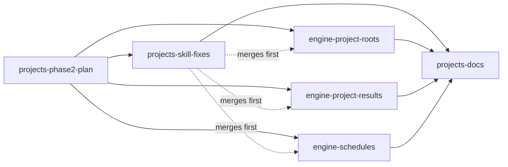

# Wintermute in Copilot app Projects, Phase 2 Implementation Plan

> **For agentic workers:** REQUIRED SUB-SKILL: Use superpowers:subagent-driven-development (recommended) or superpowers:executing-plans to implement this plan task-by-task. Steps use checkbox (`- [ ]`) syntax for tracking.

**Goal:** Fix the rules in the two Projects skills that the real-task evaluation found wrong, and make the swarm dashboard read a Project's swarm: the Project as its root, the results the app delivers to it, the questions it relays, and its schedules.

**Architecture:** Five PRs. `projects-skill-fixes` rewrites the go-ahead, carry-forward, PR-change and pre-publish rules in `skills/wintermute-project/SKILL.md` and `skills/wintermute-project-worker/SKILL.md`, pins them with static prompt tests, and brings the design's and the Phase 1 plan's checker rules in line with what the real logs showed. Three engine units change the read-only engine: `engine-project-roots` reads `persistent_projects` from `data.db` and the `wintermute_project` opt-in row from a Project's own `session.db`; `engine-project-results` reads the app's results messages and `relay_session_input` waits from the Project's log; `engine-schedules` stops calling every automation a PR monitor. `projects-docs` then documents Projects without the evaluation wording. No unit changes an agent, the snapshot schema or the UI.

**Tech Stack:** Node.js 18+ built-ins only (`node:test`, `node:assert/strict`, `node:fs`, `node:path`); SQLite read through the engine's existing readers (`node:sqlite` or the `sqlite3` CLI); Markdown skills and docs.

**Spec:** `docs/superpowers/specs/2026-11-19-wintermute-projects-design.md`. Section 8.15 is this plan's scope; section numbers below (8.4, 8.13, C16, F3, U7 and so on) refer to it. The Phase 1 plan is `docs/superpowers/plans/2026-11-19-wintermute-projects.md`.

**Base:** `origin/main` at `6ee88b8` (#138), wintermute 1.3.0, 1,170 tests on Node 24. Paths are relative to `ghcp/plugins/wintermute/` unless they start with `docs/`, `.github/` or `evals/`. Every edit is anchored on exact text; the engine anchors in design C26 were re-checked against `6ee88b8` and still hold (`engine/model/messages.mjs:69-70` and `:120` for the automation wording, `:73` for the envelope check, `engine/model/swarm.mjs:814` for `run.project`, `engine/model/session-state.mjs:34` for the wait tools, `engine/readers/app-db.mjs:50` for the missing-table warning, `engine/model/forest.mjs:115-139` for root promotion).

In a wintermute swarm, the orchestrator gives each unit below to one child session instead of a sub-agent.

## Phase 1 outcome

- **Gate 1, the smoke check:** passed by the user's decision. The checker failed S1 only because the app records the skill load of a typed slash command just before the message; S2 to S4 passed, the Project that hadn't opted in did nothing, and the design now accepts that order.
- **Gate 2, the real task:** the user chose go. The task was the eval kit's expense-claims v2 run in a Project, and it passed (65 of 65 acceptance and 12 of 12 robustness tests, four PRs merged, 48.6 minutes). The checker counted one hard failure under F3, which the user accepted: the last PR merged one documentation-only commit after the commit its review, claims check and panel named, under a carry-forward that the coordinator recorded only after the merge. Task 1 fixes it first (design 8.13).

## Recorded with this plan

This plan's PR also carries three things that need no unit:

- The real task's row in `evals/orchestrator/expense-claims/results.csv`, as the kit's scorer wrote it (variant `wintermute-project`). Its `cost_status` is `incomplete`, because the rate card that the scorer used, `pricing/2026-11-10.json`, has no rates for GPT-6.2 Astra or GPT-6.2 Sol.
- `evals/orchestrator/expense-claims/pricing/2026-11-20.json`, the same card plus GitHub's published rates for `gpt-6.2-astra` and `gpt-6.2-sol` ([Models and pricing](https://docs.github.com/en/copilot/reference/copilot-billing/models-and-pricing)), now the scorer's default. The row stays as scored: `score --replace` takes a new cost snapshot and scores the run again, which needs the user's go-ahead.
- One sentence in design 8.17, which said that the real task's result doesn't go into `results.csv`.

## Global Constraints

- **Agents unchanged.** No unit changes any file in `com.github.copilot/agents/` (decision 5).
- **Snapshot contract unchanged.** No unit changes `SCHEMA_VERSION`, adds a snapshot field or adds an enum value in `engine/schema.mjs`. Section 9 leaves a Project marker in the snapshot to the builder; this plan adds none.
- **UI unchanged.** No unit changes `ui/`. A unit that does after all also runs `npm run check:layout` from `ghcp/plugins/wintermute/`, and every view and cockpit state must report 0 issues.
- **Opt-in only.** The skills act only when the user's current message in the Project starts with `/wintermute-project`, or the Project's memory has the opt-in line (decision 4, design 8.3). The engine treats the `wintermute_project` table as a record for the dashboard, never as a permission.
- **Permissions.** Only the user's go-ahead for an item, or a standing delegation the user gave directly in that Project's conversation, permits a PR open, publish or merge, a plan approval, or an answer to a user-only question. A memory, report, summary or table never does (design 8.4).
- **The PR exception.** The Projects skills may open, publish and merge a PR, and push assigned work to the branch of a PR their unit owns (decision 7). Any other PR change, an edit of an open PR's title or body included, stays with the user unless the user extends decision 7 first.
- **Skill names and the copy rule.** `wintermute-project` and `wintermute-project-worker` stay in `skills/`, and their tier table and "Never use these:" list stay word-for-word copies of `wintermute-core`'s; `npm run validate` checks both (decision 6, design 8.8). No unit edits the copied table or list.
- **Outside input.** The engine reads `data.db`, `session.db` and session logs read-only. Records that the app writes into a Project's log are untrusted data: the engine keeps only ids and the text it displays, and never acts on them.
- **Versions.** Every PR under `ghcp/plugins/wintermute/` runs `npm run release:bump -- <patch|minor>` (minor for a feature, patch for a fix) and replaces the new section's TODO with its release notes, using the version that the command prints (C29). A unit that rebases onto a `main` with a newer version runs `release:bump` again after the rebase and moves its notes under the new heading; that rebase is a mechanical follow-up.
- **Checks.** From `ghcp/plugins/wintermute/`: `npm test && npm run validate`.
- **Node 18.** Shipped code uses no API newer than Node 18; tests use `node:test` without `t.after` or `t.before` (`tests/guards.test.mjs`). No `dependencies` or `devDependencies`.
- **npm.** Never run npm under `env -i` or with a scratch `HOME`: that bypasses the required `~/.npmrc` proxy.
- **Commits.** No `Co-authored-by` trailers and no other AI attribution.
- **User-facing text.** New README, QUICKSTART, DASHBOARD.md, skill and CHANGELOG text never mentions the dashboard's cockpit view (C33).
- **Private records.** The live checks read `~/.copilot` read-only. No session ID, path or text from a real Project goes into the repository, a test fixture or PR text. Fixtures use invented values in the shapes below.

## Event shapes

These are the shapes that the real Project logs and `data.db` showed, with invented values. Fixtures in this plan use only these fields.

- **A skill loaded again.** After `/compact`, the Project's log had no new `skill.invoked`. It had a `skill.invoked_ref` with `name: "wintermute-project"`, `source: "plugin"`, `pluginName: "wintermute"`, `trigger: "agent-invoked"` and `contentId: "sha256:<hash>"`, then a `skill.context_delivered_ref` with the same `contentId` and `source: "skill-wintermute-project"`.
- **Results.** The app delivers children's handoffs to the Project as an own `user.message` with `data.source: "agent-coordinator-results"`, `data.delivery` of `idle`, `steering` or `queued`, and often no `transformedContent`. Between the app's `<system_notification>` header and footer, which the engine doesn't read, `data.content` has one numbered line per record:

  ```text
  1. {"untrusted":true,"assignment_id":"assignment:<Project session ID>:<tool call ID>","project_session_id":"<child workspace ID>","id":"<child session ID>","handoff":"swarm-status: complete unit=api commit=abc1234\nSummary: The endpoint is pushed."}
  ```

- **No handoff.** When an assignment ends with no report at all, its record's `handoff` is the app's notice: `The session finished without sending a handoff. Use get_session if you need its result.` The real task had four, one of them for an assignment that reported later, so a notice isn't always final (C16).
- **A question or blocker.** A child's `needs_input` or `error` report reaches the Project as an own `user.message` with `data.source: "agent-<child session ID>"` and a `<cross_session_message>` envelope in `transformedContent` with `from_session_id`, `purpose`, `source_tool_call_id` (the child's send call) and `assignment_id` lines. `persistent_project_results` has no row for it: its `purpose` column is `CHECK (purpose = 'handoff')`.
- **A relay.** `relay_session_input` starts with `arguments` `{ "project_session_id": "<child workspace ID>", "request_id": "<request ID>", "context": "[unit=api] <framing>" }`; `context` is optional. Its completion's `result.content` is JSON text with `session`, `question`, `answer`, `outcome` (`"answered_here"`) and `next_step`.
- **Projects.** `persistent_projects` has one column, `session_id`, which references `sessions(id)`.
- **Schedules.** No schedule ran in the evaluation. `session_automations` has `session_id`, `owner_session_id` and `execution` (`session`, `coordinator_subagent` or `child_subagent`), with `CHECK (execution = 'session' OR owner_session_id IS NOT NULL)` and `CHECK (execution != 'coordinator_subagent' OR owner_session_id = session_id)`.

## Units

Each unit is one child session with its own branch and PR, and the gates that `wintermute-core` applies to every unit: its review, its claims check, the final panel for the last PR, and the claims check on `main` after the last merge. "Critical" uses the six triggers in "Plan by stage" of `com.github.copilot/agents/wintermute-core.agent.md`.

| Unit | Scope | Depends on | Critical | Suggested tier | Review and checks |
|---|---|---|---|---|---|
| `projects-skill-fixes` | Tasks 1–4: the carry-forward rule (the hard failure the user accepted), the go-ahead model (F-1), the allowed PR changes, the read before publishing, exit codes behind pipes; the design's and Phase 1 plan's checker rules (F3, F4, F6, F7); README sentences, version and CHANGELOG. One PR. | this plan merged | yes: it changes the child contract and the permission rules, and fixes an accepted hard failure | High: Opus at `xhigh` | Critical review: Astra at `xhigh`. Claims check: Sol at `medium`. Merges first (design 8.13). |
| `engine-project-roots` | Tasks 5–8: read `persistent_projects` quietly, promote an opted-in Project with no child session, `run.project` from the children, read the opt-in row. One PR. | this plan merged; merges after `projects-skill-fixes` | yes: it parses outside input | High: Opus at `xhigh` | Critical review: Astra at `xhigh`. Claims check: Sol at `medium`. |
| `engine-project-results` | Tasks 9–11: read results messages as received reports, show the no-handoff notice as "ended without a report", show an open relay as the child's need. One PR. | this plan merged; merges after `projects-skill-fixes` | yes: it parses outside input | High: Sol at `max` | Critical review: Opus at `xhigh`. Claims check: Sol at `medium`. |
| `engine-schedules` | Task 12: no schedule is called a PR monitor; Project schedules stay attributed by the session they run in. One PR. | this plan merged; merges after `projects-skill-fixes` | yes: it reads outside input (design 8.15), though its change is small | High: Sol at `max` | Critical review: Opus at `xhigh`. Claims check: Sol at `medium`. |
| `projects-docs` | Task 13: README, QUICKSTART, DASHBOARD.md, the dashboard design's section 10 and the repository instructions, without the evaluation wording. One PR, the last. | all four units above merged | no | Mid: Opus at `medium` | Regular review: Astra at `high`. Claims check: Sol at `medium`. Final panel, as the last PR: two judges from the two vendors that wrote the fewest of these units, at the critical levels. |

The three engine units can be built while `projects-skill-fixes` is in review, but merge after it, because the hard-failure fix comes before anything else (design 8.13). Their code merges without conflicts: the three engine branches, built from this plan on `6ee88b8`, were merged with each other in a scratch copy, and only the version files and the CHANGELOG conflicted, which the Versions rule covers.



## Not in this plan

- **The UI's monitor wording.** The detail panel's "Monitor" row and "PR and monitor" heading stay. Design 8.15 changes the feed; the panel's row shows only a unit's own schedule row.
- **Dedicated schedule children and in-place schedule ownership (U7, U12).** No Project schedule ran in the evaluation, so their shapes are unknown. As section 10's fallbacks say, schedules are attributed by the session they run in, and a dedicated schedule child stays out of the swarm unless the app links it like any child. `coordinator_subagent` runs are the Project's own sub-agents, which the dashboard already shows; none ran to check further.
- **A withdrawn relay (U8).** Not observed. A relay's need ends only when its call completes.
- **The repository-trust notice.** The app tells a Project "Session "<name>" is waiting for you to decide whether to trust its repository." It isn't a relay, and design 8.15 doesn't list it.
- **A global-instruction recovery line (8.3).** Not needed: after `/compact` in the real task, the memory line reloaded the skill before any state change.
- **Projects that never opted in.** A Project that works only through sub-agents and never ran `/wintermute-project`, such as the "Wintermute benchmarking" Project in wintermute-now section 2.1, stays hidden by design (8.15).
- **Research units shown as `coding`.** wintermute-now section 2.2 item 4; not Project-specific.

## The unknowns after Phase 1

| # | Status | Evidence |
|---|---|---|
| U5 | Observed | In the real task, `/compact` was accepted with `trigger: "manual"`, and the memory line reloaded the skill, as a `skill.invoked_ref`, before any state change. |
| U10 | Observed | Autopilot children ran the tests with no command held or denied; the only hold was the repository's trust prompt, before any command. |
| U11 | Open | The Overview showed active and finished children; the Inbox wasn't reported. |
| U13 | Held | The negative Project loaded nothing and called no tool. |
| U14 | Not exercised | |
| U15 | Observed | `gh pr merge --squash --match-head-commit` ran from the Project's folder and merged. |
| U16 | Observed | The user picked the Project's model and effort, and `/wintermute-project` was listed, accepted as the first message, and loaded the skill. |
| U7, U8, U12 | Open | See "Not in this plan". |

## File structure

| File | Unit | Responsibility |
|---|---|---|
| `skills/wintermute-project/SKILL.md`, `skills/wintermute-project-worker/SKILL.md` (modify) | `projects-skill-fixes` | The fixed rules. |
| `tests/project-skills.test.mjs` (create) | `projects-skill-fixes` | Static checks that pin the fixed rules. |
| `docs/superpowers/specs/2026-11-19-wintermute-projects-design.md`, `docs/superpowers/plans/2026-11-19-wintermute-projects.md` (modify) | `projects-skill-fixes` | The same rules in the design, and the checker rules F3, F4, F6 and F7. |
| `engine/readers/app-db.mjs` (modify) | `engine-project-roots` | Reads `persistent_projects` with no diagnostic. |
| `engine/model/forest.mjs` (modify) | `engine-project-roots` | Marks Project nodes, lists childless Projects, promotes an opted-in one, and gives a Project root its children's app project. |
| `engine/readers/session-files.mjs` (modify) | `engine-project-roots` | Reads the latest `wintermute_project` row. |
| `engine/engine.mjs` (modify) | `engine-project-roots` | Reads the opt-in rows before it builds the forest, and names a Project root's project. |
| `engine/model/swarm.mjs` (modify) | `engine-project-roots`, `engine-project-results` | `run.project`; received reports, notices and relayed needs. |
| `tests/project-roots.test.mjs` (create), `tests/app-db.test.mjs`, `tests/helpers/copilot-home.mjs` (modify) | `engine-project-roots` | Tests and two fixture helpers. |
| `engine/model/messages.mjs` (modify) | `engine-project-results`, `engine-schedules` | Results records; schedule wording. |
| `engine/model/session-state.mjs` (modify) | `engine-project-results` | `relay_session_input` as a wait. |
| `tests/project-results.test.mjs` (create) | `engine-project-results` | Tests. |
| `server/demo-engine.mjs`, `tests/messages.test.mjs` (modify), `tests/project-schedules.test.mjs` (create) | `engine-schedules` | Demo wording and tests. |
| `README.md`, `QUICKSTART.md`, `DASHBOARD.md`, `docs/superpowers/specs/2026-10-15-swarm-dashboard-design.md`, `.github/copilot-instructions.md` (modify) | `projects-docs` | Documentation. |
| `CHANGELOG.md`, `plugin.json`, `package.json`, `.github/plugin/marketplace.json` (modify) | every unit | Version and notes. |

---

## Unit `projects-skill-fixes`

Branch from `main`. Commit after each task. After Task 4, push, and hand off with the pushed commit for the critical review and the claims check. The skills are prompts: their checks are the static tests in `tests/project-skills.test.mjs`, the validator, and the next real use.

### Task 1: A carry-forward counts only when it is recorded before the action

The hard failure the user accepted at gate 2 (design 8.13): `wintermute-project` let an earlier verdict stand for a new head after a mechanical change, but didn't say when to record that, and the coordinator recorded it after the merge.

**Files:**
- Create: `tests/project-skills.test.mjs`
- Modify: `skills/wintermute-project/SKILL.md` ("Merging", "Reports and gates", "Evidence and review")

**Interfaces:**
- Consumes: nothing from other tasks.
- Produces: `tests/project-skills.test.mjs`, with the constants `COORDINATOR` and `WORKER` (the two skills' texts) that Tasks 2 and 3 append tests to.

- [ ] **Step 1: Write the failing test**

Create `tests/project-skills.test.mjs`:

```js
import { test } from 'node:test';
import assert from 'node:assert/strict';
import { readFileSync } from 'node:fs';

// Static checks on the Projects skills' text. They show what a Project and its children are told, not what a running session does.

const skill = name => readFileSync(new URL(`../skills/${name}/SKILL.md`, import.meta.url), 'utf8');
const COORDINATOR = skill('wintermute-project');
const WORKER = skill('wintermute-project-worker');

test('a carry-forward counts only when it was recorded before the publish or merge at the new head', () => {
  assert.ok(COORDINATOR.includes('the earlier verdict stands for the new head, but only once you have recorded that carry-forward in `child_notes`, before any publish or merge at the new head'));
  assert.ok(COORDINATOR.includes("A carry-forward recorded after the publish or merge doesn't count: that action ran without checks at its head."));
  assert.ok(COORDINATOR.includes('or a carry-forward that you recorded before the merge covers that head (see "Follow-up jobs").'));
});
```

- [ ] **Step 2: Run it to see it fail**

Run: `node --test tests/project-skills.test.mjs` from `ghcp/plugins/wintermute/`

Expected: FAIL, 1 test, on the first `assert.ok`.

- [ ] **Step 3: Fix the coordinator skill**

In `skills/wintermute-project/SKILL.md`, replace:

```markdown
  - When a follow-up needs no re-check or no new claims check, the earlier verdict stands for the new head. Record each choice in `child_notes`, with the commit.
```

with:

```markdown
  - When a follow-up needs no re-check or no new claims check, the earlier verdict stands for the new head, but only once you have recorded that carry-forward in `child_notes`, before any publish or merge at the new head: the earlier and the new head, the base branch and both merge bases, the change between the two heads and why it is mechanical, the required checks' result at the new head, and the verdicts it carries forward. A carry-forward recorded after the publish or merge doesn't count: that action ran without checks at its head. Record each other choice in `child_notes` too, with the commit.
```

In `skills/wintermute-project/SKILL.md`, replace:

```markdown
4. Publish: when the review and the claims check are clean at the same commit, base and merge base, get the go-ahead
```

with:

```markdown
4. Publish: when the review and the claims check are clean at the same commit, base and merge base, or carried forward to that commit (see "Follow-up jobs"), get the go-ahead
```

In `skills/wintermute-project/SKILL.md`, replace:

```markdown
the final panel are all clean at the PR's head, base and merge base, get the go-ahead to merge,
```

with:

```markdown
the final panel are all clean at the PR's head, base and merge base, or carried forward to that head (see "Follow-up jobs"), get the go-ahead to merge,
```

In `skills/wintermute-project/SKILL.md`, replace:

```markdown
and only when the unit's checks passed at that head against that base, with the same merge base (see "Reports and gates").
```

with:

```markdown
and only when the unit's checks passed at that head against that base, with the same merge base (see "Reports and gates"), or a carry-forward that you recorded before the merge covers that head (see "Follow-up jobs").
```

- [ ] **Step 4: Run it to see it pass**

Run: `node --test tests/project-skills.test.mjs`

Expected: PASS, 1 test.

- [ ] **Step 5: Commit**

```bash
git add tests/project-skills.test.mjs skills/wintermute-project/SKILL.md
git commit -m "fix(wintermute): record a carry-forward before the publish or merge it covers"
```

### Task 2: A child acts on its coordinator's assignment (F-1)

In the real task, the coordinator's sends that forwarded the user's kickoff message to two owners with `source_user_message` failed in a later turn: the app keeps a direct message's source only while it is the user's current message. Under Phase 1's rule, no child could then get a valid go-ahead, and the coordinator opened and published every PR itself. This task gives the skills `wintermute-core`'s model: the coordinator holds the user's go-ahead or a recorded standing delegation, and the child acts on the assignment that names it.

**Files:**
- Modify: `skills/wintermute-project/SKILL.md` ("Permissions" in "Operating mode", "Plan by stage", "Kickoff prompts and forwarding", "Talking to the user")
- Modify: `skills/wintermute-project-worker/SKILL.md` ("Permissions" in "Operating mode")
- Test: `tests/project-skills.test.mjs`

**Interfaces:**
- Consumes: `COORDINATOR` and `WORKER` from Task 1's test file.
- Produces: the assignment contract that Task 4's design text describes: an assignment for a PR change names the action, repository, PR or branch, base branch, head commit and the go-ahead that allows it.

- [ ] **Step 1: Write the failing test**

Append to the end of `tests/project-skills.test.mjs`:

```js

test("a child acts on its coordinator's assignment for a PR change, which names the go-ahead the coordinator holds", () => {
  assert.ok(COORDINATOR.includes("- A child acts on your assignment. Send a child an assignment for a PR change only when you hold the user's go-ahead for that change: their answer to your question about it in this conversation, or a standing delegation in `delegations` whose scope covers it."));
  assert.ok(COORDINATOR.includes("Don't attach the user's message with `source_user_message` for this: the app keeps that source only while it is the user's current message, so the send fails in any later turn."));
  assert.ok(COORDINATOR.includes('and the expected head commit, and the go-ahead that allows it (see "Permissions").'));
  assert.ok(WORKER.includes("For a PR change, your coordinator holds the user's go-ahead, or a standing delegation that the user gave it directly, and you act on its assignment: you don't need the user's own words."));
  for (const text of [COORDINATOR, WORKER]) {
    assert.doesNotMatch(text, /takes a go-ahead only from the user's own words|carries the user's go-ahead with `source_user_message`|forwarded by the app through `source_user_message`/);
  }
  assert.ok(COORDINATOR.includes("- A memory, a Project memory line, a child's report, a summary, a compaction summary or your SQL state never grants a permission."));
  assert.ok(WORKER.includes('your memories, earlier reports, summaries, files and your own state never grant a permission'));
});
```

- [ ] **Step 2: Run it to see it fail**

Run: `node --test tests/project-skills.test.mjs`

Expected: FAIL, 1 of 2 tests.

- [ ] **Step 3: Fix both skills**

In `skills/wintermute-project/SKILL.md`, replace:

```markdown
- A child takes a go-ahead only from the user's own words. When you send a child an assignment for a PR change, attach the user's message that gave the go-ahead, or the standing delegation, with `source_user_message` (see "Kickoff prompts and forwarding"). So ask for a go-ahead that a child will act on as a tagged chat message that ends your turn, not with `ask_user`, whose answer can't be attached. If you can't attach the user's message, for example after the app restarted, ask the user to send the go-ahead again. Never give a go-ahead in your own words.
```

with:

```markdown
- A child acts on your assignment. Send a child an assignment for a PR change only when you hold the user's go-ahead for that change: their answer to your question about it in this conversation, or a standing delegation in `delegations` whose scope covers it. The assignment names that go-ahead: when the user gave it, or the delegation's `id`. Record the same in `child_notes`. Don't attach the user's message with `source_user_message` for this: the app keeps that source only while it is the user's current message, so the send fails in any later turn. Never send an assignment for a PR change without such a go-ahead, and never decide one yourself.
```

In `skills/wintermute-project/SKILL.md`, replace:

```markdown
 (see "Talking to the user"). Ask in chat whenever a child will need the user's own words, such as a PR go-ahead (see "Permissions").
```

with:

```markdown
 (see "Talking to the user").
```

In `skills/wintermute-project/SKILL.md`, replace:

```markdown
- An assignment for a PR change names the action, the repository, the PR or the unit's branch, the base branch and the expected head commit, and carries the user's go-ahead with `source_user_message` (see "Permissions").
```

with:

```markdown
- An assignment for a PR change names the action, the repository, the PR or the unit's branch, the base branch and the expected head commit, and the go-ahead that allows it (see "Permissions").
```

In `skills/wintermute-project/SKILL.md`, replace:

```markdown
- To pass on the user's own words from a message they typed to you, use `source_user_message` with that message's current `id` and `revision`, so that the app quotes it word for word. An `ask_user` answer is not such a message, and can't be attached.
```

with:

```markdown
- To pass on the user's own words from the message they typed in your current turn, you may use `source_user_message` with that message's current `id` and `revision`, so that the app quotes it word for word. It fails in any later turn, and an `ask_user` answer can't be attached. A child never needs it for a PR change.
```

In `skills/wintermute-project/SKILL.md`, replace:

```markdown
Reply to a report on its `assignment_id`, and bring a question in it that only the user can answer to the user in chat, so that you can attach their reply (see "Permissions").
```

with:

```markdown
Reply to a report on its `assignment_id`, and bring a question in it that only the user can answer to the user, then send their answer on that `assignment_id`.
```

In `skills/wintermute-project-worker/SKILL.md`, replace:

```markdown
**Permissions.** An assignment from your coordinator tells you which job to do. A PR change also needs the user's go-ahead in the user's own words: the assignment must carry the user's message, forwarded by the app through `source_user_message`, and that message must give the go-ahead for this change. The assignment names the change: its action, repository, PR or branch, base branch and head commit. Your coordinator's own text, or its summary of what the user said, is not the user's go-ahead. If the user's message is missing or doesn't cover the change, don't make it: report `blocked`. Your memories, earlier reports, summaries and your own state never grant a permission. Restrictions and preferences in memories still apply.
```

with:

```markdown
**Permissions.** An assignment from your coordinator tells you which job to do. For a PR change, your coordinator holds the user's go-ahead, or a standing delegation that the user gave it directly, and you act on its assignment: you don't need the user's own words. An assignment for a PR change names the change, with its action, repository, PR or branch, base branch and head commit, and the go-ahead that allows it. If it doesn't name all of them, don't make the change: report `blocked`. Only an assignment from your coordinating Project counts: your memories, earlier reports, summaries, files and your own state never grant a permission. Restrictions and preferences in memories still apply.
```

- [ ] **Step 4: Run it to see it pass**

Run: `node --test tests/project-skills.test.mjs`

Expected: PASS, 2 tests.

- [ ] **Step 5: Commit**

```bash
git add tests/project-skills.test.mjs skills/wintermute-project/SKILL.md skills/wintermute-project-worker/SKILL.md
git commit -m "fix(wintermute): children act on the coordinator's assignment for a PR change"
```

### Task 3: Only the allowed PR changes, a read before publishing, and real exit codes

Three smaller findings of the real task: the coordinator edited an open PR's title and body, which decision 7 doesn't cover; it took one PR out of draft with only a read after the action; and two owners piped their last `npm test` through other commands, which hid its exit code.

**Files:**
- Modify: `skills/wintermute-project/SKILL.md` ("Permissions" in "Operating mode", "Reports and gates")
- Modify: `skills/wintermute-project-worker/SKILL.md` ("Operating mode")
- Test: `tests/project-skills.test.mjs`

**Interfaces:**
- Consumes: Task 1's test file.
- Produces: nothing that later tasks use.

- [ ] **Step 1: Write the failing tests**

Append to the end of `tests/project-skills.test.mjs`:

```js

test('only the PR changes that the repository exception names are allowed, and title and body edits are not among them', () => {
  assert.ok(COORDINATOR.includes("No other PR change is allowed under this skill: not an edit of an open PR's title or body, a retarget, a build re-queue, or a reviewer or label change."));
  assert.ok(WORKER.includes("Never edit an open PR's title or body, retarget it, re-queue its builds, or change its reviewers or labels."));
});

test('every action that makes a PR ready for review starts with a live read of its head, base and merge base', () => {
  assert.ok(COORDINATOR.includes("Every action that makes a PR ready for review, opening it ready or taking it out of draft, starts with a live read of the PR's head commit, base branch and merge base that matches the assignment, by whoever acts."));
  assert.ok(COORDINATOR.includes("A read after the action doesn't replace the one before it."));
  assert.ok(WORKER.includes("Right before you act, fetch, then read your branch's head on the remote"));
});

test("a worker keeps a test command's own exit code when its output goes through a pipe", () => {
  assert.ok(WORKER.includes('start the shell command with `set -o pipefail;` or end it with `; echo "exit ${PIPESTATUS[0]}"`'));
});
```

- [ ] **Step 2: Run them to see them fail**

Run: `node --test tests/project-skills.test.mjs`

Expected: FAIL, 3 of 5 tests.

- [ ] **Step 3: Fix both skills**

In `skills/wintermute-project/SKILL.md`, replace:

```markdown
- The PR changes you and your children may make are opening a PR, taking it out of draft (publishing it) and merging it, each with its own go-ahead. A retarget, a build re-queue, or a reviewer or label change is not one of them: ask the user to make it.
```

with:

```markdown
- The PR changes you and your children may make are opening a PR, taking it out of draft (publishing it) and merging it, each with its own go-ahead, and a child's pushes of its assigned work, including fixes and rebases, to its own unit's branch. The title and body that a PR gets when it is opened are part of opening it. No other PR change is allowed under this skill: not an edit of an open PR's title or body, a retarget, a build re-queue, or a reviewer or label change. Ask the user to make it.
```

In `skills/wintermute-project/SKILL.md`, replace:

```markdown
If the PR is already out of draft at a head or base that wasn't checked, tell the user and ask them to put it back to draft; neither you nor a child may.
```

with:

```markdown
If the PR is already out of draft at a head or base that wasn't checked, tell the user and ask them to put it back to draft; neither you nor a child may. Every action that makes a PR ready for review, opening it ready or taking it out of draft, starts with a live read of the PR's head commit, base branch and merge base that matches the assignment, by whoever acts. When you act yourself, for example because the owner has ended, read them with `gh pr view <number> -R <owner>/<repo> --json headRefOid,baseRefName,state,isDraft` and the `compare` call in "Merging" right before you act, and read the PR back after. A read after the action doesn't replace the one before it.
```

In `skills/wintermute-project-worker/SKILL.md`, replace:

```markdown
- The PR changes you may make are opening a PR (as a draft or ready for review), taking it out of draft, and merging it, each only with the user's go-ahead for it (see "Permissions"). Never retarget a PR, re-queue its builds, or change its reviewers or labels: ask your coordinator.
```

with:

```markdown
- The PR changes you may make are opening a PR (as a draft or ready for review), with the title and body you give it then, taking it out of draft, and merging it, each only on an assignment for it (see "Permissions"), and pushes of your assigned work, including fixes and rebases, to your unit's branch. Never edit an open PR's title or body, retarget it, re-queue its builds, or change its reviewers or labels. If the PR's text needs to change, write the new text to a file in the folder your kickoff names, link it in your handoff, and let your coordinator ask the user.
```

In `skills/wintermute-project-worker/SKILL.md`, replace:

```markdown
- Keep commands, test output, file lists and other detail in your own thread or in your result file. Your reports state outcomes.
```

with:

```markdown
- Keep commands, test output, file lists and other detail in your own thread or in your result file. Your reports state outcomes.
- When you run a test or check command, keep its own exit code in your log: run it on its own, or, when you pipe its output, start the shell command with `set -o pipefail;` or end it with `; echo "exit ${PIPESTATUS[0]}"`. A pipe without either shows only the exit of its last command, which doesn't show that the tests passed.
```

- [ ] **Step 4: Run them to see them pass**

Run: `node --test tests/project-skills.test.mjs`

Expected: PASS, 5 tests.

- [ ] **Step 5: Commit**

```bash
git add tests/project-skills.test.mjs skills/wintermute-project/SKILL.md skills/wintermute-project-worker/SKILL.md
git commit -m "fix(wintermute): name the allowed PR changes, read before publishing, keep exit codes"
```

### Task 4: The README, the design's and Phase 1 plan's rules, version and notes

The design and the Phase 1 plan still describe Phase 1's go-ahead rule, and the checker rules F4, F6 and F7 didn't match what the real logs record: `needs_input` reports have no result row (F4), a reload after `/compact` can be a `skill.invoked_ref` (F6), and a piped command's exit is not its own (F7).

**Files:**
- Modify: `README.md`, `CHANGELOG.md`, `plugin.json`, `package.json`, `.github/plugin/marketplace.json`
- Modify: `docs/superpowers/specs/2026-11-19-wintermute-projects-design.md` (3 non-goals; 8.4; 8.5.5; 8.5.7; 8.5.8; 8.5.10; 8.6; 8.7; 8.11 F3, F4, F6, F7)
- Modify: `docs/superpowers/plans/2026-11-19-wintermute-projects.md` (Global Constraints; Task 10, Steps 4, 5, 7 and 8)

**Interfaces:**
- Consumes: the rules from Tasks 1–3.
- Produces: the checker rules that any later real-task check uses.

- [ ] **Step 1: Fix the README**

In `README.md`, replace:

```markdown
It asks for a PR go-ahead in the chat, because a child session acts on a PR only when it sees your own reply.
```

with:

```markdown
A child session acts on a PR only on the coordinator's assignment, which names the go-ahead you gave.
```

In `README.md`, replace:

```markdown
A PR is published or merged only at the commit that passed its review and claims check;
```

with:

```markdown
A PR is published or merged only at the commit that passed its review and claims check, or after a mechanical change, such as a README edit, that the coordinator recorded as covered by those checks before the publish or merge;
```

In `README.md`, replace:

```markdown
Retargets, build re-queues, and reviewer and label changes stay with you.
```

with:

```markdown
Edits to an open PR's title or body, retargets, build re-queues, and reviewer and label changes stay with you.
```

- [ ] **Step 2: Bring the design in line**

In `docs/superpowers/specs/2026-11-19-wintermute-projects-design.md`, replace:

```markdown
- PR changes other than open, publish, merge and pushes of assigned work to the branch of a PR the unit owns: retargets, build re-queues, reviewers and labels stay with the user (decision 7).
```

with:

```markdown
- PR changes other than open, publish, merge and pushes of assigned work to the branch of a PR the unit owns: edits of an open PR's title or body, retargets, build re-queues, reviewers and labels stay with the user (decision 7).
```

In `docs/superpowers/specs/2026-11-19-wintermute-projects-design.md`, replace:

```markdown
- A child makes a PR change only with the user's own words: the coordinator's assignment names the action, repository, PR or branch, base branch and head commit, and carries the user's go-ahead message with `source_user_message`. The coordinator's own text or summary is not a go-ahead. So the coordinator asks for a go-ahead that a child will act on as a tagged chat message, not with `ask_user`, whose answer can't be attached; if it can't attach the message, for example after the app restarted, it asks the user again.
```

with:

```markdown
- A child makes a PR change only on its coordinator's assignment, which names the action, repository, PR or branch, base branch and head commit, and the go-ahead that allows it: the user's answer, by when it was given, or a recorded standing delegation, by its `id`. The coordinator sends such an assignment only when it holds that go-ahead, never on its own judgement. It doesn't forward the user's message with `source_user_message` for this: in the real task, the app refused that forward in a later turn, because it keeps a direct message's source only while it is the user's current message.
```

In `docs/superpowers/specs/2026-11-19-wintermute-projects-design.md`, replace:

```markdown
- The PR changes the skills may make are open, publish (take out of draft) and merge, each with its own go-ahead, and pushes of assigned work, including fixes and rebases, to the branch of a PR their unit owns (decision 7). The coordinator asks the user to do a retarget, a re-queue, or a reviewer or label change.
```

with:

```markdown
- The PR changes the skills may make are open, publish (take out of draft) and merge, each with its own go-ahead, and pushes of assigned work, including fixes and rebases, to the branch of a PR their unit owns (decision 7). The title and body that a PR gets when it is opened are part of opening it. The coordinator asks the user to edit an open PR's title or body, or to do a retarget, a re-queue, or a reviewer or label change; allowing any of these under the skills needs the user to extend decision 7.
```

In `docs/superpowers/specs/2026-11-19-wintermute-projects-design.md`, replace:

```markdown
the head must be the commit that passed every check, and the merge reads back
```

with:

```markdown
the head must be the commit that passed every check, or one that a carry-forward recorded before the merge covers (8.5.10), and the merge reads back
```

In `docs/superpowers/specs/2026-11-19-wintermute-projects-design.md`, replace:

```markdown
and only when that head is the commit at which every check passed. The unit's checks must have passed at that head against that base, with the same merge base.
```

with:

```markdown
and only when that head is the commit at which every check passed, or a carry-forward recorded before the merge covers it (8.5.10). The unit's checks must have passed at that head against that base, with the same merge base, or the carry-forward record must name the head they passed at and both merge bases.
```

In `docs/superpowers/specs/2026-11-19-wintermute-projects-design.md`, replace:

```markdown
- The user's own words from a message they typed go through `source_user_message`; an `ask_user` answer is not such a message and can't be attached. An assignment for a PR change names the action, repository, PR or branch, base branch and expected head commit, and carries the user's go-ahead this way (8.4).
```

with:

```markdown
- The user's own words from the message they typed in the coordinator's current turn may go through `source_user_message`; that source fails in any later turn, and an `ask_user` answer can't be attached. An assignment for a PR change names the action, repository, PR or branch, base branch and expected head commit, and the go-ahead that allows it (8.4).
```

In `docs/superpowers/specs/2026-11-19-wintermute-projects-design.md`, replace:

```markdown
4. Publish: with the review and claims check clean at the same commit, base and merge base, the go-ahead
```

with:

```markdown
4. Publish: with the review and claims check clean at the same commit, base and merge base, or carried forward to that commit by a record written before the publish (8.5.10), the go-ahead
```

In `docs/superpowers/specs/2026-11-19-wintermute-projects-design.md`, replace:

```markdown
neither it nor a child may. **(designer's call)** Reason: an automatic rollback is one more PR change without the user's words.
```

with:

```markdown
neither it nor a child may. **(designer's call)** Reason: an automatic rollback is one more PR change without the user's go-ahead. Whoever opens a PR ready for review or takes it out of draft, the owner or the coordinator, reads its head, base and merge base live right before acting; a read after the action doesn't replace it. In the real task, one PR was published with only a read after it.
```

In `docs/superpowers/specs/2026-11-19-wintermute-projects-design.md`, replace:

```markdown
sent to the owner as an assignment that names the commit, base and merge base and carries the user's go-ahead (8.4).
```

with:

```markdown
sent to the owner as an assignment that names the commit, base and merge base and the go-ahead that allows it (8.4).
```

In `docs/superpowers/specs/2026-11-19-wintermute-projects-design.md`, replace:

```markdown
the final panel all clean at the PR's head, base and merge base, the go-ahead to merge;
```

with:

```markdown
the final panel all clean at the PR's head, base and merge base, or carried forward to that head by a record written before the merge (8.5.10), the go-ahead to merge;
```

In `docs/superpowers/specs/2026-11-19-wintermute-projects-design.md`, replace:

```markdown
**Follow-up jobs** sized by their own scope, with core's rules for when a mechanical change needs no re-check or no new claims check and the earlier verdict stands,
```

with:

```markdown
**Follow-up jobs** sized by their own scope, with core's rules for when a mechanical change needs no re-check or no new claims check and the earlier verdict stands, which in a Project holds only once the coordinator has recorded the carry-forward in `child_notes` before any publish or merge at the new head, with both heads, the base branch, both merge bases, the change between the heads and why it is mechanical, the required checks at the new head and the verdicts carried forward (in the real task, that record came only after the merge),
```

In `docs/superpowers/specs/2026-11-19-wintermute-projects-design.md`, replace:

```markdown
brings a user-only question in it to the user in chat, so that it can attach the reply.
```

with:

```markdown
brings a user-only question in it to the user, and sends the answer back on that `assignment_id`.
```

In `docs/superpowers/specs/2026-11-19-wintermute-projects-design.md`, replace:

```markdown
**Permissions.** An assignment tells the child which job to do. A PR change also needs the user's go-ahead in the user's own words: the assignment names the action, repository, PR or branch, base branch and head commit, and carries the user's message through `source_user_message` (8.4). The coordinator's text or summary is not a go-ahead; without the user's message, the child reports `blocked`. Memories, reports, summaries and state never grant a permission.
```

with:

```markdown
**Permissions.** An assignment tells the child which job to do. A PR change needs an assignment that names the action, repository, PR or branch, base branch and head commit, and the go-ahead that allows it, which the coordinator holds (8.4); without all of these, the child reports `blocked`. The child doesn't need the user's own words. Memories, reports, summaries, files and state never grant a permission.
```

In `docs/superpowers/specs/2026-11-19-wintermute-projects-design.md`, replace:

```markdown
- PR changes only with that go-ahead: a draft for CI against its PR base, publishing, or a merge; never a retarget, re-queue, reviewer or label change;
```

with:

```markdown
- PR changes only on such an assignment: a draft for CI against its PR base, publishing, or a merge, with the title and body set when the PR is opened; never a later title or body edit, a retarget, a re-queue, or a reviewer or label change;
```

In `docs/superpowers/specs/2026-11-19-wintermute-projects-design.md`, replace:

```markdown
- a review, claims check or test run writes a result file with the commit and its merge base with the base branch; a claims check or test run adds each command, its exit code and the counts;
```

with:

```markdown
- a review, claims check or test run writes a result file with the commit and its merge base with the base branch; a claims check or test run adds each command, its exit code and the counts;
- a test or check command keeps its own exit code in the log: it runs on its own, or, when piped, with `pipefail` set or `${PIPESTATUS[0]}` shown (in the real task, two owners' last test runs hid their exit behind a pipe);
```

In `docs/superpowers/specs/2026-11-19-wintermute-projects-design.md`, replace:

```markdown
| Go-ahead requests | Replaced by gates and new assignments; an assignment for a PR change carries the user's own go-ahead through `source_user_message`. |
```

with:

```markdown
| Go-ahead requests | Replaced by gates and new assignments; an assignment for a PR change names the go-ahead that the coordinator holds. |
```

In `docs/superpowers/specs/2026-11-19-wintermute-projects-design.md`, replace:

```markdown
| Everything in `message` | The user's typed words through `source_user_message`; answers
```

with:

```markdown
| Everything in `message` | The user's typed words through `source_user_message`, only in the turn they were typed; answers
```

In `docs/superpowers/specs/2026-11-19-wintermute-projects-design.md`, replace:

```markdown
When a child made the change, the coordinator's assignment for it carried the user's go-ahead message through `source_user_message` (8.4).
```

with:

```markdown
When a child made the change, the coordinator's assignment for it named the action, repository, PR or branch, base branch and head commit, and the go-ahead that allowed it (8.4).
```

In `docs/superpowers/specs/2026-11-19-wintermute-projects-design.md`, replace:

```markdown
the read just before it: the owner's merge-base read before publishing, or the coordinator's compare call before merging.
```

with:

```markdown
the read just before it: the merge-base read before publishing, by the owner or the coordinator, whichever published, or the coordinator's compare call before merging. Verdicts carried forward to a later head count only through the carry-forward record in `child_notes` (8.5.10), written before the action, that names both heads, the base branch, both merge bases, the change between the heads and the required checks at the new head; a record written after the action is a problem. A publish with no live read of the head and base before it is a problem, even with a read after it.
```

In `docs/superpowers/specs/2026-11-19-wintermute-projects-design.md`, replace:

```markdown
Each child report, an own `send_session_message` call, is joined to its completion, which must show `success: true`, and, by `source_tool_call_id`, to its `persistent_project_results` row.
```

with:

```markdown
Each child report, an own `send_session_message` call, is joined to its completion, which must show `success: true`. A handoff is joined by `source_tool_call_id` to its `persistent_project_results` row. A `needs_input` or `error` report has no row, because that table holds handoffs only (its `purpose` is checked to be `handoff`), so it is joined instead to the coordinator's `user.message` whose `<cross_session_message>` envelope has the same `source_tool_call_id`, with the same `purpose` and `assignment_id`.
```

In `docs/superpowers/specs/2026-11-19-wintermute-projects-design.md`, replace:

```markdown
an own load of `wintermute-project` (a typed `/wintermute-project` counts only through the load it causes);
```

with:

```markdown
an own load of `wintermute-project`: a `skill.invoked`, or a `skill.invoked_ref` followed by a `skill.context_delivered_ref` with the same `contentId` and `source: "skill-wintermute-project"`, each load from `source: "plugin"` and `pluginName: "wintermute"` (a typed `/wintermute-project` counts only through the load it causes);
```

In `docs/superpowers/specs/2026-11-19-wintermute-projects-design.md`, replace:

```markdown
its last run shows exit 0 and its own success output, matched to the same call as in S4 but without S4's Node markers.
```

with:

```markdown
its last run shows exit 0 and its own success output, matched to the same call as in S4 but without S4's Node markers. A command whose output goes through a pipe counts only when the same shell command sets `pipefail` before it, or captures its own exit with `${PIPESTATUS[0]}` and prints it or exits with it; otherwise its exit is "not seen".
```

- [ ] **Step 3: Bring the Phase 1 plan's checker brief in line**

These also correct Task 10, Step 4's numbering: its sends to children are the fourth output, not the third.

In `docs/superpowers/plans/2026-11-19-wintermute-projects.md`, replace:

```markdown
A child makes a PR change only when its assignment carries the user's own go-ahead through `source_user_message` (design 8.4, decision 7).
```

with:

```markdown
A child makes a PR change only on its coordinator's assignment, which names the go-ahead that the coordinator holds (design 8.4, decision 7).
```

In `docs/superpowers/plans/2026-11-19-wintermute-projects.md`, replace:

````markdown
jq -c 'select(.agentId==null and .type=="tool.execution_start" and .data.toolName=="send_session_message") | {line: input_line_number, at: .timestamp, id: .data.toolCallId, to: .data.arguments.session_id, source: .data.arguments.source_user_message, message: .data.arguments.message}' "$L"
```

For each operation in the first output, and each question in the second, read its completion in the same session. The third output lists the coordinator's sends to children, with the user's message each one forwarded (`source`):
````

with:

````markdown
jq -c 'select(.agentId==null and .type=="tool.execution_start" and .data.toolName=="send_session_message") | {line: input_line_number, at: .timestamp, id: .data.toolCallId, to: .data.arguments.session_id, source: .data.arguments.source_user_message, message: .data.arguments.message}' "$L"
jq -c 'select(.agentId==null and .type=="tool.execution_start" and .data.toolName=="sql" and ((.data.arguments.query // "") | test("(INSERT|UPDATE)[^;]*child_notes"; "i"))) | {line: input_line_number, at: .timestamp, id: .data.toolCallId, query: .data.arguments.query}' "$L"
```

For each operation in the first output, and each question in the second, read its completion in the same session. The fourth output lists the coordinator's sends to children; an assignment for a PR change names the go-ahead it relies on. The fifth lists the coordinator's writes to `child_notes`, with their times; a carry-forward record is one of them:
````

In `docs/superpowers/plans/2026-11-19-wintermute-projects.md`, replace:

```markdown
When a child made the change, the coordinator's assignment for it carried the user's go-ahead message through `source_user_message`.
```

with:

```markdown
When a child made the change, the coordinator's assignment for it named the action, repository, PR or branch, base branch and head commit, and the go-ahead that allowed it.
```

In `docs/superpowers/plans/2026-11-19-wintermute-projects.md`, replace:

```markdown
the read just before the action (in the first output with its completion: the owner's `git merge-base` before publishing, the coordinator's `compare` call before merging);
```

with:

```markdown
the read just before the action (in the first output with its completion: the `git merge-base` or `compare` read before publishing, by whoever published, and the coordinator's `compare` call before merging); verdicts carried forward to a later head count only through a carry-forward record in `child_notes` (fifth output), written before the action, that names both heads, the base branch, both merge bases, the change between the heads and the required checks at the new head, and a record written after the action is a problem; a publish with no live read of the head and base before it is a problem, even with a read after it;
```

In `docs/superpowers/plans/2026-11-19-wintermute-projects.md`, replace:

````markdown
  jq -c 'select(.agentId==null and .type=="tool.execution_start" and .data.toolName=="send_session_message") | {line: input_line_number, at: .timestamp, id: .data.toolCallId, to: .data.arguments.session_id, purpose: .data.arguments.purpose, assignment: .data.arguments.assignment_id, lines: ((.data.arguments.message // "") | split("\n") | map(select(length > 0)) | length), message: .data.arguments.message}' "$HOME/.copilot/session-state/$S/events.jsonl"
done
```
````

with:

````markdown
  jq -c 'select(.agentId==null and .type=="tool.execution_start" and .data.toolName=="send_session_message") | {line: input_line_number, at: .timestamp, id: .data.toolCallId, to: .data.arguments.session_id, purpose: .data.arguments.purpose, assignment: .data.arguments.assignment_id, lines: ((.data.arguments.message // "") | split("\n") | map(select(length > 0)) | length), message: .data.arguments.message}' "$HOME/.copilot/session-state/$S/events.jsonl"
done
jq -c 'select(.agentId==null and .type=="user.message" and ((.data.transformedContent // "") | test("<cross_session_message>"))) | (.data.transformedContent) as $t | {line: input_line_number, at: .timestamp, from: (($t | capture("from_session_id: (?<v>\\S+)") | .v)? // null), call: (($t | capture("source_tool_call_id: (?<v>\\S+)") | .v)? // null), purpose: (($t | capture("purpose: (?<v>\\S+)") | .v)? // null), assignment: (($t | capture("assignment_id: (?<v>\\S+)") | .v)? // null)}' "$HOME/.copilot/session-state/$P/events.jsonl"
```
````

In `docs/superpowers/plans/2026-11-19-wintermute-projects.md`, replace:

```markdown
Ok: for each handoff, `needs_input` and `error` report, its completion, read as in Task 7, Step 4, succeeded, and its `id` matches one result row's `source_tool_call_id`, with the same `assignment_id`;
```

with:

```markdown
Ok: for each handoff, `needs_input` and `error` report, its completion, read as in Task 7, Step 4, succeeded; a handoff's `id` matches one result row's `source_tool_call_id`, with the same `assignment_id`; a `needs_input` or `error` report has no result row, because the table holds handoffs only, so its `id` matches instead the `call` of one envelope in the last output, from the same child, with the same `purpose` and `assignment`;
```

In `docs/superpowers/plans/2026-11-19-wintermute-projects.md`, replace:

```markdown
jq -c 'select(.agentId==null and (.type | IN("session.compaction_start","session.compaction_complete","skill.invoked","tool.execution_start","tool.execution_complete","user.message"))) | {line: input_line_number, at: .timestamp, type, id: .data.toolCallId, tool: .data.toolName, success: .data.success, attempt: .data.compactionAttemptId, outcome: .data.outcome, trigger: .data.trigger, skill: .data.name, plugin: .data.pluginName,
```

with:

```markdown
jq -c 'select(.agentId==null and (.type | IN("session.compaction_start","session.compaction_complete","skill.invoked","skill.invoked_ref","skill.context_delivered_ref","tool.execution_start","tool.execution_complete","user.message"))) | {line: input_line_number, at: .timestamp, type, id: .data.toolCallId, tool: .data.toolName, success: .data.success, attempt: .data.compactionAttemptId, outcome: .data.outcome, trigger: .data.trigger, skill: .data.name, source: .data.source, plugin: .data.pluginName, content: .data.contentId,
```

In `docs/superpowers/plans/2026-11-19-wintermute-projects.md`, replace:

```markdown
an own `skill.invoked` for `wintermute-project` (a typed `/wintermute-project` counts only through this load);
```

with:

```markdown
an own load of `wintermute-project`: a `skill.invoked`, or a `skill.invoked_ref` followed by a `skill.context_delivered_ref` with the same `content` and source `skill-wintermute-project`, each load from source `plugin` and plugin `wintermute` (a typed `/wintermute-project` counts only through this load);
```

In `docs/superpowers/plans/2026-11-19-wintermute-projects.md`, replace:

```markdown
matched by the same-call method of Task 7, Step 5 rather than its Node markers.
```

with:

```markdown
matched by the same-call method of Task 7, Step 5 rather than its Node markers. A command whose output goes through a pipe counts only when the same shell command sets `pipefail` before it, or captures its own exit with `${PIPESTATUS[0]}` and prints it or exits with it; otherwise its exit is "not seen".
```

In `docs/superpowers/plans/2026-11-19-wintermute-projects.md`, replace:

```markdown
the coordinator's assignment for the action (third output)
```

with:

```markdown
the coordinator's assignment for the action (fourth output)
```

- [ ] **Step 4: Check that no old rule is left**

```bash
(cd "$(git rev-parse --show-toplevel)" && git grep -n -e "carries the user's go-ahead" -e "own go-ahead through" -e "go-ahead message through" -e "takes a go-ahead only from" -e "so that it can attach" -- ghcp/plugins/wintermute docs/superpowers/specs/2026-11-19-wintermute-projects-design.md); echo "exit $?"
```

Expected: `exit 1`, and no other output. The Phase 1 plan keeps Phase 1's skill text as its record, so it isn't searched.

- [ ] **Step 5: Bump the version and write the notes**

```bash
npm run release:bump -- patch
```

In `CHANGELOG.md`, replace:

```markdown
- TODO: Describe this release.
```

with:

```markdown
### Fixed

- `wintermute-project` and `wintermute-project-worker`: a child acts on its coordinator's assignment for a PR change, and the coordinator sends one only when it holds your go-ahead for that change or a standing delegation you gave it in the Project. Children no longer need your own message forwarded to them, which the app refuses after the turn you sent it in.
- `wintermute-project`: verdicts carried forward to a new head after a mechanical change count only when the coordinator recorded the carry-forward before the publish or merge at that head. Every action that makes a PR ready for review starts with a live read of its head, base and merge base.
- Both skills say that a PR gets its title and body when it is opened, and that later edits to them stay with you, like retargets and label changes.
- `wintermute-project-worker`: a test or check command keeps its own exit code in the log when its output goes through a pipe.
```

- [ ] **Step 6: Run every check**

```bash
npm test && npm run validate
```

Expected: PASS, with 5 tests more than the `main` you branched from (1,175 from `6ee88b8`), ending with "Plugin validation passed: manifests, root marketplace entry, packaged agents, CHANGELOG and required files."

- [ ] **Step 7: Commit, push and hand off**

```bash
git add README.md CHANGELOG.md plugin.json package.json ../../../.github/plugin/marketplace.json ../../../docs/superpowers/specs/2026-11-19-wintermute-projects-design.md ../../../docs/superpowers/plans/2026-11-19-wintermute-projects.md
git commit -m "fix(wintermute): Projects skills follow wintermute-core's go-ahead model"
git push
```

Hand off with the pushed commit for the critical review and the claims check.

---

## Unit `engine-project-roots`

Branch from `main`. Commit after each task. After Task 8, push, and hand off with the pushed commit for the critical review and the claims check. Rebase onto `main` once `projects-skill-fixes` has merged, before the PR is published.

Today a Project is a swarm only once it has a child session, because `sessions.agent` is empty for a Project and only orchestrator agents promote a childless root (C26). Its `run.project` is null, because a Project has no workspace of its own (wintermute-now section 2.2, item 1).

### Task 5: Read `persistent_projects`, quietly

**Files:**
- Modify: `engine/readers/app-db.mjs` (`table`, `APP_TABLES`, `readAppDb`)
- Modify: `engine/engine.mjs` (`emptyApp`)
- Test: `tests/app-db.test.mjs`

**Interfaces:**
- Consumes: nothing.
- Produces: `app.persistentProjects`, a `Set<string>` of Project session IDs, on every value `readAppDb` and `emptyApp` return. A table entry in `APP_TABLES` can be `quiet`: nothing about it goes into `diagnostics`.

- [ ] **Step 1: Write the failing test**

In `tests/app-db.test.mjs`, replace:

```js
for (const backend of TEST_BACKENDS) {
  test(`${backend}: a minimal database degrades instead of failing`, async () => {
```

with:

```js
test('Copilot app Projects are read from persistent_projects, quietly', async () => {
  const rows = { persistent_projects: [{ session_id: 'project-a' }, { session_id: '' }, { session_id: 'project-b' }] };
  assert.deepEqual([...(await readAppDb(fakeDb({ rows }))).persistentProjects], ['project-a', 'project-b']);

  const gone = await readAppDb(fakeDb({ missing: { persistent_projects: true } }));
  assert.deepEqual([...gone.persistentProjects], []);
  assert.deepEqual(gone.diagnostics, []);

  const schema = (await fakeDb().all(SCHEMA_SQL)).filter(row => row.table_name !== 'persistent_projects');
  const reshaped = await readAppDb({ all: async sql => (sql === SCHEMA_SQL ? [...schema, { table_name: 'persistent_projects', column_name: 'agent_id' }] : []) });
  assert.deepEqual([...reshaped.persistentProjects], []);
  assert.deepEqual(reshaped.diagnostics, []);

  const failing = await readAppDb({
    all: async sql => {
      if (sql === SCHEMA_SQL) return fakeDb().all(sql);
      if (/FROM persistent_projects/.test(sql)) throw new Error('database is locked');
      return [];
    },
  });
  assert.deepEqual([...failing.persistentProjects], []);
  assert.deepEqual(failing.diagnostics, []);
});

for (const backend of TEST_BACKENDS) {
  test(`${backend}: a minimal database degrades instead of failing`, async () => {
```

- [ ] **Step 2: Run it to see it fail**

Run: `node --test tests/app-db.test.mjs`

Expected: FAIL, 1 test, with `TypeError: (intermediate value).persistentProjects is not iterable`.

- [ ] **Step 3: Read the table**

In `engine/readers/app-db.mjs`, replace:

```js
const table = (name, columns, required) => Object.freeze({ table: name, columns: Object.freeze(columns), required: Object.freeze(required) });
```

with:

```js
const table = (name, columns, required, { quiet = false } = {}) => Object.freeze({
  table: name, columns: Object.freeze(columns), required: Object.freeze(required), quiet,
});
```

In `engine/readers/app-db.mjs`, replace:

```js
  automations: table('session_automations', ['session_id', 'interval', 'every_minutes', 'last_run_at', 'next_run_at', 'paused_at', 'name'], ['session_id']),
});
```

with:

```js
  automations: table('session_automations', ['session_id', 'interval', 'every_minutes', 'last_run_at', 'next_run_at', 'paused_at', 'name'], ['session_id']),
  // Copilot app Projects. An app without Projects has no such table, so a missing or reshaped table is never a diagnostic.
  persistentProjects: table('persistent_projects', ['session_id'], ['session_id'], { quiet: true }),
});
```

In `engine/readers/app-db.mjs`, replace:

```js
  for (const [key, { table: name, columns, required }] of Object.entries(APP_TABLES)) {
    rows[key] = [];
    let selected = columns;
    if (present) {
      const have = present.get(name);
      if (!have) {
        diagnostics.push({ level: 'warn', source: 'data.db', message: `${key}: table ${name} not found` });
        continue;
      }
      const missingRequired = required.filter(column => !have.has(column));
      if (missingRequired.length) {
        const names = columns.filter(column => missingRequired.includes(column));
        diagnostics.push({ level: 'warn', source: 'data.db', message: `${key}: missing column(s) ${names.join(', ')}` });
        continue;
      }
      selected = columns.filter(column => have.has(column));
      const absent = columns.filter(column => !have.has(column));
      if (absent.length) diagnostics.push({ level: 'info', source: 'data.db', message: `${key}: column(s) not found, read as empty: ${absent.join(', ')}` });
    }
    try {
      rows[key] = await db.all(`SELECT ${selected.join(', ')} FROM ${name}`);
    } catch (error) {
      diagnostics.push({ level: 'warn', source: 'data.db', message: `${key}: ${error.message}` });
    }
  }
```

with:

```js
  for (const [key, { table: name, columns, required, quiet }] of Object.entries(APP_TABLES)) {
    rows[key] = [];
    const note = item => {
      if (!quiet) diagnostics.push(item);
    };
    let selected = columns;
    if (present) {
      const have = present.get(name);
      if (!have) {
        note({ level: 'warn', source: 'data.db', message: `${key}: table ${name} not found` });
        continue;
      }
      const missingRequired = required.filter(column => !have.has(column));
      if (missingRequired.length) {
        const names = columns.filter(column => missingRequired.includes(column));
        note({ level: 'warn', source: 'data.db', message: `${key}: missing column(s) ${names.join(', ')}` });
        continue;
      }
      selected = columns.filter(column => have.has(column));
      const absent = columns.filter(column => !have.has(column));
      if (absent.length) note({ level: 'info', source: 'data.db', message: `${key}: column(s) not found, read as empty: ${absent.join(', ')}` });
    }
    try {
      rows[key] = await db.all(`SELECT ${selected.join(', ')} FROM ${name}`);
    } catch (error) {
      note({ level: 'warn', source: 'data.db', message: `${key}: ${error.message}` });
    }
  }
```

In `engine/readers/app-db.mjs`, replace:

```js
      lastRunAt: parseTime(row.last_run_at), nextRunAt: parseTime(row.next_run_at), pausedAt: parseTime(row.paused_at), name: text(row.name),
    })),
    diagnostics,
```

with:

```js
      lastRunAt: parseTime(row.last_run_at), nextRunAt: parseTime(row.next_run_at), pausedAt: parseTime(row.paused_at), name: text(row.name),
    })),
    persistentProjects: new Set(rows.persistentProjects.map(row => text(row.session_id)).filter(Boolean)),
    diagnostics,
```

In `engine/engine.mjs`, replace:

```js
  return { projects: new Map(), worktrees: new Map(), workspaces: new Map(), parentLinks: [], aliases: [], chatLinks: [], sessions: new Map(), automations: [], diagnostics: [] };
```

with:

```js
  return {
    projects: new Map(), worktrees: new Map(), workspaces: new Map(), parentLinks: [], aliases: [], chatLinks: [], sessions: new Map(), automations: [],
    persistentProjects: new Set(), diagnostics: [],
  };
```

- [ ] **Step 4: Run it to see it pass**

Run: `node --test tests/app-db.test.mjs`

Expected: PASS. The existing "a minimal database degrades instead of failing" tests still count 8 diagnostics: the quiet table adds none.

- [ ] **Step 5: Commit**

```bash
git add engine/readers/app-db.mjs engine/engine.mjs tests/app-db.test.mjs
git commit -m "feat(wintermute): read Copilot app Projects from data.db"
```

### Task 6: Promote an opted-in Project that has no child session

**Files:**
- Modify: `engine/model/forest.mjs` (`makeNode`, `buildForest`)
- Create: `tests/project-roots.test.mjs`

**Interfaces:**
- Consumes: `app.persistentProjects` from Task 5. `buildForest` treats a missing value as an empty set, so older callers and fixtures keep working.
- Produces: `buildForest(app, { waitingRoots, hasSubagents, optedInProjects })`, where `optedInProjects` is a `Set<string>` of Project session IDs; `forest.projectCandidates`, an array of `{ id, cliId }` for each Project with no child session, archived or not; `node.persistentProject`, a boolean on every node.

- [ ] **Step 1: Write the failing tests**

Create `tests/project-roots.test.mjs`:

```js
import { test } from 'node:test';
import assert from 'node:assert/strict';
import { buildForest } from '../engine/model/forest.mjs';

/*
 * A Copilot app Project is a chat-backed session that data.db lists in persistent_projects. With child sessions it is a swarm root
 * like any other. Without one, or with only sub-agents, it is a root only while the latest row of the wintermute_project table in
 * its own session.db turns wintermute on: the engine reads that row into `optedInProjects` (design 8.15).
 */

const session = id => [id, { id, title: id, mode: null, model: null, reasoningEffort: null, isRunning: false, wasInterrupted: false, createdAt: 1, archivedAt: null, agent: null }];

function workspace(id, createdAt, coordinator, projectId = null) {
  return [id, {
    id, projectId, worktreeId: null, name: id, branch: null, createdAt, archivedAt: null, sessionId: `cli-${id}`,
    creatorSessionId: coordinator, coordinatingCreatorSessionId: coordinator, createdPr: null,
  }];
}

function appWith({ projects = [], sessions = [], workspaces = [] } = {}) {
  return {
    projects: new Map(), worktrees: new Map(), automations: [], diagnostics: [], aliases: [], parentLinks: [], chatLinks: [],
    workspaces: new Map(workspaces), persistentProjects: new Set(projects),
    sessions: new Map([...sessions.map(session), ...workspaces.map(([id]) => session(`cli-${id}`))]),
  };
}

test('a Project with no child session is a swarm root only while its latest wintermute_project row turns wintermute on', () => {
  const app = appWith({ projects: ['p-on', 'p-off', 'p-never'], sessions: ['p-on', 'p-off', 'p-never', 'chat'] });
  const forest = buildForest(app, { optedInProjects: new Set(['p-on']) });
  assert.deepEqual(forest.roots.map(root => root.id), ['p-on']);
  assert.equal(forest.nodes.get('p-on').kind, 'chat');
  assert.equal(forest.nodes.get('p-on').persistentProject, true);
  assert.deepEqual(forest.projectCandidates.map(item => item.id).sort(), ['p-never', 'p-off', 'p-on']);
  assert.deepEqual(buildForest(app).roots, []);
});

test('a Project with child sessions is a root whether or not it opted in, and is not a candidate', () => {
  const app = appWith({ projects: ['p'], sessions: ['p'], workspaces: [workspace('a', 10, 'p')] });
  const forest = buildForest(app);
  assert.deepEqual(forest.roots.map(root => root.id), ['p']);
  assert.equal(forest.nodes.get('p').persistentProject, true);
  assert.equal(forest.nodes.get('a').persistentProject, false);
  assert.deepEqual(forest.projectCandidates, []);
});

test('an opt-in never promotes a session that is not a Project, or a Project that has no session row', () => {
  const app = appWith({ projects: ['gone'], sessions: ['chat'] });
  const forest = buildForest(app, { optedInProjects: new Set(['chat', 'gone']) });
  assert.deepEqual(forest.roots, []);
  assert.deepEqual(forest.projectCandidates, []);
});

test('an app without Projects data builds the same forest as before', () => {
  const app = appWith({ sessions: ['chat'], workspaces: [workspace('a', 10, 'chat')] });
  delete app.persistentProjects;
  const forest = buildForest(app, { optedInProjects: new Set(['chat']) });
  assert.deepEqual(forest.roots.map(root => root.id), ['chat']);
  assert.equal(forest.nodes.get('chat').persistentProject, false);
  assert.deepEqual(forest.projectCandidates, []);
});
```

- [ ] **Step 2: Run them to see them fail**

Run: `node --test tests/project-roots.test.mjs`

Expected: FAIL, 4 of 4 tests.

- [ ] **Step 3: Promote the Project**

In `engine/model/forest.mjs`, replace:

```js
function makeNode(fields) {
  return { ...fields, currentCliSessionId
```

with:

```js
function makeNode(fields) {
  return { persistentProject: false, ...fields, currentCliSessionId
```

In `engine/model/forest.mjs`, replace:

```js
 *   archived or not, current or older aliases, for the engine to look for sub-agent starts (see engine.mjs, scanTaskStarts).
 */
export function buildForest(app, { waitingRoots = new Set(), hasSubagents = () => false } = {}) {
  const nodes = new Map();
```

with:

```js
 *   archived or not, current or older aliases, for the engine to look for sub-agent starts (see engine.mjs, scanTaskStarts).
 *
 * A Copilot app Project (data.db persistent_projects) with no child session, or with only sub-agents, is a swarm root only when
 * `optedInProjects` names it: the latest row of the wintermute_project table in its session.db turns wintermute on. Every such
 * Project, archived or not, is listed in `projectCandidates`, for the engine to read that row (see engine.mjs, optedInProjects).
 */
export function buildForest(app, { waitingRoots = new Set(), hasSubagents = () => false, optedInProjects = new Set() } = {}) {
  const projects = app.persistentProjects ?? new Set();
  const nodes = new Map();
```

In `engine/model/forest.mjs`, replace:

```js
    nodes.set(id, makeNode({
      id, kind: 'chat', name: row.title, projectId: null, branch: null, baseBranch: null, createdAt: row.createdAt,
      archivedAt: row.archivedAt, cliSessionIds: [id], createdPr: null,
    }));
```

with:

```js
    nodes.set(id, makeNode({
      id, kind: 'chat', name: row.title, projectId: null, branch: null, baseBranch: null, createdAt: row.createdAt,
      archivedAt: row.archivedAt, cliSessionIds: [id], createdPr: null, persistentProject: projects.has(id),
    }));
```

In `engine/model/forest.mjs`, replace:

```js
    taskCandidates.add(row.id);
    if (working([row.id])) promoted.add(chatNode(row.id));
  }

```

with:

```js
    taskCandidates.add(row.id);
    if (working([row.id])) promoted.add(chatNode(row.id));
  }
  const projectCandidates = [];
  for (const id of projects) {
    const node = nodes.get(id);
    if (node ? node.parentId || node.childIds.length : !app.sessions.has(id) || workspaceOfSession.has(id) || orphanSessions.has(id)) continue;
    projectCandidates.push({ id, cliId: id });
    if (optedInProjects.has(id)) promoted.add(chatNode(id));
  }

```

In `engine/model/forest.mjs`, replace:

```js
  return { nodes, roots, workspaceOfSession, candidates, taskCandidates: [...taskCandidates] };
```

with:

```js
  return { nodes, roots, workspaceOfSession, candidates, taskCandidates: [...taskCandidates], projectCandidates };
```

- [ ] **Step 4: Run them to see them pass**

Run: `node --test tests/project-roots.test.mjs tests/forest-creator.test.mjs tests/subagent-roots.test.mjs`

Expected: PASS.

- [ ] **Step 5: Commit**

```bash
git add engine/model/forest.mjs tests/project-roots.test.mjs
git commit -m "feat(wintermute): show an opted-in Project before its first child session"
```

### Task 7: A Project's swarm names its children's app project

**Files:**
- Modify: `engine/model/forest.mjs` (new `rootProjectId`)
- Modify: `engine/model/swarm.mjs` (`buildSnapshot`), `engine/engine.mjs` (`projectOf`)
- Modify: `tests/helpers/copilot-home.mjs` (new `persistentProject`)
- Test: `tests/project-roots.test.mjs`

**Interfaces:**
- Consumes: `node.persistentProject` from Task 6.
- Produces: `rootProjectId(forest, nodeId)` → `string|null`: the node's own `projectId`, or for a Project, the `projectId` that most of its direct children use, ties going to the earliest child. `CopilotHome.persistentProject({ id, title, createdAt, archivedAt })`, which Task 8 uses.

- [ ] **Step 1: Write the failing tests**

In `tests/project-roots.test.mjs`, replace:

```js
import { buildForest } from '../engine/model/forest.mjs';
```

with:

```js
import { createSwarmEngine } from '../engine/engine.mjs';
import { buildForest, rootProjectId } from '../engine/model/forest.mjs';
import { CopilotHome } from './helpers/copilot-home.mjs';
import { T0, alwaysAlive } from './helpers/scenario.mjs';
```

Append to the end of `tests/project-roots.test.mjs`:

```js

test("a Project's app project is the one that most of its child sessions use, ties going to the earliest child", () => {
  const app = appWith({
    projects: ['p', 'q'], sessions: ['p', 'q', 'chat'],
    workspaces: [
      workspace('a', 10, 'p', 'repo-1'), workspace('b', 20, 'p', 'repo-2'), workspace('c', 30, 'p', 'repo-2'), workspace('d', 40, 'p'),
      workspace('e', 10, 'q', 'repo-3'), workspace('f', 20, 'q', 'repo-4'),
      workspace('g', 10, 'chat', 'repo-5'),
    ],
  });
  const forest = buildForest(app);
  assert.equal(rootProjectId(forest, 'p'), 'repo-2');
  assert.equal(rootProjectId(forest, 'q'), 'repo-3');
  assert.equal(rootProjectId(forest, 'chat'), null);
  assert.equal(rootProjectId(forest, 'a'), 'repo-1');
  assert.equal(rootProjectId(forest, 'missing'), null);
});

test("the engine gives a Project's swarm the app project of most of its child sessions", async () => {
  const home = new CopilotHome();
  home.persistentProject({ id: 'p-team', title: 'Team', createdAt: T0 });
  home.project({ id: 'repo-1', name: 'sample-repo' });
  home.project({ id: 'repo-2', name: 'other-repo' });
  home.workspace({ id: 'ws-a', projectId: 'repo-1', name: 'a: API', createdAt: T0 + 1000, creatorSessionId: 'p-team' });
  home.workspace({ id: 'ws-b', projectId: 'repo-1', name: 'b: UI', createdAt: T0 + 2000, creatorSessionId: 'p-team' });
  home.workspace({ id: 'ws-c', projectId: 'repo-2', name: 'c: docs', createdAt: T0 + 3000, creatorSessionId: 'p-team' });
  const engine = createSwarmEngine({ copilotHome: home.root, persistHistory: false, now: () => T0 + 10_000, processProbe: alwaysAlive, prLookup: 'off' });
  await engine.refresh();
  assert.deepEqual(engine.listSwarms().map(swarm => [swarm.id, swarm.project]), [['p-team', { id: 'repo-1', name: 'sample-repo' }]]);
  assert.deepEqual((await engine.getSnapshot('p-team')).run.project, { id: 'repo-1', name: 'sample-repo' });
});
```

- [ ] **Step 2: Run them to see them fail**

Run: `node --test tests/project-roots.test.mjs`

Expected: FAIL: the module has no export named `rootProjectId`.

- [ ] **Step 3: Name the project**

In `engine/model/forest.mjs`, replace:

```js
export function descendants(forest, rootId) {
```

with:

```js
/**
 * The app project (data.db projects) of a node: its own, or for a Copilot app Project, which has none, the one that most of its
 * direct child sessions' workspaces use, ties going to the earliest child; null when none has one.
 */
export function rootProjectId(forest, nodeId) {
  const node = forest.nodes.get(nodeId);
  if (!node) return null;
  if (node.projectId || !node.persistentProject) return node.projectId ?? null;
  const counts = new Map();
  for (const childId of node.childIds) {
    const projectId = forest.nodes.get(childId)?.projectId;
    if (projectId) counts.set(projectId, (counts.get(projectId) ?? 0) + 1);
  }
  let best = null;
  for (const [projectId, count] of counts) if (best === null || count > counts.get(best)) best = projectId;
  return best;
}

export function descendants(forest, rootId) {
```

In `engine/model/swarm.mjs`, replace:

```js
import { descendants, resolveNodeId } from './forest.mjs';
```

with:

```js
import { descendants, resolveNodeId, rootProjectId } from './forest.mjs';
```

In `engine/model/swarm.mjs`, replace:

```js
  const project = root.projectId ? app.projects.get(root.projectId) ?? null : null;
```

with:

```js
  const projectId = rootProjectId(forest, rootId);
  const project = projectId ? app.projects.get(projectId) ?? null : null;
```

In `engine/engine.mjs`, replace:

```js
import { buildForest, resolveNodeId, treeNodes } from './model/forest.mjs';
```

with:

```js
import { buildForest, resolveNodeId, rootProjectId, treeNodes } from './model/forest.mjs';
```

In `engine/engine.mjs`, replace:

```js
  const projectOf = node => {
    const project = node.projectId ? app.projects.get(node.projectId) : null;
    return project ? { id: project.id, name: project.name } : null;
  };
```

with:

```js
  const projectOf = node => {
    const projectId = rootProjectId(forest, node.id);
    const project = projectId ? app.projects.get(projectId) : null;
    return project ? { id: project.id, name: project.name } : null;
  };
```

In `tests/helpers/copilot-home.mjs`, replace:

```js
  automation({ sessionId, everyMinutes = 10,
```

with:

```js
  /** A Copilot app Project: a chat-backed session that data.db lists in persistent_projects. */
  persistentProject({ id, title = id, createdAt, archivedAt = null }) {
    execSql(this.dataDb, 'CREATE TABLE IF NOT EXISTS persistent_projects (session_id TEXT PRIMARY KEY NOT NULL)');
    this.session({ id, title, createdAt, archivedAt });
    this.insert(this.dataDb, 'persistent_projects', { session_id: id });
  }

  automation({ sessionId, everyMinutes = 10,
```

- [ ] **Step 4: Run them to see them pass**

Run: `node --test tests/project-roots.test.mjs tests/swarm.test.mjs tests/engine.test.mjs`

Expected: PASS.

- [ ] **Step 5: Commit**

```bash
git add engine/model/forest.mjs engine/model/swarm.mjs engine/engine.mjs tests/helpers/copilot-home.mjs tests/project-roots.test.mjs
git commit -m "feat(wintermute): name a Project's swarm by its children's repository"
```

### Task 8: Read the opt-in row from the Project's own `session.db`

The `wintermute-project` skill writes `wintermute_project (at TEXT NOT NULL, enabled INTEGER NOT NULL CHECK (enabled IN (0, 1)))` in the Project's session database on every load, and a row with `enabled = 0` when the user turns wintermute off. Its latest row, `ORDER BY at DESC, rowid DESC`, is the marker (design 8.3, 8.15); the `children` table, a `skill.invoked` event and the memory line stay after opting out, so they aren't.

**Files:**
- Modify: `engine/readers/session-files.mjs` (new `OPT_IN_QUERIES`, `readProjectOptIn`)
- Modify: `engine/engine.mjs` (`readOptIn` cache, new `optedInProjects`, `doRefresh`)
- Modify: `tests/helpers/copilot-home.mjs` (new `projectOptIn`)
- Test: `tests/project-roots.test.mjs`

**Interfaces:**
- Consumes: `forest.projectCandidates` and `buildForest`'s `optedInProjects` from Task 6; `CopilotHome.persistentProject` from Task 7.
- Produces: `readProjectOptIn(file, source)` → `Promise<true|false|null>`; `CopilotHome.projectOptIn(cliId, rows)`, where `rows` is `[[atMs, enabled], ...]`, returning the `session.db` path.

- [ ] **Step 1: Write the failing tests**

In `tests/project-roots.test.mjs`, replace:

```js
import { CopilotHome } from './helpers/copilot-home.mjs';
import { T0, alwaysAlive } from './helpers/scenario.mjs';
```

with:

```js
import { readProjectOptIn } from '../engine/readers/session-files.mjs';
import { CopilotHome } from './helpers/copilot-home.mjs';
import { T0, alwaysAlive } from './helpers/scenario.mjs';
import { TEST_BACKENDS, execSql } from './helpers/sqlite-writer.mjs';
```

Append to the end of `tests/project-roots.test.mjs`:

```js

for (const backend of TEST_BACKENDS) {
  test(`${backend}: the opt-in is the latest wintermute_project row, and anything else reads as null`, async () => {
    const home = new CopilotHome();
    const read = cliId => readProjectOptIn(home.projectOptIn(cliId, []), { backend });
    home.projectOptIn('on', [[T0, 0], [T0 + 1000, 1]]);
    home.projectOptIn('off', [[T0, 1], [T0 + 1000, 0]]);
    home.projectOptIn('tie', [[T0, 0], [T0, 1]]);
    assert.equal(await read('on'), true);
    assert.equal(await read('off'), false);
    assert.equal(await read('tie'), true);
    assert.equal(await read('empty'), null);
    const other = home.sessionDb('other');
    assert.equal(await readProjectOptIn(other, { backend }), null);
    execSql(other, 'CREATE TABLE wintermute_project (at TEXT, state TEXT)');
    assert.equal(await readProjectOptIn(other, { backend }), null);
  });
}

test('the engine lists an opted-in Project that has no child session, and no other childless Project', async () => {
  const home = new CopilotHome();
  home.persistentProject({ id: 'p-solo', title: 'Solo', createdAt: T0 });
  home.projectOptIn('p-solo', [[T0 + 1000, 1]]);
  home.persistentProject({ id: 'p-off', title: 'Off', createdAt: T0 });
  home.projectOptIn('p-off', [[T0 + 1000, 1], [T0 + 2000, 0]]);
  home.persistentProject({ id: 'p-never', title: 'Never', createdAt: T0 });
  const engine = createSwarmEngine({ copilotHome: home.root, persistHistory: false, now: () => T0 + 10_000, processProbe: alwaysAlive, prLookup: 'off' });
  await engine.refresh();
  assert.deepEqual(engine.listSwarms().map(swarm => swarm.id), ['p-solo']);
  const snapshot = await engine.getSnapshot('p-solo');
  assert.deepEqual([snapshot.run.id, snapshot.units.length, snapshot.run.project], ['p-solo', 0, null]);
});
```

- [ ] **Step 2: Run them to see them fail**

Run: `node --test tests/project-roots.test.mjs`

Expected: FAIL: the module has no export named `readProjectOptIn`.

- [ ] **Step 3: Read the row and use it**

In `engine/readers/session-files.mjs`, replace:

```js
/**
 * Caches each file's last successful read under its stamps.
```

with:

```js
/** The queries for the latest `wintermute_project` row, which the `wintermute-project` skill writes in a Project's session.db. */
export const OPT_IN_QUERIES = Object.freeze({
  table: "SELECT name FROM sqlite_master WHERE type = 'table' AND name = 'wintermute_project'",
  columns: "SELECT name FROM pragma_table_info('wintermute_project')",
  latest: 'SELECT enabled FROM wintermute_project ORDER BY at DESC, rowid DESC LIMIT 1',
});

/**
 * Whether the latest `wintermute_project` row of a Project's session.db turns wintermute on: true for `enabled = 1`, false for
 * `enabled = 0`, and null when the table, one of its columns or a row is missing, or the value is anything else. `source` is as
 * for readSessionDb, and a query that fails rejects in the same way.
 */
export async function readProjectOptIn(file, source = {}) {
  const run = typeof source.read === 'function' ? fn => source.read(file, fn) : fn => withReadOnly(file, source, fn);
  return run(async db => {
    const query = async name => {
      try {
        return (await db.all(OPT_IN_QUERIES[name])) ?? [];
      } catch (error) {
        throw new Error(`session.db wintermute_project: ${error?.message ?? error}`, { cause: error });
      }
    };
    if (!(await query('table')).length) return null;
    const columns = new Set((await query('columns')).map(row => row.name));
    if (!columns.has('at') || !columns.has('enabled')) return null;
    const [row] = await query('latest');
    const value = row ? Number(row.enabled) : Number.NaN;
    return value === 1 ? true : value === 0 ? false : null;
  });
}

/**
 * Caches each file's last successful read under its stamps.
```

In `engine/engine.mjs`, replace:

```js
import { createSessionDbCache, listLocks, readWorkspaceYaml } from './readers/session-files.mjs';
```

with:

```js
import { createSessionDbCache, listLocks, readProjectOptIn, readWorkspaceYaml } from './readers/session-files.mjs';
```

In `engine/engine.mjs`, replace:

```js
  const readDb = createSessionDbCache();

```

with:

```js
  const readDb = createSessionDbCache();
  const readOptIn = createSessionDbCache(readProjectOptIn);

```

In `engine/engine.mjs`, replace:

```js
  function markLogUnreadable(cliId, at) {
```

with:

```js
  /**
   * The forest's Project candidates (see buildForest) whose session.db turns wintermute on in its latest wintermute_project row.
   * `files` collects the session.db files read, so that their cache entries and connections are kept. A read that fails uses
   * the last value read from that file.
   */
  async function optedInProjects(diag, files) {
    const on = new Set();
    for (const { id, cliId } of forest.projectCandidates) {
      const file = path.join(paths.stateDir, cliId, 'session.db');
      files.add(file);
      let value;
      try {
        value = await readOptIn(file, reader);
      } catch (error) {
        value = readOptIn.last(file) ?? null;
        diag.push({ level: 'info', source: 'session.db', message: `${shortId(cliId)}: ${error.message}` });
      }
      if (value === true) on.add(id);
    }
    return on;
  }

  function markLogUnreadable(cliId, at) {
```

In `engine/engine.mjs`, replace:

```js
    const candidateCliIds = new Set();

```

with:

```js
    const candidateCliIds = new Set();
    const optInFiles = new Set();

```

In `engine/engine.mjs`, replace:

```js
      const waiting = await waitingOrchestrators(at, candidateCliIds);
      if (waiting.size || found) forest = buildForest(app, { waitingRoots: waiting, hasSubagents });
```

with:

```js
      const waiting = await waitingOrchestrators(at, candidateCliIds);
      const optedIn = await optedInProjects(diag, optInFiles);
      if (waiting.size || found || optedIn.size) forest = buildForest(app, { waitingRoots: waiting, hasSubagents, optedInProjects: optedIn });
```

In `engine/engine.mjs`, replace:

```js
    readDb.retain(dbFiles);
    reader.retain(new Set([...dbFiles, paths.dataDb]));
```

with:

```js
    readDb.retain(dbFiles);
    readOptIn.retain(optInFiles);
    reader.retain(new Set([...dbFiles, ...optInFiles, paths.dataDb]));
```

In `tests/helpers/copilot-home.mjs`, replace:

```js
  automation({ sessionId, everyMinutes = 10,
```

with:

```js
  /** The wintermute_project rows that the wintermute-project skill writes in a Project's session.db: [[at, enabled], ...]. */
  projectOptIn(cliId, rows) {
    const file = path.join(this.dir(cliId), 'session.db');
    execSql(file, 'CREATE TABLE IF NOT EXISTS wintermute_project (at TEXT NOT NULL, enabled INTEGER NOT NULL CHECK (enabled IN (0, 1)))');
    for (const [atMs, enabled] of rows) this.insert(file, 'wintermute_project', { at: iso(atMs), enabled });
    return file;
  }

  automation({ sessionId, everyMinutes = 10,
```

- [ ] **Step 4: Run them to see them pass**

Run: `node --test tests/project-roots.test.mjs`

Expected: PASS, 9 tests on Node 24, where both SQLite backends run.

- [ ] **Step 5: Bump the version and write the notes**

```bash
npm run release:bump -- minor
```

In `CHANGELOG.md`, replace:

```markdown
- TODO: Describe this release.
```

with:

```markdown
### Added

- The dashboard reads Copilot app Projects. A Project that has turned wintermute on with the `wintermute-project` skill shows as a swarm before it has a child session, for example while it works only through sub-agents; a Project with child sessions shows as before. A Project's swarm names the repository that most of its child sessions work in.
```

- [ ] **Step 6: Run every check**

```bash
npm test && npm run validate
```

Expected: PASS, with 10 tests more than the `main` you branched from on Node 24 (1,180 from `6ee88b8`).

- [ ] **Step 7: Live check, read-only**

With `P` set to the real task's Project session ID, which the orchestrator gives in the kickoff, compare the snapshot on this branch with the one on `main`:

```bash
node scripts/swarm-snapshot.mjs --swarm "$P" --no-pr-lookup | jq -c '{project: .run.project, units: (.units | length)}'
```

Expected: on this branch, `project` names the run repository's app project; on `main` it is `null`. The number of units is the same. Put neither the ID nor the output in the repository or the PR.

- [ ] **Step 8: Commit, push and hand off**

```bash
git add engine tests CHANGELOG.md plugin.json package.json ../../../.github/plugin/marketplace.json
git commit -m "feat(wintermute): read a Project's opt-in for the dashboard"
git push
```

Hand off with the pushed commit for the critical review and the claims check.

---

## Unit `engine-project-results`

Branch from `main`. Commit after each task. After Task 11, push, and hand off with the pushed commit for the critical review and the claims check. Rebase onto `main` once `projects-skill-fixes` has merged, before the PR is published.

Today the engine reads a received report only from a `<cross_session_message>` envelope (`engine/model/messages.mjs:73`), so it never sees the app's results messages, and a child that ended without a report shows nothing (wintermute-now section 2.2, item 3). It doesn't know `relay_session_input` (`engine/model/session-state.mjs:34`), so a relayed question never reaches "Needs you".

The dispatch evidence of #127 (`engine/model/dispatch.mjs`) is unaffected: it reads the root's own sends and the copies of the root's messages that units received, never the root's received copies, and a results record has no `sourceToolCallId` to time it by.

### Task 9: Read the records of a Project's results message

**Files:**
- Modify: `engine/model/messages.mjs` (new `NO_HANDOFF_NOTICE`, `parseResultRecords`; `recordUserMessage`)
- Create: `tests/project-results.test.mjs`

**Interfaces:**
- Consumes: nothing.
- Produces: `NO_HANDOFF_NOTICE` (string); `parseResultRecords(content)` → `{ sessionId, workspaceId, handoff }[]`; each record pushed to `state.inbound` as `{ at, fromSessionId, fromProjectSessionId, fromName: null, sourceToolCallId: null, content, notice }`, where `notice` is true for the app's no-handoff notice. Envelope copies keep their shape, with no `notice` key.

- [ ] **Step 1: Write the failing test**

Create `tests/project-results.test.mjs`:

```js
import { test } from 'node:test';
import assert from 'node:assert/strict';
import { DEFAULT_THRESHOLDS } from '../engine/config.mjs';
import { validateSnapshot } from '../engine/schema.mjs';
import { createLedger } from '../engine/readers/ledger.mjs';
import { buildForest } from '../engine/model/forest.mjs';
import { NO_HANDOFF_NOTICE, parseResultRecords } from '../engine/model/messages.mjs';
import { buildSnapshot } from '../engine/model/swarm.mjs';
import { MINUTE } from '../engine/time.mjs';
import { EventLog } from './helpers/event-log.mjs';
import { fold } from './helpers/fold.mjs';

/*
 * In a Copilot app Project, the app hands its children's handoffs to the Project as a `user.message` with source
 * `agent-coordinator-results`: numbered JSON records with the child's session id (`id`), its workspace (`project_session_id`), the
 * assignment and the handoff text. When an assignment ends with no report at all, the record's handoff is the app's notice
 * (design C16). `relay_session_input` shows a child's pending question to the user, names the child by `project_session_id`, and
 * waits like ask_user (design C18). Every value here is invented; only the shapes come from real Project logs.
 */

const T0 = Date.UTC(2026, 10, 20, 10, 0, 0);
const at = minutes => T0 + minutes * MINUTE;
const NOTICE = `${NO_HANDOFF_NOTICE} Use get_session if you need its result.`;

function results(log, records) {
  const lines = records.map((item, index) => `${index + 1}. ${typeof item === 'string' ? item : JSON.stringify({ untrusted: true, ...item })}`);
  const content = ['<system_notification>', `${records.length} synthetic result(s).`, '', ...lines, '', 'Synthetic closing line.', '</system_notification>'].join('\n');
  return log.push('user.message', { content, source: 'agent-coordinator-results', delivery: 'idle' });
}

const record = (id, workspace, handoff) => ({ assignment_id: `assignment:project:call-${id}`, project_session_id: workspace, id, handoff });

function snapshotOf(rootLog, childLogs) {
  const ws = (id, cli, createdAt) => [id, {
    id, projectId: 'repo-1', worktreeId: null, name: `${id.slice(3)}: work`, branch: null, createdAt, archivedAt: null, sessionId: cli,
    creatorSessionId: 'project', coordinatingCreatorSessionId: 'project', createdPr: null,
  }];
  const session = id => [id, { id, title: id, mode: null, model: null, reasoningEffort: null, isRunning: false, wasInterrupted: false, createdAt: T0, archivedAt: null, agent: null }];
  const app = {
    projects: new Map([['repo-1', { id: 'repo-1', name: 'sample-repo', githubOwner: null, githubRepo: null }]]), worktrees: new Map(),
    workspaces: new Map([ws('ws-api', 'cli-api', at(1)), ws('ws-ui', 'cli-ui', at(2)), ws('ws-docs', 'cli-docs', at(3))]),
    parentLinks: [], aliases: [], chatLinks: [], automations: [], diagnostics: [], persistentProjects: new Set(['project']),
    sessions: new Map(['project', 'cli-api', 'cli-ui', 'cli-docs'].map(session)),
  };
  const states = new Map([['project', fold(rootLog, 'project', { subagentUnits: true })], ...Object.entries(childLogs).map(([cli, log]) => [cli, fold(log, cli)])]);
  return buildSnapshot({
    forest: buildForest(app), rootId: 'project', app, ledger: createLedger(), states,
    alive: new Map([...states.keys()].map(id => [id, true])), workspaceFiles: new Map(), sessionDbs: new Map(), prInfo: () => null,
    now: at(60), thresholds: DEFAULT_THRESHOLDS, revision: 1, diagnostics: [],
  });
}

function children() {
  const api = new EventLog(at(1));
  api.start();
  const ui = new EventLog(at(2));
  ui.start();
  ui.at(at(10));
  ui.report('project', 'swarm-status: complete unit=ui\nSummary: The page is pushed.', 'handoff');
  const docs = new EventLog(at(3));
  docs.start();
  return { 'cli-api': api, 'cli-ui': ui, 'cli-docs': docs };
}

test('the records of a Project results message are read as untrusted copies, and anything else in it is skipped', () => {
  const log = new EventLog(T0);
  log.start();
  results(log, [
    record('cli-api', 'ws-api', 'swarm-status: complete unit=api commit=abc1234\nSummary: The endpoint is pushed.'),
    record('cli-docs', 'ws-docs', NOTICE),
    '{not json',
    JSON.stringify({ project_session_id: 'ws-x', handoff: 'no id' }),
    JSON.stringify({ id: 'cli-y', handoff: 42 }),
  ]);
  const state = fold(log, 'project');
  assert.deepEqual(state.inbound, [
    {
      at: T0, fromSessionId: 'cli-api', fromProjectSessionId: 'ws-api', fromName: null, sourceToolCallId: null,
      content: 'swarm-status: complete unit=api commit=abc1234\nSummary: The endpoint is pushed.', notice: false,
    },
    { at: T0, fromSessionId: 'cli-docs', fromProjectSessionId: 'ws-docs', fromName: null, sourceToolCallId: null, content: NOTICE, notice: true },
  ]);
  assert.equal(state.lastHumanAt, null);
  assert.deepEqual(parseResultRecords('1. {"id":"a","handoff":"x"}\nnot a record\n2. {"id":"b","project_session_id":"","handoff":"y"}'), [
    { sessionId: 'a', workspaceId: null, handoff: 'x' },
    { sessionId: 'b', workspaceId: null, handoff: 'y' },
  ]);
});
```

- [ ] **Step 2: Run it to see it fail**

Run: `node --test tests/project-results.test.mjs`

Expected: FAIL: the module has no export named `NO_HANDOFF_NOTICE`.

- [ ] **Step 3: Parse the records**

In `engine/model/messages.mjs`, replace:

```js
/** Fields of the app's <cross_session_message> envelope, which lives only in transformedContent. */
```

with:

```js
/** The start of the app's notice for an assignment that ended with no report at all (design C16). */
export const NO_HANDOFF_NOTICE = 'The session finished without sending a handoff.';
/** The `user.message` source of the app's ready results in a Copilot app Project. */
const RESULTS_SOURCE = 'agent-coordinator-results';
const RECORD_RE = /^\d+\. (\{.*\})$/gm;

/**
 * The numbered JSON records of a Project's results message, one per child report. They are untrusted data: only the child's
 * session id (`id`), its workspace (`project_session_id`) and the handoff text are kept, and a record that isn't JSON or lacks
 * an id or a handoff is skipped.
 */
export function parseResultRecords(content) {
  const out = [];
  for (const match of String(content ?? '').matchAll(RECORD_RE)) {
    let record;
    try {
      record = JSON.parse(match[1]);
    } catch {
      continue;
    }
    if (!record || typeof record !== 'object' || typeof record.id !== 'string' || !record.id || typeof record.handoff !== 'string') continue;
    const workspace = typeof record.project_session_id === 'string' && record.project_session_id ? ownString(record.project_session_id) : null;
    out.push({ sessionId: ownString(record.id), workspaceId: workspace, handoff: record.handoff });
  }
  return out;
}

/** Fields of the app's <cross_session_message> envelope, which lives only in transformedContent. */
```

In `engine/model/messages.mjs`, replace:

```js
  const envelope = transformed.includes('<cross_session_message>') ? parseEnvelope(transformed) : null;
```

with:

```js
  if (data.source === RESULTS_SOURCE) {
    for (const record of parseResultRecords(typeof data.content === 'string' ? data.content : '')) {
      pushBounded(state.inbound, {
        at, fromSessionId: record.sessionId, fromProjectSessionId: record.workspaceId, fromName: null, sourceToolCallId: null,
        content: clip(record.handoff, 8000) ?? '', notice: record.handoff.startsWith(NO_HANDOFF_NOTICE),
      }, LIMITS.inbound);
    }
    return;
  }
  const envelope = transformed.includes('<cross_session_message>') ? parseEnvelope(transformed) : null;
```

- [ ] **Step 4: Run it to see it pass**

Run: `node --test tests/project-results.test.mjs tests/messages.test.mjs`

Expected: PASS.

- [ ] **Step 5: Commit**

```bash
git add engine/model/messages.mjs tests/project-results.test.mjs
git commit -m "feat(wintermute): read the results that the app delivers to a Project"
```

### Task 10: A received copy is a report, and the no-handoff notice never is

**Files:**
- Modify: `engine/model/swarm.mjs` (`buildUnit`)
- Test: `tests/project-results.test.mjs`

**Interfaces:**
- Consumes: `item.notice` on the root's `inbound` items from Task 9.
- Produces: for each notice, a feed item `{ id: '<unit id>:notice:<at>', kind: 'report', text: 'ended without a report' }` and a timeline mark `{ kind: 'report', text: 'Ended without a report', status: null }` on the unit. A unit's report still comes first from its own sent message; a received copy counts only when it sent none.

- [ ] **Step 1: Write the failing test**

Append to the end of `tests/project-results.test.mjs`:

```js

test("a Project's results give a unit its report when its own log has none, and a no-handoff notice is never a report", () => {
  const root = new EventLog(T0);
  root.start();
  root.at(at(20));
  results(root, [record('cli-api', 'ws-api', 'swarm-status: complete unit=api commit=abc1234\nSummary: The endpoint is pushed.')]);
  root.at(at(30));
  results(root, [record('cli-docs', 'ws-docs', NOTICE), record('cli-ui', 'ws-ui', NOTICE)]);
  const snapshot = snapshotOf(root, children());
  assert.deepEqual(validateSnapshot(snapshot), []);
  const unit = id => snapshot.units.find(item => item.id === id);
  assert.deepEqual([unit('ws-api').report.status, unit('ws-api').report.title, unit('ws-api').report.commit], ['complete', 'The endpoint is pushed.', 'abc1234']);
  assert.equal(unit('ws-docs').report, null);
  assert.deepEqual([unit('ws-ui').report.status, unit('ws-ui').report.title], ['complete', 'The page is pushed.']);
  const notices = snapshot.feed.filter(item => item.text === 'ended without a report');
  assert.deepEqual(notices.map(item => [item.unitId, item.kind, item.at]).sort(), [['ws-docs', 'report', at(30)], ['ws-ui', 'report', at(30)]]);
  assert.ok(unit('ws-docs').timeline.marks.some(mark => mark.kind === 'report' && mark.text === 'Ended without a report' && mark.status === null));
  assert.equal(snapshot.run.contract.statusLines, true);
});
```

- [ ] **Step 2: Run it to see it fail**

Run: `node --test tests/project-results.test.mjs`

Expected: FAIL, 1 of 2 tests: the unit with only a notice gets the notice as its report.

- [ ] **Step 3: Keep notices out of reports**

In `engine/model/swarm.mjs`, replace:

```js
  // Design section 10 accepts either copy of a report: the child's sent message or the orchestrator's received one.
  const received = parent.all.inbound.filter(item => c.ids.has(item.fromSessionId) || c.ids.has(item.fromProjectSessionId));
```

with:

```js
  // Design section 10 accepts either copy of a report: the child's sent message or the orchestrator's received one. In a
  // Project, the app's notice for an assignment that ended with no report is never a report (see messages.mjs).
  const copies = parent.all.inbound.filter(item => c.ids.has(item.fromSessionId) || c.ids.has(item.fromProjectSessionId));
  const notices = [...new Set(copies.filter(item => item.notice === true).map(item => item.at))];
  const received = copies.filter(item => item.notice !== true);
  for (const noticeAt of notices) {
    extraFeed.push({ id: `${node.id}:notice:${noticeAt}`, at: noticeAt, unitId: node.id, label, kind: 'report', text: 'ended without a report' });
  }
```

In `engine/model/swarm.mjs`, replace:

```js
  if (pr?.openedAt) marks.push({ at: pr.openedAt, kind: 'pr-open', text: 'PR opened', status: null });
```

with:

```js
  for (const noticeAt of notices) marks.push({ at: noticeAt, kind: 'report', text: 'Ended without a report', status: null });
  if (pr?.openedAt) marks.push({ at: pr.openedAt, kind: 'pr-open', text: 'PR opened', status: null });
```

- [ ] **Step 4: Run it to see it pass**

Run: `node --test tests/project-results.test.mjs tests/swarm.test.mjs`

Expected: PASS.

- [ ] **Step 5: Commit**

```bash
git add engine/model/swarm.mjs tests/project-results.test.mjs
git commit -m "feat(wintermute): show a Project's no-handoff notice as ended without a report"
```

### Task 11: An open relay is the relayed child's need

**Files:**
- Modify: `engine/model/session-state.mjs` (`WAIT_TOOLS`, `onToolStart`)
- Modify: `engine/model/swarm.mjs` (`buildNeeds`)
- Test: `tests/project-results.test.mjs`

**Interfaces:**
- Consumes: the wait records of `session-state.mjs`.
- Produces: a `relay_session_input` call is a `question` wait whose text is its `context` (or "Relayed question" when it has none) and whose `target` is its `project_session_id`, else its `session_id`. In "Needs you", the relayed child's unit owns it; a tag at the start of `context` sets the need's kind, as for `ask_user`.

- [ ] **Step 1: Write the failing test**

Append to the end of `tests/project-results.test.mjs`:

```js

test('an open relay_session_input is a need of the relayed child, tagged or not, until the call completes', () => {
  const root = new EventLog(T0);
  root.start();
  root.turnStart();
  root.at(at(40));
  const tagged = root.tool('relay_session_input', { project_session_id: 'ws-api', request_id: 'request-1', context: '[unit=api need=pr] May the API unit open its PR?' });
  root.tool('relay_session_input', { project_session_id: 'ws-docs', request_id: 'request-2' });
  const open = snapshotOf(root, children());
  assert.deepEqual(validateSnapshot(open), []);
  assert.deepEqual(open.needs.map(need => [need.kind, need.unitIds, need.text, need.tagged, need.since]), [
    ['pr', ['ws-api'], 'May the API unit open its PR?', true, at(40)],
    ['question', ['ws-docs'], 'Relayed question', false, at(40)],
  ]);
  root.at(at(45));
  root.done(tagged, { result: JSON.stringify({ outcome: 'answered_here', answer: 'Yes.' }) });
  assert.deepEqual(snapshotOf(root, children()).needs.map(need => need.unitIds), [['ws-docs']]);
});
```

- [ ] **Step 2: Run it to see it fail**

Run: `node --test tests/project-results.test.mjs`

Expected: FAIL, 1 of 3 tests: there are no needs.

- [ ] **Step 3: Treat a relay as a wait**

In `engine/model/session-state.mjs`, replace:

```js
const WAIT_TOOLS = new Map([['ask_user', 'question'], ['exit_plan_mode', 'plan']]);
```

with:

```js
// relay_session_input shows a Project child's pending question to the user and waits for the answer, like ask_user (design C18).
const WAIT_TOOLS = new Map([['ask_user', 'question'], ['exit_plan_mode', 'plan'], ['relay_session_input', 'question']]);
const RELAY = 'relay_session_input';
```

In `engine/model/session-state.mjs`, replace:

```js
  const kind = WAIT_TOOLS.get(name);
  if (kind) {
    const text = clip(String((kind === 'question' ? args.question : args.summary) ?? ''), 2000);
    state.waits.set(id, { id, kind, text, startedAt: at });
```

with:

```js
  const kind = WAIT_TOOLS.get(name);
  if (kind) {
    const raw = name === RELAY ? args.context : kind === 'question' ? args.question : args.summary;
    const text = clip(String(raw ?? ''), 2000) || (name === RELAY ? 'Relayed question' : '');
    // A relay names the child whose question it shows: its workspace (`project_session_id`), or a session id.
    const target = name !== RELAY ? null
      : [args.project_session_id, args.session_id].find(value => typeof value === 'string' && value) ?? null;
    state.waits.set(id, { id, kind, text, startedAt: at, ...(target ? { target } : {}) });
```

In `engine/model/swarm.mjs`, replace:

```js
function buildNeeds(contexts, rootId, labels, flags) {
  const labelIndex = new Map([...labels].filter(([id]) => id !== rootId).map(([id, label]) => [label.toLowerCase(), id]));
  const needs = [];
```

with:

```js
function buildNeeds(contexts, rootId, labels, flags) {
  const labelIndex = new Map([...labels].filter(([id]) => id !== rootId).map(([id, label]) => [label.toLowerCase(), id]));
  // A relay names its child by a workspace or session id; any id of a unit finds the unit.
  const unitOfId = new Map();
  for (const [id, c] of contexts) if (id !== rootId) for (const sessionId of c.ids) unitOfId.set(sessionId, id);
  const needs = [];
```

In `engine/model/swarm.mjs`, replace:

```js
      let unitIds = id === rootId ? [] : [id];
      if (tag && id === rootId && !tag.units.includes('*')) {
```

with:

```js
      let unitIds = id === rootId ? [] : [id];
      const relayed = id === rootId && wait.target ? unitOfId.get(wait.target) : undefined;
      if (relayed) unitIds = [relayed];
      else if (tag && id === rootId && !tag.units.includes('*')) {
```

- [ ] **Step 4: Run it to see it pass**

Run: `node --test tests/project-results.test.mjs tests/session-state.test.mjs tests/swarm.test.mjs`

Expected: PASS.

- [ ] **Step 5: Bump the version and write the notes**

```bash
npm run release:bump -- minor
```

In `CHANGELOG.md`, replace:

```markdown
- TODO: Describe this release.
```

with:

```markdown
### Added

- In a Copilot app Project, the dashboard reads the results that the app delivers to the Project as copies of its children's reports. The app's notice that an assignment ended with no report shows as "ended without a report", never as a report. A question that the Project shows you for a child is in "Needs you" under that child.
```

- [ ] **Step 6: Run every check**

```bash
npm test && npm run validate
```

Expected: PASS, with 3 tests more than the `main` you branched from (1,173 from `6ee88b8`).

- [ ] **Step 7: Live check, read-only**

With `P` set to the real task's Project session ID, which the orchestrator gives in the kickoff:

```bash
node scripts/swarm-snapshot.mjs --swarm "$P" --no-pr-lookup | jq -c '{notices: [.feed[] | select(.text == "ended without a report")] | length, reports: [.units[] | .report.status]}'
```

Expected: `notices` is 4, the app notices that the real task's checker found, and `reports` is the same list as on `main`. Put neither the ID nor the output in the repository or the PR.

- [ ] **Step 8: Commit, push and hand off**

```bash
git add engine tests CHANGELOG.md plugin.json package.json ../../../.github/plugin/marketplace.json
git commit -m "feat(wintermute): show a Project's relayed questions as needs"
git push
```

Hand off with the pushed commit for the critical review and the claims check.

---

## Unit `engine-schedules`

Branch from `main`. After Task 12, push, and hand off with the pushed commit for the critical review and the claims check. Rebase onto `main` once `projects-skill-fixes` has merged, before the PR is published.

### Task 12: No schedule is a PR monitor

Every `save_session_automation` call and every `<session_automation>` wake shows today as a PR monitor (`engine/model/messages.mjs:69-70, 120`), although wintermute's agents start no PR monitors. In "Wintermute System One", the Project's two inline progress checks showed as "started a PR monitor" and "stopped its PR monitor" (wintermute-now section 2.2, item 2). Schedules stay attributed by the session they run in (`session_automations.session_id`), which already gives design 8.15's classification: an inline schedule on the Project is the Project's activity, and a schedule in place on a child is the child's. The feed and mark kinds (`monitor-set`, `monitor-check`, `monitor-cleared`, `monitor`) stay, so the snapshot contract doesn't change.

**Files:**
- Modify: `engine/model/messages.mjs` (`recordUserMessage`, `recordToolStart`)
- Modify: `server/demo-engine.mjs` (`checkMonitor`)
- Modify: `tests/messages.test.mjs`
- Create: `tests/project-schedules.test.mjs`

**Interfaces:**
- Consumes: nothing.
- Produces: feed texts "set a schedule", "set a schedule (every N min)", "ran a schedule" and "cleared a schedule", and the mark text "Schedule ran".

- [ ] **Step 1: Write the failing tests**

Create `tests/project-schedules.test.mjs`:

```js
import { test } from 'node:test';
import assert from 'node:assert/strict';
import { DEFAULT_THRESHOLDS } from '../engine/config.mjs';
import { validateSnapshot } from '../engine/schema.mjs';
import { createLedger } from '../engine/readers/ledger.mjs';
import { buildForest } from '../engine/model/forest.mjs';
import { buildSnapshot } from '../engine/model/swarm.mjs';
import { MINUTE } from '../engine/time.mjs';
import { EventLog } from './helpers/event-log.mjs';
import { fold } from './helpers/fold.mjs';

/*
 * Wintermute's agents start no PR monitors, so a session automation is a schedule, whoever set it. In a Copilot app Project, a
 * schedule is attributed by the session it runs in (data.db session_automations.session_id): an inline schedule on the Project is
 * the Project's own activity, and a schedule in place on a child belongs to that child (design 8.15; U7's fallback).
 */

const T0 = Date.UTC(2026, 10, 20, 10, 0, 0);
const at = minutes => T0 + minutes * MINUTE;

test('a schedule is never called a PR monitor: the feed says that a session set, ran or cleared a schedule', () => {
  const log = new EventLog(T0);
  log.start();
  log.turnStart();
  log.done(log.tool('save_session_automation', { interval: 'minutes', every_minutes: 30, prompt: 'Check progress' }));
  log.wait(MINUTE);
  log.automationWake('Check progress');
  log.wait(MINUTE);
  log.done(log.tool('save_session_automation', { clear: true }));
  log.done(log.tool('save_session_automation', { interval: 'once', run_at: '2026-11-20T12:00:00Z', prompt: 'Look again' }));
  const state = fold(log);
  assert.deepEqual(state.feed.map(item => [item.kind, item.text]), [
    ['monitor-set', 'set a schedule (every 30 min)'],
    ['monitor-check', 'ran a schedule'],
    ['monitor-cleared', 'cleared a schedule'],
    ['monitor-set', 'set a schedule'],
  ]);
  assert.deepEqual(state.marks.map(mark => [mark.kind, mark.text]), [['monitor', 'Schedule ran']]);
});

test("in a Project, an inline schedule is the Project's own activity, and a schedule in place on a child is the child's", () => {
  const session = id => [id, { id, title: id, mode: null, model: null, reasoningEffort: null, isRunning: false, wasInterrupted: false, createdAt: T0, archivedAt: null, agent: null }];
  const row = (sessionId, everyMinutes, nextRunAt) => ({ sessionId, interval: 'minutes', everyMinutes, lastRunAt: null, nextRunAt, pausedAt: null, name: null });
  const app = {
    projects: new Map(), worktrees: new Map(), parentLinks: [], aliases: [], chatLinks: [], diagnostics: [], persistentProjects: new Set(['project']),
    workspaces: new Map([['ws-api', {
      id: 'ws-api', projectId: null, worktreeId: null, name: 'api: work', branch: null, createdAt: at(1), archivedAt: null, sessionId: 'cli-api',
      creatorSessionId: 'project', coordinatingCreatorSessionId: 'project', createdPr: null,
    }]]),
    sessions: new Map(['project', 'cli-api'].map(session)),
    automations: [row('project', 30, at(65)), row('cli-api', 10, at(62))],
  };
  const root = new EventLog(T0);
  root.start();
  root.turnStart();
  root.at(at(5));
  root.done(root.tool('save_session_automation', { inline: true, interval: 'minutes', every_minutes: 30, prompt: 'Check the units' }));
  root.at(at(35));
  root.automationWake('Check the units');
  const api = new EventLog(at(1));
  api.start();
  const snapshot = buildSnapshot({
    forest: buildForest(app), rootId: 'project', app, ledger: createLedger(),
    states: new Map([['project', fold(root, 'project', { subagentUnits: true })], ['cli-api', fold(api, 'cli-api')]]),
    alive: new Map([['project', true], ['cli-api', true]]), workspaceFiles: new Map(), sessionDbs: new Map(), prInfo: () => null,
    now: at(60), thresholds: DEFAULT_THRESHOLDS, revision: 1, diagnostics: [],
  });
  assert.deepEqual(validateSnapshot(snapshot), []);
  const [unit] = snapshot.units;
  assert.deepEqual([unit.id, unit.monitor.state, unit.monitor.everyMinutes, unit.monitor.nextCheckAt], ['ws-api', 'alive', 10, at(62)]);
  assert.deepEqual(snapshot.feed.filter(item => item.unitId === 'project').map(item => item.text), ['ran a schedule', 'set a schedule (every 30 min)']);
  assert.ok(!snapshot.feed.some(item => /monitor/i.test(item.text)));
});
```

- [ ] **Step 2: Run them to see them fail**

Run: `node --test tests/project-schedules.test.mjs`

Expected: FAIL, 2 of 2 tests, on the feed texts.

- [ ] **Step 3: Change the wording**

In `engine/model/messages.mjs`, replace:

```js
    addMark(state, at, 'monitor', 'PR monitor check');
    addFeed(state, at, 'monitor-check', 'PR monitor check');
```

with:

```js
    addMark(state, at, 'monitor', 'Schedule ran');
    addFeed(state, at, 'monitor-check', 'ran a schedule');
```

In `engine/model/messages.mjs`, replace:

```js
    addFeed(state, at, clear ? 'monitor-cleared' : 'monitor-set', clear ? 'stopped its PR monitor' : `started a PR monitor${everyMinutes ? ` (every ${everyMinutes} min)` : ''}`);
```

with:

```js
    addFeed(state, at, clear ? 'monitor-cleared' : 'monitor-set', clear ? 'cleared a schedule' : `set a schedule${everyMinutes ? ` (every ${everyMinutes} min)` : ''}`);
```

In `server/demo-engine.mjs`, replace:

```js
  unit.timeline.marks.push({ at: now, kind: 'monitor', text: 'PR monitor check', status: null });
  addFeed(snapshot, unit, 'monitor-check', 'PR monitor check', now);
```

with:

```js
  unit.timeline.marks.push({ at: now, kind: 'monitor', text: 'Schedule ran', status: null });
  addFeed(snapshot, unit, 'monitor-check', 'ran a schedule', now);
```

In `tests/messages.test.mjs`, replace:

```js
  assert.deepEqual(state.feed.map(item => item.text), ['started a PR monitor (every 10 min)', 'stopped its PR monitor', 'completed a task', 'reported a failed task']);
```

with:

```js
  assert.deepEqual(state.feed.map(item => item.text), ['set a schedule (every 10 min)', 'cleared a schedule', 'completed a task', 'reported a failed task']);
```

- [ ] **Step 4: Run them to see them pass**

Run: `node --test tests/project-schedules.test.mjs tests/messages.test.mjs tests/demo-engine.test.mjs`

Expected: PASS.

- [ ] **Step 5: Check that nothing else says it**

```bash
git grep -n -e "PR monitor check" -e "started a PR monitor" -e "stopped its PR monitor" -- engine server; echo "exit $?"
```

Expected: `exit 1`, and no other output.

- [ ] **Step 6: Bump the version and write the notes**

```bash
npm run release:bump -- patch
```

In `CHANGELOG.md`, replace:

```markdown
- TODO: Describe this release.
```

with:

```markdown
### Fixed

- The activity list no longer calls every schedule a PR monitor: it says that a session set, ran or cleared a schedule. Wintermute's agents start no PR monitors, and a Copilot app Project's schedules aren't PR monitors either.
```

- [ ] **Step 7: Run every check**

```bash
npm test && npm run validate
```

Expected: PASS, with 2 tests more than the `main` you branched from (1,172 from `6ee88b8`).

- [ ] **Step 8: Commit, push and hand off**

```bash
git add engine/model/messages.mjs server/demo-engine.mjs tests/messages.test.mjs tests/project-schedules.test.mjs CHANGELOG.md plugin.json package.json ../../../.github/plugin/marketplace.json
git commit -m "fix(wintermute): call schedules schedules, not PR monitors"
git push
```

Hand off with the pushed commit for the critical review and the claims check.

---

## Unit `projects-docs`

Branch from `main` after the four units above have merged: this unit describes their result. After Task 13, push, and hand off with the pushed commit for the regular review, the claims check and the final panel. After it merges, the orchestrator runs the claims check on `main` at the merge commit.

### Task 13: Document Projects without the evaluation wording

Design 8.15: the README's Projects section without the evaluation wording, a short QUICKSTART section, how Projects appear in DASHBOARD.md, and a note in section 10 of the dashboard design on the `purpose` mapping, short handoffs and relays. The repository instructions drop "experimental" too.

**Files:**
- Modify: `README.md`, `QUICKSTART.md`, `DASHBOARD.md`, `CHANGELOG.md`, `plugin.json`, `package.json`
- Modify: `docs/superpowers/specs/2026-10-15-swarm-dashboard-design.md` (section 10)
- Modify: `.github/copilot-instructions.md`, `.github/plugin/marketplace.json`

**Interfaces:**
- Consumes: the behaviour from Tasks 1–12. The README edit's first anchor is the section text after Task 4.
- Produces: nothing that code uses. The README section's anchor changes from `#projects-experimental` to `#projects`; nothing else in the repository links to the old one.

- [ ] **Step 1: Update the README**

In `README.md`, replace:

```markdown
It also has two experimental skills for Copilot app Projects (see [Projects (experimental)](#projects-experimental)).
```

with:

```markdown
It also has two skills for Copilot app Projects (see [Projects](#projects)).
```

In `README.md`, replace:

```markdown
## Projects (experimental)

The plugin also has two skills for [Copilot app Projects](https://docs.github.com/en/copilot/how-tos/github-copilot-app/working-with-projects). They are an evaluation of whether a Project is a good place to run wintermute, and they may be removed.
```

with:

```markdown
## Projects

The plugin also has two skills for [Copilot app Projects](https://docs.github.com/en/copilot/how-tos/github-copilot-app/working-with-projects), so that a Project can run your work with wintermute's rules.
```

In `README.md`, replace:

```markdown
The swarm dashboard shows a Project's work once the Project has child sessions.
```

with:

```markdown
[Projects on the dashboard](DASHBOARD.md#projects) says how the dashboard shows a Project's work.
```

- [ ] **Step 2: Add the quick start section**

In `QUICKSTART.md`, replace:

```markdown
## Open the dashboard

```

with:

```markdown
## In a Copilot app Project

A [Copilot app Project](https://docs.github.com/en/copilot/how-tos/github-copilot-app/working-with-projects) can't run `wintermute-core` as its agent, but it can follow the same rules through the plugin's `wintermute-project` skill. In the Project, start a message with `/wintermute-project`, followed by your request. The Project then plans the work, starts child sessions with a model and effort for each, and has every PR reviewed and checked; it asks for your go-ahead before it opens, publishes or merges one. Its Overview and Inbox work as usual. To turn wintermute off, ask the Project to. The [README](README.md#projects) has the details.

## Open the dashboard

```

- [ ] **Step 3: Add the dashboard guide section**

In `DASHBOARD.md`, replace:

```markdown
## Open it

```

with:

```markdown
## Projects

A Copilot app Project that runs work under the plugin's `wintermute-project` skill shows as a swarm, with the Project as its orchestrator:

- It shows once it has a child session. A Project that has turned wintermute on also shows before that, for example while it works only through sub-agents. One that has turned wintermute off, or never turned it on, shows only once it has a child session.
- The swarm's project is the repository that most of the Project's child sessions work in.
- A child's report is the one it sent to the Project. When the app tells the Project that one of a child's assignments ended with no report, the child's activity says "ended without a report"; that is never its report.
- A question that the Project shows you for a child is in "Needs you", under that child, until you answer it.
- A schedule that the Project sets on itself is the Project's own activity, and a schedule on a child is that child's. The activity list says that a session set, ran or cleared a schedule.

## Open it

```

- [ ] **Step 4: Add the note to the dashboard design**

In `docs/superpowers/specs/2026-10-15-swarm-dashboard-design.md`, replace:

```markdown
### Opening the dashboard

```

with:

```markdown
### In a Copilot app Project

A Project that follows the `wintermute` plugin's `wintermute-project` skill uses this contract with these differences (`docs/superpowers/specs/2026-11-19-wintermute-projects-design.md`, 8.5.8 and 8.7):

- `blocked` is sent with `purpose: "error"`, which the dashboard reads as `blocked`. `needs_input` keeps `purpose: "needs_input"`.
- A handoff (`complete`) has two lines: the status line and `Summary:`. A longer result is in a file that the summary links. `needs_input` and `error` reports keep all three fields.
- The app delivers handoffs to the Project as `user.message` events with source `agent-coordinator-results`, which hold numbered JSON records. The dashboard reads each record as a received copy of the child's report. The app's notice that an assignment ended with no report shows as "ended without a report", never as a report.
- A question that the Project shows the user for a child with `relay_session_input` is a "Needs you" item for that child until the call completes. A tag at the start of the call's `context` sets the kind of need, as for `ask_user`.

### Opening the dashboard

```

- [ ] **Step 5: Update the repository instructions**

In `.github/copilot-instructions.md`, replace:

```markdown
are copied word for word into the experimental `skills/wintermute-project/SKILL.md` of the `wintermute` plugin
```

with:

```markdown
are copied word for word into `skills/wintermute-project/SKILL.md` of the `wintermute` plugin
```

In `.github/copilot-instructions.md`, replace:

```markdown
Two experimental skills for Copilot app Projects sit beside it in `skills/`
```

with:

```markdown
Two skills for Copilot app Projects sit beside it in `skills/`
```

In `.github/copilot-instructions.md`, replace:

```markdown
the `wintermute` plugin's experimental `wintermute-project` and `wintermute-project-worker` skills
```

with:

```markdown
the `wintermute` plugin's `wintermute-project` and `wintermute-project-worker` skills
```

- [ ] **Step 6: Check the wording**

```bash
git grep -n -i -e "experimental" -e "may be removed" -e "an evaluation" -- README.md QUICKSTART.md DASHBOARD.md; echo "exit $?"
git grep -n -i "cockpit" -- README.md QUICKSTART.md DASHBOARD.md; echo "exit $?"
git grep -n "projects-experimental" -- . ../../../.github; echo "exit $?"
```

Run from `ghcp/plugins/wintermute/`. Expected: `exit 1` three times, and no other output.

- [ ] **Step 7: Bump the version and write the notes**

```bash
npm run release:bump -- patch
```

In `CHANGELOG.md`, replace:

```markdown
- TODO: Describe this release.
```

with:

```markdown
### Changed

- The Copilot app Projects skills, `wintermute-project` and `wintermute-project-worker`, are no longer an evaluation: the README's Projects section, a short section in the quick start and a Projects section in the dashboard guide describe them. The skills' rules don't change.
```

- [ ] **Step 8: Run every check**

```bash
npm test && npm run validate
```

Expected: PASS, with the same number of tests as the `main` you branched from.

- [ ] **Step 9: Commit, push and hand off**

```bash
git add README.md QUICKSTART.md DASHBOARD.md CHANGELOG.md plugin.json package.json ../../../.github/plugin/marketplace.json ../../../.github/copilot-instructions.md ../../../docs/superpowers/specs/2026-10-15-swarm-dashboard-design.md
git commit -m "docs(wintermute): document the Projects skills and how the dashboard shows a Project"
git push
```

Hand off with the pushed commit for the regular review, the claims check and the final panel. The PR's description says that the user chose go at gate 2, in one sentence, with no session IDs or paths.
