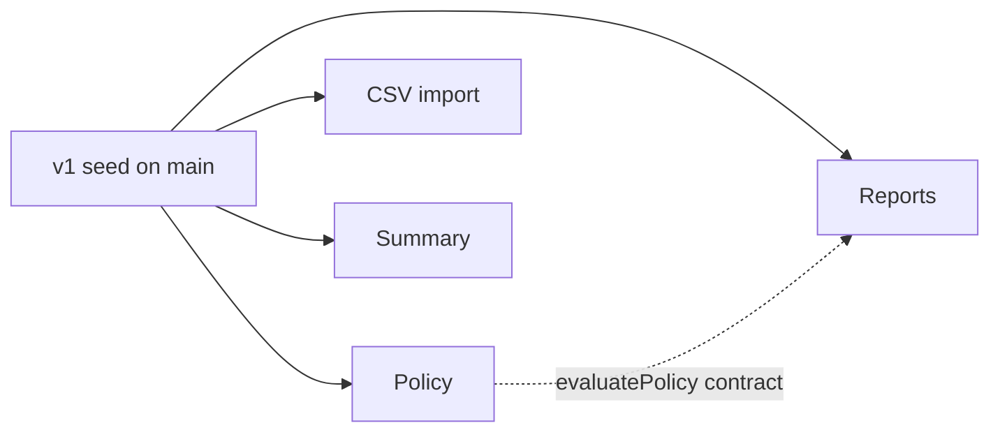

# Orchestrator speed eval: expense claims API — design

Date: 18 October 2026. Status: design for the builder; design calls not yet reviewed by the user.

## How to read this

Every decision carries one label:

- **Decided by the user**: the user's own requirement or rule.
- **Approved in conversation**: proposed to the user, seen and approved.
- **Design call**: made on the user's behalf, not yet reviewed. Treat as a sound default, not as agreed.
- **Left to the builder**: open; choose during the build.

The user's request: "I need you to come up with short eval test project that I can use to evaluate orchestator agents. The idea is to create new session with agent load, give it a design spec and see how long it will take it to implement and how well it will do it. Something that looks like a small app mimicking real work. Should be something that is not going to take too much time for the agent to implement. Maybe 15-30 minutes of work."

Asked what makes one orchestrator better than another: "mainly how fast it has finished the task."

## Intent

Compare orchestrator agents (`orchestrator`, `session-orchestrator`, and later versions of either, defined in `ghcp/agents/`) on one fixed, realistic task. These agents don't write code; they plan, start child sessions (each owning a branch and PR) and sub-agents, track them and report. The eval shows how each agent's planning, parallel work, merge ordering and verification turn into wall-clock time.

- **Decided by the user:** speed is the main score. The task is small: 15–30 minutes of work.
- **Approved in conversation:** quality is a pass/fail gate, not a score. The task is fixed, so runs differ only by agent, and each variant runs several times.

## Goals, non-goals, anti-goals

### Goals

- Wall-clock time per run, comparable across variants and over time. **Decided by the user**
- A pass/fail quality gate from a hidden black-box acceptance suite. **Approved in conversation**
- The same start state, prompt and scoring for every run. **Approved in conversation**
- Little setup per run, so repeated runs are cheap. **Design call**
- A run that works in parallel finishes in about 20 minutes (**Approved in conversation**, estimate); the target range is 15–30 minutes (**Decided by the user**).

### Non-goals

- Grading code style, architecture or cost. **Design call** (follows from "mainly how fast").
- Testing how agents cope with ambiguous or trick requirements. **Approved in conversation** ("no trick requirements").
- Automating the Copilot app itself (adding projects, starting sessions). **Design call** (the approved run steps are manual).
- Benchmarking the child models' coding ability; each agent's own tier table picks those. **Approved in conversation**

### Anti-goals

Things that make the eval fail even if it technically works:

- Hidden tests that check anything the spec doesn't state; the gate would then measure luck. **Approved in conversation**
- The agent under test seeing the hidden suite or the reference implementation. **Approved in conversation**
- Timing dominated by installs, builds or CI rather than orchestration. **Design call**
- Setup per run heavy enough to discourage repeated runs. **Design call**
- An orchestrator run started as a child of another session. The orchestrator always runs as a top-level session. **Decided by the user**

## Constraints

- **Decided by the user:** Node.js with TypeScript run natively by Node (type stripping), the built-in `node:test` runner, no npm dependencies.
- **Design call:** this applies to everything in the kit (seed, reference, suite, scripts). Target Node 24. TypeScript uses erasable syntax only (no enums, namespaces or parameter properties). Relative imports use `.ts` extensions.
- **Approved in conversation:** each run happens in its own private GitHub repo, because the orchestrator's child sessions and PRs need a GitHub-backed project in the Copilot app.
- **Approved in conversation:** only `seed/` content ever goes into a run repo. The hidden suite and the reference implementation stay in the kit.
- **Decided by the user:** commits carry no AI attribution or `Co-authored-by` trailers (the user's standing policy).
- **Approved in conversation:** the new top-level `evals/` folder is added to the "Layout" section of `.github/copilot-instructions.md`.
- **Design call:** the hidden suite and the reference implementation only need to be absent from the run repo, and never mentioned in the kickoff prompt, the spec or the seed. Keeping them away from the agent at the disk level is not required.
- **Design call:** building or validating the kit must not create GitHub repos or other external resources unless the user approves.

## Scoring

**Decided by the user:**

- Speed is the main score.

**Approved in conversation:**

- The score is wall-clock time from sending the kickoff prompt to the orchestrator's final "done" report, minus any time the run was blocked on a question to the user.
- "Done" means all four v2 features merged to main with CI green.
- A hidden acceptance suite, run on main afterwards, is a pass/fail gate, so a fast run that ships broken code doesn't win.
- Runs are hands-off. The kickoff prompt approves the plan and the opening and squash-merging of PRs in advance. If the agent still asks something, the user answers straight away, verbatim, from a short answer sheet.
- Each variant runs two or three times; medians are compared.

**Design call:**

- The gate is 100% of the suite.
- A run ends as `timeout` if it hasn't reported done 90 minutes after the kickoff, or as `stalled` when the orchestrator and all its child sessions have been idle for 15 minutes with the work not done. The evaluator never nudges a run: after the kickoff, the only messages sent are answers from the answer sheet.
- Timed-out, stalled and gate-failed runs are recorded with their outcome and left out of the time comparison. For each variant, report the pass rate and the median time of the passed runs.
- Blocked time: `score` subtracts the duration of every `ask_user` call. For each human message after the kickoff, which in a hands-off run is always an answer to a question asked in plain text, it also subtracts the idle time between the orchestrator's previous turn end and that message. Human messages are `user.message` events with no `data.source`. Events with an `agentId` were written by sub-agents and are ignored when finding the orchestrator's final report.
- Secondary columns: number of questions asked, PRs merged, main's CI state.

## The eval project: expense claims API

**Approved in conversation:** each run starts from a small, working v1 service already on main: TypeScript run by Node 24, no dependencies, about 25 tests and CI, with expenses CRUD and validation, a JSON error format, a fixed FX table and an in-memory store. Starting from existing code keeps runs short and makes the agent follow the conventions already in place, as in real work.

### v1 seed

**Design call** (a sketch the builder may refine):

- Expense fields: `id` (server-generated), `date` (YYYY-MM-DD), `merchant` (non-empty), `category` (`meals` | `travel` | `lodging` | `other`), `amount` (positive integer, minor units), `currency` (`GBP` | `EUR` | `USD`), `description` (optional), `receipt` (boolean, default false).
- Endpoints: `GET /health`; `POST /expenses`; `GET /expenses` with `category`, `from` and `to` filters; `GET /expenses/:id`; `PATCH /expenses/:id`; `DELETE /expenses/:id`.
- Error format: `{ "error": { "code", "message", "details": [{ "field", "message" }] } }`.
- Layout: `src/server.ts` (entry point; reads `PORT`), `src/routes.ts` (the single route table every feature edits), `src/router.ts`, `src/http.ts` (body parsing, error helpers), `src/store.ts`, `src/money.ts`, `src/expenses.ts`; tests in `test/`.
- `src/money.ts` exports `convert(amountMinor, from, to)` with fixed integer rates (GBP per unit × 10 000: GBP 10000, EUR 8500, USD 8000) and round-half-up to minor units. Policy and Summary must both use it, so there is one conversion rule.
- `README.md` with an endpoint table and the conventions: where routes go, the error format, money in minor units, how to run tests.
- `.github/workflows/ci.yml` runs `npm test` on Node 24 for pushes and PRs.
- `docs/spec-v2.md` holds the v2 spec (the task).

### v2 spec (the task)

**Approved in conversation:**

| Unit | Scope |
|---|---|
| Policy | `POST /policy/check`: receipt required over £25, £50 daily cap on meals, weekend warning |
| Reports | draft → submitted → approved or rejected. Submit is refused if the policy check finds errors; expenses in a submitted report are locked. |
| CSV import | `POST /expenses/import`: columns read from the header row, quoted fields supported, valid rows created, bad rows reported by line number |
| Summary | `GET /summary?month=&currency=`: totals per category, converted and rounded by a fixed rule |

- Reports depends on Policy, but the spec fixes the `evaluatePolicy` signature, so a strong orchestrator can build both at once instead of stacking them. The other units are independent; running them in parallel is the main time saving.
- All four units add routes to `src/routes.ts` and rows to the README, so parallel PRs hit real merge conflicts and merges must be ordered.
- No trick requirements. The hidden suite has about 50 black-box HTTP tests, including v1 regressions, and checks whether the spec was built correctly.



### v2 behaviour

**Design call** (a sketch; the builder makes it exact in `spec-v2.md`):

- **Policy:** `evaluatePolicy(expenses)` in `src/policy.ts` returns violations `{ code, severity: "error" | "warning", expenseIds, message }` in a fixed order. Rules use GBP equivalents from `convert()`:
  - `RECEIPT_REQUIRED` (error): an expense over £25.00 without a receipt.
  - `MEALS_DAILY_CAP` (error): one per date where meals total over £50.00.
  - `WEEKEND` (warning): a Saturday or Sunday date.
  - `POST /policy/check` takes `{ expenseIds }` and returns `{ violations }`.
- **Reports:** `POST /reports` with a title; `GET /reports/:id`; attach and detach expenses while the report is a draft (an expense can be in at most one report); submit (an empty report is refused; error violations are refused, with the violations in the error details); approve; reject with a required reason. Invalid transitions return 409. `PATCH` or `DELETE` of an expense in a submitted or approved report returns 409. Rejected is final and unlocks its expenses.
- **CSV import:** `text/csv` body. Required columns `date`, `merchant`, `category`, `amount`, `currency`; optional `description`, `receipt`; any column order; unknown columns ignored. A missing required column fails the whole file with 400. `amount` is a decimal string with at most two decimals. RFC 4180 quoting (commas, doubled quotes and line breaks inside quotes). Valid rows are created even when others fail; the response lists created ids and each bad row's errors with its line number in the file.
- **Summary:** `month` (YYYY-MM) and `currency` are required. Convert each expense with `convert()`, then sum. All four categories are always present, and a count is included.
- Every boundary (for example exactly £25.00) is stated in the spec and tested.

### Sizing

- **Approved in conversation:** about 20 minutes for a run that works in parallel, over 40 for a serial one (estimates). If the first real runs are slower than that, drop Summary.
- **Design call:** calibration rule. The first run of each variant forms the calibration batch. If the median of that batch, across all variants, is 30 minutes or less, those runs count as scored runs. If it is over 30 minutes, Summary is dropped once, before any scored run: those calibration rows stay in `results.csv` marked as calibration, and every variant's scored runs use the three-feature spec. Each `results.csv` row records its feature set, and runs are compared only within one feature set. To drop Summary, remove its section from the spec and run the suite without its tests. The kickoff prompt names no features, so it stays the same. The suite must therefore be runnable per feature.

## Running it

### Kit location and layout

**Approved in conversation:** the kit lives at `evals/orchestrator/expense-claims/` in this repo. It holds the seed app, the spec, the kickoff prompt, an answer sheet, the hidden acceptance suite, a reference v2 implementation (only to prove the suite is correct and passable) and two scripts. `evals/` is added to the layout in `.github/copilot-instructions.md`.

**Design call:** layout:

```text
evals/orchestrator/expense-claims/
  README.md      runbook
  kickoff.md     exact kickoff prompt
  answers.md     answer sheet
  results.csv    one row per run
  seed/          v1 app, including docs/spec-v2.md and CI
  reference/     full v2 implementation, for validation only
  acceptance/    hidden black-box suite
  scripts/       new-run and score
```

**Design call:** this design document is committed at `docs/superpowers/specs/2026-10-18-orchestrator-eval-design.md` in the kit's PR, next to the existing specs.

### `new-run`

- **Approved in conversation:** creates a private repo from the seed, such as `ncksol/orch-eval-session-orchestrator-2`, and clones it. Branches, PRs and repo memories don't carry over between runs, and the hidden tests are never in the run repo.
- **Design call:** before creating the repo, `new-run` checks that the active `gh` account is the repo owner (several accounts are logged in on this machine), and fails if it isn't.
- **Design call:** name pattern `orch-eval-<variant>-<n>`. The repo gets a fresh history with one "Seed v1" commit on main. The script prints the next steps. `--dry-run` builds the repo locally without touching GitHub.

### Steps per run

**Approved in conversation**; numbering and details are a **Design call**:

1. Run `new-run`.
2. Add the clone as a project in the Copilot app.
3. Start a new top-level session in that project with the agent under test, using the held-constant model and effort.
4. Paste `kickoff.md` into the composer as typed text.
5. Answer any question straight away, verbatim, from `answers.md`. Send nothing else.
6. After the final report, run `score` before sending anything else to the session.

**Design call:** run repos are kept until the user deletes them. Deleting needs a token with the `delete_repo` scope, or the GitHub web UI (see Risks).

### Kickoff prompt

- **Approved in conversation:** the same for every variant and every feature set. It approves the plan and the opening, marking ready and squash-merging of PRs once CI is green, in advance. It defines "done" as every feature in the spec merged to main through PRs, with CI on main green, followed by a final report. The agent works unattended.
- **Decided by the user:** the kickoff is a short typed query that points at `docs/spec-v2.md` in the run repo and doesn't include the spec. A long paste becomes an attached file in the Copilot app, and an orchestrator that can't read files would have to start a child session to read it. The kickoff stays a few lines, well under 1,000 characters, so it goes in as typed text.
- **Decided by the user:** the kit expects orchestrator agents that can read files. An agent that can't has to delegate the read, and that time counts in its score.
- **Design call:** it says nothing about how to split the work or which models to use, and nothing about the hidden suite, the reference or the kit. It names no feature and gives no feature count, so it fits a spec without Summary.

### Answer sheet

**Design call:** fixed replies:

| Question type | Reply |
|---|---|
| Plan approval | "Approved. Go ahead." |
| Opening, publishing or merging a PR | "Approved. Squash-merge when CI is green." |
| A question about the spec | "Follow docs/spec-v2.md. Where it is silent, make a reasonable call and note it in the PR description." |
| Anything else | "Your call. Don't wait for me." |

### `score`

- **Approved in conversation:** runs the hidden suite against the run repo's main. Reads the orchestrator session's local event log for the time from kickoff to final report, minus time blocked on questions to the user, and counts those questions. Appends one row per run to `results.csv`, so medians come straight from it.
- **Design call:** blocked time follows the rule in Scoring: every `ask_user` duration, plus the idle gap before each human message that answers a plain-text question. Human messages are `user.message` events with no `data.source`; events with an `agentId` are ignored when finding the final report.
- **Design call:** tests a fresh clone of main, not the local checkout. Also records the run's outcome and feature set, and records the number of merged PRs and main's CI state using `gh`. Prints the median per variant. `results.csv` is committed so history across agent versions is kept.

### Held constant

- **Approved in conversation:** the orchestrator session's model and effort, for example Claude Opus 5.5 at max. Child and sub-agent models come from each agent's own tier table, because that is part of what is tested.
- **Design call:** each row also records the Copilot app or CLI version.

### Memory hygiene

**Approved in conversation:** user-level memories saved during a run carry into later runs, so the runbook says to check for eval-related memories after each run and remove them. Repo memories don't carry over, because every run uses a new repo.

## Left to the builder

- Exact field names, error codes, status codes, response shapes and rule boundaries, as long as `spec-v2.md` states them and the suite tests them.
- How to parse the event log, and how the user finds the session id. "Facts checked" below gives the fields observed.
- Script language and flags, the suite runner and its output, the reference implementation's structure, and the wording of the spec, kickoff prompt and runbook.

## Kit acceptance checks

**Design call**, except where marked:

- `npm test` passes for the seed and for the reference on the local Node.
- The suite passes 100% on the reference. On the seed, the v1 regression tests pass and every v2 test fails.
- Every suite assertion maps to a statement in `spec-v2.md` or the seed README.
- `new-run --dry-run` produces a repo with only seed content: no acceptance, reference or results files.
- The kickoff is at most 800 characters, points at `docs/spec-v2.md`, shares no run of eight words with the spec, names no feature, gives no feature count, and mentions nothing about the hidden suite, the reference, scoring or the kit. It passes these checks against the full spec and against the spec without Summary, and `new-run` copies it unchanged for every feature set.
- `score` works against a local reference checkout and computes timing from a real session event log.
- No GitHub repo is created during the build without the user's approval.
- Calibrating the timing needs real runs, which the user starts as top-level sessions (**Decided by the user**: top-level only). The builder can't do this step.

## Risks

- Agent runs vary a lot. Three runs per variant may still be noisy.
- Copilot's local event-log format is internal and may change. `score` should fail clearly when it can't parse the log, and the runbook should give a manual timing fallback. (**Design call**)
- An agent that searched the disk could find the kit in the local ai_tools checkout.
- Merge conflicts in `routes.ts` and the README may cost more time than expected. The first runs calibrate this.
- GitHub Actions queue time adds noise to merges that wait for CI.
- Questions asked in plain text instead of through `ask_user` leave no `ask_user` pair in the log. `score` handles them with the gap rule in Scoring; the rule depends on the event-log format staying as observed.
- Sub-agent events are written into the orchestrator's own `events.jsonl`, tagged with `agentId`. A parser that doesn't filter on `agentId` would pick up a sub-agent's messages or tool calls as the orchestrator's, and could take the wrong "final report".
- The active `gh` token has `repo` but not `delete_repo`. Creating run repos works. Deleting old run repos needs a token with `delete_repo`. The active login comes from the `GH_TOKEN` environment variable, so `gh auth refresh` won't add the scope; a new token is needed. Run repos pile up until then.

## Facts checked

Checked on 18 October 2026 on the user's Mac, in worktree `ncksol-literate-dollop` of `ncksol/ai_tools` at commit `1329f0b` (same as `origin/main`).

1. **Node:** `node --version` gives v24.19.0. A trivial `a.test.ts` with a type annotation and `node:test`, run with `node --test` and no flags in a temp folder, passed (1 test, 0 failures) and printed no warning. The temp folder was deleted. Node 24 meets the target; no conflict with the design.
2. **Event log:** the session folder holds `events.jsonl` (plus `session.db`, `workspace.yaml`, `checkpoints/`, `files/`, `research/`). Each line is a JSON event with `type`, `timestamp` (ISO 8601 UTC), `id`, `parentId`, and for most types `agentId` (absent for the session's own events, set for a sub-agent's). Events that matter for timing:
   - `session.start`: `sessionId`, `startTime`, `copilotVersion` (1.0.99-2 here), `selectedModel`, `reasoningEffort`. Useful for checking the held-constant model and recording the version.
   - `user.message`: `data.source` tells senders apart. In this session and a survey of 400 recent local sessions (field values only), it is absent for messages typed by the human, `system` for system notifications, `agent-<uuid>`, `agent-workspace-<uuid>` or `agent-chat-<uuid>` for messages from other sessions or agents, `skill-<name>` for skill-injected text, and `autopilot`. `data.delivery` is `idle`, `queued` or `steering`. There is also a separate `system.notification` event type.
   - `assistant.message`, `assistant.turn_start`, `assistant.turn_end`: timestamped per turn.
   - `tool.execution_start` (`toolName`, `toolCallId`) and `tool.execution_complete` (`toolCallId`, `success`). An `ask_user` call shows both: start when the question is asked, complete when the answer arrives. All 285 `ask_user` starts in the survey had a matching complete. The difference is the blocked time.
   - A workable mapping, for the builder to confirm: start = first top-level `user.message` with no `source`; end = last top-level `assistant.message` before `score` runs; blocked = sum of top-level `ask_user` complete minus start, matched by `toolCallId`. No message contents were copied.
3. **GitHub CLI:** logged in. The active account is `ncksol` (token from `GH_TOKEN`), with `repo` and `workflow` scopes but not `delete_repo`. No token was printed or recorded.
4. **Repo conventions:** `docs/superpowers/specs/` exists and has `2026-10-15-swarm-dashboard-design.md`. `.github/copilot-instructions.md` "Layout" lists only `ghcp/skills`, `ghcp/agents`, `ghcp/plugins` and the marketplace manifest, so `evals/` needs a new entry there. "Working in this repo" requires tests only for plugins under `ghcp/plugins/`; it says nothing about `evals/`, so the kit's own checks (above) should be added to that section too. That is a **Design call**.
