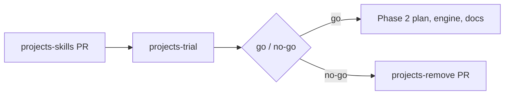

# Wintermute in Copilot app Projects: design

Date: 19 November 2026. Status: draft for the user's approval. Scope: the `wintermute` plugin in `ncksol/ai_tools` (`ghcp/plugins/wintermute/`), version 1.2.6 at `origin/main` commit `7e7ded4`, and GitHub Copilot app 1.4.3 Projects (public preview). Paths are relative to `ghcp/plugins/wintermute/` unless they start with `docs/`, `.github/` or `~`. Line numbers refer to commit `7e7ded4`.

## How to read this

- Section 7 holds the user's decisions. They are fixed.
- Choices made on the user's behalf are marked **(designer's call)**, each with its reason. None is approved yet. Section 8.14 lists them all.
- Section 9 lists what is left to the builder, and section 10 the unknowns.
- "Inference" marks a claim that was not checked directly.

Evidence notation:

| Tag | Source |
|---|---|
| [WN §n] | `wintermute-now.md`, section n: the state of the plugin on 19 November 2026 (at `4229137`, 1.2.5). Commit `7e7ded4` (#135) changed only the canvas extension's SDK import, its validator check and the version, so the agent and engine findings still hold. |
| [PR §n], [PR Un] | `projects-recheck.md`, section n or unknown Un: the Projects contract in app 1.4.3, with evidence from seven real Projects, including "Wintermute benchmarking" and "Wintermute System One". |
| [PC §n] | `projects-contract.md`: the earlier contract study, app 1.1.33. Background only. |
| core:n, peon:n | Line n of `com.github.copilot/agents/wintermute-core.agent.md` or `wintermute-peon.agent.md`. |
| [K1]–[K6] | Checks made for this document, listed below. |

The three research files are in the orchestrator's session files folder, `/Users/nicksologoub/.copilot/session-state/e0c34f1a-6bb3-4fb1-82c0-1978a6b221f8/files/`, on the user's machine.

Checks made for this document (all read-only, or in a scratch copy outside the repository):

- **K1.** The app binary has the string "Clear is not available for Projects. Use /compact to reduce context instead." (`strings` on `/Applications/GitHub.app/Contents/MacOS/github`). So `/compact` works in a Project.
- **K2.** `node scripts/swarm-snapshot.mjs --swarm <id> --no-pr-lookup` reads a Project swarm that has children: "Wintermute System One" gives each child's model, effort and cost, its 13 root sub-agents, and a total of $32.28. The same command on the wintermute-core swarm "Dashboard stuck on blocked status" (one owner unit, a reviewer, two judges and a claims checker) gives $32.08. Small wintermute-core swarms in this repository cost about $5 to $32.
- **K3.** A prototype of the validator in section 8.7, run in a scratch copy of the plugin at `7e7ded4`: it takes a 14-line tier table and a 10-line "Never use these:" list from `wintermute-core`, finds the three names they refer to ("Follow-up jobs", "Evidence and review" and "Security review"), reports an edited row as drift at the right line, and the full suite passes (1,161 tests).
- **K4.** `ncksol/ai_tools` has no CI: `.github/` holds only `copilot-instructions.md` and `plugin/`. A claims check here rests on test runs at the pushed commit.
- **K5.** A plugin skill load is logged as a `skill.invoked` event with `name`, `pluginName` and `trigger` (System One's log, line 57). Children's reports are `send_session_message` calls with `purpose` and `assignment_id` in their arguments. A prototype of the trial's measurement script read these from the real logs of System One and of "Dashboard stuck on blocked status".
- **K6.** The coordinator and worker skill texts in the plan were written in full and checked in the same scratch copy: with the copied table and list, the coordinator skill is about 31 KB and the worker skill about 9 KB.

## 1. Intent

The user's words:

- 29 October 2026: "Projects seems to be a new way how to use this app. I feel like it specifically fits into our idea of agentic swarm work. So I was wondering if I can take what I can from our wintermute plugin and enhance Projects with it, while keeping the UI/UX from the new Projects feature."
- 19 November 2026: "Wintermute plugin had some substantial changes since this research was done and plan written. Lots of things are not relevant any more. Lets reanalyse the state of Wintermute plugin and rewrite the plan for Projects integration"
- On the approach: "lets go with Copy. especially since I am not sure if Projects even a good place for Wintermute so we might abandon this after a few checks"

A Project is already a durable coordinator. It creates child sessions, follows them in its Overview, collects their output in its Inbox and Library, and runs its own schedules [PR §1]. What it lacks is wintermute's discipline: work split into units, a model and an effort chosen for every job, an independent review from another vendor's model and a claims check before every merge, and a limit on repair cycles (core:137-181, core:316-362).

A Project can't run `wintermute-core` as its agent: the app blocks custom agents in a Project and in its child sessions [PR §1, U1]. It does load plugin skills [PR §1; WN §1.2]. So the discipline comes in as two skills, and the Project stays the face of the work.

The user doubts that a Project is the right place for wintermute. So the work starts with a cheap evaluation that ends in a clear go or no-go decision. Only a "go" leads to engine and dashboard work. A "no-go" removes everything in one PR.

## 2. Goals

1. Find out cheaply whether a Project is a good place to run wintermute, and give the user a go/no-go decision with measured evidence.
2. A Project that the user opts in runs work with wintermute's discipline: units, a model and effort for every job, an independent cross-vendor review and a claims check before every merge, and at most two repair cycles.
3. The Project's own UI keeps working as designed. Its Overview, Inbox, Library and Automations get what they expect: typed reports, assignment IDs, short handoffs, and deliverables published by the session that made them.
4. The skill's model tier table and "Never use these" list stay identical to `wintermute-core`'s, and a validator enforces it.
5. Opt-in per Project.
6. If the answer is no-go, one PR removes everything.
7. If the answer is go, the dashboard later reads Project swarms: cost, sub-agents and the model of each child.

## 3. Non-goals

- Changing `wintermute-core` or `wintermute-peon` (decision 5).
- Replacing the Project's built-in coordinator prompt or any part of its UI.
- Hard tool limits in a Project. A skill can't remove tools [PR §1].
- Engine, server or UI changes before the go/no-go gate.
- PR monitoring of any kind. Wintermute stopped all PR watching in 0.5.0 (core:368, peon:27).
- Event subscriptions (`manage_event_subscriptions`): live enablement is not proven [PR §1].
- Dashboard controls. The dashboard stays watch-only.
- A hook or a global instruction that loads the skill (decision 4).
- Chat children (`session_kind: "chat"`) as a delegation type. The worker skill still works in one, because its scope check accepts the chat child's marker.
- Swarms across several Projects, or `create_persistent_project`.
- Any change to the eval kit, or running Projects through the overnight eval runner.
- Validating `wintermute-pr-commands` in `npm run validate`, or a test that guards the core and peon report blocks. Both are real gaps [WN §1.1, §1.2], but they are not part of this work. Section 8.9 uses them as the trial's tasks.

## 4. Anti-goals

The design fails, even if it technically works, when:

- a Project or an ordinary session gets wintermute's rules without the user asking for them;
- the Project's Overview or Inbox gets worse: reports the app can't route, long handoffs that flood the coordinator, deliverables that never reach the Inbox, or unchecked work that does;
- the copied tier table or "Never use these" list drifts from `wintermute-core` and nobody notices;
- a child loads the coordinator skill and starts to coordinate;
- work done before the gate touches an agent, or can't be removed in one PR;
- engine or dashboard work is done before anyone knows whether Projects fit;
- the evaluation ends with numbers that nobody can turn into a decision.

## 5. Constraints

### App (Copilot app 1.4.3, public preview)

- **C1. No custom agents in a Project's lineage.** The selection handler, the child-creation helper and the runtime all reject or drop a custom agent for a Project and its children. This is a strong static gate, not a tested call [PR §1, U1].
- **C2. Children can't create app sessions.** The `<copilot_project_child_session>` block bars creating or forking sessions, opening PR or issue sessions, and automations that spawn sessions. It allows reports, inspection, scheduling the same session and native sub-agents [PR §1].
- **C3. A broad tool set with no allowlist.** A Project has shell, file edits, `sql`, `skill`, `task`, `write_agent`, `create_session`, `get_session`, `send_session_message`, `relay_session_input`, `answer_session_input`, `respond_to_session_plan_v2`, `archive_session`, `update_project_memory`, `publish_chat_update`, `save_session_automation`, `open_canvas` and `ask_user`. It has no `create_pull_request` [WN §2.3; PR §1].
- **C4. No checkout.** A Project runs in a folder under `~/.copilot/chats/` and adds repositories through its repository setup. Repository work goes to children [WN §3.1; PR §1].
- **C5. Typed reports.** `progress` stays in the child's thread and never reaches the coordinator. `handoff` is saved as a ready result and delivered together with nearby results; it doesn't settle the assignment, and a material change needs another handoff. `needs_input` and `error` are delivered at once, at the next turn boundary. The app asks for one-sentence handoffs [PR §1; PC §3].
- **C6. Assignments.** Assignment IDs are `assignment:<coordinator>:<tool call id>`. New work, a revision or a rerun is a new assignment and omits `assignment_id`; context about current work passes it; a report copies it [PR §1].
- **C7. Forwarding.** The user's words go to a child through `source_user_message` (`id` and `revision` of the current direct message), and the app quotes them word for word. `message` and `coordinator_instructions` hold only the coordinator's own words. A stale or unavailable source fails; it can't be rebuilt from history after a restart [PR §1].
- **C8. Publishing.** `publish_chat_update` takes at most six attachments and is presentation only. A child publishes its review-ready output in its own thread first. A coordinator publishes non-PR output per producing child with `agent_session_id`, and pull requests together, with `source_session_id` on each attachment [PR §1].
- **C9. Project memory.** At most 8,192 UTF-8 bytes of preferences. `update_project_memory` replaces the whole profile. Memory is labelled data, not authority. It stays in the Project's context after compactions, and children don't get it [PR §1].
- **C10. Skills.** Plugin skills load in a Project with no custom agent (`investigate` from the `clio` plugin in System One). A plugin's top-level `skills/` folder loads from the installed plugin, and `wintermute-pr-commands` is listed in a Project and in a Project's chat child [WN §1.2; PR U2].
- **C11. Scope markers.** A Project's context has `<copilot_persistent_agent>` and `<copilot_agent_coordinator>`. Both repository and chat children have `<copilot_project_child_session>`. Repository children also have `<copilot_coordinated_child>`; chat children don't [PR U6; WN §2.3].
- **C12. Hooks.** A `sessionStart` hook has no Project flag and doesn't run after every compaction [PR §1].
- **C13. Canvases.** A Project has called `open_canvas` [PR U3].
- **C14. Shell in autopilot children.** One older Project child had every shell command denied; System One's autopilot child ran 143 shell commands. Whether builds and tests run without a prompt is not proven [PR U10].
- **C15. Project rows.** A Project is a `persistent_projects` row and a `sessions` row with `session_type = 'agent'` and an empty `agent` [PR §1].
- **C16. Results.** Ready results reach the coordinator as `user.message` events with `source: agent-coordinator-results`, without a `<cross_session_message>` envelope. When a child stops without a handoff, the app sends "The session finished without sending a handoff. Use get_session if you need its result." [WN §2.2; PC §3].
- **C17. Roster.** The app's prompt asks a Project for one sentence ending in a colon before `create_session`, and one short paragraph without bullets after it [PR §1].
- **C18. Relays.** `relay_session_input` shows a child's pending question to the user and waits like `ask_user`. The result `outcome: "answered_here"` means the answer already reached the child [PR U8].
- **C19. Compaction.** `/compact` works in a Project [K1]. Project memory survives a compaction; a loaded skill's text is not shown to survive [PR U5].
- **C20. Prompt cache.** A coordinator turn after more than five minutes of idle time writes its whole context to the cache again. For a large Opus context this costs about $2 per turn (session log `8a7ef112…/events.jsonl:52619`, `cacheTtlSeconds: 300`). Fewer coordinator wakes cost less.

### Plugin (1.2.6)

- **C21. Two agents.** `wintermute-core` and `wintermute-peon` (`scripts/lib/validate-package.mjs:6`). Their rules assume agent mechanics: a `tools` allowlist, `kickoff.agent: "wintermute:wintermute-peon"`, full Summary, Evidence and Blockers fields on every report, `blocked` sent with `purpose: "needs_input"`, go-ahead requests as `needs_input`, and progress replies to status checks [WN §4] (core:85, core:96, peon:82).
- **C22. The model policy.** The tier table is core:143-156 and the "Never use these:" list is core:172-181, both in "Models and effort". The table refers to "Follow-up jobs", "Evidence and review" and "Security review"; the list refers to "Evidence and review" [K3].
- **C23. `wintermute-peon` can't be a sub-agent.** It sets `disable-model-invocation: true` (peon:6), which blocks `task` launches.
- **C24. Skills.** `skills/wintermute-pr-commands/` is the plugin's only skill. `npm run validate` checks no skill [WN §1.2, §1.4].
- **C25. Engine on Projects today.** A Project with children is a swarm root; a Project with no child is never one, because its `agent` is empty (`engine/model/forest.mjs:115-139`). `run.project` is null for Project swarms (`engine/model/swarm.mjs:814`). Ready-result notifications are not parsed (`engine/model/messages.mjs:73`). Every automation shows as a PR monitor (`engine/model/messages.mjs:69-70, 120`). `relay_session_input` is not a wait (`engine/model/session-state.mjs:34`). A missing app table warns (`engine/readers/app-db.mjs:50`) [WN §1.3, §2].
- **C26. The snapshot as a measuring tool.** Without engine changes, the snapshot already reads a Project swarm that has children: cost, each child's model and effort, and root sub-agents [K2].

### Repository

- **C27. Versions.** Every change under the plugin runs `npm run release:bump -- <version|patch|minor|major>` and replaces the new CHANGELOG section's TODO: major for incompatible changes to agent IDs, invocation, the canvas ID or the report and dashboard contracts, minor for compatible features, patch for compatible fixes (`CHANGELOG.md:5`). In practice every PR bumps [WN §1.5].
- **C28. Skill rules.** Skill names stay namespaced to the plugin; no copy goes into `ghcp/skills/`; every `SKILL.md` has `name` and `description` frontmatter, an Operating mode section, an Output format, and the rules against invented results (`.github/copilot-instructions.md`).
- **C29. Node 18.** Shipped code uses no API newer than Node 18, and tests use no `t.after` or `t.before` (`tests/guards.test.mjs:48-64`). The plugin has no npm dependencies.
- **C30. The dashboard's cockpit view is an Easter egg.** User-facing text (README, QUICKSTART, DASHBOARD.md, skill and plugin descriptions, CHANGELOG) never mentions it.
- **C31. No CI** [K4].
- **C32. Agent frontmatter parser.** `parseAgentFrontmatter` (`scripts/lib/validate-package.mjs`) accepts only one-line values, so a skill it checks needs a one-line `description`.

## 6. Approaches considered

All three put the Project rules in two skills. They differ in how the coordinator skill gets wintermute's model policy and review rules.

| | Copy (chosen) | Shared policy file | Read at load |
|---|---|---|---|
| How | The skill copies the model tier table and the "Never use these" list word for word, and a validator test fails if they drift from `wintermute-core`. The review and gate rules are written fresh for Projects. | Move the policy into one file that both `wintermute-core` and the skill load. | At every load, the skill reads "Models and effort" and "Evidence and review" from the installed `wintermute-core.agent.md`, through a table that adapts agent mechanics to Projects. |
| Gain | No file read at run time and no adaptation table. The Project text is easy to rewrite or to delete. `wintermute-core` doesn't change. | One source for all shared policy. | No copy at all. |
| Cost | The review rules exist twice and can differ in substance; only the table and the list are guarded. A tier change touches two files, which the validator forces. | It changes the core agent, against decision 5. | The two sections are about 22.8 KB, full of agent mechanics, so the adaptation table is large. `wintermute-core` changes in almost every release, so the adaptation breaks often [WN §1.5, §3.2]. |

The user chose Copy on 19 November 2026 and rejected the other two for the reasons in their Cost rows.

## 7. The user's decisions

1. The Project stays the coordinator and the face of the work. Its Overview, Inbox, Library and Automations stay as they are. Wintermute's rules follow the Project's conventions wherever they feed that UI: assignment IDs, typed `purpose` reports, short handoffs, and publishing deliverables to the Inbox.
2. Wintermute adds its discipline through a coordinator skill that the Project loads: units, a model and effort per child, an independent review from another vendor's model and a claims check before every merge, and repair-cycle limits. Children get a worker skill, because custom agents are blocked in a Project's lineage.
3. The dashboard should eventually read Project swarms: cost, sub-agents, the model per child.
4. Opt-in per Project, through the skill or a line in Project memory, not a global hook.
5. Agents unchanged: `wintermute-core` and `wintermute-peon` stay as they are, for top-level sessions and the evals.
6. Approach Copy (section 6).

## 8. Design

### 8.1 Phases and the gate

**The work runs in phases around one gate (designer's call).** Reason: the user may abandon Projects, so nothing that only matters for a long-term integration is built before the user has evidence.

- **Phase 1, evaluate.** One PR, `projects-skills`, ships the two skills, written minimally, and the validator guard, behind the opt-in. Then `projects-trial` runs one small real task in a scratch Project, the same task with `wintermute-core` in an ordinary session as a baseline, and measures both.
- **The gate.** The user decides go or no-go from the findings, using the criteria in 8.10.
- **Phase 2a, go.** A plan for the engine and dashboard work in 8.11 is written from this design and the trial's findings, and then built.
- **Phase 2b, no-go.** One PR, `projects-remove`, removes everything Phase 1 added (8.12).

**No bug fix moves before the gate (designer's call).** The one candidate is the engine's habit of calling every automation a PR monitor (C25). It is a plain bug with some value outside Projects, but wintermute's agents create no automations, so outside Projects it rarely shows, and it changes none of the gate's evidence. It goes into Phase 2a.

### 8.2 The pieces (Phase 1)

| Piece | Path | What it does |
|---|---|---|
| Coordinator skill `wintermute-project` | `skills/wintermute-project/SKILL.md` | The Project loads it. It adds wintermute's planning, delegation, model policy, review, gate and reporting rules to the Project's built-in coordinator. |
| Worker skill `wintermute-project-worker` | `skills/wintermute-project-worker/SKILL.md` | Each child loads it on its kickoff's instruction. It holds the child's rules for assignments, gates, reports and publishing. |
| Skill validator | `scripts/lib/validate-skills.mjs`, called from `scripts/validate-plugin.mjs`; tests in `tests/validate-skills.test.mjs` | Checks both skills, and the copy of the model policy. |
| Docs | `README.md`, `CHANGELOG.md`, `.github/copilot-instructions.md` | An experimental section, release notes and the copy rule for contributors. |

- **Skill names (designer's call):** `wintermute-project` and `wintermute-project-worker`. Reason: namespaced to the plugin (C28), short to type, and they say they are for Projects.
- **Location:** the top-level `skills/` folder, where `wintermute-pr-commands` already loads (C10). This is settled by evidence.
- **Size (designer's call):** written minimally, as rules a Project's coordinator needs and nothing for later phases. Reason: Phase 1 exists to judge fit. The full texts in the plan are about 31 KB and 9 KB [K6], against about 69 KB for `wintermute-core`.

### 8.3 Turning it on, recovery and turning it off

**Opt-in (decision 4).** The user types `/wintermute-project` with the request in a Project's conversation, or has this line in the Project's memory:

> Wintermute: this Project follows the `wintermute-project` skill. If that skill's rules aren't in your context, load it before you do anything else.

- **The skill's description is narrow (designer's call).** It says to load the skill only on `/wintermute-project` in a Project, or when the Project's memory says so, and names no general triggers such as "swarm". Reason: anti-goal 1. The scope check (8.4.1) is the real guard, because description matching is not a hard boundary.
- **Neither skill sets `disable-model-invocation` (designer's call).** Reason: the model must load the coordinator skill from the memory line after a compaction, and each child loads the worker skill on its kickoff's instruction. Both are model invocations, which the field would block.
- **The coordinator saves the memory line (designer's call).** When the user invokes the skill and the memory lacks the line, the coordinator adds it with `update_project_memory`, saving the whole current memory text unchanged with the line added, within 8,192 bytes (C9). It tells the user in one line what it saved and how to remove it. Reason: invoking the skill is the user's opt-in for this Project, and memory stays in the Project's context after a compaction.

**Every load, including after a compaction or a resume (designer's call),** the coordinator:

1. starts its reply with the line `wintermute-project rules loaded.`;
2. reads its SQL state (`todos`, `tasks`, `children`, `child_notes`);
3. calls `get_session` for every child that `child_notes` doesn't mark as archived, and reconciles, before it creates a session, sends work or merges.

Reason: the first line makes a reload visible to the user, and steps 2 and 3 are `wintermute-core`'s own recovery rule (core:207).

**Recovery.** Whether the memory line makes a compacted Project load the skill again is unknown (U5). The trial measures it (8.9, 8.10 F6). The documented recovery in Phase 1 is that the user types `/wintermute-project` again. A conditional line in the user's global instructions is not part of Phase 1; Phase 2a may offer it, with the user's consent, if the trial shows that the memory line doesn't work (designer's call). Reason: it is the user's personal file, and the manual path is enough for an evaluation.

**Turning it off.** The user removes the line from the Project's memory and tells the Project to stop. The coordinator stops following the skill and keeps its tables.

### 8.4 Coordinator skill `wintermute-project`

The skill is a prompt to the Project's built-in agent, written fresh for Projects except for the copied table and list. It follows the repository's skill rules (C28): an Operating mode section with the scope check and limits, an Output format, and the rules against invented status, results and sources. The plan holds its full text.

#### 8.4.1 Scope check

- The context has `<copilot_persistent_agent>`: a Project's own conversation. Go on.
- The context has `<copilot_project_child_session>` or `<copilot_coordinated_child>`: a child. Stop, and load `wintermute-project-worker` if the kickoff asked for it.
- Neither: an ordinary session. Stop, and tell the user that `wintermute:wintermute-core` does this job outside a Project.

Reason: C11 gives both markers for repository children and only the first for chat children. This keeps children and ordinary sessions from coordinating (anti-goal 1 and 4).

#### 8.4.2 Limits and quick jobs

A Project keeps all its tools (C3), so the skill states its limits as rules:

- A quick job is about five tool calls or two minutes: reading a file, a log or a Library item; `gh`, `az` or `git` status commands; a simple PR job; one web fetch; a note in its own files folder. Anything bigger is delegated, with what was done so far (core:32-41).
- **The coordinator makes no repository commits (designer's call).** Reason: a Project has no checkout (C4). `wintermute-core`'s own-unit flow and its `own_units` table are not used.
- It never does a review, a claims check, a panel or a second opinion, and never reads in or writes to a child's worktree.
- `az` for Azure DevOps, and `wintermute-pr-commands` loaded once before PR work (core:17-18).
- If the app's `orchestrate` skill is also loaded, this skill wins on delegation, models and reviews (core:20).

#### 8.4.3 Planning

As `wintermute-core`'s "Plan by stage" and "Split work for speed" (core:50-77), written for a Project: research in parallel one-off jobs; one owner child per PR-sized unit, stacked with `base_branch` once the parent has pushed; the six critical-unit triggers, with a one-line reason in `child_notes`; separate hypotheses for investigations; and each unit's review, claims check and the final panel planned up front. Plans that need approval are asked for with `[unit=* need=plan]`.

**Tasks (designer's call).** Each user request that the coordinator plans is a task, recorded in a `tasks` table, and each unit's task is in `child_notes`. Reason: a Project is long-lived and runs many requests, so the final panel, the post-merge claims check and archiving work per task (8.4.9), and the dashboard's `children` table must not change.

#### 8.4.4 Delegation

| Job | Runs as |
|---|---|
| Owner unit: a branch, a PR or follow-ups | A child session (`create_session`, or `open_pr_session` and `open_issue_session`) |
| One-off job that needs a checkout: a review, a claims check, a judge, a verification, a repository command | A child session with `base_branch` set to the pushed branch under test |
| One-off job with no checkout: web research, a Library summary, a plan critique, a second opinion on a document, a fact-check | A `task` sub-agent, `agent_type: "general-purpose"`, with `model` and `reasoning_effort`; `mode: "background"` when it may get a re-check through `write_agent` |
| Quick job | The coordinator |

- **Sub-agents for jobs with no checkout (designer's call).** Reason: they start faster and add no Overview items; the dashboard already shows root sub-agents with their model and cost [K2]; `wintermute-peon` can't be a `task` agent (C23). `write_agent` needs a background sub-agent [PR §2], hence the mode rule.
- **Never set `kickoff.agent` (designer's call).** Reason: custom agents are blocked (C1), and `wintermute-peon`'s report block conflicts with the Project contract (C21). The worker skill replaces it.
- **Kickoff fields (designer's call):** `project_id` of a repository the Project has added; `base_branch` only to a pushed branch; `kickoff.mode` `"autopilot"`, or `"plan"` when the user wants to approve the approach, never unset; `kickoff.model` and `kickoff.reasoning_effort` always; `coordinate_with_creator: true`; `notify_on_idle: "once"`. Reason: these are the values the Project itself used (System One, line 146 [WN §2.2]); `"once"` avoids a coordinator wake each time a child goes idle (C20), and the app's no-handoff notice (C16) covers a child that stops without a report. Unknown U14 checks that this holds after a child's first assignment.
- **Session names (designer's call):** each child's session name starts with its unit label, for example `api: Orders endpoint`. Reason: the user sees the Overview and the dashboard side by side, and one name links them.
- From `wintermute-core` (core:90-103, 121-135): one owner per piece of work; confirm a start with `get_session` or the first report; a failed `create_session` can leave a session behind, so archive it, note it and retry once as a new unit; a child paused on a plan or a question doesn't read messages; helper requests are handled in core's order; the coordinator runs the fan-out of any workflow that launches agents.

#### 8.4.5 Simple PR jobs

As `wintermute-core` (core:111-119): reading PR state and CI, merging after the go-ahead, retargeting, re-queuing builds, reviewers and labels are quick jobs through `gh` or `az`, or a Low-tier one-off when they outgrow the budget. They change only the PR, never the branch, and a merge never deletes the source branch. **On GitHub the coordinator merges with `gh pr merge <number> -R <owner>/<repo> --squash --match-head-commit <sha>` (designer's call).** Reason: the merge must happen only at the commit that passed every check, and `--match-head-commit` makes GitHub refuse it otherwise. `wintermute-pr-commands` has no verified GitHub writes, so this command is untested there and the coordinator says so in its report.

No session watches a PR. One bounded CI wait of about 30 minutes is allowed for a required check (core:368).

#### 8.4.6 Models and effort

- The skill's "Models and effort" section holds **the tier table and the "Never use these:" list, word for word from `wintermute-core`** (decision 6).
- Around them, fresh rules for applying the table in a Project: set the model and effort on every child and every `task` call; newest version of each family, or another family in the same tier; the vendor of each family; a child gets the tier of the work it owns; a follow-up job gets the tier of its own scope; execution at Max only in the Max row's two roles and only with approval; one tier-up rerun of a shallow one-off job, at most to High; a model and effort with a reason in `child_notes`.
- **Cross-references resolve inside the skill (designer's call).** The copied text points to "Evidence and review", "Follow-up jobs" and "Security review" (C22). The skill has a `## Evidence and review` section with bold labels **Follow-up jobs** and **Security review**, and the validator checks that every name the copied text quotes is a heading or a bold label in the skill. Reason: a copy that points to missing text is a silent drift in meaning.

#### 8.4.7 Kickoff prompts and forwarding

Each kickoff prompt:

- starts with ``Load the `wintermute-project-worker` skill now, before anything else, and follow it for this whole session.``;
- quotes the user's request verbatim, then adds only what the child needs to work alone;
- gives the unit label, what the child owns and must leave alone, and keeps decisions apart from suggestions;
- for Mid-tier implementation, includes acceptance tests;
- turns every user memory and Project memory that applies into a requirement;
- for a one-off job: no commits or pushes, whether it is read-only, and the absolute path for its result file;
- tells an owner that the coordinator starts its review and claims check.

Later messages:

- New work, a revision, a rerun or a go-ahead is a new assignment, without `assignment_id`; context about current work carries it (C6).
- **Every new assignment starts the coordinator's text with ``Follow the `wintermute-project-worker` skill; load it again if its rules aren't in your context.`` (designer's call).** Reason: children have no Project memory (C9), so this line is how a compacted child gets its rules back.
- The user's own words go through `source_user_message`; the coordinator's words go in `message` and `coordinator_instructions`, and a summary is never presented as the user's words. If the source is gone, the coordinator asks the user to send the message again (C7).

#### 8.4.8 Reports and gates

| Status line | `purpose` | Reaches the coordinator |
|---|---|---|
| `complete` | `handoff` | As a ready result, with others that arrive close to it (C5) |
| `progress` | `progress` | Never |
| `needs_input` | `needs_input` | At once |
| `blocked` | `error` | At once |

- `blocked → error` replaces the agents' `blocked → needs_input` (decision 1). The engine already maps `error` to `blocked` (`engine/model/contract.mjs:6`).
- **A handoff is two lines (designer's call):** the `swarm-status:` line with `unit=`, and `pr=` and `commit=` when they apply, then `Summary:` with one outcome sentence. Longer results go to a file whose absolute path the sentence gives. `needs_input` and `error` keep all three fields. Reason: the Project asks for one-sentence handoffs (C5), the status line keeps the commit that checks need, and the engine parses a report without `Evidence:` (`engine/model/contract.mjs:34-69`).
- `assignment_id` is an argument of `send_session_message` on every report, never part of the status line. Reason: the dashboard contract stays at version 1.
- **One-off jobs say whether their worktree is clean in the outcome sentence (designer's call).** Reason: archiving needs it, and a handoff has no `Evidence:` field for `git status` output.

**Gates (designer's call).** A unit's work is a chain of assignments, each ending in one handoff:

1. Kickoff: implement, test, push; hand off with `commit=`. When the repository's CI runs only on PRs, the owner also opens a draft PR here.
2. Checks: the coordinator starts the review and the claims check at that commit, and for a task's last unit in a repository, the final panel. Each fix is a new assignment that ends in a handoff with the new commit.
3. Publish: with the review and claims check clean at the same commit, the go-ahead to open the PR ready for review (or take the draft out of draft) goes to the owner as a new assignment, after the user's `need=pr` answer unless the user gave it. The owner publishes the PR to the Inbox and hands off with `pr=`.
4. Merge: with the review, the claims check and, for the last unit, the final panel all clean at the PR's head, the go-ahead to merge (`need=pr` unless given), and the coordinator merges as a simple PR job, then runs the claims check on `main`.

Reasons: the Project's model is "new work is a new assignment" (C6), and a gate result is a ready result, so it fits `handoff`. Children never ask for a go-ahead with `needs_input`, which keeps the immediate channel for real questions and blockers. The merge stays with the coordinator, as in `wintermute-core` (core:113-117).

**Status checks (designer's call).** The coordinator never asks a child for a progress report, because the reply would never arrive (C5). It uses `get_session` and the child's todos. A child that is idle with no handoff since its last assignment gets a message with that `assignment_id` asking for its result as a handoff or its blocker as an error. The app's no-handoff notice (C16) is not a report: the coordinator checks the child with `get_session`.

**Ending work.** Reviewers and claims checkers stay until their unit merges, and judges until the task's last merge, for re-checks (core:320-338). After the post-merge claims check, the task's children are archived once each has no open work, PR or automation and its branch is pushed. A one-off session is archived once its result is recorded and its worktree is clean. `outcome` is set first, and each archive is recorded in `child_notes`.

#### 8.4.9 State and registry

All state is in the Project's own SQL database, through `sql`.

- `todos` and `todo_deps`: the plan.
- `tasks` (8.4.3): `task`, `title`, `request`, `created_at`, `ended_at`.
- `children`: the dashboard contract's registry, with the exact definition from `wintermute-core` (core:216-231) and the same rules. The coordinator takes the PR URL from `get_session` or `gh pr view`, because handoffs have no `Evidence:` field.
- `child_notes`: per unit, its task, kind, model and effort with a reason, **its current `assignment_id` (designer's call)**, working status, last report, and each review verdict and claims check result with its commit. Reason: gates run one at a time, so one current assignment per unit is enough, and a separate assignments table adds nothing.
- Unit labels follow the contract (core:189-192): 1–32 characters from `[A-Za-z0-9._-]`, unique within the Project across all tasks, never reused, compared with `lower(unit)`.
- The `children` definition is written out in the skill and not guarded by the validator (designer's call). Reason: the contract changes only with a new version across the dashboard, which would update the skill too, and the user chose to guard only the model policy.

**Final panel per task and per repository (designer's call).** When one unit of a task is left unmerged in a repository, its branch, rebased onto that repository's `main`, gets the final panel alongside its review. The judges' vendors and the critical levels are counted over that task's units in that repository. Units of other tasks don't wait. Reason: a Project runs many requests, so "the swarm" in core:331-338 has no end for a panel to wait for.

#### 8.4.10 Evidence and review

Written fresh, with the same substance as core:316-362: evidence that the work ran; the claims check before every merge, publish and "done", by a separate claims checker at the claims check row, kept until the unit merges; one regular review per unit from another vendor at the regular review row, with core's vendor pairs; a critical review for critical units; **Security review** routing; the final panel (8.4.9); the disagreement panel; documents drafted and fact-checked by two vendors; must-fix and should-fix findings block, nits never do; **Follow-up jobs** sized by their own scope from the diff; re-checks of the new diff only; at most two repair cycles; a second opinion at Max from another vendor; required reviews stay open until done by someone other than the author.

**Left out of the minimal skill (designer's call):** incident investigators, the unavailable-judge fallback, and the detailed skip rules for claims checks on mechanical follow-ups. Reason: none affects a small trial, and each can be added later from core:316-362 if Phase 2a goes ahead.

#### 8.4.11 Talking to the user and publishing

- Updates lead with what needs the user, and say nothing about idle notices or checks with no news.
- Every `ask_user` question starts with a tag: `[unit=<unit>]`, `[unit=<unit> need=pr]` or `[unit=* need=plan]` (core:382-398).
- **Relays (designer's call).** The coordinator answers a paused child from its own state when it can (`answer_session_input`, or `respond_to_session_plan_v2` never with `autopilot_fleet`). Otherwise it uses `relay_session_input`, with the tag at the start of the context, and doesn't resend after `outcome: "answered_here"` (C18). Reason: the relay keeps the child's exact question in the Project's UI, and the tag keeps the dashboard's unit mapping.
- **Children publish their own review-ready output (designer's call).** A PR is review-ready at the publish gate, after a clean review and claims check; a draft PR opened for CI is not. A document or other output is review-ready when the coordinator says so in an assignment. The coordinator publishes only its own deliverables and presents children's outputs by the app's routing rules (C8). Reason: the Inbox gets checked work only (anti-goal 2), and the app's own instruction to children stays intact.
- The roster follows the app's rules (C17), and adds each new child's model and effort.
- The coordinator opens the dashboard once per task with `open_canvas` (`canvasId: "swarm-dashboard"`, `instanceId: "swarm-dashboard"`, `input: {}`), never waits for it and never retries (core:366; C13).

### 8.5 Worker skill `wintermute-project-worker`

**Scope check.** The skill applies only when the context has `<copilot_project_child_session>` or `<copilot_coordinated_child>` (C11). Otherwise it stops.

**Carried over from `wintermute-peon`** (peon:19-61), written for a Project:

- owner unit or one-off job, as the kickoff says;
- no sessions, no agent CLIs from the shell, no app local API, no assigning work to Copilot, no Copilot code review requests;
- **no sub-agents (designer's call)**: a step that a skill or brief says to give a sub-agent is done by the child itself, and one that needs independence becomes a helper request. Reason: the coordinator keeps the model policy and the fan-out in one place, and cost lands where the dashboard expects it. Children may use sub-agents under the app's rules (C2), so this is a rule, not a limit;
- **no `ask_user` (designer's call)**: questions go to the coordinator as `needs_input`. Reason: every question reaches the user through one place, with its tag;
- no PR opened, published or merged without a go-ahead, which arrives as a new assignment;
- read the PR's state again after a pause, and stop if it merged or closed; pause when the coordinator says it will merge or retarget;
- no PR watching, and one bounded CI wait;
- Copilot Browser and Computer Use, with sign-ins and approvals sent as `needs_input`;
- `az` and `wintermute-pr-commands`;
- after two failed attempts, report `blocked`;
- a reviewer sent a claims job does the review only and says so;
- one-off limits: inside the brief, no commits or pushes, files only where told, read-only when asked; a PR job changes only the PR, at the named commit;
- no invented results, and anything not checked is marked as unverified.

**Replaced by the Project contract:**

| `wintermute-peon` | `wintermute-project-worker` |
|---|---|
| Full report block on every report | Handoff: the status line and one `Summary:` sentence. `needs_input` and `error`: all three fields |
| `blocked` sent with `needs_input` | `blocked` sent with `error` |
| Go-ahead requests as `needs_input` | Hand off at the gate and wait for the next assignment |
| A reply to a status check is `progress` | No status checks; `progress` stays in the child's thread |
| No `assignment_id` | `assignment_id` on every report, from the kickoff context or the message's envelope |
| `git status` output under `Evidence:` | "worktree clean" or not, in the outcome sentence |
| No publishing rule | Publish review-ready output in its own thread, then hand off |

Also: the session name starts with the unit label, and the child keeps its todos current, because the Overview shows them. A material change after a handoff gets another handoff with the same `assignment_id` (C5).

### 8.6 Contract terms in a Project

| Term | In a Project |
|---|---|
| Unit labels | Kept, same rules. |
| `children` table | Kept, same definition, in the Project's SQL database. |
| `swarm-status:` line | Kept on every report. |
| `Summary:`, `Evidence:`, `Blockers:` | Kept on `needs_input` and `error`. A handoff has only `Summary:`. |
| Question tags | Kept on `ask_user`, and at the start of a relay's context. |
| `purpose` for `blocked` | `error` instead of `needs_input`. |
| Progress reports | Stay in the child's thread. |
| Go-ahead requests | Replaced by gates and new assignments. |
| `kickoff.agent` | Not set; the worker skill replaces it. |
| Everything in `message` | The user's words through `source_user_message`; the coordinator's in `message` and `coordinator_instructions`. |
| Deliverables as paths | Children publish review-ready output; long results are files linked from the outcome sentence. |
| Final panel on the swarm's last PR | Per task and per repository. |
| `own_units` | Not used. |
| The `tools` allowlist | Replaced by rules. |

### 8.7 Validator guard (Phase 1)

A new module, `scripts/lib/validate-skills.mjs`, called from `validatePlugin` in `scripts/validate-plugin.mjs` with one import and one call **(designer's call: nothing else in `validate-plugin.mjs` changes, so removal is two lines)**. For each of the two Projects skills it checks:

- `skills/<name>/SKILL.md` exists, its frontmatter parses with `parseAgentFrontmatter` (C32), `name` equals the folder, `description` is present and at most 1,024 characters, and `disable-model-invocation` is not set;
- no copy of the skill is in `ghcp/skills/`.

For the coordinator skill it also checks:

- the first Markdown table in its `## Models and effort` section is identical to the one in `wintermute-core`'s, and so is the "Never use these:" list, with any wrapped items; a difference names the first different line;
- every capitalised quoted name in those two copied blocks is a `## ` heading or a bold label in the skill (8.4.6).

**The validator covers only the two Projects skills (designer's call).** Reason: anything wider, such as checking `wintermute-pr-commands`, would survive an abandon and so belongs to separate work (section 3).

Tests: `tests/validate-skills.test.mjs`, with Node 18 rules (C29), in a scratch folder holding the real `wintermute-core` and fixture skills: a passing pair; drift in the table and in the list; a missing copy; a missing referenced label; each packaging rule. `tests/validate-plugin.test.mjs` already checks that the real plugin passes `validatePlugin`, which then includes the skills.

### 8.8 Documentation and version (Phase 1)

- `README.md`: one line after "What's in the plugin" pointing to a new section, `## Projects (experimental)`, placed before `## The swarm dashboard`. It says what the skills do, that they are an evaluation that may be removed, how to turn them on and off, that `/wintermute-project` restores the rules after a compaction, that the model policy is a validated copy, and that the dashboard shows a Project once it has children.
- `.github/copilot-instructions.md`: the `wintermute` plugin entry names the two skills and their validator, and a new bullet after the report-block rule says that the tier table and the list are copied into the skill, that `npm run validate` fails on drift, and that a change in `wintermute-core` copies them in the same PR.
- QUICKSTART.md and DASHBOARD.md don't change in Phase 1 (designer's call). Reason: an experiment stays out of the getting-started path, and the dashboard doesn't change.
- **Version:** `npm run release:bump -- minor` (a new feature), which gives 1.3.0 from 1.2.6, with an "Added" section (C27).

### 8.9 The trial

**One small real task, run twice in parallel (designer's call):** once in a scratch Project named `wm-trial` with `/wintermute-project`, and once in an ordinary session with `wintermute-core` as the baseline. Reason: the user's real alternative to a Project is `wintermute-core` in an ordinary session, so cost, time and effort only mean something side by side. One run each keeps the evaluation cheap: the one-unit wintermute-core swarm in [K2] cost $32.08.

- **The task (designer's call):** add a test to the `wintermute` plugin that fails when the "How to report to the orchestrator" block differs between `wintermute-core.agent.md` and `wintermute-peon.agent.md`, with a patch version bump and CHANGELOG entry. Reason: it is a real gap (the repository instructions require the two blocks to match and no test checks it [WN §1.1]), it is small, it has code and tests for the review and claims check to work on, it uses the plugin's normal version flow, and it touches neither agent nor any Projects file. **Spare task**, for a rerun or if the first is done before the trial: add a test that `skills/wintermute-pr-commands/SKILL.md` has `name` and `description` frontmatter and that its `name` matches its folder [WN §1.2].
- **Same conditions (designer's call):** the same prompt, the same coordinator model and effort (Claude Opus at `high`), both told to show their plan first, to open and publish the PR on the user's behalf once its review and claims check are clean, and not to merge but to write `READY TO MERGE:` with the PR's URL. Reason: the plan approval exercises a user question in both, the delegated publish removes clicks that would only measure the user's reaction time, and the marker gives a measurable end point.
- **After both are ready:** in the Project only, the user forces a compaction with `/compact`, asks a read-only status question, re-invokes the skill only if the reply doesn't start with `wintermute-project rules loaded.`, and then tells the Project to merge. Reason: this tests recovery with real state (children, tables and verdicts) after the comparison is measured, so the compaction doesn't distort the cost and time numbers. The merge then exercises the merge gate, the post-merge claims check and the Inbox.
- The baseline closes its PR without merging. The Project's PR merges as real work.
- **Measurement:** a one-off job runs `scripts/swarm-snapshot.mjs` on both swarms and a measurement script (in the plan) over their logs, reads the Project's `child_notes` and the merged PR's head commit, and writes a findings file against 8.10. A second one-off job from another vendor fact-checks the findings, because the gate rests on them.
- **No local plugin build (designer's call).** The trial uses the plugin from the marketplace after `projects-skills` merges. Reason: Phase 1 ships behind the opt-in anyway, and a scratch marketplace adds setup and cleanup steps without lowering any risk.
- **Cleanup** archives the trial Project and the baseline session with their children, and deletes only the baseline's unmerged branches, from a list the user approves.
- **The findings go into the repository (designer's call)** as `docs/superpowers/specs/<trial date>-wintermute-projects-trial-findings.md`, in the next PR after the gate: the removal PR, or the Phase 2 plan's PR. Reason: the gate decision needs a durable record, and this adds no PR of its own.

### 8.10 Go/no-go criteria

The gate uses the checked findings. Each criterion is pass or fail on the named evidence. "Ready" is the first coordinator message, or `ask_user` question, that contains `READY TO MERGE:`. "Before ready" counts from the user's first message.

**Fit (each must pass):**

| # | Criterion | Evidence |
|---|---|---|
| F1 | The Project loads `wintermute-project` from the `wintermute` plugin before its first `create_session`, and every child loads `wintermute-project-worker` before its first report. No child loads `wintermute-project`. | `skill.invoked` events in the Project's and children's logs |
| F2 | Every `create_session` sets `kickoff.model` and `kickoff.reasoning_effort` and no `kickoff.agent`; every `task` call sets `model` and `reasoning_effort`; each pair fits the tier table's row for the job and is not on the "Never use these" list; every reviewer and judge is from another vendor than the owner. | The Project's `create_session` and `task` arguments; each unit's model and effort in the snapshot |
| F3 | The PR is published only after its review and claims check are clean, and merged only at a head commit where the review, the claims check and the final panel are all clean; the claims checker is a separate session from the owner and the reviewers. | Reports' `commit=` values, `child_notes` verdicts, the merge command, and the PR's head commit from `gh pr view` |
| F4 | Every child report carries `assignment_id` and a `purpose` that matches its status line; every handoff has at most two non-empty lines; no report asks for a go-ahead with `needs_input`. | Each child's `send_session_message` arguments |
| F5 | Every child appears in the Overview; the PR appears in the Inbox; nothing appears in the Inbox before its review and claims check are clean; the user never has to open a child session to unblock the work. | The user's notes; `publish_chat_update` calls |
| F6 | After `/compact`, before its next `create_session`, `send_session_message` or merge, the Project has the skill loaded again (by itself through the memory line, or after one `/wintermute-project` from the user), has read `children` and `child_notes`, and has called `get_session` for each child that isn't archived. It starts no second owner, reviewer or claims checker for work that already has one. | The Project's log after the compaction; the user's note on whether they re-invoked |
| F7 | The owner and the claims checker ran `npm test` and `npm run validate` in their worktrees in autopilot, with at most one command approval or setting change from the user. | The children's shell calls and results; the user's notes |

**Cost, time and effort against the baseline:**

| # | Criterion | Go | User decides | No-go |
|---|---|---|---|---|
| F8 | Cost to ready, Project ÷ baseline (snapshot cost at the last 5-minute bucket that starts at or before ready) | ≤ 1.5 | 1.5 to 2.0 | > 2.0 |
| F8 | Wall-clock time to ready, Project ÷ baseline | ≤ 1.5 | 1.5 to 2.0 | > 2.0 |
| F9 | User actions before ready (messages plus answered questions), Project minus baseline | ≤ 1 | 2 | ≥ 3 |

**The user's verdict:**

- **F10.** "For your next swarm task in a repository, would you run it in a Project with this skill rather than with `wintermute-core` in an ordinary session?" Yes or no, with a reason.

**Decision rule:**

- **Go:** F1–F7 pass, F8 and F9 are in the Go column, and F10 is yes.
- **No-go:** F7 fails (children can't run the repository's tests, so no claims check can work); or any of F1–F6 still fails after one fix round; or F8 or F9 is in the No-go column; or F10 is no.
- **The user decides** in every other case, with the numbers.
- **One fix round (designer's call):** a fit criterion that fails because of a defect in the skill text may be fixed once, in a patch PR, and the trial run once more with the spare task. A second failure counts as a fail. Reason: the evaluation must stay cheap, and a fit that needs more than one round of prompt fixes on a one-unit task is itself evidence against it.
- **Limits.** One run of each is noisy, which is why F8 has a band where the user decides. The trial doesn't test many parallel owners or stacked units; they use the same `create_session` and handoff mechanics that the trial does test (designer's call to accept this).

### 8.11 If the answer is go (Phase 2a)

The first unit writes a Phase 2 plan from this section and the trial's findings, with the findings file committed alongside. Reason for a separate plan **(designer's call)**: Phase 2 depends on event shapes that only the trial records, and it may never be needed. The units:

- **`engine-project-roots`.** Read `persistent_projects(session_id)` and `sessions.session_type`, quietly: a missing or reshaped Project table or column gives no diagnostic, because these tables are new in a preview (C25). A Project is a swarm root before its first child, or with only sub-agents, when it has a wintermute marker: a `skill.invoked` event for `wintermute-project` in its log, or a `children` table in its SQL database, even an empty one. A Project without a marker stays as today, so a Project that never opted in is not shown as a swarm. `run.project` for a Project root is the most common `workspaces.project_id` among its children, or null.
- **`engine-project-results`.** Read `agent-coordinator-results` messages (C16) as received copies of children's reports, as untrusted data. Show the no-handoff notice as "ended without a report", never as `complete`. Treat an open `relay_session_input` as a "Needs you" item for the relayed child's unit, with its kind from the tag, ending when the call completes, including `answered_here` (C18). Check the interplay with the dispatch evidence in `engine/model/dispatch.mjs` [WN §3.3].
- **`engine-schedules`.** Stop calling every automation a PR monitor, for all swarms, not only Projects: the feed says that a session set, ran or cleared a schedule. Classify Project-owned schedules: an inline schedule on the Project is root activity; one in place on a child belongs to that child; a dedicated schedule child is not a unit but its cost counts; `coordinator_subagent` runs show as root sub-agents. Keep `readRegistry`'s `prs` field (`engine/model/swarm.mjs:261`).
- **`projects-skill-fixes`**, only if the findings list skill changes, including the optional global-instruction recovery line with the user's consent (8.3).
- **`projects-docs`.** README's Projects section without the evaluation wording, a short QUICKSTART section, how Projects appear in DASHBOARD.md, and a note in section 10 of `docs/superpowers/specs/2026-10-15-swarm-dashboard-design.md` on the `purpose` mapping, short handoffs and relays. No mention of the cockpit view (C30).

Each engine unit is critical (it parses outside input) and each PR bumps the version. UI changes, if any, run `npm run check:layout`.

### 8.12 If the answer is no-go: removal

**One PR, `projects-remove` (designer's call on its shape):**

- delete `skills/wintermute-project/`, `skills/wintermute-project-worker/`, `scripts/lib/validate-skills.mjs` and `tests/validate-skills.test.mjs`;
- remove the import and the call from `scripts/validate-plugin.mjs`;
- remove the README line and the README section, and the two additions to `.github/copilot-instructions.md`;
- add the trial findings file to `docs/superpowers/specs/`;
- `npm run release:bump -- minor`, with a "Removed" section (designer's call: removing a feature is a minor change under C27).

A scratch run of these steps on a copy of Phase 1's result gave `README.md`, `scripts/validate-plugin.mjs` and `.github/copilot-instructions.md` byte-identical to `7e7ded4`, and the test count back to 1,154 [K3]. Nothing in the agents, engine, server or UI needs to change. The user removes the memory line from any other Project where they turned the skill on.

### 8.13 Evals

The eval kit in `evals/orchestrator/expense-claims/`, its variants, the `eval-runner` agent and `results.csv` don't change. The trial is not an eval run, and its results don't go into `results.csv`.

### 8.14 Index of designer's calls

| Call | Section |
|---|---|
| Phases around one gate; engine and docs only after a go | 8.1 |
| No bug fix before the gate | 8.1 |
| Skill names; minimal size | 8.2 |
| Narrow description; no `disable-model-invocation`; coordinator saves the memory line | 8.3 |
| Load routine with a visible first line; manual recovery in Phase 1 | 8.3 |
| Scope check markers | 8.4.1 |
| No repository commits by the coordinator | 8.4.2 |
| Tasks table | 8.4.3 |
| Sub-agents for jobs with no checkout; never `kickoff.agent`; kickoff fields; session names | 8.4.4 |
| Merge with `--match-head-commit` | 8.4.5 |
| Copied text's references resolve inside the skill | 8.4.6 |
| Reload line in every new assignment | 8.4.7 |
| Two-line handoffs; clean-worktree sentence; the gate chain; no status-report requests | 8.4.8 |
| Current `assignment_id` in `child_notes`; `children` not guarded; final panel per task and repository | 8.4.9 |
| What the minimal skill leaves out | 8.4.10 |
| Relays; children publish their own review-ready output | 8.4.11 |
| Worker: no sub-agents; no `ask_user` | 8.5 |
| Two-line validator hook; validator covers only the Projects skills | 8.7 |
| QUICKSTART and DASHBOARD.md unchanged in Phase 1 | 8.8 |
| Parallel baseline; the task and the spare; same conditions; compaction after measuring; no local build; findings in the repository | 8.9 |
| One fix round; accepted limits | 8.10 |
| Separate Phase 2 plan | 8.11 |
| Removal PR shape and minor bump | 8.12 |

## 9. Left to the builder

- Wording fixes in the two skills that reviews ask for, within the decisions and calls above. The copied table and list are never edited by hand in the skill.
- In Phase 2a: the engine's code structure, names and fixtures; whether a Project root gets a marker in the snapshot schema, with a schema version bump; how to show a dedicated schedule child and a unit that ended without a report.
- The trial's spare task, if both default tasks are done before the trial: another small change to the plugin with code and tests, one PR-sized unit, that touches neither agent nor any Projects file.
- The order and wording of the trial's notes, as long as they cover F5, F7, F10 and the recovery note.

## 10. Unknowns

| # | Unknown | When | How it is checked | If the answer is bad |
|---|---|---|---|---|
| U5 | Does the memory line make a compacted Project load the skill again, and does it reconcile before acting? | Trial | F6: the Project's log after `/compact` | Recovery stays manual (`/wintermute-project`). Phase 2a may offer a global-instruction line with consent. |
| U10 | Do autopilot Project children run `npm test` and `npm run validate` without a prompt? | Trial | F7 | One user approval or setting change is allowed. If nothing works, no-go. |
| U11 | What shows in the Overview's "Needs input" and in the Inbox, and does a child's publish followed by the coordinator's presentation of the same PR show twice? | Trial | The user's notes; `publish_chat_update` calls | Phase 2a adjusts the publishing rules. |
| U13 | Does the skill's description keep it out of ordinary sessions? | Trial | The baseline is an ordinary session with a swarm task: its log must have no `skill.invoked` for `wintermute-project` | The scope check stops it; tighten the description. |
| U14 | With `notify_on_idle: "once"`, does the Project learn when a child stops without a handoff after its first assignment? | Trial, if it happens | The Project's log: a no-handoff notice after a later assignment | Use `notify_on_idle: "always"`, and weigh the extra wakes (C20). |
| U15 | Does `gh pr merge --match-head-commit` behave as expected from a Project's folder, with no checkout? | Trial | The merge command and its result | Merge through a Low-tier one-off child with a checkout. |
| U7 | Does a schedule in place on a child show in the Project's Automations tab, and with which owner and execution? | Phase 2a | One schedule and a read-only `session_automations` query | Classify by `session_id` only. |
| U8 | How does a withdrawn or cancelled relay look in the logs? | Phase 2a | Real relay calls and their results | Show the need from the child's own open request. |
| U12 | How does a dedicated schedule child link to its Project in `data.db`? | Phase 2a | One such schedule, read-only queries | Leave dedicated schedule children out of the swarm. |
| U1 | Would `create_session` accept `kickoff.agent` for a Project child? | Not checked | The design never sets it | None needed. |
