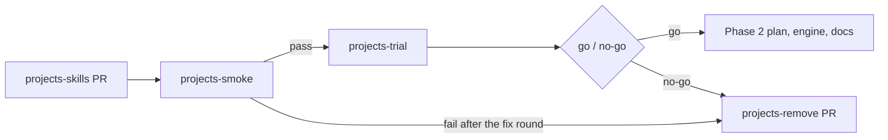

# Wintermute in Copilot app Projects: design

Date: 19 November 2026. Status: draft for the user's approval. Scope: the `wintermute` plugin in `ncksol/ai_tools` (`ghcp/plugins/wintermute/`), version 1.2.6 at `origin/main` commit `7e7ded4`, and GitHub Copilot app 1.4.3 Projects (public preview). Paths are relative to `ghcp/plugins/wintermute/` unless they start with `docs/`, `.github/` or `~`. Line numbers refer to commit `7e7ded4`.

## How to read this

- Section 7 holds the user's decisions. They are fixed.
- Choices made on the user's behalf are marked **(designer's call)**, each with its reason. None is approved yet. Section 8.18 lists them all.
- Section 9 lists what is left to the builder, and section 10 the unknowns.
- "Inference" marks a claim that was not checked directly. "Observed" marks behaviour seen in real logs, which the app doesn't promise.

Evidence notation:

| Tag | Source |
|---|---|
| [WN §n] | `wintermute-now.md`, section n: the plugin on 19 November 2026 at `4229137` (1.2.5). Commit `7e7ded4` (#135) changed the canvas extension's SDK import, its validator check (`scripts/lib/validate-dashboard.mjs`), `tests/canvas.test.mjs`, `tests/packaging.test.mjs`, the CHANGELOG and the version; no agent or engine file changed. |
| [PR §n], [PR Un] | `projects-recheck.md`, section n or unknown Un: the Projects contract in app 1.4.3, with evidence from seven real Projects. |
| S*n* | Line *n* of `LC_ALL=C strings -n 20 /Applications/GitHub.app/Contents/MacOS/github` for app 1.4.3: a string in the binary, not a source line. |
| *alias*:*n* | Line *n* of that session's `~/.copilot/session-state/<id>/events.jsonl`; aliases in the next table. |
| core:n, peon:n | Line n of `com.github.copilot/agents/wintermute-core.agent.md` or `wintermute-peon.agent.md`. |
| [K1]–[K8] | Checks made for this document, listed below. |

| Alias | Session |
|---|---|
| S1 | `595bab89-e406-4982-86db-fff317f5e04b`, the "Wintermute System One" Project |
| S1 repo, S1 chat | `82f42d83-45f8-4f80-9a61-4fef57a3a2c2` and `70ca75cc-56a7-48bc-95c6-5de431a0ed13`, its two children |
| Bench | `fc7660c2-07f9-4c51-aba0-bcab993720ea`, the "Wintermute benchmarking" Project |
| Expense | `a36bd31e-b7da-41d1-8ebb-368b40434038`, the "Expense reports" Project |
| Denied | `add99e31-08be-4e4f-bd1e-a75bb399f052`, an Expense child whose shell commands were denied |
| Trial Sim | `cbfb9b32-26e0-4f1a-90c3-3769d9b5cfad`, the "BI-MS trial simulator" Project |
| Core #127 | `c7b5579f-6755-4823-9c08-7019471f95da`, an ordinary `wintermute-core` swarm with one owner unit |

The research files are in the orchestrator's session files folder, `/Users/nicksologoub/.copilot/session-state/e0c34f1a-6bb3-4fb1-82c0-1978a6b221f8/files/`, on the user's machine.

Checks made for this document (read-only, or in scratch copies outside the repository):

- **K1. `/compact`.** S14749 says "Clear is not available for Projects. Use /compact to reduce context instead." No Project log shows a manual compaction: the observed ones have `trigger: "threshold"` (Bench:2119) or `"model_switch"`. Whether `/compact` works in a Project is unverified.
- **K2. Cost references.** `node scripts/swarm-snapshot.mjs --swarm <id> --no-pr-lookup` gives $32.28 for S1 and $32.08 for Core #127 (one owner, a reviewer, a claims checker and two judges). These are list-price conversions of usage records, not invoices. Summing the deduplicated usage records of the same sessions with the engine's own `usageOf` (`engine/readers/ledger.mjs`) gives the same two totals.
- **K3. The validator.** A scratch copy shows the copy guard's pitfall: a list item added only to `wintermute-core`, after a blank line, passes a guard that stops at the first blank line. The design in 8.8 catches it. With both skills and the guard, the suite has 1,164 tests and passes, and `npm run validate` passes.
- **K4. CI.** `ncksol/ai_tools` has no checked-in root CI workflow (`.github/` holds only `copilot-instructions.md` and `plugin/`), and #135 reported no checks. `gh workflow list` shows the service workflows "Copilot" and "Copilot cloud agent". A claims check here rests on test runs at the pushed commit.
- **K5. Event shapes.** A plugin skill load is a `skill.invoked` event with `name`, `pluginName`, `source` and `trigger` (S1:57). A sub-agent's events carry a top-level `agentId` and `data.parentToolCallId` (S1:234 onward). A shell result has `data.shellExecution.exitCode`; a denied call has `data.error.code: "denied"` (Denied:56). A `create_session` result names the child, as `(id: …)` for a repository child or `(session_id: …)` for a chat child, and its `Assignment ID`. A compaction records its `trigger`.
- **K6. Skill sizes.** The two skill texts in the plan are about 39 KB (with the copied table and list) and 11 KB.
- **K7. Run tooling.** The plan's collector, measurement and finalizer scripts ran in scratch: on the real logs of S1 and Core #127 (exact roots, every child, branch SHAs, requested and effective models, test runs), on synthetic logs (an early `READY TO MERGE:` echo, a sub-agent's message, a peer message that looks human, usage after ready in the same five-minute bucket, a denied command, a negative Project that loads the skill and acts), and against a local bare repository (branch deletes guarded by the expected SHA, an approval digest, refusal of a symbolic link or a foreign folder).
- **K8. Acceptance checks.** On `main` at `7e7ded4`, changing the status line in `wintermute-peon`'s report block, or removing `name:` from `skills/wintermute-pr-commands/SKILL.md`, leaves all 1,154 tests passing. A correct test for either trial task must fail under that change.

## 1. Intent

The user's words:

- 29 October 2026: "Projects seems to be a new way how to use this app. I feel like it specifically fits into our idea of agentic swarm work. So I was wondering if I can take what I can from our wintermute plugin and enhance Projects with it, while keeping the UI/UX from the new Projects feature."
- 19 November 2026: "Wintermute plugin had some substantial changes since this research was done and plan written. Lots of things are not relevant any more. Lets reanalyse the state of Wintermute plugin and rewrite the plan for Projects integration"
- On the approach: "lets go with Copy. especially since I am not sure if Projects even a good place for Wintermute so we might abandon this after a few checks"

A Project is already a durable coordinator. It creates child sessions, follows them in its Overview, collects their output in its Inbox and Library, and runs its own schedules [PR §1]. What it lacks is wintermute's discipline: work split into units, a model and an effort chosen for every job, an independent review from another vendor's model and a claims check before every merge, and a limit on repair cycles (core:137-181, core:316-362).

A Project can't run `wintermute-core` as its agent: the app blocks custom agents in a Project and in its child sessions [PR §1, U1]. It does load plugin skills [PR §1; WN §1.2]. So the discipline comes in as two skills, and the Project stays the face of the work.

The user doubts that a Project is the right place for wintermute. So the work starts with the cheapest check that could rule it out, then a paired trial only if that check passes, and ends in a clear go or no-go decision. Only a "go" leads to engine and dashboard work. A "no-go" removes everything in one PR.

## 2. Goals

1. Find out cheaply whether a Project is a good place to run wintermute for repository work that ends in a PR, and give the user a go/no-go decision on measured evidence.
2. A Project that the user opted in runs that work with wintermute's discipline: units, a model and effort for every job, an independent cross-vendor review and a claims check before every merge, and at most two repair cycles.
3. The Project's own UI keeps working as designed. Its Overview, Inbox, Library and Automations get what they expect: typed reports, assignment IDs, short handoffs, and deliverables published by the session that made them.
4. The skill's model tier table and "Never use these" list stay identical to `wintermute-core`'s, and a validator enforces it.
5. Opt-in per Project, and nothing happens in a Project that didn't opt in.
6. The evaluation changes nothing on any real branch of the repository.
7. If the answer is no-go, one PR removes everything.
8. If the answer is go, the dashboard later reads Project swarms: cost, sub-agents and the model of each child.

## 3. Non-goals

- Changing `wintermute-core` or `wintermute-peon` (decision 5).
- Replacing the Project's built-in coordinator prompt or any part of its UI.
- Hard tool limits in a Project. A skill can't remove tools [PR §1].
- Engine, server or UI changes before the go/no-go gate.
- Judging research, document or investigation work in Phase 1 (designer's call). Reason: the trial's one task ends in a PR, and a second full swarm only for breadth would double the cost. The conclusion is stated for repository PR work only; the skill still defines evidence for work without a commit (8.5.10).
- PR monitoring of any kind. Wintermute stopped all PR watching in 0.5.0 (core:368, peon:27).
- Event subscriptions (`manage_event_subscriptions`): live enablement is not proven [PR §1].
- PR changes other than open, publish, merge and pushes of assigned work to the branch of a PR the unit owns: retargets, build re-queues, reviewers and labels stay with the user (decision 7).
- Dashboard controls. The dashboard stays watch-only.
- A hook or a global instruction that loads the skill (decision 4).
- Chat children (`session_kind: "chat"`) as a delegation type. The worker skill still works in one, because its scope check uses the marker that chat children have.
- Swarms across several Projects, or `create_persistent_project`.
- Any change to the eval kit, or running Projects through the overnight eval runner.
- Validating `wintermute-pr-commands` in `npm run validate`, or a test that guards the core and peon report blocks. Both are real gaps [WN §1.1, §1.2]; section 8.12 uses them as the trial's tasks, on disposable branches.

## 4. Anti-goals

The design fails, even if it technically works, when:

- a Project or an ordinary session acts under wintermute's rules without the user turning them on;
- a memory, a report, a summary or a table is taken as the user's permission;
- the Project's Overview or Inbox gets worse: reports the app can't route, long handoffs that flood the coordinator, deliverables that never reach the Inbox, or unchecked work that does;
- the copied tier table or "Never use these" list drifts from `wintermute-core` and nobody notices;
- a child loads the coordinator skill and starts to coordinate;
- the evaluation merges anything into `main`, or its cleanup deletes something the run didn't create;
- work done before the gate touches an agent, or can't be removed in one PR;
- engine or dashboard work is done before anyone knows whether Projects fit;
- the evaluation ends with numbers that nobody can turn into a decision, or a missing measurement is read as a pass.

## 5. Constraints

### App (Copilot app 1.4.3, public preview)

- **C1. No custom agents in a Project's lineage.** The selection handler, the child-creation helper and the runtime reject or drop a custom agent for a Project and its children (S18598, S14246, S14197). A strong static gate, not a tested call [PR §1, U1].
- **C2. Children can't create app sessions.** The `<copilot_project_child_session>` block bars creating or forking sessions, opening PR or issue sessions, and automations that spawn sessions; it allows reports, inspection, scheduling the same session and native sub-agents (S21739-21742) [PR §1].
- **C3. Tools: observed, not a manifest.** Real Project logs show shell, file edits, `sql`, `skill`, `task`, `create_session`, `get_session`, `send_session_message`, `relay_session_input`, `answer_session_input`, `respond_to_session_plan_v2`, `archive_session`, `update_project_memory`, `publish_chat_update`, `save_session_automation`, `open_canvas` and `ask_user` (S1; Trial Sim). S18970-18985 is a coordination tool list, not a complete manifest. `write_agent` was seen but works only on a background sub-agent (S1:620-625); `create_pull_request` was not seen in a Project. Neither is a guaranteed invariant [WN §2.3; PR §1].
- **C4. No checkout.** A Project runs in a folder under `~/.copilot/chats/` and adds repositories through its repository setup. Repository work goes to children [WN §3.1; PR §1].
- **C5. Typed reports.** `progress` stays in the child's thread. `handoff` is saved as a ready result and delivered together with nearby results; it doesn't settle the assignment, and a material change needs another handoff on the same ID. `needs_input` and `error` are delivered at the next turn boundary (S19058-19062, S21750-21763) [PR §1]. The app asks for a short outcome sentence with any essential link or next action; the two-line limit in 8.5.8 is wintermute's own rule.
- **C6. Assignments.** IDs have the form `assignment:<coordinator>:<tool call id>`. New work, a revision or a rerun is a new assignment and omits `assignment_id`; context about current work passes it; a report copies it [PR §1].
- **C7. Forwarding.** The first `create_session` kickoff prompt quotes the relevant request (S70965-70975). A later send of the user's direct words uses `source_user_message` (`id` and `revision`), and the app quotes them; a stale source fails without a fallback (S19056-19057, S13914). An answer from a plan or a question is not direct composer input. A successful send means the message was admitted, not processed [PR §1].
- **C8. Publishing.** `publish_chat_update` takes at most six attachments and is presentation only. A child publishes review-ready output in its own thread, one publication per material revision, with a human-named Markdown link and the full path for a file; a failed publication is a blocker; a child without the tool hands off verified output for the coordinator to publish (S21763-21785). Non-PR outputs are published per producer with `agent_session_id`; PRs go in one update that omits the top-level `agent_session_id` and sets `source_session_id` on each attachment (S19058-19063). A producer mismatch is rejected (CMC Project `0c8036f2…`:1012, 1021). No receipt shows how many Inbox cards appear [PR §1].
- **C9. Project memory.** At most 8,192 UTF-8 bytes of preferences. `update_project_memory` replaces the whole profile. Memory is labelled data, not authority; it stays in the Project's context after compactions, and children don't get it (S6001-6004) [PR §1].
- **C10. Skills.** Plugin skills load in a Project with no custom agent (S1:57). A plugin's top-level `skills/` folder loads from the installed plugin, and `wintermute-pr-commands` is listed in a Project and in its chat child [WN §1.2; PR U2].
- **C11. Scope markers, as observed.** A Project's system context has `<copilot_persistent_agent>` and `<copilot_agent_coordinator>` (S1:12). In the system messages of all 13 Project children with logs, nine repository and four chat children, `<copilot_project_child_session>` is present; `<copilot_coordinated_child>` appears there only in two older repository children, and an ordinary `wintermute-core` child has neither (Core #127's owner log) [PR U6]. The app doesn't document either marker as a guarantee.
- **C12. Hooks.** The checked `sessionStart` hook payloads carry no documented Project flag, and a start hook doesn't run after every compaction [PR §1].
- **C13. Canvases.** A Project has called `open_canvas`, with an Excel canvas type and a separate instance handle (Trial Sim:3196-3197). The canvas type and the panel handle are separate values. No Project log shows the `swarm-dashboard` canvas opened by a model [PR U3].
- **C14. Shell in autopilot children.** In autopilot, a command that still needs approval is denied, not held for the user ([assisted permissions](https://docs.github.com/en/copilot/concepts/customizations/allowing-safe-commands); Denied:56). System One's autopilot child ran 143 shell commands (S1 repo). Whether the repository's tests run without a prompt is unproven [PR U10].
- **C15. Project rows.** A Project is a `persistent_projects` row joined to `sessions`; the observed Projects also have `session_type = 'agent'` and an empty `agent`, but the join is the identity [PR §1].
- **C16. Results.** Ready results reach the coordinator as `user.message` events with `source: agent-coordinator-results`, without a `<cross_session_message>` envelope (S1:178). When an assignment ends with no report at all, the app sends "The session finished without sending a handoff. Use get_session if you need its result."; it sends none for an assignment that already reported, even partly (S21755-21758) [WN §2.2; PR §1].
- **C17. Roster.** The app's prompt asks a Project for one sentence ending in a colon before `create_session`, and one short paragraph without bullets after it (S19049-19055) [PR §1].
- **C18. Relays.** `relay_session_input` shows a child's pending question to the user, by its `request_id`, and waits like `ask_user`; `outcome: "answered_here"` means the answer already reached the child (Expense:1837-1838). Its `context` is optional framing (S94457) [PR U8].
- **C19. Compaction.** Project memory survives a compaction; a loaded skill's text is not shown to survive [PR U5]. Manual `/compact` is unverified (K1).
- **C20. Coordinator turns cost money.** A coordinator turn after a long idle gap can write its whole context to the cache again: an ordinary `wintermute-core` turn after an overnight gap cost about $1.22 at list price, nearly all cache write (session `8a7ef112…`:52619, `cacheTtlSeconds: 300`). Expense shows cache hits after gaps of 24 and 18 minutes (Expense:537, 867-868; 1748, 1779-1780), so the gap alone doesn't decide it. Fewer unnecessary turns can reduce usage; no cost per Project wake is known.
- **C21. Idle notices.** `coordinate_with_creator` defaults to true (S70982-70985). Idle means the end of a turn, not of a task (S70997-70999). `notify_on_idle: "once"` sends one idle notice, observed for a chat child (S1:1355).

### Plugin (1.2.6)

- **C22. Two agents.** `wintermute-core` and `wintermute-peon` (`scripts/lib/validate-package.mjs:6`). Their rules assume agent mechanics: a `tools` allowlist, `kickoff.agent: "wintermute:wintermute-peon"`, full Summary, Evidence and Blockers fields on every report, `blocked` sent with `purpose: "needs_input"`, go-ahead requests as `needs_input`, and progress replies to status checks [WN §4] (core:85, core:96, peon:82).
- **C23. The model policy.** The tier table is core:143-156 and the "Never use these:" list is core:172-181, the last block of "Models and effort". The table refers to "Follow-up jobs", "Evidence and review" and "Security review"; the list refers to "Evidence and review".
- **C24. `wintermute-peon` can't be a sub-agent.** It sets `disable-model-invocation: true` (peon:6), which blocks `task` launches.
- **C25. Skills.** `skills/wintermute-pr-commands/` is the plugin's only skill; its `description` is a folded YAML block (`skills/wintermute-pr-commands/SKILL.md:3-10`). `npm run validate` checks no skill [WN §1.2, §1.4].
- **C26. Engine on Projects today.** Every parent with children is a swarm root (`engine/model/forest.mjs:139`); a Project with no child is never one, because only orchestrator agents promote a childless root (`engine/model/forest.mjs:115-138`). `run.project` is null for Project swarms (`engine/model/swarm.mjs:814`). Ready-result notifications are not parsed (`engine/model/messages.mjs:73`). Every automation shows as a PR monitor (`engine/model/messages.mjs:69-70, 120`). `relay_session_input` is not a wait, and relay framing is not read as a question tag (`engine/model/session-state.mjs:34`; `engine/model/contract.mjs:71-90`). A missing app table gives a warning diagnostic (`engine/readers/app-db.mjs:50`) [WN §1.3, §2].
- **C27. Snapshot IDs.** `--swarm` takes a root's node ID: a workspace ID for a repository-backed session (`engine/model/forest.mjs:47-58`), matched exactly (`engine/engine.mjs:726-735`). A session ID works only where it equals the workspace ID.
- **C28. Cost records.** `usageOf` (`engine/readers/ledger.mjs`) turns each usage record and compaction into one call with a dedupe key and a timestamp; snapshots sum them into 5-minute buckets (`engine/readers/ledger.mjs:93-98`).

### Repository

- **C29. Versions.** Every change under the plugin runs `npm run release:bump -- <version|patch|minor|major>` and replaces the new CHANGELOG section's TODO: major for incompatible changes to agent IDs, invocation, the canvas ID or the report and dashboard contracts, minor for compatible features, patch for compatible fixes (`CHANGELOG.md:5`) [WN §1.5].
- **C30. Skill rules.** Skill names stay namespaced to the plugin; no copy goes into `ghcp/skills/`; every `SKILL.md` has `name` and `description` frontmatter, an Operating mode section, an Output format, and the rules against invented results (`.github/copilot-instructions.md`).
- **C31. No PR-mutating skill.** "Do not add a skill that mutates a PR." (`.github/copilot-instructions.md:125`). Decision 7 adds one narrow exception.
- **C32. Node 18.** Shipped code uses no API newer than Node 18, and tests use no `t.after` or `t.before` (`tests/guards.test.mjs:48-64`). The plugin has no npm dependencies.
- **C33. The dashboard's cockpit view is an Easter egg.** New user-facing text (README, QUICKSTART, DASHBOARD.md, skill and plugin descriptions, CHANGELOG entries) never mentions it. Older CHANGELOG entries do, and stay as they are.
- **C34. Agent frontmatter parser.** `parseAgentFrontmatter` (`scripts/lib/validate-package.mjs`) accepts only one-line values, so a skill it checks needs a one-line `description`.
- **C35. Branch leases.** `git push --force-with-lease=refs/heads/<b>:<sha> <remote> :refs/heads/<b>` deletes a branch only while it still points at `<sha>`, and `--force-with-lease=refs/heads/<b>:` creates one only if it doesn't exist (checked on a local bare repository, git 2.56).

## 6. Approaches considered

All three put the Project rules in two skills. They differ in how the coordinator skill gets wintermute's model policy and review rules.

| | Copy (chosen) | Shared policy file | Read at load |
|---|---|---|---|
| How | The skill copies the model tier table and the "Never use these" list word for word, and a validator test fails if they drift from `wintermute-core`. The review and gate rules are written fresh for Projects. | Move the policy into one file that both `wintermute-core` and the skill load. | At every load, the skill reads "Models and effort" and "Evidence and review" from the installed `wintermute-core.agent.md`, through a table that adapts agent mechanics to Projects. |
| Gain | No file read at run time and no adaptation table. The Project text is easy to rewrite or to delete. `wintermute-core` doesn't change. | One source for all shared policy. | No copy at all. |
| Cost | The review rules exist twice and can differ in substance; only the table and the list are guarded. A tier change touches two files, which the validator forces. | It changes the core agent, against decision 5. | The two sections are about 22.8 KB, full of agent mechanics, so the adaptation table is large. `wintermute-core` changes in almost every release, so the adaptation breaks often [WN §1.5, §3.2]. |

The user chose Copy on 19 November 2026 and rejected the other two for the reasons in their Cost rows.

## 7. The user's decisions

1. The Project stays the coordinator and the face of the work. Its Overview, Inbox, Library and Automations stay as they are. Wintermute's rules follow the Project's conventions wherever they feed that UI: assignment IDs, typed `purpose` reports, short handoffs, and publishing deliverables to the Inbox.
2. Wintermute adds its discipline through a coordinator skill that the Project loads: units, a model and effort per child, an independent review from another vendor's model and a claims check before every merge, and repair-cycle limits. Children get a worker skill, because custom agents are blocked in a Project's lineage.
3. The dashboard should eventually read Project swarms: cost, sub-agents, the model per child.
4. Opt-in per Project, through the skill or a line in Project memory, not a global hook.
5. Agents unchanged: `wintermute-core` and `wintermute-peon` stay as they are, for top-level sessions and the evals.
6. Approach Copy (section 6).
7. A narrow exception to "Do not add a skill that mutates a PR." (19 November 2026). The PR-review skills (`strict-code-review`, `analyse-pr-feedback`, `rereview-pr`) stay inspection-only and never mutate a PR. `wintermute-project` and `wintermute-project-worker` may open, publish and merge a PR, but only after the user's explicit go-ahead for that PR, under the permission rules in 8.4, as `wintermute-core` and `wintermute-peon` already do. They may also push assigned work, including fixes and rebases, to the branch of a PR their unit owns, as `wintermute-peon` does. Any other skill still may not mutate a PR. The skills PR records the exception in `.github/copilot-instructions.md`, and the removal PR reverts it.

## 8. Design

### 8.1 Phases and gates

**The work runs in phases, and the cheapest decisive check comes first (designer's call).** Reason: the user said "we might abandon this after a few checks", so nothing that only matters for a long-term integration is built, and no expensive comparison is paid for, before a cheap check could rule Projects out.

- **Phase 1, evaluate.**
  1. `projects-skills`, one PR: the two skills, the validator guard, short docs and the instructions exception, behind the opt-in.
  2. `projects-smoke`: a capped, non-destructive check in a scratch Project (8.11). It passes or fails on four conditions.
  3. `projects-trial`, only if the smoke check passes and the user agrees to its cost: one small real task, run in a Project and, as a baseline, with `wintermute-core` in an ordinary session, each against a disposable base branch (8.12).
- **The gate.** The user decides go or no-go from the checked findings, by the rules in 8.14.
- **Phase 2a, go.** A plan for the engine and dashboard work in 8.15, written from this design and the findings, then built.
- **Phase 2b, no-go.** One PR, `projects-remove`, removes everything Phase 1 added (8.16).

**One fix round in Phase 1 (designer's call).** A smoke or trial criterion that fails because of a defect in the skill text may be fixed once, in a patch PR, and that stage run again as a new run. A second failure counts as a fail. Reason: a fit that needs more than one round of prompt fixes on a one-unit task is itself evidence against it.

**No bug fix moves before the gate (designer's call).** The one candidate is the engine's habit of calling every automation a PR monitor (C26). It has some value outside Projects, but wintermute's agents create no automations, so outside Projects it rarely shows, and it changes none of the gate's evidence. It goes into Phase 2a.

### 8.2 The pieces (Phase 1)

| Piece | Path | What it does |
|---|---|---|
| Coordinator skill `wintermute-project` | `skills/wintermute-project/SKILL.md` | The Project loads it. It adds wintermute's planning, delegation, model policy, review, gate and reporting rules to the Project's built-in coordinator. |
| Worker skill `wintermute-project-worker` | `skills/wintermute-project-worker/SKILL.md` | Each child loads it on its kickoff's instruction. It holds the child's rules for assignments, gates, reports and publishing. |
| Skill validator | `scripts/lib/validate-skills.mjs`, called from `scripts/validate-plugin.mjs`; tests in `tests/validate-skills.test.mjs` and `tests/validate-skills-plugin.test.mjs` | Checks both skills, and the copy of the model policy. |
| Docs | `README.md`, `CHANGELOG.md`, `.github/copilot-instructions.md` | An experimental section, release notes, the copy rule and the PR exception (decision 7). |
| Run tooling | Three scripts in the plan, written into each run's folder: `wm-collect.mjs`, `wm-measure.mjs`, `wm-finalize.mjs` | Exact IDs and an inventory, measurement, and cleanup (8.10, 8.13). Not shipped in the plugin. |

- **Skill names (designer's call):** `wintermute-project` and `wintermute-project-worker`. Reason: namespaced to the plugin (C30), short to type, and they say they are for Projects.
- **Location:** the top-level `skills/` folder, where `wintermute-pr-commands` already loads (C10).
- **Size (designer's call):** only the rules that a pilot on repository PR work needs, with the conditions that change decisions kept from core:316-362. Reason: Phase 1 exists to judge fit; the texts are about 39 KB and 11 KB [K6], against about 69 KB for `wintermute-core`.

### 8.3 Opt-in, recovery and turning it off

**Opt-in is a hard condition (designer's call).** The coordinator acts under the skill only when its system context has the Project marker (8.5.1) and either the message that loaded the skill starts with `/wintermute-project`, or the Project's memory holds the opt-in line:

> Wintermute: this Project follows the `wintermute-project` skill. If that skill's rules aren't in your context, load it before you do anything else.

Otherwise it says in one line that wintermute isn't on in this Project, and does nothing else: no state reads, no sessions, no changes. Reason: anti-goal 1. Description matching is not a hard boundary [PR U13], so the guard must not depend on how the skill was loaded.

- **The skill's description is narrow (designer's call).** It names `/wintermute-project` and the opt-in line, and no general triggers such as "swarm". Reason: fewer accidental loads; the hard condition stops the rest.
- **Neither skill sets `disable-model-invocation` (designer's call).** Reason: the model must load the coordinator skill from the memory line after a compaction, and each child loads the worker skill on its kickoff's instruction. Both are model invocations, which the field would block.
- **Turning it on saves the opt-in (designer's call).** On `/wintermute-project`, when the memory lacks the line, the coordinator saves the whole current memory with the line added, within 8,192 bytes (C9), and records a `wintermute_project` row with `enabled = 1`. If it can't save the line, it says that wintermute stays on only until a compaction. Reason: the user's command is the opt-in for this Project; memory survives compactions; the table gives Phase 2's engine a marker that also records opting out (8.15).
- **Turning it off (designer's call).** The coordinator stops dispatching, tells the user which units have open work and asks what to do with each, then, with the user's consent, removes the line, keeping every other line, and records `enabled = 0`. Reason: the line alone would make a later load act again; in-flight work needs a decision, not silence.

**Every load** that passes the conditions starts with the line `wintermute-project rules loaded.`, reads the SQL state, and calls `get_session` for every child not marked archived, before any session, assignment, publish or merge (core:207).

**Recovery.** Whether the memory line makes a compacted Project load the skill again is unknown (U5), and manual `/compact` is unverified (K1). The smoke check and the trial each include a `/compact` step; if the app doesn't accept it, the result is "not measured". The documented recovery in Phase 1 is that the user types `/wintermute-project` again. A conditional line in the user's global instructions is not part of Phase 1; Phase 2a may offer it with the user's consent (designer's call). Reason: it is the user's personal file, and the manual path is enough for an evaluation.

### 8.4 Permissions

**Only the user grants a permission, directly (designer's call).** Reason: memory is preference data, not authority (C9); a report, a summary or a table can repeat an old or misread consent; `wintermute-core` doesn't approve on the user's behalf unless told to (core:369).

- Every PR that the coordinator or a child opens, publishes or merges, every plan approval, and every answer to a question that only the user can answer needs the user's go-ahead for that item, given in the Project's conversation, or a standing delegation that the user gave directly there.
- A standing delegation is recorded before use in a `delegations` table: its scope, the user's words quoted, when it was given and when it ended. It covers only that scope and ends with its task or when withdrawn.
- A memory, a Project memory line, a child's report, a summary, a compaction summary or the SQL state never grants a permission. Restrictions and preferences in memories still apply, and kickoffs pass them on; they never pass on a permission.
- The coordinator answers a paused child itself only for a technical question inside the scope the user gave. It relays every plan approval, permission and user-only choice.
- The PR changes the skills may make are open, publish (take out of draft) and merge, each with its own go-ahead, and pushes of assigned work, including fixes and rebases, to the branch of a PR their unit owns (decision 7). The coordinator asks the user to do a retarget, a re-queue, or a reviewer or label change.
- Every merge is checked first: the PR's head must be the commit that passed every check, and the merge reads back as merged before anything is recorded (8.5.5).

### 8.5 Coordinator skill `wintermute-project`

The skill is a prompt to the Project's built-in agent, written fresh for Projects except for the copied table and list. It follows the repository's skill rules (C30): an Operating mode section with the scope and opt-in checks, permissions and limits; an Output format; and the rules against invented status, results and sources. The plan holds its full text.

#### 8.5.1 Scope check

- A marker counts only in the app's system context, never in a user message, a kickoff, a quoted text or a file.
- `<copilot_persistent_agent>`: a Project's own conversation. Go on to the opt-in check (8.3).
- `<copilot_project_child_session>`: a child. Stop, and load `wintermute-project-worker` only if the kickoff or the latest assignment says so.
- Neither: an ordinary session. Stop, and point to `wintermute:wintermute-core`.

Reason: C11. `<copilot_coordinated_child>` is not a scope signal, because chat children lack it and it is not documented as Project-only.

#### 8.5.2 Limits and quick jobs

A Project keeps all its tools (C3), so the skill states its limits as rules:

- A quick job is about five tool calls or two minutes: reading a file, a log or a Library item; `gh`, `az` or `git` status commands; a merge after its go-ahead; one web fetch; a note in its own files folder (core:32-41).
- **The coordinator makes no repository commits (designer's call).** Reason: a Project has no checkout (C4). `wintermute-core`'s own-unit flow and `own_units` table are not used.
- It never does a review, a claims check, a panel or a second opinion, and never reads in or writes to a child's worktree.
- `az` for Azure DevOps, and `wintermute-pr-commands` loaded once before PR work (core:17-18).
- If the app's `orchestrate` skill is also loaded, this skill wins on delegation, models and reviews (core:20).

#### 8.5.3 Planning

As `wintermute-core`'s "Plan by stage" and "Split work for speed" (core:50-77): research in parallel one-off jobs; one owner child per PR-sized unit, stacked with `base_branch` once the parent has pushed; the six critical-unit triggers, with a reason in `child_notes`, and raising a unit to critical later when it proves risky; separate hypotheses for investigations; each unit's review, claims check and the final panel planned up front.

- **Tasks and target branches (designer's call).** Each user request is a task in a `tasks` table, with its target branch: `main` unless the user names another. Reason: a Project is long-lived and runs many requests, so the final panel, the post-merge claims check and archiving work per task; the target lets the trial work against a disposable branch without special rules.
- **Plan approval (designer's call).** The coordinator shows the breakdown before substantial work, and waits for the user's approval of that plan when the user asks for it. Child sessions run in `autopilot`, or in `plan` only when the user asked to approve each unit's approach. Reason: one root plan approval per task is what the user asks for in practice; a plan per unit would multiply prompts.
- **How it asks (designer's call).** With `ask_user`, or, when the user's memories or the Project's memory say that the user reads questions in chat, as a tagged chat message that ends the turn. Reason: the user can't read `ask_user` prompts in every surface, and a pilot must not fail on the wrong question channel. Both are counted as user actions (8.13).

#### 8.5.4 Delegation

| Job | Runs as |
|---|---|
| Owner unit: a branch, a PR or follow-ups | A child session (`create_session`, or `open_pr_session` and `open_issue_session`) |
| One-off job that needs a checkout: a review, a claims check, a judge, a verification, a repository command | A child session with `base_branch` set to the pushed branch under test |
| One-off job with no checkout: web research, a Library summary, a plan critique, a second opinion on a document, a fact-check | A `task` sub-agent, `agent_type: "general-purpose"`, with `model` and `reasoning_effort`; `mode: "background"` when it may get a re-check through `write_agent` |
| Quick job | The coordinator |

- **Sub-agents for jobs with no checkout (designer's call).** Reason: they start faster and add no Overview items; the dashboard already shows root sub-agents with their model and cost [K2]; `wintermute-peon` can't be a `task` agent (C24); `write_agent` needs a background sub-agent (C3).
- **A sub-agent gets its own brief (designer's call):** role, job, inputs, output file and summary, the evidence to give, and that it starts no sub-agents and creates no sessions. It doesn't use the worker skill or the child report protocol, and it is recorded in `child_notes` with kind `sub-agent`. Reason: it is not an app child (C2), so the child contract doesn't apply to it.
- **Never set `kickoff.agent` (designer's call).** Reason: custom agents are blocked (C1), and `wintermute-peon`'s report block conflicts with the Project contract (C22). The worker skill replaces it.
- **Kickoff fields for every child session, from `create_session`, `open_pr_session` or `open_issue_session` (designer's call):** `project_id` of a repository the Project has added (`create_session`); `base_branch` only to a pushed branch; `kickoff.mode` set explicitly; `kickoff.model` and `kickoff.reasoning_effort` always; `coordinate_with_creator: true`; `notify_on_idle: "once"`. After the child starts, the coordinator checks its model and effort with `get_session`. Reason: these are the values the Project itself used (S1:146, S1:1166); `"once"` is a notification setting, not a watchdog (C21), and status checks cover the rest (8.5.8); fewer turns can reduce cost (C20).
- **Session names (designer's call):** each child's session name starts with its unit label. Reason: the user sees the Overview and the dashboard side by side, and one name links them.
- From `wintermute-core` (core:90-103, 121-135): one owner per piece of work; confirm a start; a failed `create_session` can leave a session behind, so archive it, note it and retry once as a new unit; a child paused on a plan or a question doesn't read messages; helper requests are handled in core's order; the coordinator runs the fan-out of any workflow that launches agents.

#### 8.5.5 Merging

- Merge only when the PR's head is the commit at which every check passed. **On GitHub, `gh pr merge <number> -R <owner>/<repo> --squash --match-head-commit <sha>` (designer's call).** Reason: GitHub then refuses the merge if the head moved. On Azure DevOps, the verified completion command in `wintermute-pr-commands`, after checking the source commit. No GitHub write in `wintermute-pr-commands` is verified, so the coordinator says that this command is untested there.
- Never delete the source branch.
- If the target moved since the final panel, the new integration is sized as a follow-up job before the merge (core:348-358).
- If the owner may be working on the PR, the coordinator tells it, on its current assignment, that it will merge, and waits for the owner's handoff that it paused (8.6).
- The coordinator reads the PR back and records `merged` only when the provider reports it merged, with its merge commit. A queued merge is not merged.
- No session watches a PR; one bounded CI wait of about 30 minutes is allowed for a required check (core:368).

#### 8.5.6 Models and effort

- The skill's "Models and effort" section holds **the tier table and the "Never use these:" list, word for word from `wintermute-core`** (decision 6). The list is the last block of the section, as in core.
- Around them, fresh rules for applying the table in a Project: set the model and effort on every child and every `task` call; newest version of each family, or another family in the same tier; the vendor of each family; a child gets the tier of the work it owns; a follow-up job gets the tier of its own scope; execution at Max only in the Max row's two roles and only with approval; one tier-up rerun of a shallow one-off job, at most to High, but a document draft or fact-check reruns only at the next level its own row lists, and nothing tiers up after a `blocked` or `needs_input` report, a known cause or a repair cycle (core:158-169); a model and effort with a reason in `child_notes`.
- **Cross-references resolve inside the skill (designer's call).** The copied text points to "Evidence and review", "Follow-up jobs" and "Security review" (C23). The skill has a `## Evidence and review` section with bold labels **Follow-up jobs** and **Security review**, and the validator checks that every name the copied text quotes is a heading or a bold label in the skill. Reason: a copy that points to missing text is a silent drift in meaning.

#### 8.5.7 Kickoff prompts and forwarding

Each child session's kickoff prompt:

- starts with ``Load the `wintermute-project-worker` skill now, before anything else, and follow it for this whole session.``;
- quotes the user's request verbatim, then adds only what the child needs to work alone (C7);
- gives the unit label, the task's target branch, what the child owns and must leave alone, and keeps decisions apart from suggestions;
- for Mid-tier implementation, includes acceptance tests;
- passes on the restrictions and preferences from memories, never a permission (8.4);
- for a one-off job: no commits or pushes, whether it is read-only, and the absolute path for its result file;
- tells an owner that the coordinator starts its review and claims check.

Later messages:

- New work, a revision, a rerun or a go-ahead is a new assignment, without `assignment_id`; context about current work carries it (C6).
- **Every new assignment starts the coordinator's text with ``Follow the `wintermute-project-worker` skill; load it again if its rules aren't in your context.`` (designer's call).** Reason: children have no Project memory (C9), so this line is how a compacted child gets its rules back.
- The user's own words from a message they typed go through `source_user_message`. An answer from `ask_user` or a plan decision goes to the child's pending request with `answer_session_input` or `respond_to_session_plan_v2` and its request ID. The coordinator's own words go in `message` and `coordinator_instructions`, never presented as the user's and never as a permission. If a source is gone, the coordinator asks the user to send it again (C7).

#### 8.5.8 Reports, assignments and gates

| Status line | `purpose` | Reaches the coordinator |
|---|---|---|
| `complete` | `handoff` | As a ready result, with others that arrive close to it (C5) |
| `progress` | `progress` | Never |
| `needs_input` | `needs_input` | At the next turn boundary |
| `blocked` | `error` | At the next turn boundary |

- `blocked → error` replaces the agents' `blocked → needs_input` (decision 1). The engine already maps `error` to `blocked` (`engine/model/contract.mjs:6`).
- **A handoff is two lines (designer's call):** the `swarm-status:` line with `unit=`, and `pr=` and `commit=` when they apply, then `Summary:` with one outcome sentence; a sentence that starts with "Partial:" is not final. Longer results go to a file that the sentence links by full path. `needs_input` and `error` keep all three fields. Reason: the app asks for short handoffs (C5); the status line keeps the commit that checks need; the engine parses a report without `Evidence:` (`engine/model/contract.mjs:34-69`).
- `assignment_id` is an argument of `send_session_message` on every report, never part of the status line. Reason: the dashboard contract stays at version 1.
- **An `assignments` table (designer's call)** records each assignment's unit, role, scope, commit, status (`open`, `partial`, `reported`, `superseded`) and latest result. A handoff doesn't close an assignment; a newer result replaces an older one; a duplicate is ignored; a new commit supersedes the earlier review, claims check and panel verdicts for that unit. Reason: one child holds several assignments, results can arrive late or twice (C5), and a verdict must never carry over to a commit it didn't check.
- **One-off jobs say whether their worktree is clean in the outcome sentence (designer's call).** Reason: archiving needs it, and a handoff has no `Evidence:` field.

**Gates (designer's call).** A unit's work is a chain of assignments, and each PR change has its own go-ahead:

1. Kickoff: implement, test, push; hand off with `commit=`. No PR yet.
2. CI that runs only on PRs: the go-ahead to open a draft PR for CI, as its own item. Without it, the claims check uses local runs and reports CI as not run.
3. Checks: the review and the claims check at the pushed commit, and for a task's last unit in a repository, the final panel. Each fix is a new assignment.
4. Publish: with the review and claims check clean at the same commit, the go-ahead to open the PR ready for review (or take the draft out of draft), sent to the owner as an assignment. The owner publishes the PR and hands off with `pr=`.
5. Merge: with the review, the claims check and, for the last unit, the final panel all clean at the PR's head, the go-ahead to merge; the coordinator merges (8.5.5).
6. After the task's last merge into its target branch, a claims check on that branch at the merge commit. A merge into a parent unit's branch doesn't get it.

Reasons: the Project's model is "new work is a new assignment" (C6); children never ask for a go-ahead with `needs_input`, which keeps the immediate channel for real questions and blockers; each PR change is a separate permission (8.4); the merge stays with the coordinator, as in `wintermute-core` (core:113-117).

**Status checks (designer's call).** The coordinator never asks a child for a progress report, because the reply would never arrive (C5). When a child is idle and one of its assignments has no final result, it checks the child with `get_session`, then asks on that `assignment_id` for the result as a handoff or the blocker as an error. The app's no-handoff notice comes only for an assignment with no report at all (C16) and is not a report.

**Ending work.** Reviewers and claims checkers stay until their unit merges, and judges until the task's last merge, for re-checks (core:320-338); they are not archived as ordinary one-offs. A child is archived only when it is idle, has no open assignment, PR or automation, and its branch is pushed; a busy child is told to stop first. `outcome` is set before the archive, and each archive is recorded.

#### 8.5.9 State and registry

All state is in the Project's own SQL database, through `sql`: `todos` and `todo_deps`; `tasks` (with `target`); `children`, the dashboard's registry, with the exact definition from `wintermute-core` (core:216-231) and the same rules, one row per child session and none per sub-agent; `child_notes` per unit, with its task, kind, model and effort with a reason, working status, last report, and each verdict with its commit; `assignments`; `delegations`; and `wintermute_project`.

- The coordinator takes a PR's URL from `get_session` or `gh pr view`, because handoffs have no `Evidence:` field.
- Unit labels follow the contract (core:189-192): 1–32 characters from `[A-Za-z0-9._-]`, unique within the Project across all tasks, never reused, compared with `lower(unit)`.
- The `children` definition is written out in the skill and not guarded by the validator (designer's call). Reason: the contract changes only with a new version across the dashboard, which would update the skill too, and the user chose to guard only the model policy.

**Final panel per task and per repository (designer's call).** When one unit of a task is left unmerged in a repository, its branch, rebased onto the task's target branch, gets the final panel alongside its review. The judges come from the two vendors that wrote the fewest of that task's units there, with Argon and Carbon counted together, at the critical levels if any of those units was critical. A panel finding blocks only if both judges raise it or it is reproduced. If the unit's PR targets a parent branch, the coordinator asks the user to retarget it (8.4). Reason: a Project runs many requests, so "the swarm" in core:331-338 has no end for a panel to wait for.

#### 8.5.10 Evidence and review

Written fresh, with the conditions from core:316-362 that change decisions: evidence that the work ran; the claims check before every merge, publish and "done" for repository work, by a separate read-only claims checker at the claims check row that writes a result file with the commit, the commands, their exit codes and the counts, and stays until the unit merges; for work with no commit, the file itself with its sources, and a fact-check from another vendor for a load-bearing document, which plays the claims check's role; one regular review per unit from another vendor, with core's vendor pairs; a critical review for critical units; **Security review** routing; the final panel (8.5.9); the disagreement panel, with one judge from the vendor outside the dispute; the one-vendor exception when the user limits the work to one vendor; documents drafted and fact-checked by two vendors; must-fix and should-fix findings block, nits never do; **Follow-up jobs** sized by their own scope, with core's rules for when a mechanical change needs no re-check or no new claims check and the earlier verdict stands, when the unit's original reviewers return, and Astra's costly re-reads; re-checks of the new diff only; at most two repair cycles; a second opinion at Max from another vendor; required reviews stay open until done by someone other than the author.

**Left out of the minimal skill (designer's call):** incident investigators and the unavailable-judge fallback. Reason: neither affects the pilot, and both can be added later from core:316-362.

#### 8.5.11 Talking to the user and publishing

- Updates lead with what needs the user, and say nothing about idle notices or checks with no news.
- Every question starts with a tag: `[unit=<unit>]`, `[unit=<unit> need=pr]` or `[unit=* need=plan]` (core:382-398), and is self-contained.
- **Relays (designer's call).** A user-only question from a paused child goes through `relay_session_input` with the child's pending request ID and the tag at the start of the context; the answer isn't sent again after `outcome: "answered_here"` (C18). The tag is a wintermute convention; the 1.2.6 dashboard doesn't read relays (C26), so Phase 2a must parse them before the dashboard claims support.
- **Children publish their own review-ready output (designer's call).** A PR is review-ready at the publish gate, after a clean review and claims check; a draft PR for CI is not. A document or other output is review-ready when the coordinator says so in an assignment. Publication follows C8: a full-path link, once per material revision, a failure reported as a blocker, coordinator publication when a child lacks the tool, and the coordinator's own routing for batches. A publish receipt is not proof of an Inbox card and never an authorization. Reason: the Inbox gets checked work only (anti-goal 3), and the app's own instruction to children stays intact.
- The roster follows the app's rules (C17), and adds each new child's model and effort.
- **The dashboard (designer's call).** When a task's first child exists, the coordinator checks with `list_canvas_capabilities` that the `swarm-dashboard` canvas is installed, then opens it once with `canvasId: "swarm-dashboard"`, `instanceId: "wintermute-<task>-dashboard"`, `input: {}`. If it is missing or fails, it tells the user once and carries on. Reason: the canvas type and the panel handle are separate values (C13); an unavailable dashboard is an observation, not a gate.

### 8.6 Worker skill `wintermute-project-worker`

**Scope check.** The skill applies only when the app's system context has `<copilot_project_child_session>` (C11) and the kickoff or an assignment from the coordinating Project tells the child to load it. Otherwise it stops.

**Permissions.** Only an assignment that names an action lets the child take it; the coordinator sends one after the user's go-ahead (8.4). Memories, reports, summaries and state never grant a permission.

**Carried over from `wintermute-peon`** (peon:19-61), written for a Project:

- owner unit or one-off job, as the kickoff says;
- no sessions, no agent CLIs from the shell, no app local API, no assigning work to Copilot, no Copilot code review requests;
- **no sub-agents (designer's call)**: a step that a skill or brief says to give a sub-agent is done by the child itself, and one that needs independence becomes a helper request. Reason: the coordinator keeps the model policy and the fan-out in one place, and cost lands where the dashboard expects it. Children may use sub-agents under the app's rules (C2), so this is a rule, not a limit;
- **no `ask_user` (designer's call)**: questions go to the coordinator as `needs_input`. Reason: every question reaches the user through one place, with its tag;
- PR changes only on an assignment that names them: a draft for CI, publishing, or a merge; never a retarget, re-queue, reviewer or label change;
- when the coordinator says that it will merge the PR, stop work on it and hand off on that assignment that the work is paused; read the PR's state again after a pause, and stop if it merged or closed;
- no PR watching, and one bounded CI wait;
- Copilot Browser and Computer Use, with sign-ins and approvals sent as `needs_input`;
- `az` and `wintermute-pr-commands`;
- after two failed attempts, report `blocked`;
- a reviewer sent a claims job does the review only and says so;
- one-off limits: inside the brief, no commits or pushes, files only where told, read-only when asked; a PR job changes only the PR, at the named commit;
- a claims check or test run writes a result file with the commit, each command, its exit code and the counts;
- no invented results, and anything not checked is marked as unverified.

**Replaced by the Project contract:**

| `wintermute-peon` | `wintermute-project-worker` |
|---|---|
| Full report block on every report | Handoff: the status line and one `Summary:` sentence ("Partial:" when not final). `needs_input` and `error`: all three fields |
| `blocked` sent with `needs_input` | `blocked` sent with `error`, including a failed publish |
| Go-ahead requests as `needs_input` | Hand off at the gate and wait for the next assignment |
| A reply to a status check is `progress` | No status checks; `progress` stays in the child's thread |
| No `assignment_id` | `assignment_id` on every report; another handoff on the same ID when the result changes |
| `git status` output under `Evidence:` | "worktree clean" or not, in the outcome sentence |
| No publishing rule | Publish review-ready output in its own thread, once per material revision, then hand off |

Also: the session name starts with the unit label, and the child keeps its todos current, because the Overview shows them.

### 8.7 Contract terms in a Project

| Term | In a Project |
|---|---|
| Unit labels | Kept, same rules. |
| `children` table | Kept, same definition, in the Project's SQL database; child sessions only. |
| `swarm-status:` line | Kept on every report. |
| `Summary:`, `Evidence:`, `Blockers:` | Kept on `needs_input` and `error`. A handoff has only `Summary:`. |
| Question tags | Kept on questions, in `ask_user` or a chat message; also at the start of a relay's context, as a convention. |
| `purpose` for `blocked` | `error` instead of `needs_input`. |
| Progress reports | Stay in the child's thread. |
| Go-ahead requests | Replaced by gates and new assignments. |
| `kickoff.agent` | Not set; the worker skill replaces it. |
| Everything in `message` | The user's typed words through `source_user_message`; answers through the answer tools; the coordinator's own words in `message` and `coordinator_instructions`. |
| Deliverables as paths | Children publish review-ready output; long results are files linked from the outcome sentence. |
| Final panel on the swarm's last PR | Per task and per repository, against the task's target branch. |
| `own_units` | Not used. |
| The `tools` allowlist | Replaced by rules. |

### 8.8 Validator guard (Phase 1)

A new module, `scripts/lib/validate-skills.mjs`, called from `validatePlugin` in `scripts/validate-plugin.mjs` with one import and one call **(designer's call: nothing else in `validate-plugin.mjs` changes, so removal is two lines)**. For each of the two Projects skills it checks:

- `skills/<name>/SKILL.md` exists, its frontmatter parses with `parseAgentFrontmatter` (C34), `name` equals the folder, `description` is present and at most 1,024 characters, and `disable-model-invocation` is not set;
- no copy of the skill is in `ghcp/skills/`.

For the coordinator skill and `wintermute-core` it reads the "Models and effort" section of each, and fails closed when either can't be read without guessing:

- **The tier table** is the one Markdown table in the section outside code fences, with a header row, a separator row and body rows of the same width. No table, two tables, or pipe lines that aren't a table are errors.
- **The "Never use these:" list** runs from that line to the end of the section, and may hold only list items, wrapped continuation lines and blank lines. Any other text after it is an error, because the list's end would be unclear. So a new item added only in `wintermute-core`, even after a blank line, is part of the core's list and shows as drift [K3].
- The two blocks in the skill must equal those in `wintermute-core`; a difference names the first different line.
- Every capitalised quoted name in the copied blocks must be a `## ` heading or a bold label in the skill (8.5.6).

**The validator covers only the two Projects skills (designer's call).** Reason: anything wider, such as checking `wintermute-pr-commands`, would survive an abandon and so belongs to separate work (section 3).

Tests, with Node 18 rules (C32):

- `tests/validate-skills.test.mjs` uses a scratch folder holding the real `wintermute-core` and fixture skills: table and list extraction, including fenced, fake, double and uneven tables and wrapped, loose and trailing list text; a passing pair; drift in a table row, in a list item and as a loose item added only in core; text after the core's list; a skill without its copy; a missing referenced label; each packaging rule.
- `tests/validate-skills-plugin.test.mjs` runs `validatePlugin` on a scratch copy of the whole plugin with an edited `wintermute-core`, so that `npm run validate` is proved to catch table and list drift without touching the real agent file. It fails until the hook is wired in.

### 8.9 Documentation and version (Phase 1)

- `README.md`: one line after "What's in the plugin" pointing to a new section, `## Projects (experimental)`, placed before `## The swarm dashboard`. It says what the skills do, that they are an evaluation that may be removed, that they act only in a Project that opted in, that go-aheads stay with the user, how to turn them on and off, that `/wintermute-project` restores the rules after a compaction, that the model policy is a validated copy, and that the dashboard shows a Project once it has children.
- `.github/copilot-instructions.md`: the `wintermute` plugin entry names the two skills and their validator; a new bullet after the report-block rule states the copy rule; and the bullet "The **PR-review skills** are inspection-and-reporting only…" gains decision 7's exception after "Do not add a skill that mutates a PR.".
- QUICKSTART.md and DASHBOARD.md don't change in Phase 1 (designer's call). Reason: an experiment stays out of the getting-started path, and the dashboard doesn't change.
- **Version:** `npm run release:bump -- minor` (a new feature), with an "Added" section (C29). From 1.2.6 that gives 1.3.0; the notes use whatever version the command prints.

### 8.10 Run tooling: identities, inventory and the finalizer

Each smoke check and each trial is a **run** with a unique ID, `wm-smoke-<UTC time>` or `wm-trial-<UTC time>` (designer's call). Reason: a rerun after a fix gets its own ID, names, branches, folder and evidence, and cleans up separately.

- **The run folder** is `~/wm-runs/<run ID>/`, a direct child of `~/wm-runs`, with an owner file `.wm-run-owner` that holds the run ID, `run.json` (mode, creation time, repository, arms, caps and base branches), and the three scripts. Output that outlives the run goes to the folder that the orchestrator names in the job's kickoff.
- **Names.** Each scratch Project is named `<run ID>-project` (and `<run ID>-negative` for the smoke check), and every prompt starts with `<run ID> <arm>:`, so that the collector finds exactly one root for each arm and fails closed on zero or several.
- **`wm-collect.mjs`** (read-only outside the run folder) resolves each arm's exact identities from `data.db`: the Project by `persistent_projects` and its name, the baseline by the `wintermute-core` sessions created after the run started whose first typed message has the arm's marker; the workspace ID and every CLI alias; children through Project assignments, chat links, workspace creators and workspace parent links; branches with their current SHA from `git ls-remote`, and PRs from `gh pr list`. It appends every new or changed fact to `inventory.jsonl`, which is never rewritten, and writes `ids.json` for the measurement. It runs at each checkpoint of a run, so that identities are recorded as they appear. Reason: names are not identities (C27), and an abort must still find everything.
- **`wm-finalize.mjs`** is the one finalizer for every exit: success, abort, timeout, failure or a rerun (designer's call). It always runs after a stop message to the coordinators and a fresh collect:
  - `plan` lists the run's open PRs against its base branches, the branches the run created (its base branches and the branches of sessions created after the run started), sessions not yet archived, dirty child worktrees, and anything it can't classify; it never lists `main`, a protected branch, or a branch or session that existed before the run. It prints a digest of the plan.
  - `apply` runs only with the digest of the plan the user approved. It re-reads each PR and closes it only if it is still open at the planned head; it deletes each branch only with a lease on the planned SHA (C35), and records "already absent", "changed; left to the user" or "failed" otherwise. Running it again is safe.
  - Sessions are archived by the user in the app, children first while their parent is still visible, then the roots; a fresh collect confirms each archive.
  - `remove-run-dir` deletes the run folder only if it is a real directory, a direct child of `~/wm-runs`, named for the run, with a matching owner file. It runs after the findings and the evidence they need are saved elsewhere.
- **Base branches** for a trial are created from `main` with a create-only lease (C35) and recorded with their SHA in `run.json` and the inventory before any session starts.

### 8.11 The smoke check

**A capped, non-destructive check in a scratch Project comes first (designer's call).** Reason: if the skill doesn't load on opt-in, a Project that didn't opt in still acts, a child can't be started with the right model, a handoff doesn't route, or a child can't run the tests, Projects is ruled out without paying for a paired trial.

Two scratch Projects on `ncksol/ai_tools`: `<run ID>-project`, which opts in, and `<run ID>-negative`, which doesn't. The opted-in Project gets one read-only one-off job: run `npm test` and `npm run validate` in the plugin at `main`, write the result file, and hand off. Nothing is committed, pushed or opened as a PR.

| # | Check | Pass condition (from `measure.json`) |
|---|---|---|
| S1 | Opt-in | In the opted-in Project, the first typed message starts with `/wintermute-project` and `wintermute-project` loads from the `wintermute` plugin. In the negative Project, the skill doesn't load, or, if it loads, no state read, session tool or `wintermute-project rules loaded.` line follows. |
| S2 | Dispatch | A child session is created with `kickoff.model` and `kickoff.reasoning_effort` and no `kickoff.agent`, and the child's `session.start` shows the same model and effort. |
| S3 | Handoff | That child sends a report that succeeds, to the Project, with `purpose: "handoff"`, a `complete` status line, and the `assignment_id` from the `create_session` result. |
| S4 | Tests | The child ran `npm test` and `npm run validate`, both passing by their output, with no denied command. |
| S5 | Caps | The handoff arrives within 30 minutes of the opt-in message, and the cost from that message to the handoff, plus all of the negative Project's cost, is at most $12. |

- **The smoke check passes only when S1–S5 all pass.** A failure caused by the skill text may use the fix round (8.1). Any other failure, or a second one, is a no-go.
- **After S5,** as an observation only, the user tries `/compact` in the opted-in Project and asks a read-only status question. This is early evidence for U5; it doesn't decide the check.
- **The orchestrator checks the verdict against the receipts in `measure.json` (designer's call)** instead of a separate fact-check. Reason: the verdict is a mechanical output with event receipts, and a false "fail" is cheap to recheck.
- **The user confirms before the trial (designer's call).** The orchestrator brings the smoke result and the trial's caps to the user, who decides whether to pay for the trial. Reason: the trial costs several times the smoke check.

### 8.12 The paired trial

**One small real task, run twice in parallel, against disposable base branches (designer's call).** One arm is a scratch Project named `<run ID>-project` that opts in with `/wintermute-project`; the baseline is an ordinary session with `wintermute-core`. Each arm works against its own base branch, `<run ID>-project-base` or `<run ID>-baseline-base`, created from the same `main` commit; each creates its branches from it, opens its PR against it, and merges into it. Reasons: the user's real alternative to a Project is `wintermute-core` in an ordinary session, so cost, time and effort only mean something side by side; one run each keeps the evaluation cheap; nothing reaches `main`, so the merge gate can be exercised for real, both arms can merge, the task stays open for a rerun, and the removal leaves no unrelated change behind (anti-goal 6).

- **The task (designer's call):** add a test to the `wintermute` plugin that fails when the "How to report to the orchestrator" block differs between `wintermute-core.agent.md` and `wintermute-peon.agent.md`, with a patch version bump and CHANGELOG entry. Reason: a real gap (the repository requires the two blocks to match and no test checks it [WN §1.1]); small; code and tests for the review and claims check to work on; the plugin's normal version flow; it touches neither agent nor any Projects file. **Spare task**, for the rerun after a fix round or if the default is already covered: a test that `skills/wintermute-pr-commands/SKILL.md` has `name` and `description` frontmatter and that `name` matches its folder, reading its folded `description` (C25) without changing the skill.
- **Whether a task is open** is checked by behaviour, not by a word search: on current `main`, the task's change (K8) must leave every test and `npm run validate` passing. If either check errors, the run stops.
- **Same conditions (designer's call):** the same prompt, apart from the arm's marker and base branch; the same coordinator model and effort (Claude Opus at `high`), recorded from each session's `session.start`; both asked to show the plan and wait for approval; both allowed, after that approval, to open and publish the PR on the user's behalf once its review and claims check are clean; neither allowed to merge before the user says so; both asked to write `READY TO MERGE:` followed by the PR's URL and stop. Reason: the plan approval exercises one user decision in each; the delegated publish removes clicks that would only measure the user's reaction time; the marker gives a measurable end point.
- **The user reviews each plan** and approves only a reasonable one; a change they ask for is noted, and the arms are flagged as not equivalent if it changes the work.
- **Caps (designer's call):** each arm stops at 120 minutes from its prompt or $60, and the whole trial at $140. An arm that hits its cap is stopped and recorded as not ready. Reason: a run without a ceiling can't be cheap, and a non-ready arm is still evidence (8.14).
- **Commands in autopilot.** Before the run, the user notes the app's current approval settings and doesn't change them. A denied command is recorded, not approved after the fact (C14). If the app shows a held command, the user approves it only if it is one of the trial's expected commands in a trial checkout.
- **After both are ready,** in the Project only: `/compact` (or "not measured" if the app doesn't accept it), a read-only status question, and `/wintermute-project` again only if the reply doesn't start with the loaded line. Then, in both arms, the user asks the coordinator to show the PR's repository, number, base branch, full head commit and the check results with their commits, compares them with the arm's base branch, and only then says "Merge it." Reason: this tests recovery with real state after the comparison is measured, and exercises the merge gate in both arms without touching `main`.
- **The verdict question (F10) is asked at the gate,** after the user has seen the measurements.
- **Cleanup** is the finalizer (8.10): it closes any open trial PR, deletes the base and unit branches under their leases, and the user archives the sessions.
- **The findings (designer's call)** are two files in the folder the orchestrator names: a private one with every ID and receipt, and a public summary with role names instead of IDs, no paths, prompts, answers or usernames. Only the public summary goes into the repository, as `docs/superpowers/specs/<trial date>-wintermute-projects-trial-findings.md`, in the next PR after the gate: the removal PR, or the Phase 2 plan's PR. Reason: the decision needs a durable record; IDs and paths help only local cleanup.

### 8.13 Measurement

`wm-measure.mjs` reads `ids.json` and the session logs of every identified session, and writes `measure.json`. It decides on unrounded values and shows rounded ones (designer's call). Rules:

- **Ownership.** An event belongs to a coordinator or a child only when it has no top-level `agentId` and no `parentToolCallId`; sub-agents' messages and tools never count as the coordinator's (K5).
- **Start** is the arm's typed message that carries its marker. A typed message has no `source`, isn't a system notice, and has no `<cross_session_message>` in its content or transformed content.
- **Ready** is the first coordinator message, or `ask_user` question after its tag, that starts with `READY TO MERGE:` followed directly by a PR URL, after the start, where the PR's readback shows the arm's base branch and a creation time before the message. Earlier mentions are listed as rejected with their reason.
- **Cost** is the sum of deduplicated usage and compaction records, through the engine's `usageOf` (C28), over the coordinator's and every child's logs, with timestamps from start to ready. Sub-agent records sit in their parent's log, so nothing is counted twice. Coordinator-only usage before the start is excluded.
- **Time** is wall-clock from start to ready, and working time: wall-clock minus the time spent waiting for the user's answers and messages. F8 compares working time; both are reported.
- **User actions** are typed messages plus answered questions (an `ask_user` result that starts "User responded", or a relay whose outcome starts "answered"), counted at the answer time, inside the window. Approvals in the app, setting changes, visits to child sessions and recovery steps come from the user's notes and are reported separately.
- **Children** are matched to their `create_session` or `open_*_session` results by ID. For each: requested and effective model and effort; the worker skill load against the first work action; every report with its delivery, target, status, unit, commit, purpose, `assignment_id` and line count, and the full text of `needs_input` and `blocked` reports; test and validate runs, judged by their output and exit codes, with denials from `error.code`.
- **Recovery** is bound to the first applied compaction after ready whose trigger isn't `threshold` or `model_switch`: skill loads, successful SQL reads and `get_session` calls before the first state-changing call, compared with the children active at that moment.
- **Coverage.** Missing logs, malformed lines, unresolved identities and children without logs are listed. Any of them makes the affected criterion "not measured", never a pass.
- **The common acceptance check.** For each arm's ready head, in a scratch clone: the suite passes, and the task's change (K8) makes the arm's new test fail. Both arms must pass it for the comparison to count as equivalent.
- `wm-measure.mjs --self-test` checks these rules on synthetic logs before every use (K7).

### 8.14 Go/no-go

The gate uses the checked findings. Each criterion is pass, fail or not measured. Criteria F1, F2 and F4–F7 grade the Project arm; F3 grades both arms.

**Fit:**

| # | Criterion | Evidence |
|---|---|---|
| F1 | The coordinator skill loads from the `wintermute` plugin after the opt-in and before the first session tool; every child loads the worker skill before its first work action; no child loads the coordinator skill. | `skill.invoked` events against each session's first work action |
| F2 | Every child session request sets model and effort and no `kickoff.agent`, and the child runs with them; every `task` call sets model and effort and the sub-agent starts with that model; each pair fits its role's tier row and isn't on the "Never use these" list; reviewers come from another vendor than the author; judges follow the final-panel rule; any user override is recorded. | Requests, `session.start`, `subagent.started`, kickoff roles |
| F3 | The PR is published only after its review and claims check reported clean at the published head; it merges only at a head where the review, the claims check and the final panel reported clean; the merge reads back as merged into the arm's base branch with a merge commit; the claims checker is a separate session from the owner and the reviewers; the post-merge claims check ran at the merge commit. | Reports' commits and times, PR readback and timeline, merge commands and exit codes |
| F4 | Every child report is delivered to the Project with a known `assignment_id` for that child and a `purpose` that matches its status line; every handoff has at most two non-empty lines; no `needs_input` asks for a go-ahead; every assignment has a final result or an explanation. | Child `send_session_message` calls and assignment rows |
| F5 | Every child appears in the Overview; the PR appears in the Inbox after it is published; nothing appears there before its review and claims check are clean; the user never opens a child session to unblock the work; questions arrive where the user can read them. | The user's notes; publish calls and their results |
| F6 | After a manual `/compact`, before the next state-changing call, the skill is loaded again (by the memory line, or after one `/wintermute-project` from the user, noted), `children` and `child_notes` are read, `get_session` covers every active child, and no second owner, reviewer or claims checker starts for work that has one. | The recovery block in `measure.json`; the user's notes |
| F7 | The owner and the claims checker ran `npm test` and `npm run validate` and both passed, in autopilot. A denial that no allowed setting change fixes is an inability; one approval or setting change is friction, reported under F9. | Test runs, exit codes and denials |

**Comparison:**

| # | Measure | Go | User decides | No-go |
|---|---|---|---|---|
| F8 | Cost to ready, Project ÷ baseline, and working time to ready, Project ÷ baseline; the worse band of the two counts | ≤ 1.5 | > 1.5 and ≤ 2.0 | > 2.0 |
| F9 | User actions to ready, Project minus baseline; interventions reported beside it | ≤ 1 | 2 | ≥ 3 |
| E | Equivalence: the same base commit and coordinator model, both arms' common acceptance check passes, and the plans weren't changed in a way that changes the work | holds | — | not comparable: F8 and F9 become "user decides" |

- One arm ready and the other capped: the capped arm's cap is a lower bound for its value. If that bound already puts the ratio in the no-go band, F8 is no-go; otherwise F8 is not measured.
- One run each is noisy; F8's thresholds are decision aids for this pair, not a general performance claim.

**F10, the user's verdict,** asked at the gate after the measurements: "For your next repository task that ends in a PR, would you run it in a Project with this skill rather than with `wintermute-core` in an ordinary session?", with what the user had to click or watch, and whether the Project improved on the ordinary session.

**Decision table:**

| State | Rule | Outcome |
|---|---|---|
| Hard failure | F7 inability; a publish or merge without clean checks (F3); a smoke check that fails after the fix round | No-go |
| Skill defect | An F1–F6 failure caused by the skill text, with no fix round used yet | One fix round, then that stage again as a new run |
| Not measured | A criterion without its evidence | Reported as such. The gate may rerun the measurement; it never counts as a pass |
| Go | F1–F7 pass, F8 and F9 in the Go column, E holds, F10 yes | Go: Phase 2a |
| No-go | A hard failure, F8 or F9 in the No-go column, or F10 no | No-go: Phase 2b |
| User decides | Any other case | The user decides with the numbers. A go that overrides a measured result is recorded as the user's override, with the reason, never as a measured go |

### 8.15 If the answer is go (Phase 2a)

The first unit writes a Phase 2 plan from this section and the findings, and commits the public summary. Reason for a separate plan **(designer's call)**: Phase 2 depends on event shapes that only the trial records, and it may never be needed. The units:

- **`engine-project-roots`.** Read `persistent_projects` quietly: a missing or reshaped Project table or column gives no diagnostic (C26). Promote a Project root that has no children, or only sub-agents, only when its latest `wintermute_project` row has `enabled = 1`. `run.project` for a Project root is the most common `workspaces.project_id` among its children, or null.

  | Root | Today (1.2.6) | After |
  |---|---|---|
  | Project with children, opted in or not | Shown | Shown, unchanged |
  | Project without children, never opted in | Not shown | Not shown |
  | Project without children, or with only sub-agents, latest opt-in row enabled | Not shown | Shown |
  | Project without children, latest opt-in row disabled | Not shown | Not shown |

  The `children` table, a `skill.invoked` event and the memory line are not markers: they stay after opting out.
- **`engine-project-results`.** Read `agent-coordinator-results` messages (C16) as received copies of children's reports, as untrusted data. Show the no-handoff notice as "ended without a report", never as `complete`. Treat an open `relay_session_input` as a "Needs you" item for the relayed child's unit, from the real call and result shapes recorded by the trial, ending when the call completes (C18). Check the interplay with the dispatch evidence in `engine/model/dispatch.mjs` [WN §3.3].
- **`engine-schedules`.** Stop calling every automation a PR monitor, for all swarms: the feed says that a session set, ran or cleared a schedule. Classify Project-owned schedules: an inline schedule on the Project is root activity; one in place on a child belongs to that child; a dedicated schedule child is not a unit but its cost counts; `coordinator_subagent` runs show as root sub-agents. Keep `readRegistry`'s `prs` field (`engine/model/swarm.mjs:261`).
- **`projects-skill-fixes`**, only if the findings list skill changes, including the optional global-instruction recovery line with the user's consent (8.3).
- **`projects-docs`.** README's Projects section without the evaluation wording, a short QUICKSTART section, how Projects appear in DASHBOARD.md, and a note in section 10 of `docs/superpowers/specs/2026-10-15-swarm-dashboard-design.md` on the `purpose` mapping, short handoffs and relays. It depends on the engine units and on `projects-skill-fixes`, because it describes both. No mention of the cockpit view (C33).

Only the constraints that apply to Phase 2 carry forward: Phase 1's "no engine changes" does not. Each engine unit is critical (it parses outside input), each PR bumps the version, and a change under `ui/` runs `npm run check:layout`.

### 8.16 If the answer is no-go: removal

**One PR, `projects-remove` (designer's call on its shape):**

- delete `skills/wintermute-project/`, `skills/wintermute-project-worker/`, `scripts/lib/validate-skills.mjs`, `tests/validate-skills.test.mjs` and `tests/validate-skills-plugin.test.mjs`;
- remove the import and the call from `scripts/validate-plugin.mjs`;
- remove the README line and section, the two additions to the `wintermute` entry of `.github/copilot-instructions.md`, and decision 7's exception;
- add the public findings summary to `docs/superpowers/specs/`;
- `npm run release:bump -- minor`, with a "Removed" section (designer's call: removing a feature is a minor change under C29);
- stage exactly the expected paths, and compare the staged list with that list before the commit.

Because the trial merges nothing into `main`, the repository keeps only these permanent differences from before Phase 1: the two CHANGELOG sections, the version numbers, this design and plan, and the findings summary. The check is that `git grep wintermute-project` finds nothing in the plugin or `.github/` outside the CHANGELOG, that no added README, instructions or validator text remains, and that `npm test && npm run validate` pass. After it merges, the user updates the plugin and restarts the app, checks in **Customize → Installed** that neither skill is listed, and removes the opt-in line from any Project that still has it.

### 8.17 Evals

The eval kit in `evals/orchestrator/expense-claims/`, its variants, the `eval-runner` agent and `results.csv` don't change. The smoke check and the trial are not eval runs, and their results don't go into `results.csv`.

### 8.18 Index of designer's calls

| Call | Section |
|---|---|
| Phases with the cheapest decisive check first; one fix round in Phase 1; no bug fix before the gate | 8.1 |
| Skill names; size | 8.2 |
| Opt-in as a hard condition; narrow description; no `disable-model-invocation`; saving and removing the opt-in; manual recovery in Phase 1 | 8.3 |
| Only the user grants permissions; recorded delegations; no permission from memory or state | 8.4 |
| No repository commits by the coordinator | 8.5.2 |
| Tasks with target branches; one root plan approval; questions in a readable channel | 8.5.3 |
| Sub-agents for jobs with no checkout, with their own brief; never `kickoff.agent`; kickoff fields for every session tool; session names | 8.5.4 |
| Merge with `--match-head-commit` and readback | 8.5.5 |
| Copied text's references resolve inside the skill | 8.5.6 |
| Reload line in every new assignment | 8.5.7 |
| Two-line handoffs with "Partial:"; the assignments table; clean-worktree sentence; the gate chain with separate go-aheads; no status-report requests | 8.5.8 |
| `children` not guarded; final panel per task and repository | 8.5.9 |
| What the minimal skill leaves out | 8.5.10 |
| Relays; children publish their own review-ready output; dashboard handle | 8.5.11 |
| Worker: no sub-agents; no `ask_user` | 8.6 |
| Two-line validator hook; validator covers only the Projects skills | 8.8 |
| QUICKSTART and DASHBOARD.md unchanged in Phase 1 | 8.9 |
| Unique run IDs and folders; the collector; one finalizer for every exit | 8.10 |
| The smoke check first; its checks and caps; the orchestrator checks its verdict; the user confirms the trial | 8.11 |
| Disposable base branches; the task and the spare; same conditions; caps; private and public findings | 8.12 |
| Decide on unrounded values; working time for F8 | 8.13 |
| Separate Phase 2 plan | 8.15 |
| Removal PR shape and minor bump | 8.16 |
| Research and document work not judged in Phase 1 | 3 |

## 9. Left to the builder

- Wording fixes in the two skills that reviews ask for, within the decisions and calls above. The copied table and list are never edited by hand in the skill.
- In Phase 2a: the engine's code structure, names and fixtures; whether a Project root gets a marker in the snapshot schema, with a schema version bump; how to show a dedicated schedule child and a unit that ended without a report.
- Another trial task, if both the default and the spare are covered by the time of a run: one PR-sized change to the plugin with code and tests, whose change leaves `main`'s suite green, that touches neither agent nor any Projects file.

## 10. Unknowns

| # | Unknown | When | How it is checked | If the answer is bad |
|---|---|---|---|---|
| U5 | Does `/compact` work in a Project, and does the memory line make a compacted Project load the skill again and reconcile before acting? | Smoke (observed), trial (F6) | The `/compact` steps; the recovery block in `measure.json` | Not measured if `/compact` fails. Recovery stays manual (`/wintermute-project`); Phase 2a may offer a global-instruction line with consent. |
| U10 | Do autopilot Project children run `npm test` and `npm run validate` without a prompt? | Smoke (S4), trial (F7) | Test runs and denials | An allowed setting change, once, as friction; otherwise no-go. |
| U11 | What shows in the Overview's Needs input, Open, Working and Done, and in the Inbox, and does a child's publish followed by the coordinator's presentation of the same PR show twice? | Trial | The user's notes; publish calls and results | Phase 2a adjusts the publishing rules. |
| U13 | Does the skill's description keep it out of a Project that didn't opt in, and out of an ordinary session? | Smoke (S1), trial (the baseline) | No `skill.invoked` for `wintermute-project`, or no action after it | The opt-in check stops it; tighten the description. A baseline that loaded it is flagged, and the comparison isn't equivalent. |
| U14 | With `notify_on_idle: "once"`, does the coordinator notice a child that stops without a final result after a later assignment? | Trial, if it happens | The assignment, its result and the coordinator's next action, joined by ID | Use `notify_on_idle: "always"`, and weigh the extra turns (C20). |
| U15 | Does `gh pr merge --match-head-commit` work from a Project's folder, with no checkout? | Trial | The merge command, its exit code and the PR readback | Merge through a Low-tier one-off child with a checkout. |
| U16 | Can the user pick the model and effort for a new Project, and does `/wintermute-project` appear in its command list before the first message? | Smoke | The user's notes; `session.start` | If not, the opt-in message still loads the skill by name; record the effective model and compare it, or mark F8 as not comparable. |
| U7 | Does a schedule in place on a child show in the Project's Automations tab, and with which owner and execution? | Phase 2a | One schedule and a read-only `session_automations` query | Classify by `session_id` only. |
| U8 | How does a withdrawn or cancelled relay look in the logs? | Phase 2a | Real relay calls and their results | Show the need from the child's own open request. |
| U12 | How does a dedicated schedule child link to its Project in `data.db`? | Phase 2a | One such schedule, read-only queries | Leave dedicated schedule children out of the swarm. |
| U1 | Would `create_session` accept `kickoff.agent` for a Project child? | Not checked | The design never sets it | None needed. |
