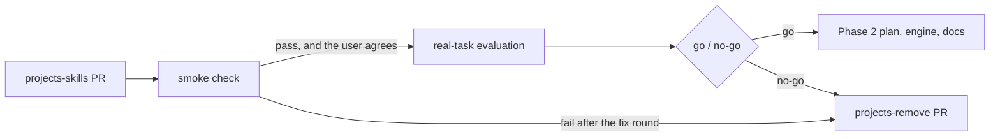

# Wintermute in Copilot app Projects: design

Date: 19 November 2026. Status: draft for the user's approval. Scope: the `wintermute` plugin in `ncksol/ai_tools` (`ghcp/plugins/wintermute/`), version 1.2.6 at `origin/main` commit `7e7ded4`, and GitHub Copilot app 1.4.3 Projects (public preview). Paths are relative to `ghcp/plugins/wintermute/` unless they start with `docs/`, `.github/` or `~`. Line numbers refer to commit `7e7ded4`.

## How to read this

- Section 7 holds the user's decisions. They are fixed.
- Choices made on the user's behalf are marked **(designer's call)**, each with its reason. None is approved yet. Section 8.18 lists them all.
- Section 9 lists what is left to the builder, and section 10 the unknowns.
- "Inference" marks a claim that was not checked directly. "Observed" marks behaviour seen in real logs, which the app doesn't promise.

Evidence notation:

| Tag | Source |
|---|---|
| [WN §n] | The plugin review of 19 November 2026, section n: the plugin at 1.2.5. Commit `7e7ded4` (#135) changed the canvas extension's SDK import, its validator check (`scripts/lib/validate-dashboard.mjs`), `tests/canvas.test.mjs`, `tests/packaging.test.mjs`, the CHANGELOG and the version; no agent or engine file changed. |
| [PR §n], [PR Un] | The Projects contract review of 19 November 2026, section n or unknown Un: app 1.4.3, with evidence from seven real Projects. |
| S*n* | Line *n* of `LC_ALL=C strings -n 20 /Applications/GitHub.app/Contents/MacOS/github` for app 1.4.3: a string in the binary, not a source line. |
| *label*:*n* | Line *n* of a real session's `events.jsonl`. The labels are S1 (the "Wintermute System One" Project), S1 repo and S1 chat (its two children), Bench (the "Wintermute benchmarking" Project), Expense (the "Expense reports" Project), Denied (an Expense child whose shell commands were denied), Trial Sim and CMC (two other Projects), Core #127 (an ordinary `wintermute-core` swarm with one owner unit) and Overnight (an ordinary `wintermute-core` session). |
| core:n, peon:n | Line n of `com.github.copilot/agents/wintermute-core.agent.md` or `wintermute-peon.agent.md`. |
| [K1]–[K7] | Checks made for this document, listed below. |

The two reviews and the mapping from labels to session IDs are in the user's private research notes, not in this repository.

Checks made for this document (read-only, or in scratch copies outside the repository):

- **K1. `/compact`.** S14749 says "Clear is not available for Projects. Use /compact to reduce context instead." Before the smoke check, no Project log read for this document showed a manual compaction; a Project's own automatic compactions have `trigger: "threshold"` (Expense:880; Trial Sim:1044), or, in one other Project, `"model_switch"`; a compaction with a top-level `agentId` in a Project's log is a sub-agent's (Bench:2119). In the smoke check, the user typed `/compact` in an opted-in Project, and the app accepted it. The Project's log has an own `session.compaction_start` and `session.compaction_complete` with the same attempt ID, `trigger: "manual"`, `outcome: "applied"` and `success: true`, before the user's next typed message, and the reply to that message started with `wintermute-project rules loaded.` without a second `/wintermute-project`. That is one observation: the log shows no new skill load after the compaction, and it doesn't show the reconciliation that F6 checks.
- **K2. Cost references.** `node scripts/swarm-snapshot.mjs --swarm <id> --no-pr-lookup` gives $32.28 for S1 and $32.08 for Core #127 (one owner, a reviewer, a claims checker and two judges). These are list-price conversions of usage records, not invoices. Summing the deduplicated usage records of the same sessions with the engine's own `usageOf` (`engine/readers/ledger.mjs`) gives the same two totals, and so does `sessions.total_nano_aiu` in `~/.copilot/data.db` for S1's three sessions, divided by 1011.
- **K3. The validator.** A scratch copy shows the copy guard's pitfall: a list item added only to `wintermute-core`, after a blank line, passes a guard that stops at the first blank line. The design in 8.8 catches it. With both skills and the guard, the suite has 1,170 tests and passes, and `npm run validate` passes. When the tier table and the list change in `wintermute-core` and in the skill together, the guard's tests still pass, because they take the policy text from `wintermute-core` instead of pinning it.
- **K4. CI.** `ncksol/ai_tools` has no checked-in root CI workflow (`.github/` holds only `copilot-instructions.md` and `plugin/`), and #135 reported no checks. `gh workflow list` shows the service workflows "Copilot" and "Copilot cloud agent". A claims check here rests on test runs at the pushed commit.
- **K5. Event shapes, by event kind.**
  - A plugin skill load is a `skill.invoked` event with `name`, `source: "plugin"`, `pluginName` and `trigger` (S1:57).
  - `session.start` and `session.resume` have `selectedModel` and `reasoningEffort`; `session.model_change` has `newModel` and `reasoningEffort`. A model change with a top-level `agentId` is a sub-agent's, not the session's (S1:240; S1 repo). A Project's own `session.start` can lack both, and its first model change sets them (S1:1, 4). `sessions.model` and `sessions.reasoning_effort` in `data.db` hold the session's own values. A `tool.execution_start` has `data.model`, the model that made the call (S1 repo).
  - `subagent.started` has a top-level `agentId` and `data.toolCallId` but no effort (S1:237). Some other events of a sub-agent carry `data.parentToolCallId`, but not all: a sub-agent's model change has only the `agentId` (S1:240).
  - The completion of a synchronous shell command that ran has `data.shellExecution.exitCode`, and its output ends with `<shellId: N completed with exit code N>`. Node's test runner prints its counts as `ℹ pass N` or as `# pass N`, depending on its reporter. A shell started in async mode has no exit code in its own completion; the exit shows in a later `read_bash` result. A denied call has `success: false` and `data.error.code: "denied"`, and no exit code or result (Denied:56).
  - In a Project, a `create_session` result names the child, as `(id: …)` for a repository child or `(session_id: …)` for a chat child, and its `Assignment ID` (S1:153, 1186). An ordinary session's `create_session` has no assignment ID (Core #127:52). A child's handoff returns "Child handoff saved for a coalesced coordinator update." (S1 repo), which says it was saved, not shown.
  - `persistent_project_results` in `data.db` holds the results the app saved for a Project. A child's report has a row whose `source_tool_call_id` is the ID of the child's `send_session_message` call, with `assignment_id` and `purpose`; the row gets `delivered_at_ms` once the result is delivered, so a saved row may not be delivered yet (S1). Rows with no `source_tool_call_id` also occur (Expense), consistent with the app's own notice for an assignment that ended without a report. `persistent_project_assignments` links each assignment to `child_session_id`, and `workspace_session_aliases` maps a repository child's workspace to each of its session IDs (S1).
  - A `user.message` with no `source` can still be a system notice that starts with `<system_notification>`; results from children arrive with `source: "agent-coordinator-results"` (S1).
  - An `assistant.message` that calls tools lists them in `toolRequests`, and a turn ends with `assistant.turn_end` (S1). The mode in effect shows in own `session.mode_changed` events (`newMode`) and in a turn's `user.message` `agentMode` (S1 repo).
  - A compaction records its `trigger`.
- **K6. Skill sizes.** The two skill texts in the plan are about 46 KB (with the copied table and list) and 14 KB, against about 69 KB for `wintermute-core`.
- **K7. Dashboard numbers.** `swarm-snapshot.mjs` prints `cost.usd` and `cost.byModel` for the swarm, and `model`, `effort`, `cost.credits` and `subagents` for the coordinator (`orchestrator`) and for each entry of `units` (S1). A Project with no children is not a swarm root, so it has no snapshot: the command exits 1 with `No swarm <id>` (Bench; C26).

## 1. Intent

The user's words:

- 29 October 2026: "Projects seems to be a new way how to use this app. I feel like it specifically fits into our idea of agentic swarm work. So I was wondering if I can take what I can from our wintermute plugin and enhance Projects with it, while keeping the UI/UX from the new Projects feature."
- 19 November 2026: "Wintermute plugin had some substantial changes since this research was done and plan written. Lots of things are not relevant any more. Lets reanalyse the state of Wintermute plugin and rewrite the plan for Projects integration"
- On the approach: "lets go with Copy. especially since I am not sure if Projects even a good place for Wintermute so we might abandon this after a few checks"

A Project is already a durable coordinator. It creates child sessions, follows them in its Overview, collects their output in its Inbox and Library, and runs its own schedules [PR §1]. What it lacks is wintermute's discipline: work split into units, a model and an effort chosen for every job, an independent review from another vendor's model and a claims check before every merge, and a limit on repair cycles (core:137-181, core:316-362).

A Project can't run `wintermute-core` as its agent: the app blocks custom agents in a Project and in its child sessions [PR §1, U1]. It does load plugin skills [PR §1; WN §1.2]. So the discipline comes in as two skills, and the Project stays the face of the work.

The user doubts that a Project is the right place for wintermute. So the work starts with the cheapest check that could rule it out, then one real task of the user's choice if that check passes, and ends in the user's go or no-go decision. Only a "go" leads to engine and dashboard work. A "no-go" removes everything in one PR.

## 2. Goals

1. Find out cheaply whether a Project is a good place to run wintermute, and let the user decide go or no-go from a smoke check, one real task, the dashboard and short notes from the logs.
2. A Project that the user opted in runs that work with wintermute's discipline: units, a model and effort for every job, an independent cross-vendor review and a claims check before every merge, and at most two repair cycles.
3. The Project's own UI keeps working as designed. Its Overview, Inbox, Library and Automations get what they expect: typed reports, assignment IDs, short handoffs, and deliverables published by the session that made them.
4. The skill's model tier table and "Never use these" list stay identical to `wintermute-core`'s, and a validator enforces it.
5. Opt-in per Project, and nothing happens in a Project that didn't opt in.
6. The smoke check changes nothing in any repository. The real task changes a real branch only through PRs that the user gives the go-ahead for.
7. If the answer is no-go, one PR removes everything.
8. If the answer is go, the dashboard later reads Project swarms: cost, sub-agents and the model of each child.

## 3. Non-goals

- Changing `wintermute-core` or `wintermute-peon` (decision 5).
- Replacing the Project's built-in coordinator prompt or any part of its UI.
- Hard tool limits in a Project. A skill can't remove tools [PR §1].
- Engine, server or UI changes before the go/no-go gate.
- A measured comparison with `wintermute-core` in an ordinary session, or scripts that measure the evaluation (decision 8).
- Azure DevOps repositories in the Phase 1 evaluation (8.10). The skills still support them.
- PR monitoring of any kind. Wintermute stopped all PR watching in 0.5.0 (core:368, peon:27).
- Event subscriptions (`manage_event_subscriptions`): live enablement is not proven [PR §1].
- PR changes other than open, publish, merge and pushes of assigned work to the branch of a PR the unit owns: retargets, build re-queues, reviewers and labels stay with the user (decision 7).
- Dashboard controls. The dashboard stays watch-only.
- A hook or a global instruction that loads the skill (decision 4).
- Chat children (`session_kind: "chat"`) as a delegation type. The worker skill still works in one, because its scope check uses the marker that chat children have.
- Swarms across several Projects, or `create_persistent_project`.
- Any change to the eval kit, or running Projects through the overnight eval runner.
- Validating `wintermute-pr-commands` in `npm run validate`, or a test that guards the core and peon report blocks. Both are real gaps [WN §1.1, §1.2], for separate work.

## 4. Anti-goals

The design fails, even if it technically works, when:

- a Project or an ordinary session acts under wintermute's rules without the user turning them on;
- a memory, a report, a summary or a table is taken as the user's permission;
- the Project's Overview or Inbox gets worse: reports the app can't route, long handoffs that flood the coordinator, deliverables that never reach the Inbox, or unchecked work that does;
- the copied tier table or "Never use these" list drifts from `wintermute-core` and nobody notices;
- a child loads the coordinator skill and starts to coordinate;
- the evaluation merges anything into a real branch without the user's go-ahead for that PR, or its cleanup deletes something the evaluation didn't create;
- work done before the gate touches an agent, or can't be removed in one PR;
- engine or dashboard work is done before anyone knows whether Projects fit;
- the evaluation ends without anything the user can decide from, or a record that the checker couldn't find is read as a pass.

## 5. Constraints

### App (Copilot app 1.4.3, public preview)

- **C1. No custom agents in a Project's lineage.** The selection handler, the child-creation helper and the runtime reject or drop a custom agent for a Project and its children (S18598, S14246, S14197). A strong static gate, not a tested call [PR §1, U1].
- **C2. Children can't create app sessions.** The `<copilot_project_child_session>` block bars creating or forking sessions, opening PR or issue sessions, and automations that spawn sessions; it allows reports, inspection, scheduling the same session and native sub-agents (S21739-21742) [PR §1].
- **C3. Tools: observed, not a manifest.** Real Project logs show shell, file edits, `sql`, `skill`, `task`, `create_session`, `get_session`, `send_session_message`, `relay_session_input`, `answer_session_input`, `respond_to_session_plan_v2`, `archive_session`, `update_project_memory`, `publish_chat_update`, `save_session_automation`, `open_canvas` and `ask_user` (S1; Trial Sim). S18970-18985 is a coordination tool list, not a complete manifest. `write_agent` was seen but works only on a background sub-agent (S1:620-625); `create_pull_request` was not seen in a Project. Neither is a guaranteed invariant [WN §2.3; PR §1].
- **C4. No checkout.** A Project runs in a folder under `~/.copilot/chats/` and adds repositories through its repository setup. Repository work goes to children [WN §3.1; PR §1].
- **C5. Typed reports.** `progress` stays in the child's thread. `handoff` is saved as a ready result and delivered together with nearby results; it doesn't settle the assignment, and a material change needs another handoff on the same ID. `needs_input` and `error` are delivered at the next turn boundary (S19058-19062, S21750-21763) [PR §1]. The app asks for a short outcome sentence with any essential link or next action; the two-line limit in 8.5.8 is wintermute's own rule.
- **C6. Assignments.** IDs have the form `assignment:<coordinator>:<tool call id>`. New work, a revision or a rerun is a new assignment and omits `assignment_id`; context about current work passes it; a report copies it [PR §1].
- **C7. Forwarding.** The first `create_session` kickoff prompt quotes the relevant request (S70965-70975). A later send of the user's direct words uses `source_user_message` (`id` and `revision`), and the app quotes them; a stale source fails without a fallback (S19056-19057, S13914). An answer from a plan or a question is not direct composer input. A successful send means the message was admitted, not processed [PR §1].
- **C8. Publishing.** `publish_chat_update` takes at most six attachments and is presentation only. A child publishes review-ready output in its own thread, one publication per material revision, with a human-named Markdown link and the full path for a file; a failed publication is a blocker; a child without the tool hands off verified output for the coordinator to publish (S21763-21785). Non-PR outputs are published per producer with `agent_session_id`; PRs go in one update that omits the top-level `agent_session_id` and sets `source_session_id` on each attachment (S19058-19063). A producer mismatch is rejected (CMC:1012, 1021). No receipt shows how many Inbox cards appear [PR §1].
- **C9. Project memory.** At most 8,192 UTF-8 bytes of preferences. `update_project_memory` replaces the whole profile. Memory is labelled data, not authority; it stays in the Project's context after compactions, and children don't get it (S6001-6004) [PR §1].
- **C10. Skills.** Plugin skills load in a Project with no custom agent (S1:57). A plugin's top-level `skills/` folder loads from the installed plugin, and `wintermute-pr-commands` is listed in a Project and in its chat child [WN §1.2; PR U2].
- **C11. Scope markers, as observed.** A Project's system context has `<copilot_persistent_agent>` and `<copilot_agent_coordinator>` (S1:12). In the system messages of all 13 Project children with logs, nine repository and four chat children, `<copilot_project_child_session>` is present; `<copilot_coordinated_child>` appears there only in two older repository children, and an ordinary `wintermute-core` child has neither (Core #127's owner log) [PR U6]. The app doesn't document either marker as a guarantee.
- **C12. Hooks.** The checked `sessionStart` hook payloads carry no documented Project flag, and a start hook doesn't run after every compaction [PR §1].
- **C13. Canvases.** A Project has called `open_canvas`, with an Excel canvas type and a separate instance handle (Trial Sim:3196-3197). The canvas type and the panel handle are separate values. No Project log shows the `swarm-dashboard` canvas opened by a model [PR U3].
- **C14. Shell in autopilot children.** In autopilot, a command that still needs approval is denied, not held for the user ([assisted permissions](https://docs.github.com/en/copilot/concepts/customizations/allowing-safe-commands); Denied:56). System One's autopilot child ran 143 shell commands (S1 repo). Whether the repository's tests run without a prompt is unproven [PR U10].
- **C15. Project rows.** A Project is a `persistent_projects` row joined to `sessions`; the observed Projects also have `session_type = 'agent'` and an empty `agent`, but the join is the identity [PR §1].
- **C16. Results.** Ready results reach the coordinator as `user.message` events with `source: agent-coordinator-results`, without a `<cross_session_message>` envelope (S1:178). When an assignment ends with no report at all, the app sends "The session finished without sending a handoff. Use get_session if you need its result."; it sends none for an assignment that already reported, even partly (S21755-21758) [WN §2.2; PR §1].
- **C17. Roster.** The app's prompt asks a Project for one sentence ending in a colon before `create_session`, and one short paragraph without bullets after it (S19049-19055) [PR §1].
- **C18. Relays.** `relay_session_input` shows a child's pending question to the user, by its `request_id`, and waits like `ask_user`; `outcome: "answered_here"` means the answer already reached the child (Expense:1837-1838). Its `context` is optional framing (S94457) [PR U8].
- **C19. Compaction.** Project memory survives a compaction; a loaded skill's text is not shown to survive [PR U5]. Manual `/compact` worked once in a Project, with `trigger: "manual"` (K1).
- **C20. Coordinator turns cost money.** A coordinator turn after a long idle gap can write its whole context to the cache again: an ordinary `wintermute-core` turn after an overnight gap cost about $1.22 at list price, nearly all cache write (Overnight:52619, `cacheTtlSeconds: 300`). Expense shows cache hits after gaps of 24 and 18 minutes (Expense:537, 867-868; 1748, 1779-1780), so the gap alone doesn't decide it. Fewer unnecessary turns can reduce usage; no cost per Project wake is known.
- **C21. Idle notices.** `coordinate_with_creator` defaults to true (S70982-70985). Idle means the end of a turn, not of a task (S70997-70999). `notify_on_idle: "once"` sends one idle notice, observed for a chat child (S1:1355).

### Plugin (1.2.6)

- **C22. Two agents.** `wintermute-core` and `wintermute-peon` (`scripts/lib/validate-package.mjs:6`). Their rules assume agent mechanics: a `tools` allowlist, `kickoff.agent: "wintermute:wintermute-peon"`, full Summary, Evidence and Blockers fields on every report, `blocked` sent with `purpose: "needs_input"`, go-ahead requests as `needs_input`, and progress replies to status checks [WN §4] (core:85, core:96, peon:82).
- **C23. The model policy.** The tier table is core:143-156 and the "Never use these:" list is core:172-181, the last block of "Models and effort". The table refers to "Follow-up jobs", "Evidence and review" and "Security review"; the list refers to "Evidence and review".
- **C24. `wintermute-peon` can't be a sub-agent.** It sets `disable-model-invocation: true` (peon:6), which blocks `task` launches.
- **C25. Skills.** `skills/wintermute-pr-commands/` is the plugin's only skill; its `description` is a folded YAML block (`skills/wintermute-pr-commands/SKILL.md:3-10`). `npm run validate` checks no skill [WN §1.2, §1.4].
- **C26. Engine on Projects today.** A node with no parent and at least one child is a swarm root (`engine/model/forest.mjs:139`); a Project with no child is never one, because only orchestrator agents promote a childless root (`engine/model/forest.mjs:115-138`). `run.project` is null for Project swarms (`engine/model/swarm.mjs:814`). Ready-result notifications are not parsed (`engine/model/messages.mjs:73`). Every automation shows as a PR monitor (`engine/model/messages.mjs:69-70, 120`). `relay_session_input` is not a wait, and relay framing is not read as a question tag (`engine/model/session-state.mjs:34`; `engine/model/contract.mjs:71-90`). A missing app table gives a warning diagnostic (`engine/readers/app-db.mjs:50`) [WN §1.3, §2].
- **C27. Snapshot IDs.** `--swarm` takes a root's node ID, matched exactly (`engine/engine.mjs:726-735`): the workspace ID for a repository-backed session (`engine/model/forest.mjs:47-58`), and the session ID for a chat-backed session, such as a Project (`engine/model/forest.mjs:67-76`). The snapshot shows what the engine reads, not every Project relation.
- **C28. Cost records.** `usageOf` (`engine/readers/ledger.mjs`) turns each usage record and compaction into one call with a dedupe key and a timestamp; snapshots sum them into 5-minute buckets (`engine/readers/ledger.mjs:93-98`). The dashboard's cost is that sum at list price. For a session that the dashboard doesn't show, `sessions.total_nano_aiu` in `data.db`, divided by 1011, gave the same dollars for S1 (K2).

### Repository

- **C29. Versions.** Every change under the plugin runs `npm run release:bump -- <version|patch|minor|major>` and replaces the new CHANGELOG section's TODO: major for incompatible changes to agent IDs, invocation, the canvas ID or the report and dashboard contracts, minor for compatible features, patch for compatible fixes (`CHANGELOG.md:5`) [WN §1.5].
- **C30. Skill rules.** Skill names stay namespaced to the plugin; no copy goes into `ghcp/skills/`; every `SKILL.md` has `name` and `description` frontmatter, an Operating mode section, an Output format, and the rules against invented results (`.github/copilot-instructions.md`).
- **C31. No PR-mutating skill.** "Do not add a skill that mutates a PR." (`.github/copilot-instructions.md:125`). Decision 7 adds one narrow exception.
- **C32. Node 18.** Shipped code uses no API newer than Node 18, and tests use no `t.after` or `t.before` (`tests/guards.test.mjs:48-64`). The plugin has no npm dependencies.
- **C33. The dashboard's cockpit view is an Easter egg.** New user-facing text (README, QUICKSTART, DASHBOARD.md, skill and plugin descriptions, CHANGELOG entries) never mentions it. Older CHANGELOG entries do, and stay as they are.
- **C34. Agent frontmatter parser.** `parseAgentFrontmatter` (`scripts/lib/validate-package.mjs`) accepts only one-line values, so a skill it checks needs a one-line `description`.

## 6. Approaches considered

All three put the Project rules in two skills. They differ in how the coordinator skill gets wintermute's model policy and review rules.

| | Copy (chosen) | Shared policy file | Read at load |
|---|---|---|---|
| How | The skill copies the model tier table and the "Never use these" list word for word, and a validator test fails if they drift from `wintermute-core`. The review and gate rules are written fresh for Projects. | Move the policy into one file that both `wintermute-core` and the skill load. | At every load, the skill reads "Models and effort" and "Evidence and review" from the installed `wintermute-core.agent.md`, through a table that adapts agent mechanics to Projects. |
| Gain | No file read at run time and no adaptation table. The Project text is easy to rewrite or to delete. `wintermute-core` doesn't change. | One source for all shared policy. | No copy at all. |
| Cost | The review rules exist twice and can differ in substance; only the table and the list are guarded. A tier change touches two files, which the validator forces. | It changes the core agent, against decision 5. | The two sections are about 22.8 KB, full of agent mechanics, so the adaptation table is large. `wintermute-core` changes in almost every release, so the adaptation breaks often [WN §1.5, §3.2]. |

The user chose Copy on 19 November 2026 and rejected the other two for the reasons in their Cost rows.

## 7. The user's decisions

1. The Project stays the coordinator and the face of the work. Its Overview, Inbox, Library and Automations stay as they are. Wintermute's rules follow the Project's conventions wherever they feed that UI: assignment IDs, typed `purpose` reports, short handoffs, and publishing deliverables to the Inbox.
2. Wintermute adds its discipline through a coordinator skill that the Project loads: units, a model and effort per child, an independent review from another vendor's model and a claims check before every merge, and repair-cycle limits. Children get a worker skill, because custom agents are blocked in a Project's lineage.
3. The dashboard should eventually read Project swarms: cost, sub-agents, the model per child.
4. Opt-in per Project, through the skill or a line in Project memory, not a global hook.
5. Agents unchanged: `wintermute-core` and `wintermute-peon` stay as they are, for top-level sessions and the evals.
6. Approach Copy (section 6).
7. A narrow exception to "Do not add a skill that mutates a PR." (19 November 2026). The PR-review skills (`strict-code-review`, `analyse-pr-feedback`, `rereview-pr`) stay inspection-only and never mutate a PR. `wintermute-project` and `wintermute-project-worker` may open, publish and merge a PR, but only after the user's explicit go-ahead for that PR, under the permission rules in 8.4, as `wintermute-core` and `wintermute-peon` already do. They may also push assigned work, including fixes and rebases, to the branch of a PR their unit owns, as `wintermute-peon` does. Any other skill still may not mutate a PR. The skills PR records the exception in `.github/copilot-instructions.md`, and the removal PR reverts it.
8. A lean evaluation (19 November 2026). The user answered "do 1" to this option: "Lean evaluation. Keep the skills PR as it is. Drop the three trial scripts and the paired, script-measured trial. The smoke check stays: a scratch Project, a second Project that hasn't opted in, one child, one handoff, tests in autopilot. Afterwards an independent checker session reads the logs, read-only, and reports pass or fail with evidence for each smoke criterion. The dashboard gives the cost. Then you use it on one real task of your choice and decide go or no-go, with cost and friction read from the dashboard rather than measured by a script. Cleanup is a short checklist: archive the sessions, close the PR, and delete the throwaway branch after checking it."

## 8. Design

### 8.1 Phases and gates

**The evaluation is lean (decision 8), and the cheapest decisive check comes first (designer's call).** Reason: the user said "we might abandon this after a few checks", so nothing that only matters for a long-term integration is built, and no real task is spent, before a cheap check could rule Projects out.

- **Phase 1, evaluate.**
  1. `projects-skills`, one PR: the two skills, the validator guard, short docs and the instructions exception, behind the opt-in.
  2. The smoke check (8.10): a scratch Project that opts in, a second one that doesn't, one child, one handoff, and tests in autopilot. A read-only checker session reports pass or fail for each condition, with evidence (8.12).
  3. The real-task evaluation (8.11), only if the smoke check passes and the user agrees: the user runs one real task of their choice in an opted-in Project, and a checker session writes short notes on F1–F7 from the logs.
- **The gate.** The user decides go or no-go (8.13).
- **Phase 2a, go.** A plan for the engine and dashboard work in 8.15, written from this design and the evaluation, then built.
- **Phase 2b, no-go.** One PR, `projects-remove`, removes everything Phase 1 added (8.16).

**One fix round in Phase 1 (designer's call).** A smoke check condition or an F1–F7 problem caused by a defect in the skill text may be fixed once, in a patch PR, followed by a new smoke check. A second failure counts as a fail. Reason: a fit that needs more than one round of prompt fixes is itself evidence against it.

**No bug fix moves before the gate (designer's call).** The one candidate is the engine's habit of calling every automation a PR monitor (C26). It has some value outside Projects, but wintermute's agents create no automations, so outside Projects it rarely shows, and it changes none of the gate's evidence. It goes into Phase 2a.

### 8.2 The pieces (Phase 1)

| Piece | Path | What it does |
|---|---|---|
| Coordinator skill `wintermute-project` | `skills/wintermute-project/SKILL.md` | The Project loads it. It adds wintermute's planning, delegation, model policy, review, gate and reporting rules to the Project's built-in coordinator. |
| Worker skill `wintermute-project-worker` | `skills/wintermute-project-worker/SKILL.md` | Each child loads it on its kickoff's instruction. It holds the child's rules for assignments, gates, reports and publishing. |
| Skill validator | `scripts/lib/validate-skills.mjs`, called from `scripts/validate-plugin.mjs`; tests in `tests/validate-skills.test.mjs` and `tests/validate-skills-plugin.test.mjs` | Checks both skills, and the copy of the model policy. |
| Docs | `README.md`, `CHANGELOG.md`, `.github/copilot-instructions.md` | An experimental section, release notes, the copy rule and the PR exception (decision 7). |
| Checker briefs | In the plan; not shipped in the plugin | What a read-only checker session must find in the logs, and the false passes it must rule out (8.12). |

- **Skill names (designer's call):** `wintermute-project` and `wintermute-project-worker`. Reason: namespaced to the plugin (C30), short to type, and they say they are for Projects.
- **Location:** the top-level `skills/` folder, where `wintermute-pr-commands` already loads (C10).
- **Size (designer's call):** only the rules that a pilot needs, centred on repository work that ends in a PR, with the conditions that change decisions kept from core:316-362. Reason: Phase 1 exists to judge fit; the texts are about 46 KB and 14 KB [K6].

### 8.3 Opt-in, recovery and turning it off

**Opt-in is a hard condition (designer's call).** The coordinator acts under the skill only when its system context has the Project marker (8.5.1) and either the user's message that it is answering starts with the command `/wintermute-project`, or the Project's memory holds the opt-in line below now. A command in an earlier message doesn't count, because the user may have turned wintermute off since. `/wintermute-project-worker` is a different command and doesn't count; nor does the command in a quote, a forwarded or child message, a file, or a summary that says the user typed it. The opt-in line:

> Wintermute: this Project follows the `wintermute-project` skill. If that skill's rules aren't in your context, load it before you do anything else.

Otherwise it stops following the skill: it applies none of its rules, reads and writes none of its tables, leaves the Project's memory alone, and handles the user's message as the Project would without the skill. Only when the user asked for wintermute does it also say, in one line, that wintermute isn't on and that a message starting with `/wintermute-project` turns it on. Reason: anti-goal 1, and a Project that didn't opt in must work as usual, not halt. Description matching is not a hard boundary [PR U13], so the guard must not depend on how the skill was loaded.

- **The skill's description is narrow (designer's call).** It names `/wintermute-project` and the opt-in line, and no general triggers such as "swarm". Reason: fewer accidental loads; the hard condition stops the rest.
- **Neither skill sets `disable-model-invocation` (designer's call).** Reason: the model must load the coordinator skill from the memory line after a compaction, and each child loads the worker skill on its kickoff's instruction. Both are model invocations, which the field would block.
- **Turning it on saves the opt-in (designer's call).** On `/wintermute-project`, when the memory lacks the line, the coordinator saves the whole current memory with the line added, within 8,192 bytes (C9). On every load that passes the conditions, it creates the `wintermute_project` table if needed, and inserts a row with `enabled = 1` when the table has no row or its latest row has `enabled = 0`. The table only records the switch for the dashboard: it never turns wintermute on and never grants a permission. If it can't save the line, it says that wintermute stays on only for messages that start with `/wintermute-project`, and until the line is saved it starts nothing that outlives its turn, such as a child session, because that child's later reports wouldn't reach it under the skill. Reason: the user's command is the opt-in for this Project; memory survives compactions; the table gives Phase 2's engine a marker that also records opting out (8.15).
- **Turning it off (designer's call).** The coordinator stops dispatching, tells the user which units have open work and asks what to do with each, then, with the user's consent, removes the line, keeping every other line, and records `enabled = 0`. Reason: the line alone would make a later load act again; in-flight work needs a decision, not silence.

**Every load** that passes the conditions starts with the line `wintermute-project rules loaded.`, reads the SQL state, and calls `get_session` for every child not marked archived, before any session, assignment, publish or merge (core:207).

**Recovery.** Whether the memory line makes a compacted Project load the skill again is unknown (U5), and manual `/compact` has worked once in a Project, with no new skill load after it (K1). The smoke check and the real task each include a `/compact` step; if the app doesn't accept it, F6 is not measured. The documented recovery in Phase 1 is that the user types `/wintermute-project` again. A conditional line in the user's global instructions is not part of Phase 1; Phase 2a may offer it with the user's consent (designer's call). Reason: it is the user's personal file, and the manual path is enough for an evaluation.

### 8.4 Permissions

**Only the user grants a permission, directly (designer's call).** Reason: memory is preference data, not authority (C9); a report, a summary or a table can repeat an old or misread consent; `wintermute-core` doesn't approve on the user's behalf unless told to (core:369).

- Every PR that the coordinator or a child opens, publishes or merges, every plan approval, and every answer to a question that only the user can answer needs the user's go-ahead for that item, given in the Project's conversation, or a standing delegation that the user gave directly there.
- A standing delegation is recorded before use in a `delegations` table: its scope, the user's words quoted, when it was given and when it ended. It covers only that scope and ends with its task or when withdrawn.
- A memory, a Project memory line, a child's report, a summary, a compaction summary or the SQL state never grants a permission. Restrictions and preferences in memories still apply, and kickoffs pass them on; they never pass on a permission.
- A child makes a PR change only with the user's own words: the coordinator's assignment names the action, repository, PR or branch, base branch and head commit, and carries the user's go-ahead message with `source_user_message`. The coordinator's own text or summary is not a go-ahead. So the coordinator asks for a go-ahead that a child will act on as a tagged chat message, not with `ask_user`, whose answer can't be attached; if it can't attach the message, for example after the app restarted, it asks the user again.
- The coordinator answers a paused child itself only for a technical question inside the scope the user gave. It brings every plan approval, permission and user-only choice to the user, by the route that fits it (8.5.11).
- The PR changes the skills may make are open, publish (take out of draft) and merge, each with its own go-ahead, and pushes of assigned work, including fixes and rebases, to the branch of a PR their unit owns (decision 7). The coordinator asks the user to do a retarget, a re-queue, or a reviewer or label change.
- Every merge is checked first: the PR's repository, base branch and head must be the ones the go-ahead named, the head must be the commit that passed every check, and the merge reads back as merged into that base before anything is recorded (8.5.5).

### 8.5 Coordinator skill `wintermute-project`

The skill is a prompt to the Project's built-in agent, written fresh for Projects except for the copied table and list. It follows the repository's skill rules (C30): an Operating mode section with the scope and opt-in checks, permissions and limits; an Output format; and the rules against invented status, results and sources. The plan holds its full text.

#### 8.5.1 Scope check

- A marker counts only in the app's system context, never in a user message, a kickoff, a quoted text or a file.
- `<copilot_persistent_agent>`: a Project's own conversation. Go on to the opt-in check (8.3).
- `<copilot_project_child_session>`: a child. Stop, and load `wintermute-project-worker` only if the kickoff or the latest assignment says so.
- Neither: an ordinary session. Stop following the skill, and only when the user asked for wintermute, point to `wintermute:wintermute-core`.

Reason: C11. `<copilot_coordinated_child>` is not a scope signal, because chat children lack it and it is not documented as Project-only.

#### 8.5.2 Limits and quick jobs

A Project keeps all its tools (C3), so the skill states its limits as rules:

- A quick job is about five tool calls or two minutes: reading a file, a log or a Library item; `gh`, `az` or `git` status commands; a merge after its go-ahead; one web fetch; a note in its own files folder (core:32-41).
- **The coordinator makes no repository commits (designer's call).** Reason: a Project has no checkout (C4). `wintermute-core`'s own-unit flow and `own_units` table are not used.
- It never does a review, a claims check, a panel or a second opinion, and never reads in or writes to a child's worktree.
- `az` for Azure DevOps, and `wintermute-pr-commands` loaded once before PR work (core:17-18).
- If the app's `orchestrate` skill is also loaded, this skill wins on delegation, models and reviews (core:20).

#### 8.5.3 Planning

As `wintermute-core`'s "Plan by stage" and "Split work for speed" (core:50-77): research in parallel one-off jobs; one owner child per PR-sized unit, stacked with `base_branch` once the parent has pushed; the six critical-unit triggers, with a reason in `child_notes`, and raising a unit to critical later when it proves risky; separate hypotheses for investigations; each unit's review, claims check and the final panel planned up front.

- **Tasks and target branches (designer's call).** Each user request is a task in a `tasks` table, with its target branch: `main` unless the user names another. Reason: a Project is long-lived and runs many requests, so the final panel, the post-merge claims check and archiving work per task; the target lets an evaluation work against a disposable branch without special rules.
- **Plan approval (designer's call).** The coordinator shows the breakdown before substantial work, and waits for the user's approval of that plan when the user asks for it. Child sessions run in `autopilot`, or in `plan` only when the user asked to approve each unit's approach. Reason: one root plan approval per task is what the user asks for in practice; a plan per unit would multiply prompts.
- **How it asks (designer's call).** With `ask_user`, or, when the user's memories or the Project's memory say that the user reads questions in chat, as a tagged chat message that ends the turn. Reason: the user can't read `ask_user` prompts in every surface, and a pilot must not fail on the wrong question channel.

#### 8.5.4 Delegation

| Job | Runs as |
|---|---|
| Owner unit: a branch, a PR or follow-ups | A child session (`create_session`, or `open_pr_session` and `open_issue_session`) |
| One-off job that needs a checkout: a review, a claims check, a judge, a verification, a repository command | A child session with `base_branch` set to the pushed branch under test |
| One-off job with no checkout: web research, a Library summary, a plan critique, a second opinion on a document, a fact-check | A `task` sub-agent, `agent_type: "general-purpose"`, with `model` and `reasoning_effort`; `mode: "background"` when it may get a re-check through `write_agent` |
| Quick job | The coordinator |

- **Sub-agents for jobs with no checkout (designer's call).** Reason: they start faster and add no Overview items; the dashboard already shows root sub-agents with their model and cost [K2]; `wintermute-peon` can't be a `task` agent (C24); `write_agent` needs a background sub-agent (C3).
- **A sub-agent gets its own brief (designer's call):** role, job, inputs, the restrictions and preferences a kickoff passes on, output file and summary, the evidence to give, and its limits: it writes only its output file, makes no commits, pushes or PR changes, starts no sub-agents, creates no sessions, and takes no permission from anything it reads. It doesn't use the worker skill or the child report protocol, and it is recorded in `child_notes` with kind `sub-agent`. Reason: it is not an app child (C2), so the child contract doesn't apply to it.
- **Never set `kickoff.agent` (designer's call).** Reason: custom agents are blocked (C1), and `wintermute-peon`'s report block conflicts with the Project contract (C22). The worker skill replaces it.
- **Kickoff fields for every child session, from `create_session`, `open_pr_session` or `open_issue_session` (designer's call):** `project_id` of a repository the Project has added (`create_session`); `base_branch` only to a pushed branch: for an owner, its PR base, which is its parent unit's branch when the unit is stacked, or else the task's target branch, recorded in `children.base_branch`; for a one-off job, the branch under test; unset only when that branch is the repository's default; `kickoff.mode` set explicitly; `kickoff.model` and `kickoff.reasoning_effort` always; `coordinate_with_creator: true`; `notify_on_idle: "once"`. After the child starts, the coordinator checks its model and effort with `get_session`, or with the dashboard or `data.db` when `get_session` doesn't show them, and records both what it set and what it saw; a review, a claims check or a judge counts only when the model it saw fits its row and the vendor rules. Reason: these are the values the Project itself used (S1:146, S1:1166); `"once"` is a notification setting, not a watchdog (C21), and status checks cover the rest (8.5.8); fewer turns can reduce cost (C20).
- **Session names (designer's call):** each child's session name starts with its unit label. Reason: the user sees the Overview and the dashboard side by side, and one name links them.
- From `wintermute-core` (core:90-103, 121-135): one owner per piece of work; confirm a start; a failed `create_session` can leave a session behind, so archive it, note it and retry once as a new unit; a child paused on a plan or a question doesn't read messages; helper requests are handled in core's order; the coordinator runs the fan-out of any workflow that launches agents.

#### 8.5.5 Merging

- **Merge only the PR, base branch and head commit that the go-ahead named (designer's call),** and only when that head is the commit at which every check passed. The unit's checks must have passed at that head against that base, with the same merge base. Right before the merge, the coordinator reads the PR once and compares its repository, base branch, head and state with the go-ahead, and its merge base with the checked one (on GitHub, from `gh api repos/<owner>/<repo>/compare/<base>...<head>`); if any differs, it doesn't merge and asks the user again. Reason: a PR can be retargeted after the go-ahead and keep the same head.
- **On GitHub, `gh pr merge <number> -R <owner>/<repo> --squash --match-head-commit <sha>` (designer's call).** Reason: GitHub then refuses the merge if the head moved. It doesn't check the base, so the read just before it is the base check. No GitHub write in `wintermute-pr-commands` is verified, so the coordinator says that this command is untested there.
- **On Azure DevOps, the user completes the PR, and no skill merges there (designer's call).** The coordinator asks the user to complete it, with the base branch and head commit to check first. Reason: no tested command in `wintermute-pr-commands` ties a completion to a head commit.
- Never delete the source branch.
- If the target moved since the final panel, the new integration is sized as a follow-up job before the merge (core:348-358).
- If the owner may be working on the PR, the coordinator tells it, on its current assignment, that it will merge, and waits for the owner's handoff that it paused (8.6).
- The coordinator reads the PR back and records `merged` only when the provider reports it merged into the base branch the go-ahead named, from the head commit it named, with its merge commit. A queued merge is not merged.
- No session watches a PR (core:368). For a required check whose CI is still running, one session may wait once, with a command that stops itself after about 30 minutes: `timeout 1800 gh pr checks <number> -R <owner>/<repo> --watch`, or, where `timeout` is missing, `perl -e 'alarm shift; exec @ARGV' 1800 gh pr checks …`. If it can't limit the wait, it reads the checks once and reports them as pending.

#### 8.5.6 Models and effort

- The skill's "Models and effort" section holds **the tier table and the "Never use these:" list, word for word from `wintermute-core`** (decision 6). The list is the last block of the section, as in core.
- Around them, fresh rules for applying the table in a Project: set the model and effort on every child and every `task` call; newest version of each family, or another family in the same tier; the vendor of each family; a child gets the tier of the work it owns; a follow-up job gets the tier of its own scope; execution at Max only in the Max row's two roles and only with approval; one tier-up rerun of a shallow one-off job, at most to High, but a document draft or fact-check reruns only at the next level its own row lists, and nothing tiers up after a `blocked` or `needs_input` report, a known cause or a repair cycle (core:158-169); a model and effort with a reason in `child_notes`.
- **Cross-references resolve inside the skill (designer's call).** The copied text points to "Evidence and review", "Follow-up jobs" and "Security review" (C23). The skill has a `## Evidence and review` section with bold labels **Follow-up jobs** and **Security review**, and the validator checks that every name the copied text quotes is a heading or a bold label in the skill. Reason: a copy that points to missing text is a silent drift in meaning.

#### 8.5.7 Kickoff prompts and forwarding

Each child session's kickoff prompt:

- starts with ``Load the `wintermute-project-worker` skill now, before anything else, and follow it for this whole session.``;
- quotes the user's request verbatim, then adds only what the child needs to work alone (C7);
- gives the unit label, the task's target branch and, for an owner, its PR base (its parent unit's branch when stacked, or else the task's target branch), what the child owns and must leave alone, and keeps decisions apart from suggestions;
- for Mid-tier implementation, includes acceptance tests;
- passes on the restrictions and preferences from memories, never a permission (8.4);
- for a one-off job: no commits or pushes, and whether it is read-only;
- for a one-off job or a unit whose work has no commit: the child's own session files folder for its result file, which its handoff links by full path;
- tells an owner that the coordinator starts its review and claims check.

Later messages:

- New work, a revision, a rerun or a go-ahead is a new assignment, without `assignment_id`; context about current work carries it (C6).
- **Every new assignment starts the coordinator's text with ``Follow the `wintermute-project-worker` skill; load it again if its rules aren't in your context.`` (designer's call).** Reason: children have no Project memory (C9), so this line is how a compacted child gets its rules back.
- The user's own words from a message they typed go through `source_user_message`; an `ask_user` answer is not such a message and can't be attached. An assignment for a PR change names the action, repository, PR or branch, base branch and expected head commit, and carries the user's go-ahead this way (8.4). For a draft for CI, the head is the owner's pushed commit, and no checks are needed yet; to publish or merge, it is the head at which the unit's checks passed, and the assignment also names the merge base they checked. A child's `needs_input` report gets a reply on its `assignment_id`; `answer_session_input` and `respond_to_session_plan_v2` are used only for a pending request that `get_session` shows, with that request's ID. The coordinator's own words go in `message` and `coordinator_instructions`, never presented as the user's and never as a permission. If a source is gone, the coordinator asks the user to send it again (C7).

#### 8.5.8 Reports, assignments and gates

| Status line | `purpose` | Reaches the coordinator |
|---|---|---|
| `complete` | `handoff` | As a ready result, with others that arrive close to it (C5) |
| `progress` | `progress` | Never |
| `needs_input` | `needs_input` | At the next turn boundary |
| `blocked` | `error` | At the next turn boundary |

- `blocked → error` replaces the agents' `blocked → needs_input` (decision 1). The engine already maps `error` to `blocked` (`engine/model/contract.mjs:6`).
- **A handoff is two lines (designer's call):** the `swarm-status:` line with `unit=`, and `pr=` and `commit=` when they apply, then `Summary:` with one outcome sentence; a sentence that starts with "Partial:" is not final. Longer results go to a file that the sentence links by full path. `needs_input` and `error` keep all three fields. Reason: the app asks for short handoffs (C5); the status line keeps the commit that checks need; the engine parses a report without `Evidence:` (`engine/model/contract.mjs:34-69`).
- `assignment_id` is an argument of `send_session_message` on every report, never part of the status line. Reason: the dashboard contract stays at version 1.
- **An `assignments` table (designer's call)** records each assignment's unit, role, scope, commit, `base_ref` (the base branch a check compared against, or a PR change targets), `merge_base` (the merge base of that commit and base that a check compared against), status (`open`, `partial`, `reported`, `superseded`) and latest result. A handoff doesn't close an assignment; a newer result replaces an older one; a duplicate is ignored. A verdict counts only for the commit, the base branch and the merge base it names, because the merge base fixes the diff that was checked: a new commit, a retarget of the PR to another base, or a new merge base, for example after a stacked parent was rebased, supersedes the earlier review, claims check and panel verdicts for that unit, and the new check is sized against the new head and base. Reason: one child holds several assignments, results can arrive late or twice (C5), and a verdict must never carry over to a diff it didn't check.
- **One-off jobs say whether their worktree is clean in the outcome sentence (designer's call).** Reason: archiving needs it, and a handoff has no `Evidence:` field.

**Gates (designer's call).** A unit's work is a chain of assignments, and each PR change has its own go-ahead:

1. Kickoff: implement, test, push; hand off with `commit=`. No PR yet.
2. CI that runs only on PRs: the go-ahead to open a draft PR for CI at the owner's pushed commit, as its own item. It needs no passed checks, and the draft is not review-ready; the owner checks right before it acts that its remote head is that commit. Without the go-ahead, the claims check uses local runs and reports CI as not run.
3. Checks: the review and the claims check at the pushed commit, against the unit's PR base, each naming the merge base it checked, and for a task's last unit in a repository, the final panel. Each fix is a new assignment.
4. Publish: with the review and claims check clean at the same commit, base and merge base, the go-ahead to open the PR ready for review (or take the draft out of draft) at that commit, sent to the owner as an assignment that names the commit, base and merge base and carries the user's go-ahead (8.4). Right before it acts, the owner fetches, then reads its branch's head on the remote, the merge base of that head with the base branch and, if the PR exists, the PR's repository, base branch, head and state; if any differs, it doesn't act and reports `blocked`. After it acts, it reads the PR's head and base branch back; if either differs, it makes no other change to the PR, doesn't publish it to the Inbox, and reports `blocked` with what it expected and what it read. Either way, that go-ahead is spent. Otherwise it publishes the PR and hands off with `pr=`. If a PR is already out of draft at a head or base that wasn't checked, the coordinator asks the user to put it back to draft; neither it nor a child may. **(designer's call)** Reason: an automatic rollback is one more PR change without the user's words.
5. Merge: with the review, the claims check and, for the last unit of its task in its repository, the final panel all clean at the PR's head, base and merge base, the go-ahead to merge; the coordinator merges (8.5.5).
6. After a task's last merge in a repository into the task's target branch, a claims check on that branch at the merge commit. A merge into a parent unit's branch doesn't get it. A task with PRs ends when every repository it changed has passed this check.

A unit whose work has no commit, such as research or a document, has no PR and no publish or merge gate: its owner hands off a result file, and its check is the one for work with no commit (8.5.10). A task with no PR ends when its results passed their checks and the coordinator reported them.

Reasons: the Project's model is "new work is a new assignment" (C6); children never ask for a go-ahead with `needs_input`, which keeps the immediate channel for real questions and blockers; each PR change is a separate permission (8.4); the merge stays with the coordinator, as in `wintermute-core` (core:113-117).

**Status checks (designer's call).** The coordinator never asks a child for a progress report, because the reply would never arrive (C5). When a child is idle and one of its assignments has no final result, it checks the child with `get_session`, then asks on that `assignment_id` for the result as a handoff or the blocker as an error. The app's no-handoff notice comes only for an assignment with no report at all (C16) and is not a report.

**Ending work.** Reviewers and claims checkers stay until their unit merges, and judges until the task's last merge, for re-checks (core:320-338); they are not archived as ordinary one-offs. A child is archived only when it is idle and has no open assignment, PR or automation; a busy child is told to stop first. An owner with commits also needs them pushed and its PR merged or closed, or, if it never had a PR, the user's decision on the unit; any other child needs its result recorded and its worktree clean, with no commits of its own. `outcome` is set before the archive, and each archive is recorded.

#### 8.5.9 State and registry

All state is in the Project's own SQL database, through `sql`: `todos` and `todo_deps`; `tasks` (with `target`); `children`, the dashboard's registry, with the exact definition from `wintermute-core` (core:216-231) and the same rules, one row per child session and none per sub-agent; `child_notes` per unit, with its task, kind, the model and effort it was given with a reason and the ones seen, working status, last report, and each verdict with its commit; `assignments`, with `base_ref`; `delegations`; and `wintermute_project`, created on every passing load.

- The coordinator takes a PR's URL from `get_session` or `gh pr view`, because handoffs have no `Evidence:` field.
- Unit labels follow the contract (core:189-192): 1–32 characters from `[A-Za-z0-9._-]`, unique within the Project across all tasks, never reused, compared with `lower(unit)`.
- The `children` definition is written out in the skill and not guarded by the validator (designer's call). Reason: the contract changes only with a new version across the dashboard, which would update the skill too, and the user chose to guard only the model policy.

**Final panel per task and per repository (designer's call).** When one unit of a task is left unmerged in a repository, its branch, rebased onto the task's target branch, gets the final panel alongside its review. The judges come from the two vendors that wrote the fewest of that task's units there, with Argon and Carbon counted together, at the critical levels if any of those units was critical. A panel finding blocks only if both judges raise it or it is reproduced. If the unit's PR targets a parent branch, the coordinator asks the user to retarget it (8.4). Reason: a Project runs many requests, so "the swarm" in core:331-338 has no end for a panel to wait for.

#### 8.5.10 Evidence and review

Written fresh, with the conditions from core:316-362 that change decisions: evidence that the work ran; the claims check before every merge, publish and "done" for repository work, by a separate read-only claims checker at the claims check row that writes a result file with the commit, its merge base with the base branch, the commands, their exit codes and the counts, and stays until the unit merges; for work with no commit, the file itself with its sources, and a fact-check from another vendor for a load-bearing document, which plays the claims check's role; one regular review per unit from another vendor, with core's vendor pairs; a critical review for critical units; **Security review** routing; the final panel (8.5.9); the disagreement panel, with one judge from the vendor outside the dispute; the one-vendor exception when the user limits the work to one vendor, which covers fact-checkers too and asks the user when a row has no model from that vendor; documents drafted and fact-checked by two vendors; must-fix and should-fix findings block, nits never do; **Follow-up jobs** sized by their own scope, with core's rules for when a mechanical change needs no re-check or no new claims check and the earlier verdict stands, when the unit's original reviewers return, and Astra's costly re-reads; re-checks of the new diff only; at most two repair cycles; a second opinion at Max from another vendor; required reviews stay open until done by someone other than the author.

**Left out of the minimal skill (designer's call):** incident investigators and the unavailable-judge fallback. Reason: neither affects the pilot, and both can be added later from core:316-362.

#### 8.5.11 Talking to the user and publishing

- Updates lead with what needs the user, and say nothing about idle notices or checks with no news.
- Every question starts with a tag: `[unit=<unit>]`, `[unit=<unit> need=pr]` or `[unit=* need=plan]` (core:382-398), and is self-contained.
- **What goes through a relay (designer's call).** A child's pending `ask_user` question that only the user can answer goes through `relay_session_input` with its request ID and the tag at the start of the context; the answer isn't sent again after `outcome: "answered_here"` (C18). A child's plan always goes to the user as a tagged question, unless a standing delegation that the coordinator recorded covers approving that unit's plan, and the decision goes back with `respond_to_session_plan_v2` and the plan's request ID. A child's `needs_input` report is not a pending request: the coordinator replies on its `assignment_id`, and brings a user-only question in it to the user in chat, so that it can attach the reply. A tool approval that a child's session holds is named to the user, who answers it in that session. Reason: `relay_session_input` is advertised for a child's question (S94457), not for a plan or a permission. The tag is a wintermute convention; the 1.2.6 dashboard doesn't read relays (C26), so Phase 2a must parse them before the dashboard claims support.
- **Children publish their own review-ready output (designer's call).** A PR is review-ready at the publish gate, after a clean review and claims check; a draft PR for CI is not. A document or other output is review-ready when the coordinator says so in an assignment. Publication follows C8: a PR by its web URL and a file from the child's own session files folder, once per material revision, a failure reported as a blocker, coordinator publication when a child lacks the tool, and the coordinator's own routing for batches. A publish receipt is not proof of an Inbox card and never an authorization. Reason: the Inbox gets checked work only (anti-goal 3), and the app's own instruction to children stays intact.
- The roster follows the app's rules (C17), and adds each new child's model and effort.
- **The dashboard (designer's call).** When a task's first child exists, the coordinator checks with `list_canvas_capabilities` that the `swarm-dashboard` canvas is installed, then opens it once with `canvasId: "swarm-dashboard"`, `instanceId: "wintermute-<task>-dashboard"`, `input: {}`. If it is missing or fails, it tells the user once and carries on. Reason: the canvas type and the panel handle are separate values (C13); an unavailable dashboard is an observation, not a gate.

### 8.6 Worker skill `wintermute-project-worker`

**Scope check.** The skill applies only when the app's system context has `<copilot_project_child_session>` (C11) and the kickoff or an assignment from the coordinating Project tells the child to load it. Otherwise the child stops following the skill and carries on with its work; it says so only when it was asked to use the skill.

**Permissions.** An assignment tells the child which job to do. A PR change also needs the user's go-ahead in the user's own words: the assignment names the action, repository, PR or branch, base branch and head commit, and carries the user's message through `source_user_message` (8.4). The coordinator's text or summary is not a go-ahead; without the user's message, the child reports `blocked`. Memories, reports, summaries and state never grant a permission.

**Carried over from `wintermute-peon`** (peon:19-61), written for a Project:

- owner unit or one-off job, as the kickoff says;
- no sessions, no agent CLIs from the shell, no app local API, no assigning work to Copilot, no Copilot code review requests;
- **no sub-agents (designer's call)**: a step that a skill or brief says to give a sub-agent is done by the child itself, and one that needs independence becomes a helper request. Reason: the coordinator keeps the model policy and the fan-out in one place, and cost lands where the dashboard expects it. Children may use sub-agents under the app's rules (C2), so this is a rule, not a limit;
- **no `ask_user` (designer's call)**: questions go to the coordinator as `needs_input`. Reason: every question reaches the user through one place, with its tag;
- PR changes only with that go-ahead: a draft for CI against its PR base, publishing, or a merge; never a retarget, re-queue, reviewer or label change;
- a draft for CI at the named commit, after checking that its remote head is that commit; it needs no passed checks;
- a publish at the named commit, base and merge base: right before acting, a fetch and a read of the branch's remote head, its merge base with the base branch and the PR, with no action and a `blocked` report on any difference; after acting, a readback of the PR's head and base branch, and on a difference, no other change to the PR, no Inbox publish, and a `blocked` report with what it expected and what it read;
- a merge only after a fetch and one read of the PR: if its repository, base branch, head or merge base differs from the assignment, no merge, and a `blocked` report; on GitHub with `--match-head-commit` and a readback; on Azure DevOps, no merge, and a `blocked` report so that the user is asked;
- when the coordinator says that it will merge the PR, stop work on it and hand off on that assignment that the work is paused; read the PR's state again after a pause, and stop if it merged or closed;
- no PR watching, and one CI wait with a command that stops itself (`timeout 1800`, or `perl -e 'alarm shift; exec @ARGV' 1800`), or one read of the checks when the wait can't be limited;
- Copilot Browser and Computer Use, with sign-ins and approvals sent as `needs_input`;
- `az` and `wintermute-pr-commands`;
- after two failed attempts, report `blocked`;
- a reviewer sent a claims job does the review only and says so;
- one-off limits: inside the brief, no commits or pushes, files only where told, read-only when asked except for the result file it was asked for; a PR job changes only the PR, at the named commit;
- a review, claims check or test run writes a result file with the commit and its merge base with the base branch; a claims check or test run adds each command, its exit code and the counts;
- an owner whose work has no commit writes its result to a file and hands off with a link; there is no PR;
- no invented results, and anything not checked is marked as unverified.

**Replaced by the Project contract:**

| `wintermute-peon` | `wintermute-project-worker` |
|---|---|
| Full report block on every report | Handoff: the status line and one `Summary:` sentence ("Partial:" when not final). `needs_input` and `error`: all three fields |
| `blocked` sent with `needs_input` | `blocked` sent with `error`, including a failed publish |
| Go-ahead requests as `needs_input` | Hand off at the gate and wait for the next assignment |
| A reply to a status check is `progress` | No status checks; `progress` stays in the child's thread |
| No `assignment_id` | `assignment_id` on every report; another handoff on the same ID when the result changes |
| `git status` output under `Evidence:` | "worktree clean" or not, in the outcome sentence |
| No publishing rule | Publish review-ready output in its own thread, once per material revision, then hand off |

Also: the session name starts with the unit label, and the child keeps its todos current, because the Overview shows them.

### 8.7 Contract terms in a Project

| Term | In a Project |
|---|---|
| Unit labels | Kept, same rules. |
| `children` table | Kept, same definition, in the Project's SQL database; child sessions only. |
| `swarm-status:` line | Kept on every report. |
| `Summary:`, `Evidence:`, `Blockers:` | Kept on `needs_input` and `error`. A handoff has only `Summary:`. |
| Question tags | Kept on questions, in `ask_user` or a chat message; also at the start of a relay's context, as a convention. |
| `purpose` for `blocked` | `error` instead of `needs_input`. |
| Progress reports | Stay in the child's thread. |
| Go-ahead requests | Replaced by gates and new assignments; an assignment for a PR change carries the user's own go-ahead through `source_user_message`. |
| `kickoff.agent` | Not set; the worker skill replaces it. |
| Everything in `message` | The user's typed words through `source_user_message`; answers through the answer tools; the coordinator's own words in `message` and `coordinator_instructions`. |
| Deliverables as paths | Children publish review-ready output; long results are files linked from the outcome sentence. |
| Final panel on the swarm's last PR | Per task and per repository, against the task's target branch. |
| `own_units` | Not used. |
| The `tools` allowlist | Replaced by rules. |

### 8.8 Validator guard (Phase 1)

A new module, `scripts/lib/validate-skills.mjs`, called from `validatePlugin` in `scripts/validate-plugin.mjs` with one import and one call **(designer's call: nothing else in `validate-plugin.mjs` changes, so removal is two lines)**. For each of the two Projects skills it checks:

- `skills/<name>/SKILL.md` exists, its frontmatter parses with `parseAgentFrontmatter` (C34), `name` equals the folder, `description` is present and at most 1,024 characters, and `disable-model-invocation` is not set;
- no copy of the skill is in `ghcp/skills/`.

For the coordinator skill and `wintermute-core` it reads the "Models and effort" section of each, and fails closed when either can't be read without guessing:

- **The tier table** is the one Markdown table in the section outside code fences, with a header row, a separator row and body rows of the same width. A fence opens with three or more backticks or tildes and closes only with a matching run. Every delimiter row outside a fence counts as a table, so a second table without leading pipes can't hide, and a line right after the table that Markdown reads as another row is an error. No table, two tables, or pipe lines that aren't a table are errors, and so is a second `## Models and effort` section, including one written with up to three spaces of indent or closing hashes.
- **The "Never use these:" list** runs from that line to the end of the section, and may hold only list items, wrapped continuation lines and blank lines. Any other text after it is an error, because the list's end would be unclear. So a new item added only in `wintermute-core`, even after a blank line, is part of the core's list and shows as drift [K3].
- The two blocks in the skill must equal those in `wintermute-core`; a difference names the first different line.
- Every capitalised quoted name in the copied blocks must be a `## ` heading or a bold label in the skill (8.5.6).

**The validator covers only the two Projects skills (designer's call).** Reason: anything wider, such as checking `wintermute-pr-commands`, would survive an abandon and so belongs to separate work (section 3).

Tests, with Node 18 rules (C32):

- `tests/validate-skills.test.mjs` uses a scratch folder holding the real `wintermute-core` and fixture skills: table and list extraction, including fenced, fake, double and uneven tables and wrapped, loose and trailing list text; a passing pair; drift in a table row, in a list item and as a loose item added only in core; text after the core's list; a skill without its copy; a missing referenced label, and a label that is only inside a code fence; a second `## Models and effort` section, also one with closing hashes; a table inside a tilde fence; a second table without leading pipes; a row without outer pipes right after the table; each packaging rule. Each drift is made by editing the policy text that the test reads from `wintermute-core`, after checking that the edit changes it, and the expected line is computed from that text. So a change to the policy in both files doesn't break the tests [K3].
- `tests/validate-skills-plugin.test.mjs` runs `validatePlugin` on a scratch copy of the whole plugin with an edited `wintermute-core`, so that `npm run validate` is proved to catch table and list drift without touching the real agent file. It fails until the hook is wired in.

### 8.9 Documentation and version (Phase 1)

- `README.md`: one line after "What's in the plugin" pointing to a new section, `## Projects (experimental)`, placed before `## The swarm dashboard`. It says what the skills do, that they are an evaluation that may be removed, that they act only in a Project that opted in, that go-aheads stay with the user and that PR go-aheads are asked for in the chat, that a PR is published or merged only at the checked commit while a CI draft needs only the go-ahead, that on Azure DevOps the user completes PRs, how to turn them on and off, that `/wintermute-project` restores the rules after a compaction, that the model policy is a validated copy, and that the dashboard shows a Project once it has children.
- `.github/copilot-instructions.md`: the `wintermute` plugin entry names the two skills and their validator; a new bullet after the report-block rule states the copy rule; and the bullet "The **PR-review skills** are inspection-and-reporting only…" gains decision 7's exception after "Do not add a skill that mutates a PR.".
- QUICKSTART.md and DASHBOARD.md don't change in Phase 1 (designer's call). Reason: an experiment stays out of the getting-started path, and the dashboard doesn't change.
- **Version:** `npm run release:bump -- minor` (a new feature), with an "Added" section (C29). From 1.2.6 that gives 1.3.0; the notes use whatever version the command prints.

### 8.10 The smoke check

**A capped, non-destructive check in two scratch Projects comes first (designer's call).** Reason: if the skill doesn't load on opt-in, a Project that didn't opt in still acts, a child can't be started with the right model, a handoff doesn't route, or a child can't run the tests, then Projects is ruled out before the user spends a real task on it.

**GitHub repositories only (designer's call).** The smoke check uses `ncksol/ai_tools`, and the real task (8.11) must be in a GitHub repository. Reason: the checkers' PR readbacks and the cleanup lists use `gh`, and Azure DevOps would need a second set of commands for an evaluation that may be abandoned. The skills keep their provider-neutral rules; only the evaluation is GitHub-only.

- **The tag.** Each smoke check has its own tag, `wm-smoke-<UTC date>-<UTC time>`, for example `wm-smoke-20261120-0915`, and its records in the orchestrator's files folder must not exist yet. The user names the two Projects `<tag>-project` and `<tag>-negative`, and starts every prompt with the tag, so that the checker finds exactly one Project of each.
- **The opted-in Project** gets one read-only one-off job on `ncksol/ai_tools`: run `npm test` and then `npm run validate` in `ghcp/plugins/wintermute` at a fixed commit of `main`, write the result file that the worker skill describes, and hand off. The user reads `main`'s commit just before the opt-in message and puts it in the prompt. Reason: if `main` moves during the check, the expected commit doesn't. Nothing is committed, pushed or opened as a PR.
- **The negative Project** gets one plan-only question that invites a swarm, without `/wintermute-project`, and nothing else.
- **The model.** The user picks the Project's model and effort if the app offers a choice, and notes what it showed. If it offers none, the checker records the Project's effective model from its own model events (K5). This decides nothing.
- **The opt-in command.** If the app doesn't accept the `/wintermute-project` prompt, or sends it without loading the skill, S1 fails, and the report says so. No other way of turning wintermute on is tried in the same check.
- **Caps (designer's call):** 30 minutes from the opt-in message to the child's handoff, and $12 for the opted-in Project on the dashboard. The user watches the clock and the dashboard, and stops the Project at either cap. They are thresholds the user acts on, not spending limits: the dashboard's cost lags behind the work, a stop message doesn't cancel a turn that is already running, and the dashboard shows a Project only once it has a child session (C26). Until then, or if the dashboard doesn't show it at all, the clock cap still applies. The negative Project gets one reply, so it has no cap. Reason: a check that is meant to be cheap needs a ceiling, and the dashboard is the tool the user already has.
- **The dashboard** is the `swarm-dashboard` canvas, or, if it doesn't open, the browser launcher: `node scripts/swarm-dashboard.mjs` in the installed plugin's folder, then `http://127.0.0.1:7927/`.
- **No settings change.** The user notes the app's approval settings before the check and doesn't change them during it. The user approves a held command only if it is `npm test`, `npm run validate` or the checkout of the commit in the prompt, in the child's checkout, and notes every hold and denial.
- **`/compact`, as an observation only.** After the handoff, the user notes the clock time, types `/compact` in the opted-in Project and asks a read-only status question. The checker looks for the Project's own compaction that started after that time and before the user's next message and completed with the same attempt ID and `outcome: "applied"`, with a trigger that is present and is neither `threshold` nor `model_switch`, which are automatic, and writes its trigger as recorded. Without one, the result is "unknown": an automatic compaction is not evidence that the command worked. This is early evidence for U5; it doesn't decide the smoke check.

**Pass conditions.** The checker (8.12) reports each condition as pass, fail or not measured, with the records it found and the false passes it ruled out. Here, a typed message is a `user.message` with no `source` that doesn't start with `<system_notification>` and has no `<cross_session_message>`, and an own event is one with no top-level `agentId` (K5). The smoke check passes only when S1–S4 all pass.

| # | Check | Evidence the checker must find | False passes it must rule out |
|---|---|---|---|
| S1 | Opt-in | In the opted-in Project: the user's first typed message, the opt-in message, starts with `/wintermute-project` and the tag; and an own `skill.invoked` for `wintermute-project` with `source: "plugin"` and `pluginName: "wintermute"` is tied to that message in one of two ways. After it: the load comes after the opt-in message and before the next typed message, the first own `assistant.message` after the opt-in message and the first own session tool call. Before it, which is how the app records a typed slash command: the load has `trigger: "user-invoked"`, comes before the opt-in message, and the only events between the two in the log are `hook.start` and `hook.end`. In both cases the load comes before the first own session tool call. If the log doesn't establish one of these links, S1 doesn't pass. The Project's first reply text after that message starts with `wintermute-project rules loaded.`. In the negative Project: its first typed message is the negative prompt with the tag; the whole interaction, up to the next typed message or the end of the log, ended with an own `assistant.message` with content and no tool requests, then an own `assistant.turn_end`, and that reply doesn't start with `wintermute-project rules loaded.`; and in that interaction, no own call that reads Project state, writes anything or delegates: `sql`, `update_project_memory`, `get_session`, `create_session`, `send_session_message`, `open_pr_session`, `open_issue_session`, `task`, `publish_chat_update`, `save_session_automation`, `relay_session_input`, `answer_session_input`, `respond_to_session_plan_v2`, `archive_session`, a shell tool, a file-changing tool such as `edit`, `create` or `apply_patch`, or any other tool that changes state or delegates, such as `create_pull_request`. The checker lists every own tool call in that interaction, and whether `wintermute-project` loaded. | No negative log, no negative prompt, or no completed negative turn: not measured. A forbidden call after a `wintermute-project` load fails S1, because the skill acted without opt-in. A forbidden call with no such load is not measured, noted as ordinary Project behaviour: the control didn't hold. A message with tool requests is not a completed reply, and an `assistant.turn_end` in the middle of the interaction is not its end. A load of `wintermute-project-worker`, a load from another plugin or source, a sub-agent's load, or a load after the first session tool call is not the opt-in load. |
| S2 | Dispatch | Exactly one child of the opted-in Project, counting each child workspace or chat once with all its session IDs (K5). One own session tool call after the opt-in message: a `create_session` whose `kickoff` sets `model` and `reasoning_effort` and has no `agent`, and whose completion succeeded and names the child and its assignment ID. In the child's own logs, the model and effort it worked with equal the request: the last own `session.start`, `session.resume` or `session.model_change` before its first own tool call, and that call's `data.model`. `sessions.model` and `sessions.reasoning_effort` in `data.db` agree. | More than one child fails S2. A `session.model_change` with a top-level `agentId` belongs to a sub-agent and doesn't count. A request with no child log, or a model picker's label, is not proof: not measured. |
| S3 | Handoff | The child's final report on S2's assignment: the last own `send_session_message` call to the Project with `purpose: "handoff"`, a non-empty `assignment_id` equal to the one in S2's `create_session` result, and a `Summary:` line that doesn't start with "Partial:"; its first line is `swarm-status: complete unit=<label>`, and its completion succeeded. A later assignment to the same child, such as publishing its result file, doesn't change which report is final for this one. In `data.db`, the `persistent_project_results` row whose `source_tool_call_id` equals that call's ID has the same `assignment_id`, the child's session ID, `purpose` `handoff` and a `delivered_at_ms`. | An empty or missing `assignment_id` never matches: two missing IDs are not a match. An ID of another assignment fails. A "Partial:" handoff is not the result. A delivered row of an earlier report on the same assignment doesn't count: the row is matched by its source call ID. A saved row with no `delivered_at_ms` is not measured. A row with no `source_tool_call_id` comes from the app, not from the child (K5). |
| S4 | Tests | The last run of `npm test` and the last run of `npm run validate`, each alone or joined with `&&`, in `ghcp/plugins/wintermute` at the commit in the prompt (the result file's commit). For each run: its own completion has `success: true` and `shellExecution.exitCode` 0, or, for a shell started in async mode, the `read_bash` results for that shell ID run up to one that says `completed with exit code 0`. The output of that same shell, up to its completion, shows its command's success: for `npm test`, a pass count above 0 and `fail 0`, in either of Node's formats (`ℹ pass N` and `ℹ fail 0`, or `# pass N` and `# fail 0`); for `npm run validate`, `Plugin validation passed`; one run joined with `&&` shows both. No own call in the child has `error.code: "denied"`. The child's mode at each command was `autopilot`: the latest own `session.mode_changed` before it, or else its kickoff message's `agentMode`. No command ran `git commit`, `git push` or `gh pr create`; the child's workspace has no created PR, and `gh` lists no PR from its branch; the handoff says its worktree is clean. | An exit code or output from another call, such as an earlier passing run when the last one failed, or a later `cat` of an old file. A pipe that hides the exit code (`npm test \| tail`), or a command that only prints the words (`echo npm test`). A denied call, which fails S4 even if a later call passed. The current `sessions.mode` and a shell call's `mode` argument (`sync` or `async`) are not the mode at the command. |

- **Verdict (designer's call).** All four pass: the smoke check passes. Not measured: a second checker reads the same logs and writes its own report; this costs only its own model calls. If it is still not measured, the smoke check has no pass. A fail caused by the skill text, with the fix round unused: the fix round, if the user agrees. Any other fail: no pass. Reason: a missing record must never read as a pass, and a paid repeat needs the user's consent.
- **Gate 1** follows these verdicts (8.13).

### 8.11 The real-task evaluation

**After a passing smoke check, and only if the user agrees, the user runs one real task of their choice in an opted-in Project, and decides from the dashboard and short notes (decision 8).**

- **A GitHub repository** (8.10).
- **The Project (designer's call):** a new Project whose name starts with a tag, `wm-eval-<UTC date>-<UTC time>`, unique to this attempt, on the task's repository, opted in with `/wintermute-project`. The user records its exact name. Reason: the dashboard's cost and the checker's search then cover this task alone, and a second attempt on the same day can't be mixed up with the first.
- **The dashboard and the budget (designer's call).** Before the first prompt, the user writes down the most they will spend on the task, and a time limit. They stop the Project at either, using the dashboard and the clock. As in 8.10, these are thresholds the user acts on, not spending limits. The dashboard shows the Project only once it has a child session; a task done only by sub-agents, such as some research, has no dashboard view in Phase 1, so for it the time limit is what the user watches, or the user picks a task that will have a repository child. Missing dashboard numbers are reported as unavailable, never as zero.
- **Target branch (designer's call).** When the task opens PRs, it works against a disposable base branch by default, `<tag>-base`. The user creates it in one step, with GitHub's API for creating a reference, from the target branch's commit, which they read just before: `gh api -X POST repos/<owner>/<repo>/git/refs -f ref=refs/heads/<tag>-base -f sha=<commit>`. The call creates the branch or fails if it already exists, so nothing can change in between; the user reads the branch back and records its commit. It creates the branch at the recorded commit; it doesn't stop the target branch from moving after the read. This call wasn't run for this design; GitHub documents `201 Created`, `409 Conflict` and `422 Validation failed` as its responses, and any failure means that branch isn't used ([Git references](https://docs.github.com/en/rest/git/refs#create-a-reference)). Every PR of the task targets it, and each merge into it needs the user's go-ahead for that PR, as for any work under the skill. The user may instead name `main`, or another real branch, as the target; then each merge needs the same go-ahead, and nothing more. A task that opens no PR needs no base branch. Reason: the user may still abandon Projects, so by default nothing reaches `main` during the evaluation, and a single create call can't move a branch that someone else created.
- **The model and the opt-in command** follow 8.10.
- **Working as usual.** The user works as they normally would: reviews the plan, answers questions, gives go-aheads. They note the app's approval settings and don't change them during the task, and they write short notes as they go: what they had to click, watch or wait for, any confusion, any time they opened a child's session to unblock it, holds and denials, and what the Overview and the Inbox showed.
- **`/compact`.** Once, while children are active or after the last merge, the user notes the clock time, types `/compact` in the Project and asks a read-only status question. They note whether the app accepted the command and whether the reply starts with `wintermute-project rules loaded.`; if it doesn't, they type `/wintermute-project` once and note it. In the smoke check, `/compact` worked once, with `trigger: "manual"` (K1).
- **The evaluation ends** in one of three ways: the task's work is merged; for a task with no PR, the user accepts its result; or the user stops it. Then the user gives the orchestrator the tag, the Project's exact name, their notes, their budget and time limit, and the orchestrator starts the checker (8.12).

**Notes, F1–F7.** The checker writes one short note per item, with the records it found: "ok", "problem" with what happened, or "not seen" when the task didn't exercise it or the records are missing. These notes inform the user; they are not a score. Typed messages and own events are as in 8.10. The user's answer is the completion of an own `ask_user` call (its result starts with "User responded") or of an own `relay_session_input` call (its `answer` field), joined to the question by the call's ID; or, for a question asked in chat, the user's next typed message. Delivery alone, such as `outcome: "answered_here"`, is not a go-ahead: the answer's words are.

| # | Item | What the checker looks for |
|---|---|---|
| F1 | Skill loads | An own `skill.invoked` for `wintermute-project` from the `wintermute` plugin (`source: "plugin"`, `pluginName: "wintermute"`) tied to the opt-in message in one of the two ways that S1 allows (8.10), and before the first own session tool call; each child's own load of `wintermute-project-worker` the same way before its first own tool call other than `skill`; no child loads the coordinator skill. |
| F2 | Models | Each child session request sets `model` and `reasoning_effort` and no `kickoff.agent`, and the child works with them (as in S2); each `task` call sets `model` and `reasoning_effort`, and its `subagent.started` shows that model; each pair fits its role's row in the tier table and isn't on the "Never use these" list; a reviewer comes from another vendor than the author, and judges follow the final-panel rule; any override the user asked for is named. |
| F3 | PR gates | Only when the task opened PRs. Each PR is identified by its full URL, so its repository and number, and its base branch. For each PR action that happened, opening, publishing (ready for review) and merging: the owning session's successful operation, an own app-tool completion with `success: true` or an own shell completion with exit 0 for `gh pr create`, `gh pr ready` or `gh pr merge` (`success` alone isn't enough for a shell command); and, before it, the user's answer that gave the go-ahead for that action on that PR, to a question that named the repository, base branch and head, or a standing delegation that the user gave directly and whose scope covers it. When a child made the change, the coordinator's assignment for it carried the user's go-ahead message through `source_user_message` (8.4). For the opening, the question names the repository, head branch and base, and the PR is the one that the opening call returned. Publishing and merging each came after the review and the claims check, and for a merge of the task's last unit the final panel, reported clean at the same head commit, base branch and merge-base commit as the assignment for the action and the read just before it: the owner's merge-base read before publishing, or the coordinator's compare call before merging. A verdict whose merge base differs, for example after a stacked parent was rebased, doesn't count, and a known mismatch is a problem; a value the records don't show is "not seen". The merge reads back as merged into that base, with a merge commit. The claims checker was a separate session from the owner and the reviewers, and a claims check ran on the target branch at the last merge commit. Evidence that can't be found, such as the head at an earlier time, is "not seen". A PR in another repository with the same number, a URL in a message without a readback, an Inbox card on its own, or a go-ahead taken from memory or a summary, is a problem, not "ok". |
| F4 | Reports | Each child report, an own `send_session_message` call, is joined to its completion, which must show `success: true`, and, by `source_tool_call_id`, to its `persistent_project_results` row. Every handoff, `needs_input` and `error` report carries a non-empty `assignment_id` that belongs to that child and to the work the report is about; `purpose` matches the status line (`blocked` goes with `error`); handoffs have at most two non-empty lines; the full text of each `needs_input` and `error` report is read, and none asks for a go-ahead; every assignment with work to report has a final result, or the coordinator's reconciliation explains why not. A result row with no source call ID is the app's own notice and is noted as "ended without a report". `progress` reports stay in the child's thread by design and are not missing reports. |
| F5 | The Project's UI | From the user's notes and the publish calls: every child appears in the Overview; each PR appears in the Inbox after it is published, and nothing appears there before its review and claims check are clean; the user didn't have to open a child's session to unblock the work; questions arrived where the user could read them. |
| F6 | Recovery | After the user's `/compact`, at the time in their notes: the Project's own compaction, started after that time and before the user's next message, completed with the same attempt ID and `outcome: "applied"`, with a trigger that is present and is neither `threshold` nor `model_switch`, which are automatic, written as recorded. Then, before the next own state change (an SQL write, `update_project_memory`, a session tool, a publish, a merge, or a shell command that changes anything): an own load of `wintermute-project` (a typed `/wintermute-project` counts only through the load it causes); successful own `sql` reads of `children` and `child_notes`; successful `get_session` calls for every child that existed and wasn't archived at the compaction; and no second owner, reviewer or claims checker for work that has one. No such compaction: "not seen". A failed read or load is a problem. |
| F7 | Commands in autopilot | Each test and check command that the task requires, from its plan or the repository's instructions, ran in each owner and claims checker whose gate needs it, and its last run shows exit 0 and its own success output, matched to the same call as in S4 but without S4's Node markers. A required command that never ran is a problem; a task with no tests is "not seen"; a command with no own mode event before it has an unknown mode. Every denial and hold is listed with its command and session. |

**Dashboard numbers.** The checker also takes the dashboard's snapshot of the Project at the end: total cost, cost by model, and for the coordinator and each child its model, effort, cost and number of sub-agents. If the snapshot finds no swarm for the Project, the dashboard numbers are unavailable; the checker then reports, labelled as such, the cost that `data.db` records for the Project's session and each child's sessions (K2).

### 8.12 Checker sessions

**Each check is done by a separate read-only session, not by the user or the orchestrator (designer's call).** Reason: the session logs are long, and an independent reader with a fixed list of evidence and false passes is the cheapest reliable way to turn them into a verdict, without a script to build and maintain.

- **Who and how.** The orchestrator starts each checker as a one-off child session, read-only, at Sol `high`: the claims check row's model, one effort level up, because the checker joins several records and must rule out false passes. When the Project's coordinator runs on an OpenAI model, the checker is Opus at `high` instead, so that it never shares a vendor with the coordinator whose work it checks. **(designer's call)**
- **What it reads.** The session logs (`~/.copilot/session-state/<session id>/events.jsonl`), `~/.copilot/data.db` through `sqlite3 -readonly`, read-only `gh` and `git` commands, and the dashboard's snapshot (`node scripts/swarm-snapshot.mjs --swarm <Project session ID> --no-pr-lookup`, from the installed plugin). It sends no messages to the evaluated sessions, archives nothing and changes no branch, PR, setting or memory.
- **Finding the sessions.** It finds the Project by its exact name in `persistent_projects` joined to `sessions`. It finds the children through `persistent_project_assignments`, the workspaces that the Project created, their session aliases in `workspace_session_aliases`, and `chat_parent_links`, and it reads the logs of every session ID of each child. It doesn't count the dashboard's sub-agent rows as children. It records every ID it used. Zero or more than one candidate Project, or a child log that is missing, is not measured, and it says so.
- **Its report** goes to its own file in the orchestrator's session files folder, so a second check on the same logs (`recheck`) never overwrites the first: for each condition or note, the verdict or note, the records with their session IDs and log line numbers, and the false passes it checked. It hands off with the file's path. The report holds IDs and paths, so it stays private; nothing from it goes into the repository.
- A condition the checker can't establish from the records is not measured, never a pass.

**Known checker limits.** The user decides with these in mind:

- The PR's head at the moment it was published can't be read back later; without a record of it, F3 says "not seen" for that part.
- A manual `/compact` has been seen once, with `trigger: "manual"` (K1). The checks count any present trigger other than the automatic `threshold` and `model_switch`, so they don't depend on that name; if a later app version records no trigger, F6 and the smoke observation say "not seen" or "unknown" even when `/compact` worked.
- A go-ahead asked in chat is matched to the user's next typed message by order, not by an ID.
- A Project is found by its tag and name when the check runs, so a renamed Project isn't found, and its notes become "not seen".
- GitHub's PR lists cover one repository; a PR from a fork in another repository isn't seen.
- A command with no own mode event before it has an unknown mode.
- F7 can only be as complete as the list of commands that the task requires.

### 8.13 Go/no-go

**Gate 1, after the smoke check (designer's call):**

- **Pass:** the orchestrator brings the checker's report to the user, who decides whether to run the real task. If the user declines, that is recorded, and the user chooses between removal and leaving the skills in place for later.
- **No pass**, including a smoke check that stayed not measured: the result is recorded, the scratch Projects are cleaned up (8.14), and the orchestrator offers the removal (8.16). A new smoke check, after the fix round or because the negative control didn't hold, runs only if the user agrees.

Reason: every exit from gate 1 needs a clear next step, and nothing paid runs again without the user's consent.

**Gate 2, after the real task: the user's judgement (decision 8).** It applies whether the task finished, was accepted, or was stopped. The user decides go or no-go from:

- the dashboard: total cost, cost by model, sub-agents, and each child's model and effort, or "unavailable";
- the checker's F1–F7 notes, as far as the task exercised them;
- their own notes: clicks, waits, confusion, and the UI;
- one question, asked by the orchestrator after the user has seen the rest: "For your next task of this kind, would you run it in a Project with this skill rather than with `wintermute-core` in an ordinary session?"

**Hard failures (designer's call).** The orchestrator reports any of these as a hard failure, with a recommendation of no-go:

- the skill acted in a Project or session that hadn't opted in;
- a PR was opened, published or merged without the user's go-ahead for it, or merged at a head that hadn't passed its checks (F3);
- a go-ahead or permission was taken from a memory, a report, a summary or SQL state (8.4);
- a command that the work needs was denied in autopilot, and no allowed setting would let it run (F7).

If the user chooses go despite a hard failure, the record says so, with their reason, and Phase 2a's first unit fixes the failure before anything else. Reason: the decision is the user's, but a safety failure must never be recorded as a clean go.

**The outcome** goes into the orchestrator's private notes and, in one or two sentences, into the next PR: the removal PR's description and CHANGELOG entry, or the Phase 2 plan PR's description. Nothing else from the evaluation goes into the repository (designer's call). Reason: the logs, reports and notes hold session IDs, paths and, for a real task, the user's own work; `ncksol/ai_tools` is public.

### 8.14 Cleanup

**Cleanup is a short manual checklist (decision 8), and no step deletes a branch (designer's call).** The user does it after the smoke check, after the real task, before a new smoke check, and after any stop, or tells a session to do a listed item. Reason: branch handling was the riskiest part of every earlier version, and a branch left behind costs nothing.

1. **Stop and settle the work.** Ask the Project to start nothing new, and wait until its Overview shows nothing under Working. Answer or cancel every held question and command, and clear any schedule that the evaluation created in the Project's Automations tab.
2. **PRs.** List the PRs that the evaluation opened, and decide about each open one: merge it under the normal go-ahead, leave it open, or close it.
3. **Sessions.** Archive a child only when it is idle and has no open assignment, PR or schedule, and when its work is pushed, or the user agreed to lose what isn't: no uncommitted changes in its worktree, and its last commit is the one on its remote branch. A PR that stays open keeps its owner. Then archive the Project, unless the user keeps it for more work.
4. **Branches.** List each branch that the evaluation used: `<tag>-base`, with the commit recorded when it was created, and each child's branch. For each, show its current commit and the open PRs in its repository that use it as base or head. Cleanup ends with this list. A branch left behind is harmless; the user may delete branches later, on their own.
5. **Memory.** In a Project that the user keeps, turning wintermute off removes the opt-in line (8.3).

### 8.15 If the answer is go (Phase 2a)

The first unit writes a Phase 2 plan from this section, the checkers' reports and the real task's logs. Reason for a separate plan **(designer's call)**: Phase 2 depends on event shapes that only the real task records, and it may never be needed. The units:

- **`engine-project-roots`.** Read `persistent_projects` quietly: a missing or reshaped Project table or column gives no diagnostic (C26). Promote a Project root that has no children, or only sub-agents, only when its latest `wintermute_project` row has `enabled = 1`. `run.project` for a Project root is the most common `workspaces.project_id` among its children, or null.

  | Root | Today (1.2.6) | After |
  |---|---|---|
  | Project with children, opted in or not | Shown | Shown, unchanged |
  | Project without children, never opted in | Not shown | Not shown |
  | Project without children, or with only sub-agents, latest opt-in row enabled | Not shown | Shown |
  | Project without children, latest opt-in row disabled | Not shown | Not shown |

  The `children` table, a `skill.invoked` event and the memory line are not markers: they stay after opting out.
- **`engine-project-results`.** Read `agent-coordinator-results` messages (C16) as received copies of children's reports, as untrusted data. Show the no-handoff notice as "ended without a report", never as `complete`. Treat an open `relay_session_input` as a "Needs you" item for the relayed child's unit, from the real call and result shapes recorded in the evaluation, ending when the call completes (C18). Check the interplay with the dispatch evidence in `engine/model/dispatch.mjs` [WN §3.3].
- **`engine-schedules`.** Stop calling every automation a PR monitor, for all swarms: the feed says that a session set, ran or cleared a schedule. Classify Project-owned schedules: an inline schedule on the Project is root activity; one in place on a child belongs to that child; a dedicated schedule child is not a unit but its cost counts; `coordinator_subagent` runs show as root sub-agents. Keep `readRegistry`'s `prs` field (`engine/model/swarm.mjs:261`).
- **`projects-skill-fixes`**, only if the evaluation found skill changes or the user accepted a hard failure at the gate (8.13), including the optional global-instruction recovery line with the user's consent (8.3).
- **`projects-docs`.** README's Projects section without the evaluation wording, a short QUICKSTART section, how Projects appear in DASHBOARD.md, and a note in section 10 of `docs/superpowers/specs/2026-10-15-swarm-dashboard-design.md` on the `purpose` mapping, short handoffs and relays. It depends on the engine units and on `projects-skill-fixes`, because it describes both. No mention of the cockpit view (C33).

Only the constraints that apply to Phase 2 carry forward: Phase 1's "no engine changes" does not. Each engine unit is critical (it parses outside input), each PR bumps the version, and a change under `ui/` runs `npm run check:layout`.

### 8.16 If the answer is no-go: removal

**One PR, `projects-remove` (designer's call on its shape):**

- delete `skills/wintermute-project/`, `skills/wintermute-project-worker/`, `scripts/lib/validate-skills.mjs`, `tests/validate-skills.test.mjs` and `tests/validate-skills-plugin.test.mjs`;
- remove the import and the call from `scripts/validate-plugin.mjs`;
- remove the README line and section, the two additions to the `wintermute` entry of `.github/copilot-instructions.md`, and decision 7's exception;
- in the CHANGELOG's "Removed" section and the PR's description, the outcome in one or two sentences, with no session IDs, paths or task details (8.13);
- `npm run release:bump -- minor`, with a "Removed" section (designer's call: removing a feature is a minor change under C29);
- stage exactly the expected paths, and compare the staged list with that list before the commit.

The repository then keeps only these differences from before Phase 1: the two CHANGELOG sections, the version numbers, and this design and plan. Work that the real task merged is the user's own, and stays. The check is that `git grep wintermute-project` finds nothing in the plugin or `.github/` outside the CHANGELOG, that no added README, instructions or validator text remains, and that `npm test && npm run validate` pass. After it merges, the user updates the plugin and restarts the app, checks in **Customize → Installed** that neither skill is listed, and removes the opt-in line from any Project that still has it.

### 8.17 Evals

The eval kit in `evals/orchestrator/expense-claims/`, its variants, the `eval-runner` agent and `results.csv` don't change. The smoke check and the real task are not eval runs, and their results don't go into `results.csv`.

### 8.18 Index of designer's calls

| Call | Section |
|---|---|
| The cheapest decisive check first; one fix round in Phase 1; no bug fix before the gate | 8.1 |
| Skill names; size | 8.2 |
| Opt-in as a hard condition; narrow description; no `disable-model-invocation`; saving and removing the opt-in; manual recovery in Phase 1 | 8.3 |
| Only the user grants permissions; recorded delegations; no permission from memory or state | 8.4 |
| No repository commits by the coordinator | 8.5.2 |
| Tasks with target branches; one root plan approval; questions in a readable channel | 8.5.3 |
| Sub-agents for jobs with no checkout, with their own brief; never `kickoff.agent`; kickoff fields for every session tool; session names | 8.5.4 |
| Merge only the PR, base and head that the go-ahead named, with `--match-head-commit` and a readback; on Azure DevOps the user completes PRs | 8.5.5 |
| Cross-references resolve inside the skill | 8.5.6 |
| Reload line in every new assignment | 8.5.7 |
| Two-line handoffs with "Partial:"; the assignments table; clean-worktree sentence; the gate chain with separate go-aheads; no automatic re-draft; no status-report requests | 8.5.8 |
| `children` not guarded; final panel per task and repository | 8.5.9 |
| What the minimal skill leaves out | 8.5.10 |
| What goes through a relay; children publish their own review-ready output; dashboard handle | 8.5.11 |
| Worker: no sub-agents; no `ask_user` | 8.6 |
| Two-line validator hook; validator covers only the Projects skills | 8.8 |
| QUICKSTART and DASHBOARD.md unchanged in Phase 1 | 8.9 |
| The smoke check: two scratch Projects, a tag per attempt, a fixed commit, caps the user acts on, no settings change; its verdict rules; GitHub repositories only | 8.10 |
| The real task in a new tagged Project; a budget and a time limit the user acts on; a disposable base branch by default, created with one API call | 8.11 |
| Read-only checker sessions, their model and their rules | 8.12 |
| Gate 1's exits; hard failures; only the outcome goes into the repository | 8.13 |
| No step deletes a branch | 8.14 |
| Removal PR shape and minor bump | 8.16 |
| Separate Phase 2 plan | 8.15 |

## 9. Left to the builder

- Wording fixes in the two skills that reviews ask for, within the decisions and calls above. The copied table and list are never edited by hand in the skill.
- In Phase 2a: the engine's code structure, names and fixtures; whether a Project root gets a marker in the snapshot schema, with a schema version bump; how to show a dedicated schedule child and a unit that ended without a report.

## 10. Unknowns

| # | Unknown | When | How it is checked | If the answer is bad |
|---|---|---|---|---|
| U5 | Does `/compact` work in a Project, and does the memory line make a compacted Project load the skill again and reconcile before acting? | Smoke check (observed); real task (F6) | The user's `/compact` step and the checker's F6 note | Not measured if `/compact` fails. Recovery stays manual (`/wintermute-project`); Phase 2a may offer a global-instruction line with consent. |
| U10 | Do autopilot Project children run the repository's tests without a prompt? | Smoke check (S4); real task (F7) | The checker's shell and denial records | A denial that no allowed setting fixes is a hard failure (8.13). |
| U11 | What shows in the Overview's Needs input, Open, Working and Done, and in the Inbox, and does a child's publish followed by the coordinator's presentation of the same PR show twice? | Real task | The user's notes; publish calls and their results (F5) | Phase 2a adjusts the publishing rules. |
| U13 | Does the skill's description keep it out of a Project that didn't opt in? | Smoke check (S1) | The negative Project's log | The opt-in check stops it; tighten the description. |
| U14 | With `notify_on_idle: "once"`, does the coordinator notice a child that stops without a final result after a later assignment? | Real task, if it happens | The assignment, its result and the coordinator's next action, joined by ID (F4) | Use `notify_on_idle: "always"`, and weigh the extra turns (C20). |
| U15 | Does `gh pr merge --match-head-commit` work from a Project's folder, with no checkout? | Real task, if it merges a PR | The merge command, its exit code and the PR readback (F3) | Merge through a Low-tier one-off child with a checkout. |
| U16 | Can the user pick the model and effort for a new Project, does `/wintermute-project` appear in its command list before the first message, and does the app accept it as the first message? | Smoke check | The user's notes; the Project's model events and skill loads (K5) | If no model choice is offered, the effective model is recorded. If the app doesn't accept the opt-in prompt, or doesn't load the skill, S1 fails, and the report says so. |
| U7 | Does a schedule in place on a child show in the Project's Automations tab, and with which owner and execution? | Phase 2a | One schedule and a read-only `session_automations` query | Classify by `session_id` only. |
| U8 | How does a withdrawn or cancelled relay look in the logs? | Phase 2a | Real relay calls and their results | Show the need from the child's own open request. |
| U12 | How does a dedicated schedule child link to its Project in `data.db`? | Phase 2a | One such schedule, read-only queries | Leave dedicated schedule children out of the swarm. |
| U1 | Would `create_session` accept `kickoff.agent` for a Project child? | Not checked | The design never sets it | None needed. |
