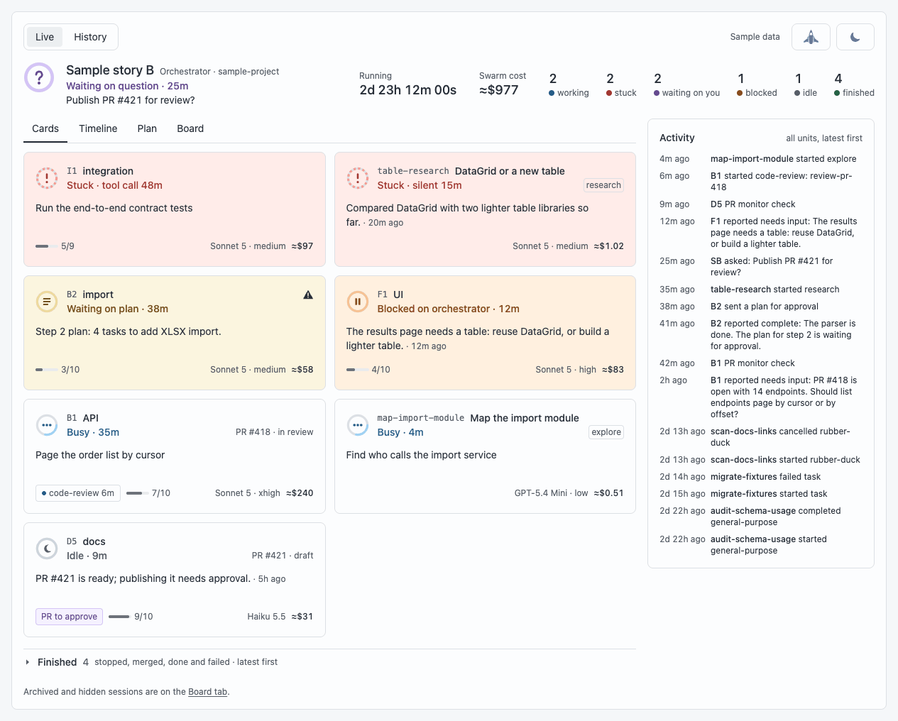
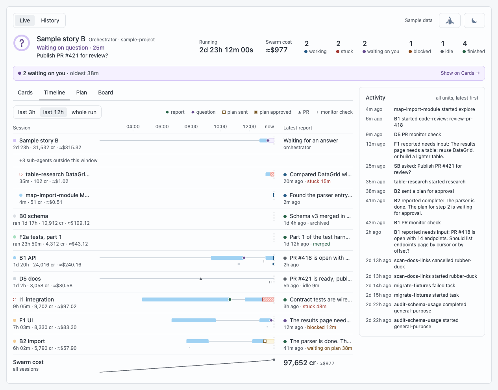
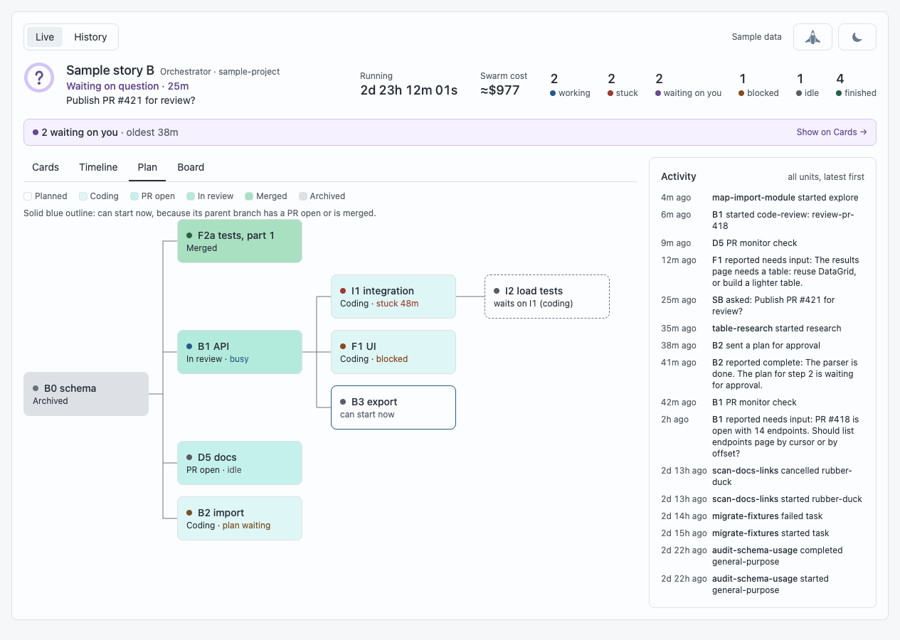
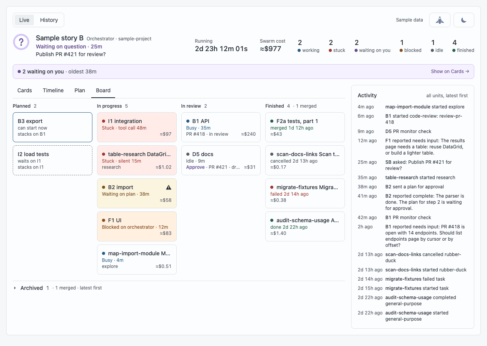
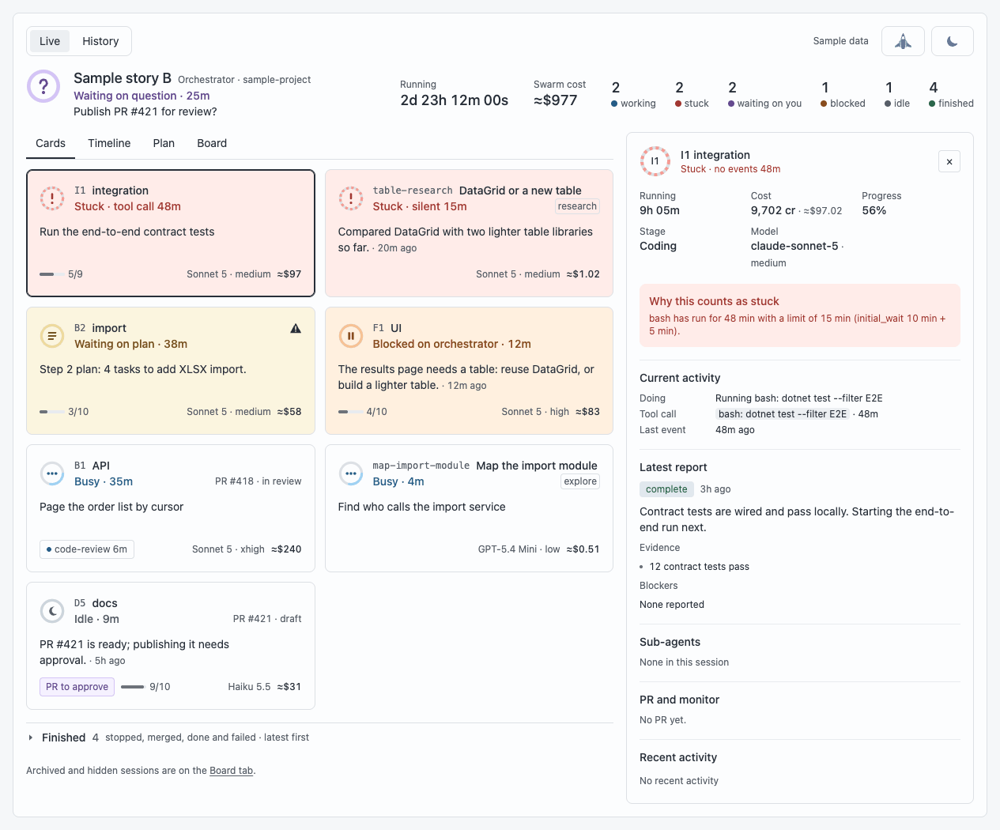
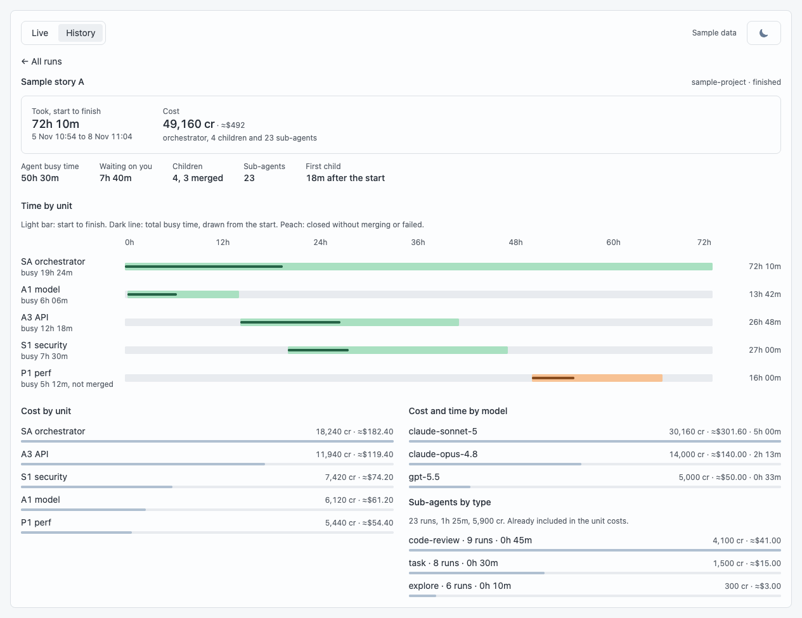
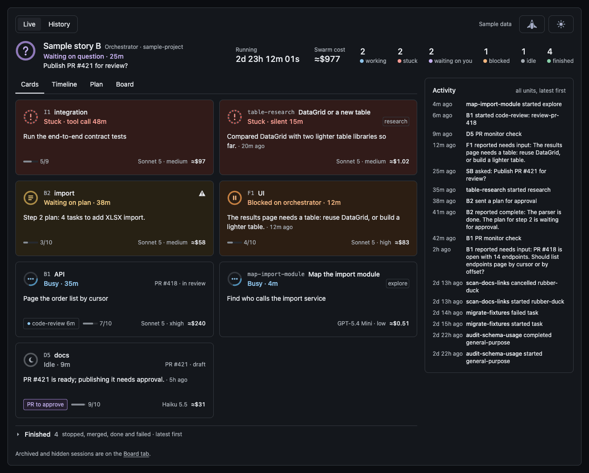

# The swarm dashboard

The swarm dashboard shows what a swarm of Copilot sessions is doing, so you can follow the whole job without reading transcripts. A swarm is usually a session that has started child sessions, such as a `wintermute-core` orchestrator and the sessions it hands work to. For every session the dashboard shows what it is doing, how far it has got, what it costs and whether it needs you.

It is watch-only. You answer questions and approve plans and PRs in the sessions themselves; the dashboard only shows you where to look.

All the pictures on this page use the dashboard's built-in sample data (`npm start -- --demo`), not real sessions. The sample swarm also runs sub-agents, which Wintermute's own agents never start; the dashboard shows them for any swarm that has them.

## What you're looking at

1. **Top bar.** Live shows the running swarm, History shows finished runs. "Sample data" marks the demo. The moon button at the right switches between the light and dark themes.
2. **Header.** The orchestrator: its state ("Waiting on question · 25m") and what it is doing or waiting for. Then how long the swarm has run, its cost, and counts of units working, stuck, waiting on you, blocked, idle and finished.
3. **Tabs.** Cards, Timeline, Plan and Board are different views of the swarm. For example, Plan leaves out sub-agents, and archived units are only on the Board.
4. **Cards.** One card per active unit, with the ones that need attention first.
5. **Finished.** Units that are done, closed by default.
6. **Activity.** The latest events across the swarm, newest first.

## Header and what needs you

Anything that waits on you shows on the card it belongs to, for example "Waiting on plan" or a "PR to approve" chip, and in the header. On the other tabs, one line under the header says how many things wait on you and since when, with a link back to the Cards tab.

When no work is active and nothing waits on you, the clocks usually stop at the last activity and the header says "quiet since" that time. They start again when work resumes. A swarm that stays quiet for 2 hours moves to History.

## Cards

Each active unit has a card. Stuck units come first, then questions and plans (the oldest wait first), then blocked, busy and idle units. A card shows:

- the unit's label and name, its state in words, and how long it has been in that state;
- its PR, or the PR it reviews ("reviews PR #418") when it has none of its own;
- a line that says what it is doing or said last: its question or plan, the stuck tool call, the todo in progress, or its latest report;
- a footer with what it needs from you, its running sub-agents, its todos done, its model and reasoning effort, and its cost.

A mark at the top right of a card means some of its data could not be read. Units that have finished (merged, done, stopped, failed, crashed, cancelled or closed, or idle with a complete report and no open PR) move to Finished below the cards. A unit with an open question or plan of its own stays on the grid. Click a card to open its details.

## Timeline

The Timeline shows each session's busy, idle and waiting time over the last 3 or 12 hours or the whole run. Marks on the lanes show reports, questions, plans sent and approved, and PRs. The right column repeats each session's latest report, and the last row draws the swarm's cost over time.

## Plan

In the picture, B3 export can start now, while I2 load tests waits for I1 integration. The Plan draws the units as a graph of stacked branches: each unit sits after the unit whose branch it builds on, and the colour says its stage. A solid blue outline marks a planned unit that can start now, because its parent has reached the PR stage or later. In a narrow panel where the graph doesn't fit, the Plan is an indented list.

## Board

The Board groups the units in columns: Planned, In progress, In review (an open or draft PR) and Finished (the latest 10, with Show all). A planned unit says whether it can start now or what it waits on. Archived units are in the closed row under the columns.

## Details

Click any card to open its details beside the tabs. In a narrow panel, the details replace the list, and Back to cards returns. The panel shows:

- how long the unit has run, its cost, progress, stage, model and effort;
- why it counts as stuck or waiting, with the rule that fired and its numbers;
- its current activity: what it is doing, the open tool call and when its last event came;
- its latest report, with the evidence and blockers it gave;
- its sub-agents, its PR and monitor, and its recent activity.

The monitor is a scheduled automation on the unit, if it has one. Wintermute's agents don't start PR monitors, so "no monitor" next to an open PR is normal. Only a configured schedule that is overdue shows as missing.

## Cost

Costs come from the model-call records and compactions in each session's log, in Copilot's AI credits. The dashboard shows them in dollars at list price, 1 credit = $0.01; hover over a cost in the header or on a card to see it in credits. While a session's log is missing or can't be read, the swarm's cost is incomplete and the dashboard warns.

## History

History lists finished runs with their duration, cost and outcomes. Open a run for its summary: how long it took, its cost, the time each unit took and how much of it was busy, and the cost by unit, by model and by sub-agent type. Units that closed without merging or failed are drawn in peach. A run that resumes and finishes again gets a new summary. Summaries are saved in `~/.copilot/swarm-dashboard/history/`, so finished runs stay in History after their logs are cleaned up.

## Light and dark

The dashboard starts in the theme your system uses and follows it until you pick one. The button at the right of the top bar switches: it shows a moon in the light theme and a sun in the dark one. The dashboard remembers your choice for that browser or the app's panel.

## How it decides what is stuck

A session counts as **stuck** when:

- a model call, tool call or sub-agent has gone quiet for longer than its limit;
- it is busy but has written nothing for 10 minutes, and no open tool call or sub-agent has a limit of its own;
- in its last 30 minutes of busy time, it had at least 5 failed tool calls, made the same tool call 3 times in a row within one prompt (polling calls don't count), or compacted its context twice or more;
- it has been idle for 30 minutes after a progress report, with no task finished and no monitor due.

A session waiting for your answer is never stuck. The detail panel names the rule that fired and its numbers. The rules are in `engine/model/status.mjs` and their limits in `engine/config.mjs`.

A whole swarm counts as **stalled** when at least one open unit remains, the orchestrator and every open unit are idle, and nothing is scheduled to run. Open units are the ones on the Cards grid; archived and finished units don't count. A unit with an open question or plan of its own stays open. An idle or stopped unit whose latest report is `complete`, whose PR is open and that has had no reply from the orchestrator since is waiting on review: it has done its part, so it doesn't count towards a stall. A swarm with no open units is not stalled.

`wintermute-core` and its children report in a fixed format that the dashboard reads exactly. The [`wintermute-core` prompt](com.github.copilot/agents/wintermute-core.agent.md) defines it in its "Dashboard data contract", "The `children` table" and "Report format" sections.

## Open it

- **In the Copilot app.** `wintermute-core` opens the dashboard in the side panel when it creates its first child session. To open it again, ask the agent to open the swarm dashboard canvas (canvas id `swarm-dashboard`). It shows the swarm of the session it was opened in. If that session is in no swarm, it says so, offers the live swarms in its swarm picker, and switches to the session's swarm as soon as there is one. To show a particular swarm, pass its root session id as the canvas input: `{ "swarm": "<root session id>" }`.
- **In a browser.** From the plugin folder (`~/.copilot/installed-plugins/ai-tools/wintermute` once installed), run `npm start` and open the address it prints, `http://127.0.0.1:7927/` by default. It needs Node.js 18 or later and a SQLite reader (see [Install](README.md#install)).
- **With sample data.** `npm start -- --demo` serves a sample swarm with simulated activity, `--demo stress` a crowded one, and `--still` stops the simulation. Your own dashboard may already use port 7927, so give the demo another port: `npm start -- --demo --port 7928`.

## More

The [README](README.md) covers [the port](README.md#the-port), [privacy and data access](README.md#privacy-and-data-access), the [commands](README.md#commands) and [troubleshooting](README.md#troubleshooting).
